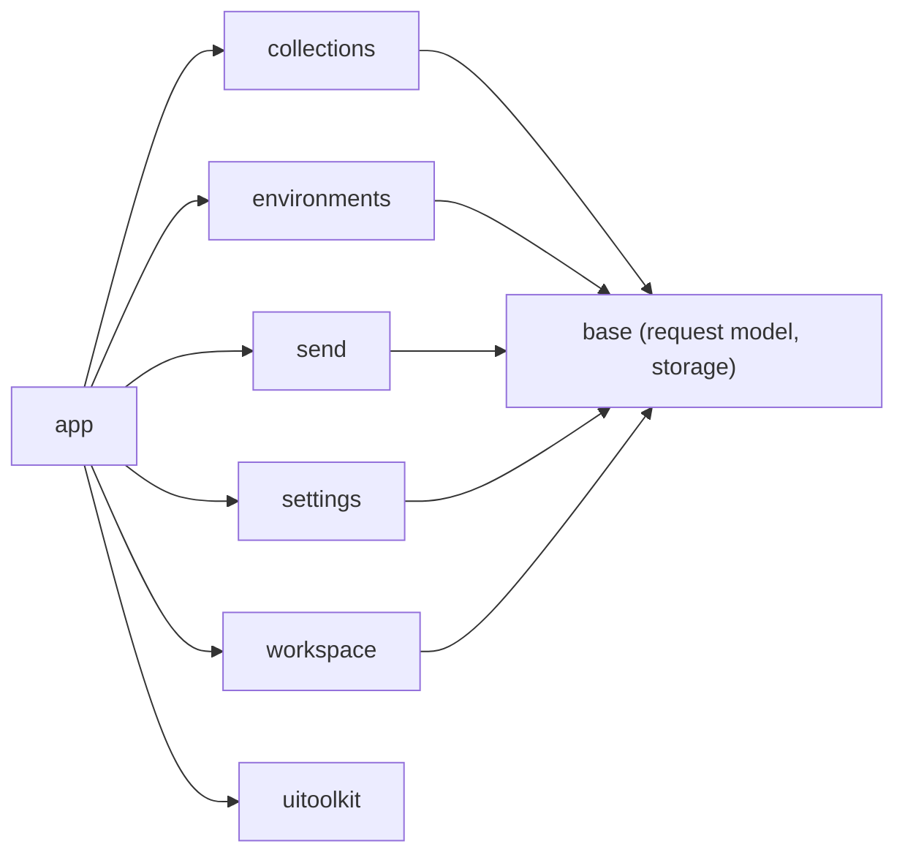

# Architecture

Start with `overview.md`; this file is the index of the detail. The layout follows the shared
`common/architecture-style.md`: each domain's root package (types and ports) is its core, `adapter` its adapters, `internal/ui` the screen,
the `App` its composition root. Known gaps are under Limits.

## Package layout

- Feature packages are `internal/feature/<domain>/<package>`; only `adapter/` is a zone directory inside a feature. The screen is `internal/ui/<area>/<component>`. The import
  rules and their written exceptions are in `internal/CLAUDE.md`; no test checks them.
- `internal/app` is one package: Go cannot declare a method in another package, and everything
  that reads or writes the one `App` struct needs its methods. Adapters come in through `Options`.
- A view that needs little of the `App` is its own `internal/ui` package behind a `Host` interface the
  `App` implements, tested with a fake host: `response`, `overlays/calltrace`, `editor/kvtable`, `editor/urlbar`, `editor/ws`, `editor/graphql`, `editor/grpc`, `editor/mcp`, `editor/mcp/mcpform`, `sidebar/sentlog`, `overlays/settingsdialog` (a component with `New(Deps)`: the `App` answers its narrow `Deps`, the component is the `Host` of the shell and the pages)
  with its pages `formpage`, `colorpage`, `shortcutpage`, `systempage`, and `overlays/destpicker`; the `overlays` composite builds its children and is the host of `overlays/calltrace`. `response/respview` and `appicon` are the other views moved so far. Adapters reach those views through the
  host (`Host.SentStore`, `Host.FontStore`).

## Modules

One functional module per file in `architecture/`; read only the one you touch. A module is a
feature directory under `internal/feature/` (root, controllers, `adapter/`; its views are under `internal/ui/`) or the toolkit.

| File | Module | Owns |
|---|---|---|
| `internal/feature/send/FEATURE.md` | `internal/feature/send`, `internal/feature/request` | the request model and ports (kernel), protocols (rest, websocket, sse, mcp, grpc), assert, requestedit, mcpexplorer, response viewer and views, calltrace, mcpform, browser preview |
| `internal/feature/collections/FEATURE.md` | `internal/feature/collections` | open set, tree, importers, transfer, store, client config, sample and example server |
| `internal/feature/environments/FEATURE.md` | `internal/feature/environments` | environments, variables resolution, the chip's menu |
| `internal/feature/history/FEATURE.md` | `internal/feature/history` | responses kept per request, sent log |
| `internal/feature/settings/FEATURE.md` | `internal/feature/settings` | schema, prefs, theme, keymap, settings dialog and its pages |
| `internal/feature/workspace/FEATURE.md` | `internal/feature/workspace` | tabs, remembered state, bus, file browser, autosave, overlays, app icon, user's files |
| `internal/ui/format` (see `internal/CLAUDE.md`) | `internal/ui/format` | display formatting (was `kernel/textfmt` and `kernel/jsonview`); documented in its package doc and in the module files that use it |
| `architecture/app.md` | `internal/app` | composition root: the `App`, its handlers and window |
| `architecture/toolkit.md` | `uitoolkit` | core, view, widgets, markup API and drawing |
| `architecture/persistence.md` | shared | formats and versions of every persisted file |
| `architecture/limits.md` | shared | limits, fuzzing, known gaps |

## Module dependencies

Every edge between features is a base package (the request model included); `go list` shows no
other one, except the `exampleserver` dev tool. `e2e/layers_test.go` checks it in `make check`.

## Known layer gaps

- A domain root imports a sub-package of its own domain: `feature/workspace` imports `feature/workspace/state`.
- `internal/exampleserver` imports `feature/send/adapter/protocol/ws`; the one written exception in `internal/CLAUDE.md`.
- Six test-only rows in `e2e/layers_rules_test.go` let tests import real adapters as fixtures:
  `exampleserver` (`feature/collections`, `feature/send/adapter/protocol`), `ui/sidebar/sentlog` (`history/adapter/historyfile`),
  `ui/overlays/settingsdialog/formpage` (`uitoolkit/desktop/fonts`, `settings/adapter/settingsfile`), `ui/overlays/settingsdialog`
  (`settings/adapter/settingsfile`). Follow-up: replace the real adapters with fakes and delete the rows.
