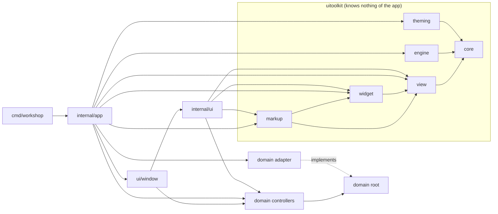
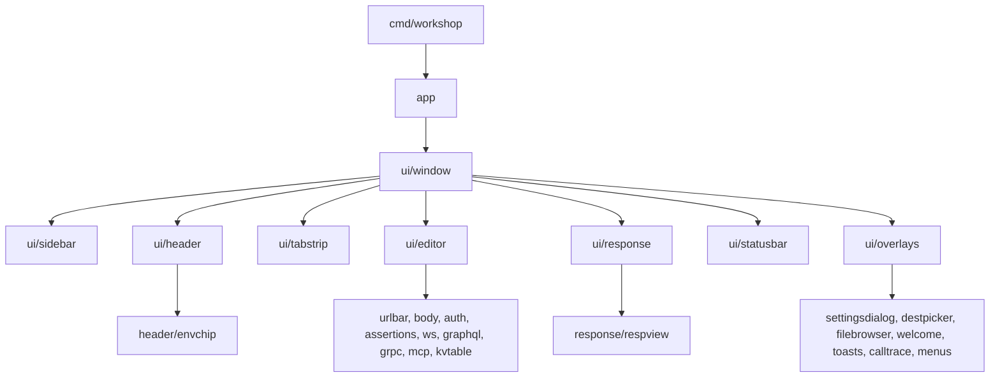
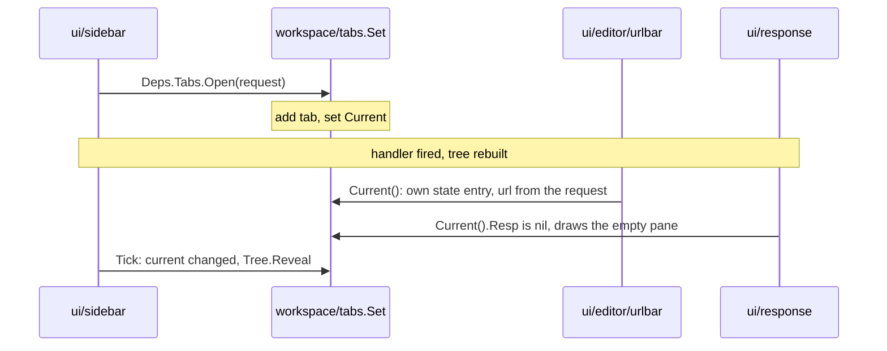
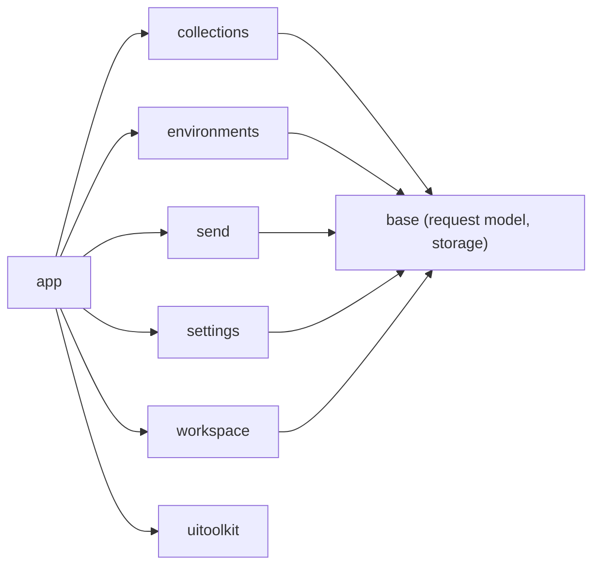

# Architecture

Start with `overview.md`; this file is the index of the detail. The layout follows the shared
`common/architecture-style.md`: each domain's root package (types and ports) is its core, `adapter` its adapters, `internal/ui` the screen,
`internal/ui/window` the root composite of the screen and the `App` the composition root that wires it. Known gaps are under Limits.

## Package layout

- Feature packages are `internal/feature/<domain>/<package>`; only `adapter/` is a zone directory inside a feature. The screen is `internal/ui/<area>/<component>`. The import
  rules and their written exceptions are in `internal/CLAUDE.md`; `e2e/layers_test.go` checks them (the table is below).
- `internal/ui/window` is one package: Go cannot declare a method in another package, and everything
  that reads or writes the one `Component` struct needs its methods. Adapters come in through `Options` of
  `internal/app`, which maps them to `window.Stores`; `app` holds five files and no handler.
- A view that needs little of the window is its own `internal/ui` package behind a `Host` or `Deps` interface the
  window answers, tested with a fake: `response`, `overlays/calltrace`, `editor` (the composite of the request pane's components), `editor/kvtable`, `editor/urlbar`, `editor/ws`, `editor/graphql`, `editor/grpc`, `editor/mcp`, `editor/mcp/mcpform`, `sidebar/sentlog`, `overlays/settingsdialog` (a component with `New(Deps)`: the window answers its narrow `Deps`, the component is the `Host` of the shell and the pages)
  with its pages `formpage`, `colorpage`, `shortcutpage`, `systempage`, and `overlays/destpicker`; the `overlays` composite builds its children and is the host of `overlays/calltrace`. `response/respview` and `appicon` are the other views moved so far. Adapters reach those views through the
  host (`Host.SentStore`, `Host.FontStore`).

## Modules

One functional module per file in `architecture/`; read only the one you touch. A module is a
feature directory under `internal/feature/` (root, controllers, `adapter/`; its views are under `internal/ui/`) or the toolkit.

| File | Module | Owns |
|---|---|---|
| `internal/feature/send/FEATURE.md` | `internal/feature/send`, `internal/feature/request` | the request model and ports, protocols (rest, websocket, sse, mcp, grpc), assert, requestedit, mcpexplorer, response viewer and views, calltrace, mcpform, browser preview |
| `internal/feature/collections/FEATURE.md` | `internal/feature/collections` | open set, tree, importers, transfer, store, client config, sample and example server |
| `internal/feature/environments/FEATURE.md` | `internal/feature/environments` | environments, variables resolution, the chip's menu |
| `internal/feature/history/FEATURE.md` | `internal/feature/history` | responses kept per request, sent log |
| `internal/feature/settings/FEATURE.md` | `internal/feature/settings` | schema, prefs, theme, keymap, settings dialog and its pages |
| `internal/feature/workspace/FEATURE.md` | `internal/feature/workspace` | tabs, remembered state, bus, file browser, autosave, overlays, app icon, user's files |
| `internal/ui/format` (see `internal/CLAUDE.md`) | `internal/ui/format` | display formatting (merged from two older leaf packages); documented in its package doc and in the module files that use it |
| `architecture/app.md` | `internal/app`, `internal/ui/window` | the game loop and composition root (`App`), the window composite, its handlers and keys |
| `architecture/toolkit.md` | `uitoolkit` | core, view, widgets, markup API and drawing |
| `architecture/persistence.md` | shared | formats and versions of every persisted file |
| `architecture/limits.md` | shared | limits, fuzzing, known gaps |

## Composition

Parents import and wire children; siblings never import each other and a child never imports its parent.
`cmd/workshop` fills `app.Options` with adapters, `app` builds the three shared stores (`tabs.Set`,
`sends.Sends`, `bus.Bus`) and maps `Options` to `window.Stores`, and `window.New` builds the screen areas
and the composites below it. `app` runs the frame loop and holds no handler.

Each composite offers a key to its children in its own order, and each child declares the narrow
interfaces it needs (`deps.go`), which a feature store or the window's host glue answers. `Tick`
returns whether something changed, and the parent ORs the answers upward. A change that reaches another
component goes through a shared feature store and is read on the next rebuild, because the whole tree is
rebuilt every frame; there is no event bus between components. `bus` stays the way from a goroutine to the
UI goroutine.

Why this shape (the rejected alternatives; the code-level reasons are in the doc comments of
`ui/window`, `ui/editor`, `ui/overlays` and `app`):

- No hub object that runs all actions: the old `App` had about 100 fields and every handler changed it
  directly; one directory per component now explains its state, callbacks, keys and layout. Revisit if a
  second window or a headless mode needs the window's handlers without the screen.
- No event bus between components: a bus hides who reacts to what and would order effects by
  subscription. Shared stores plus the per-frame rebuild give the same reach with plain calls.
- `logic/` is a nested package, not a file split: the layer check sees packages, so only a package can be
  forbidden the toolkit. It is not `<name>/view`, because parents would import several packages called
  `view` next to the dot-imported toolkit `view`.
- `ui/window` stays one package: Go cannot declare a method in another package, and the handlers that
  reach across areas need the one `Component` struct.
- No base package for components: the anatomy is a convention, not a type.

### Component anatomy

`ui/<area>/<name>` is one view package: `<name>.go` (the component, `New(Deps)`, widget state), `deps.go`
(narrow interfaces it declares itself, 1 to 4 methods each), `view.go` (the VML template and click
closures), `keys.go` (`Keys`, the keys it claims), `commands.go` (`Commands`, the shortcut actions it
offers), `tick.go` (`Tick`, per-frame work) and an optional nested `logic/` package (toolkit-free state
and decisions, tested without a GPU). Per-tab widget state lives in the component, in a
`map[*tabs.Tab]*state` made on first use and pruned in `Tick`.

## Layer table

Zones: `base` (`feature/request`, `storage`), feature root, controller, `adapter`
(`feature/*/adapter/**`), `uilogic` (`ui/**/logic`, matched before `ui`), `ui`, `app`, `exampleserver`,
`toolkit`. Production rows (`e2e/layers_rules_test.go`):

| From | May import |
|---|---|
| feature root, controller, adapter | base and their own feature |
| `uilogic` | base, feature root, controller |
| `ui` | base, feature root, controller, toolkit, `ui/format`, `ui/theme`, `ui/sizes`, its own sub-tree (`Below`: the target path has the importer path as prefix) |
| `ui/window` (a written row) | every `ui` and `uilogic` package: the root composite wires the screen areas |
| `app` | base, feature root, controller, ui, toolkit, app; no adapter (`cmd/workshop` and the e2e helper wire them) |
| `exampleserver` | base, and the written exception `send/adapter/protocol/ws` |
| toolkit | toolkit only |

Absent by design: feature to feature, ui to adapter, logic to toolkit, sibling ui, child to parent, adapter
to ui, app to adapter, feature to ui or toolkit. Test-only rows are listed under Known layer gaps.

## Module dependencies

Every edge between features is a base package (the request model included); `go list` shows no
other one, except the `exampleserver` dev tool. `e2e/layers_test.go` checks it in `make check`.

## Known layer gaps

- A domain root imports a sub-package of its own domain: `feature/workspace` imports `feature/workspace/state`.
- `internal/exampleserver` imports `feature/send/adapter/protocol/ws`; the one written exception in `internal/CLAUDE.md`.
- Test-only rows in `e2e/layers_rules_test.go` let tests import real adapters as fixtures (`ui/window` has nine for the whole-window tests: `collectionstore`, `historyfile`, `protocol`, `protocol/ws`, `settingsfile`, `statefile`, `folders`, `preview` and `exampleserver`; a later task replaces them with fakes; `e2e/apptest_adapters_test.go` is the helper that wires the real adapters for `apptest`):
  `exampleserver` (`feature/collections`, for the sample collection test), `ui/sidebar/sentlog` (`history/adapter/historyfile`),
  `ui/overlays/settingsdialog/formpage` (`uitoolkit/desktop/fonts`, `settings/adapter/settingsfile`), `ui/overlays/settingsdialog`
  (`settings/adapter/settingsfile`). Follow-up: replace the real adapters with fakes and delete the rows.
