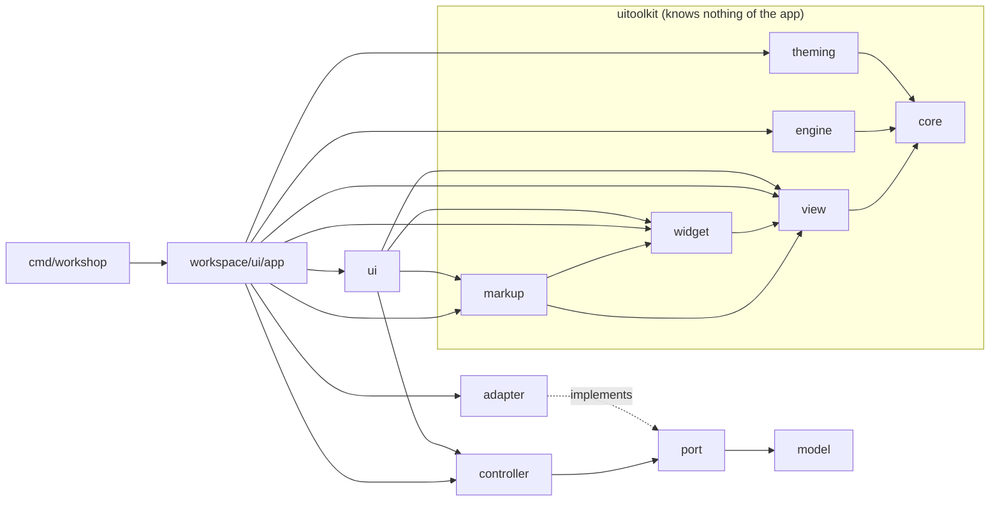

# Architecture

The short orientation is `overview.md`; this file has the detail. The layout (domain x role, ports
only at
boundaries, a layer test with no exceptions) is the reference implementation of the shared
`common/architecture-style.md`: `model` and `port` are its core, `adapter` and `ui` its adapters,
the
`App` its composition root.

Status: the three-pane window with REST, WebSocket, SSE, MCP and gRPC; known gaps are under Limits.

The toolkit packages are public and independent of the application; the import rules of the toolkit
and of the `internal/<domain>/<role>` layers are written once, in `rules.md` (Layers, Layout of
`internal/`), and enforced by `uitoolkit/core/layers_test.go` and `internal/layers_test.go`.
`internal/workspace/ui/app` is the application: the `App` state, handlers and the window as views.
Features that need little of that state are their own packages in their domain's `ui` role, each
behind a `Host`: `calltrace`, `mcpform`, `sentlog`, `settingsui`, `colorpage`, `shortcutpage`,
`systempage`, `destpicker` (see Package layout below). Every package, with its domain and role, is
in `packagemap.md`; each is described by its own package doc and by the sections below.

## Index

One file per area in `architecture/`; read the one you touch.

| File | Area | Lines |
|---|---|---|
| `architecture/package-layout.md` | Package layout | 19 |
| `architecture/model-and-protocols.md` | Model and protocols | 46 |
| `architecture/example-server-and-client-config.md` | Example server and client config | 76 |
| `architecture/collection-tree.md` | Collection tree | 13 |
| `architecture/json-view.md` | JSON view | 7 |
| `architecture/core.md` | core: the toolkit | 77 |
| `architecture/view.md` | view: the view DSL | 173 |
| `architecture/app.md` | workspace/ui/app: the app | 441 |
| `architecture/toolkit-api.md` | Toolkit: API and templates | 159 |
| `architecture/toolkit-widgets.md` | Toolkit: widgets and drawing | 105 |
| `architecture/look.md` | Look | 111 |
| `architecture/requests.md` | Requests | 62 |
| `architecture/protocols.md` | Protocols | 295 |
| `architecture/responses.md` | Responses | 102 |
| `architecture/collections-and-environments.md` | Collections and environments | 136 |
| `architecture/settings.md` | Settings | 116 |
| `architecture/files-state-and-platforms.md` | Files, state and platforms | 123 |
| `architecture/persistence.md` | Persistence | 33 |
| `architecture/limits.md` | Limits | 71 |
