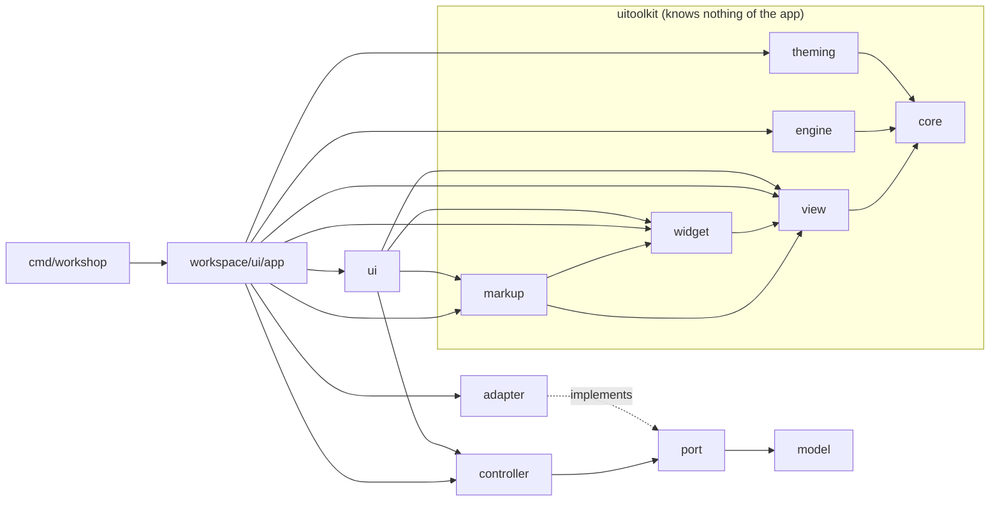

# Architecture

The short orientation is `overview.md`; this file has the detail. The layout (domain x role, ports
only at
boundaries, a layer test with no exceptions) is the reference implementation of the shared
`common/architecture-style.md`: `model` and `port` are its core, `adapter` and `ui` its adapters,
the
`App` its composition root.

Status: the three-pane window with REST, WebSocket, SSE, MCP and gRPC; known gaps are under Limits.



The toolkit packages are public and independent of the application; the import rules of the toolkit
and of the `internal/<domain>/<role>` layers are written once, in `rules.md` (Layers, Layout of
`internal/`), and enforced by `uitoolkit/core/layers_test.go` and `internal/layers_test.go`.
`internal/workspace/ui/app` is the application: the `App` state, handlers and the window as views.
Features that need little of that state are their own packages in their domain's `ui` role, each
behind a `Host`: `calltrace`, `mcpform`, `sentlog`, `settingsui`, `colorpage`, `shortcutpage`,
`systempage`, `destpicker` (see Package layout below). Every package, with its domain and role, is
in `packagemap.md`; each is described by its own package doc and by the sections below.

## Package layout

The whole tree, one row per domain and one column per role, is in `.harness/packagemap.md`; it is
generated from the tree and the layer test (`make packagemap`), and a test fails when it is stale.

`internal/` is grouped by domain, then by role (decision 11): `internal/<domain>/<role>/<package>`.
What a role may import is written once, in `rules.md` (Layout of `internal/`) and in the generated
`packagemap.md`; `internal/layers_test.go` enforces it, with a table that proves each kind of
violation is caught, and `exceptions` there is empty.

Go allows one package per directory and a method cannot be declared in another package, so
everything that reads and writes the one `App` struct (tabs, panes, sidebar, environments,
workspace) is one package, `workspace/ui/app`. It imports the other domains' views (decision 11) and
gets their adapters through ports in `Options`, which `cmd/workshop` fills; `exceptions` in the
layer test is empty. A feature that needs little of the `App` is its own package with a `Host`
interface the App implements, a package doc and tests with a fake host (`calltrace`, `mcpform`,
`sentlog`, `settingsui`, `colorpage`, `shortcutpage`, `systempage`, `destpicker`). Adapters of a
port are handed to those views through the host (`Host.SentStore`, `Host.FontStore`).

## Model and protocols

`model.Request` is protocol-neutral: `Protocol` picks the implementation, `Method` only matters for
REST (an HTTP method) and gRPC (a service method). `Protocol`, `BodyType` and `Auth.Type` are named
string types (`model.Protocol`, `model.BodyType`, `model.AuthType`) with constants; stored text
becomes one of them once, at the edge, with `ParseProtocol`, `ParseBodyType` and `ParseAuthType` (an
unknown or empty protocol, an unknown body or auth type is an error: a collection request file fails
the load naming the file, a client config names the server or request, a sent-log line is skipped).
What differs per protocol is a row of `model.Protocols` (`ProtocolInfo`: name, chip label,
`Connection` (`OneShot`, `Always`, `OnStream` for gRPC while its Stream chip is on), `Method`
(`MethodNone`, `MethodHTTP`, `MethodRPC`), `RunsCommand` (MCP `stdio:`), `ResumeHeader` (SSE
`Last-Event-ID`)), in the order the protocol chip cycles; `Protocol.Info()` finds it, and the zero
`ProtocolInfo` is the row of no protocol. `internal/protocol_literals_test.go` fails on a protocol
name literal, or a comparison, case or map key against a `model.Protocol*` constant, outside the
rows, the registry and a short list of files that use the same words for something else (settings
keys, the HTTP Upgrade token, the example server's service names and flags). `{{name}}` in a URL is
expanded from the collection vars (`model.Expand`) and the params table is folded into the URL with
`model.WithParams`; `model.ParamsFromURL` goes the other way (`model.MergeParams` rebuilds the table
after a URL edit, keeping descriptions and disabled rows), so the URL bar and the Params table stay
in sync. The caller does both before sending.

`proto.Registry` is a `model.Protocol`-to-`Protocol` table with one implementation per row of
`model.Protocols` (`rest`, `websocket`, `mcp`, `sse`, `grpc`; a test checks both directions, and
that a row that keeps a connection is a `Streamer`). `Send` returns an error only for misuse
(unknown protocol, malformed method or URL). Transport failures arrive in `Response.Err` so the UI
always has a value to render. `rest` uses `net/http`, keeps at most 32 MiB of body, and skips
disabled header rows. The request body is encoded by a table keyed by `Request.BodyType` (`none`,
`json`, `text`, `form`, `multipart`, `graphql`, `file`; `BodyRaw`, stored as "", sends `Body` as is
with no Content-Type) which also gives the automatic Content-Type; an enabled `Content-Type` header
of the user replaces it. Form and multipart bodies use the enabled, named rows of `Request.Form`; a
multipart value `@path` sends that file as a file part (named by its base name) and `@@x` sends the
text `@x`. `websocket`, `sse`, `mcp` and `grpc` are streaming or call clients of their own (decision
2).

## Example server and client config

Decision 10. `make example-server` runs `cmd/example-server`
(`internal/request/adapter/exampleserver`), one port per service on `127.0.0.1`: REST 8081 (`/echo`,
`/status/{code}`, `/delay/{ms}`, `/auth`), WebSocket 8082 (echo), SSE 8083
(`/events?count=&interval=`), MCP 8084 (`/mcp`, tools `echo` and `add`), gRPC 8085 (health and
reflection) and gRPC without reflection 8086 (`grpc-no-reflection`: the same health service, reached
only through a `.proto` file, the server's own copy in
`exampleserver/protos/grpc/health/v1/health.proto`). Flags change host and ports; port 0 picks a
free one. The services are a table (`services`), so a new protocol or port is a new row.

The default build's `collection.Sample()` is only the `Example Server` collection (no GitHub calls;
the App itself still falls back to `GitHubSample` when no `Sample` option is given), with a request
for every endpoint of the example server on those ports: the REST routes are one table
(`restRoutes`, which also feeds the index page) and tests in `exampleserver` fail when a route or a
service has no sample request or a request uses another port (a gRPC request with proto files is for
the port without reflection); the sample's proto path is absolute, found from the debug build's
source tree (`exampleHealthProto`), since the sample lives in no folder and a relative path would
depend on where the program was started, and it reads no config file (`clientConfigs` in
`cmd/workshop/clients_*.go`, tested for both builds). It reopens what it remembered, like the
release build, from its own `gascoigne-workshop-dev` directory (`userdir.Name`, decision 20), so a
run from an IDE never touches the release build's data and the example server is what a first start
shows; `-workspace` still opens a folder. Screenshot runs and the golden scenes keep settings and
state in memory, so they always start from the sample. `make release` builds `bin/workshop-release`
with `-tags release`, and `make install` installs that binary (no example servers; collections and
servers come from the client config in `~/.config/gascoigne-workshop/`): `Sample()` is empty and
`cmd/workshop` hands `clientfile.Files` to the App (`Options.Clients`). With no workspace (flag or
remembered), the App opens the client config's tree instead of the sample; an unreadable config is
named in the status line and the sample stays. `make check` also vets and tests with the tag.

`bus.Run` recovers a panic in a background command and dispatches `bus.Failed`, which the App shows
in the status line, so a protocol or parser bug does not end the app and its unsaved edits. A
whole-number setting outside its schema range is clamped when the file loads (`settings.Clamp`,
reported as a `*settings.ClampedError` that the App shows in the status line or a toast while using
the clamped settings; 0 stays "not set"). A settings file that does not parse is copied to
`settings.json.bak` before a save replaces it (`settingsfile.WriteText`). A client config is
`.workshop.yaml` (or `.yml`, `.json`, `.toml`) in the settings directory (global) and in the working
directory (local). An entry of the same name in the local file replaces the global one; two files in
one directory are an error. YAML is read by `miniyaml` (a subset), TOML by
`github.com/BurntSushi/toml`, JSON by `encoding/json`; all three become one generic tree that is
decoded strictly, so a misspelled key is an error. The client config opens as one collection, the
start one, so each configured collection becomes a folder (variables on the folder, environments on
the root) and servers become requests in a `Servers` folder.

```yaml
servers:
  - name: Local REST
    protocol: rest
    url: http://127.0.0.1:8081/echo
    auth: {type: bearer, token: secret}
collections:
  - name: Demo
    vars: {baseUrl: http://127.0.0.1:8081}
    envs:
      - name: Dev
        vars: {token: abc}
    requests:
      - name: Echo
        protocol: rest
        method: POST
        url: "{{baseUrl}}/echo"
        headers: {X-Trace: "1"}
        body_type: json
        body: '{"hello": "world"}'
    folders:
      - name: More
        requests: []
```

Request keys: `name`, `protocol`, `method`, `url`, `params` and `headers` (maps), `body`,
`body_type`, `timeout` (seconds), `auth` (`type`, `token`, `user`, `password`, `key_name`,
`key_value`, `key_in`). A server or request whose `protocol` is missing or unknown, or whose
`body_type` or auth `type` is unknown, is an error that names it.

## Collection tree

`model.Folder` holds `[]*Folder` and `[]*Request`, so a request keeps its identity (open tabs point
at it) however siblings change. `internal/request/model/tree.go` has the operations, all pure and
tested: `UniqueName` ("x", "x 2", ... across folders and requests), `AddRequest` / `AddFolder`,
`Parent`, `Contains`, `Rename` (trimmed, non-empty, unique among siblings), `Duplicate` (deep copy
placed after the original as "<name> copy"), `Delete`, `Attach` (puts a detached node, kept by
pointer, into a folder before a sibling, renamed on a clash), `Node.Clone` (deep copy of a request
or folder) and `UsedVars` (the `{{variables}}` of a request's URL, enabled rows, bodies and
credentials, first-use order); a move or copy is `controller/transfer`, which validates before it
changes anything. The tree view's `treeRows` works on pointers and the expanded set is keyed by
folder pointer, so renaming or moving a folder does not collapse it.

## JSON view

`jsonview.Lines(body)` pretty-prints valid JSON with two-space indent and returns one `Line` per
display row, each a list of `Span{Text, Kind}` (punctuation, key, string, number, literal, plain).
Lines that open an object or array are `Foldable`, which the response pane uses for its fold arrows.
Invalid JSON and other text come back as plain lines, so the pane renders any body.

## core: the toolkit

Plain values; everything except the drawing calls is tested without a GPU.

-  **Palette source.** `theming.Dark()` and `theming.Light()` take their text, muted, accent (rose
  on dark, burgundy on light), OK, error and surface colors from the color tokens of the gascoigne
  CLI dashboard's stylesheet (in the gascoigne-cli repository); `TestPalettesFollowTheCLIDashboard`
  pins them to those values. Borders, rules, chips, hover and selected rows keep the CLI's hues but
  are stronger than its soft web borders, because a native window's edges have to be visible
  (`TestNonTextElementsAreVisible`).
-  **Theme and tokens.** A `Theme` maps color `Token`s (`Bg`, `Frame`, `Sunken`, `Alt`, `Selected`,
  `Chip`, `Rule`, `Text`, `Muted`, `Accent`, ...) to colors; `theming.Dark()` and `theming.Light()`
  are the dark and light palettes (Palette source above). Applications add tokens with `Theme.With`
  (the app adds `method.GET`, `json.key`, ...). Unknown tokens fall back to the text color. A test
  checks text/surface contrast for both themes, and that non-text elements are visible: dividers
  (`Border`) at 2:1 on panes and lists, rules at 2.5:1, `AccentLine` (the accent used as an outline,
  underline or checkbox mark) and icons at 3:1, selected and hovered rows distinct from the list.
-  **`Ctx`** is what drawing and hit-testing use: theme, fonts, this frame's `Input`, tick and
  scale. Everything works in logical pixels; `Ctx` primitives (`Fill`, `Text`, `Clip`, `Line`, ...)
  multiply by `Scale` when drawing, text measures divide by it, and `Input.Scaled` converts the
  pointer back. `SetScale` and `SetTheme` rebuild the fonts. This is what makes the window sharp on
  HiDPI.
-  **Input**: `ReadInput` samples mouse (including held, for drags), wheel, typed runes, edit keys
  with repeat (the word modifier turns Left, Right, Backspace and Delete into word-wise edits:
  Option on macOS, where Command is the shortcut key and Control belongs to the system, Ctrl
  elsewhere; the primary modifier turns Home and End into document start and end; on macOS Command
  turns Left and Right into Home and End and Backspace and Delete into deletion to the line start
  and end (`EditDeleteToLineStart`, `EditDeleteToLineEnd`), and wins over Option; `modifiedEdit` is
  the table, tested per platform), Enter, Escape, Tab, Shift/Ctrl and the Ctrl+A/C/X/V/Z/Y
  shortcuts. A `Sampler` adds the click count (double and triple clicks within 400 ms and 4 px).
-  **`TextField`** (in `widget`, decision 3): single-line text with a rune cursor, a selection
  (shift+arrows, drag, shift+click, double click selects a word, triple click everything, Ctrl+A),
  word movement and deletion (Ctrl+Left/Right/Backspace/Delete, Option on macOS; with Shift it
  selects by word; the same in `TextArea` and the single-line fields), line edits on macOS
  (Cmd+Left/Right go to the line start and end, with Shift they select; Cmd+Backspace/Delete delete
  to the line start and end, and at the line edge itself take the line break so the lines join),
  horizontal scroll that keeps the cursor visible (`Reveal`, `ScrollX`) and undo/redo with
  coalescing (typing and single-character deletes merge into one step; paste, cut, word and line
  deletion are their own steps; 100 steps kept). A word (`isWordRune`) is a run of letters of any
  script with their combining marks, digits and `_`; everything else (punctuation, spaces, line
  breaks) separates words and is skipped, so word left stops at a word's start and word right at its
  end (`user.name` is two words, `https://h/v1/users` four). `Apply(typed, edits, extend)`, `Insert`
  (paste: line breaks become spaces, control characters are dropped), `DeleteSelection`,
  `SelectedText`, `Undo`, `Redo`.
-  **`TextArea`** (in `widget`): the multi-line editor, a `TextField` in multiline mode plus view
  state (`ScrollY`, optional `Styler` for syntax colors). It keeps line breaks (CRLF and CR become
  LF), moves by line with a remembered goal column (Up/Down/PageUp/PageDown; past the first or last
  line goes to the start or end), Home/End by line and Ctrl+Home/End by document, Enter inserts a
  line break plus the current indentation, Tab inserts spaces to the next stop (every selected line
  is indented when the selection spans lines), Shift+Tab dedents, triple click selects a line. Line
  numbers, scrollbars (the drag and page logic is shared with `CodeView` through `barDrag`), a
  current-line highlight and cursor-follows-scroll. Tab belongs to the editor, so Escape leaves it.
  A tab character in pasted text counts as one column.
-  **Scrollbars**: `Thumb`, `PosFromOffset` and `ClampScroll` are the pure math (thumb length has a
  24 px minimum); `Ctx.Scrollbar` draws a thumb for a vertical or horizontal track.
-  **Clipboard**: `core.Clipboard` (read/write text). Ebitengine has no clipboard API, so
  `SystemClipboard()` runs the first complete pair of platform tools (`wl-paste`/`wl-copy`, `xclip`,
  `xsel`, `pbpaste`/`pbcopy`) with a 2 s timeout; with none installed every call fails with a hint
  to install wl-clipboard or xclip. No dependency is added.
-  **`CodeView`** (in `widget`): lines of colored spans (`Span{Text, Style Token}`), a fold set, a
  pixel scroll and a character-level selection (drag, also across lines; double click a word, triple
  click a line; a click without dragging selects nothing; Ctrl+A selects all). `Find` / `SetMatches`
  / `RevealLine` give it search highlighting and scroll-to-line. Ctrl+C on the focused view copies
  the selected lines, or the whole body when nothing is selected. Long lines scroll sideways
  (Shift+wheel, a bottom scrollbar; the gutter stays put), a vertical scrollbar thumb can be
  dragged, and PageUp/PageDown/Home/End scroll while it has focus. Shift with Left, Right, Up, Down,
  Home or End moves the end of the selection (the caret is where the last click or key left it, the
  first visible line when there is none): characters cross line ends, the word keys (Ctrl or Option
  with Left/Right) select by word with the text editor's word rules, skipping lines without a word,
  Cmd+Left/Right on macOS arrive as Home and End and select to the line edges, Up/Down keep the
  column, folded lines are skipped, and the view scrolls to the caret (`extendSelection`). Selection
  and copy follow the shown text: a folded line is its preview (`shownSpans`), lines inside a fold
  are skipped, and a selection of everything copies the whole text. `Visible()` hides everything
  from a folded line through its closing line, found by indentation. `Update` handles wheel and fold
  clicks; `Draw` paints with line numbers and fold arrows.
- **`Rect`** and its split helpers.

## view: the view DSL

The layers are `core` (primitives), `view` (this section: the element tree, layout, runtime and the
extension point) and `widget` (every component, built on `view.Custom` or on other elements);
decision 3 records how they were drawn. The text inputs, scrolling containers, `Table`, icons and
tooltips named below live in `widget` and are used through the same dot-import.

A view is a Go function from state to a tree of nodes, rebuilt every frame, so the tree is always a
pure function of the state: no diffing and no reactive system.

Every constructor takes **attributes first, children after**, so what an element is reads before
what it contains. App view files dot-import `view` (and alias `core` as `w`) so views read like
markup:

```go
Row(H(urlH), PadX(w.Pad), PadY(8), Gap(8), Bg(w.Bg),
	Row(Grow(1), Bg(w.Sunken), Border(w.Border),
		Row(W(64), OnClick(cycleProtocol), Text(protocol, TextCenter(), Grow(1), Color(w.Muted))),
		VRuleInset(8),
		Field(&t.url, Grow(1), Placeholder("Enter URL"), OnEnter(send)),
	),
	PrimaryButton("Send", W(80), OnClick(send)),
)
```

-  **Items**: a constructor's arguments are `Item`s: a child `Node`, or an `Option` that sets an
  attribute. A nil node (a false `If`) adds nothing; options given later override earlier ones,
  which is how components such as `Button` let callers override their defaults.
-  **Elements** (`*El`, aliased `Node`): `Row`, `Col`, `Stack`, `Spacer`, `HRule`, `VRule` and
  `VRuleInset` (one-pixel lines in `Border`, the last shortened at both ends, each taking options
  like the rest), `Text`, `Caption`, `Lines`, `Field`, `TextArea` (`Area`), `Code`, icons
  (`Checkbox`, `Cross`, `Triangle`, `Dots`) and the widgets of `uitoolkit/widget` (`Button`,
  `PrimaryButton`, `Choice` (a primary button when selected, else a plain one), `ListRow` (selection
  background or hover tint), `FormRow` and `CheckRow` (label column and checkbox rows), `ActiveTab`
  (the open tab's look, shared by `Tabs` and the request strip), `Menu`, `Dialog`, `ResizableDialog`
  and `DialogTitle` (dimmed scrim, centered modal panel, title bar with a close button that runs
  `OnDismiss`), `Toolbar` and `TabBar` (bars over a pane, sized by `core.ToolbarH`, `core.TabBarH`,
  `core.TabGap`), `Note` (one line of small colored text under a control), `Tabs`) and `Table`,
  which are ordinary compositions of the primitives. Behaviors are values of one small interface
  (measure, layout, draw, update), not switch cases.
-  **Options**: size (`W`, `H`, `Grow`, `Shrink`, `Optional`), spacing (`Pad`, `PadX`, `PadY`,
  `PadL`, `PadT`, `PadR`, `PadB`, `Gap`; one rule for names: a side is a letter suffix, an axis is X
  or Y; templates spell the same options in kebab-case, `pad-x`), look (`Bg`, `Border`, `BorderT`,
  `BorderB`, `HoverBg`, `HoverColor` (an icon under the pointer), `Lighten`, `Shadow`, `Clip`), text
  (`Color`, `Muted`, `Small`, `Mono`, `Ellipsis`, `TextCenter`), events (`OnClick`, `OnChange`,
  `OnEnter`), overlays (`FloatAt`, `FloatCenter`, `FloatTR`, `Modal`).
-  **Vue-like control flow**: `If` (v-if), `For` (v-for), `Frag` (fragment). `Field(&textField)`
  edits state in place like v-model.
-  **`Scroll(&state, ...)`**: a column taller than its box, moved by the wheel and a draggable
  scrollbar thumb (a click in the track pages). The app owns the `ScrollState` so the position
  survives the per-frame rebuild. A clipping element (`Clip`, `Scroll`) masks the pointer position
  for its children while the pointer is outside it, so rows scrolled out of view cannot be hit; the
  click flag still passes so fields can blur. A scroller that uses the wheel zeroes it, so the
  innermost scroller wins. The tree and the table and note panes use it; the code view scrolls
  itself.
-  **`Split(&state, default, first, second)`**: two children around a one-pixel divider that is
  dragged with the pointer (a few pixels either side grab it, and the drag keeps the offset where it
  was grabbed). The size is pixels, or a fraction of the container with `AsRatio`; `MinFirst` /
  `MinSecond` clamp it, the first child winning when the window is too small for both; double click
  resets to the default; `Vertical` stacks instead of side by side. While the pointer is over the
  divider or dragging it the element asks for the resize cursor (`Ctx.Cursor`, reset every frame and
  applied by the app). The app owns the `SplitState`, so it survives the per-frame rebuild and can
  be saved later. While a table row, a tab or a tree row (over another row) is held and moving, the
  app asks for the move cursor (`core.CursorMove`, Ebitengine has no closed-hand shape) unless a
  resize shape was already asked for (`App.showGrab`).
-  **Modal overlays own the pointer**: while any visible element is `Modal` (the settings dialog, a
  context menu, a dialog), nothing under it gets clicks, wheel or hover, a click outside dismisses
  it, and hover feedback (`HoverBg`, `Lighten`, scrollbar and icon highlights) is off for everything
  drawn outside it (`Ctx.HoverOff`, read through `Ctx.Hovered`); the overlay's own items still light
  up. Toasts are not modal, so they block nothing.
-  **Controls look**: a `Checkbox` is a 14 px square, an accent fill with a check mark when on and a
  plain outline (darker under the pointer) when off; the delete cross turns red under the pointer;
  table rows light up under the pointer; `LinkButton` is a quiet text button (accent text, no
  background) used for secondary actions such as Bulk edit, while `Button` / `PrimaryButton` are the
  filled chips. The filled buttons inset their label by `buttonPadX` (10 px) and shorten it with an
  ellipsis when a fixed width is too small; callers that only need a floor use `MinW`, so a longer
  label grows the button instead of spilling out.
-  **Background writes** (`internal/workspace/ui/app/asyncwrite.go`,
  `internal/workspace/controller/serial`, task 040): the autosave of the collection and of the UI
  state clones what it writes on the UI goroutine and `App.write` runs the write as a Cmd.
  `serial.Queue` allows one write per file at a time and keeps only the newest waiting one, so an
  older write never lands after a newer one; the outcome returns as a bus message. `FlushWorkspace`,
  `SaveState` (quitting) and `openWorkspaceAt` call `waitWrites` and then write synchronously. Tests
  that read the file after a save call `waitWrites`. The files the user names go the same way
  (`App.writeFile`, queued by path, through `port.Folders.Write`): a saved response body, a Postman
  export and the screenshot; the toast or the screenshot's end comes with the outcome. The App does
  no file I/O of its own: no non-test file of `workspace/ui/app` imports `os`
  (`TestTheAppDoesNoFileAccessOfItsOwn`, decision 24).
-  **Socket sends** (`wsui.go`, task 040): sending a composed message and pinging go through
  `App.sendInOrder`, a per-tab outbox run by a Cmd, so a slow network never stops a frame and
  messages keep their order; the composer clears when the message is queued and a failure is logged
  in the message log.
-  **Change keys** (`internal/workspace/ui/app/changekeys.go`, task 040): the autosave of the
  collection and of the state, and the window title, compare JSON forms. `changeKeys` caches them
  and the frame step marks them stale only when input, a bus message, a toast change or the window
  geometry changed; idle frames reuse them. Code that saves, loads or flushes uses
  `collectionKeyNow`. A test that edits the model directly calls `markStale`, since in the app an
  edit comes with input.
-  **Layout does not write state**: `view.Layout` places children for the `ScrollState` it finds
  (clamped locally) and leaves it alone; `view.Update` settles it first (`scrollB.update` clamps
  `Y`; `hscrollB.settle` sets `Overflowing`, clamps `X` and brings the `KeepInView` child into view
  when it changed). Test: `layoutpure_test.go`.
-  **Event rule** (tested in `view_test.go`): a left click reaches the `OnClick` of every element
  under the pointer, innermost first, up through its ancestors; a right click only the innermost
  `OnRightClick`; the wheel the innermost scroller that uses it. `OnClickAt(func(x, y int))` is
  `OnClick` with the pointer position, for a menu that opens at the click; templates (`onclick`)
  cannot take it, so `wsbar.go` and `grpcui.go` still read `a.ctx.In` for theirs.
-  **Overlay primitives**: `FloatAt(x, y)` pins a Stack child's top-left at a point, shifted left
  when it would stick out on the right and opened above the point when it would stick out at the
  bottom; `FloatCenter()` centers it; `FocusScope()` makes Tab cycle only inside that element (the
  topmost scope wins); `OnRightClick(f)` gives the pointer position; a `Modal` element swallows and
  dismisses on a right click outside it as well.
-  **Alignment, justification, bounds and margins** (`uitoolkit/view/flex.go`): `AlignItems` on a
  Row or Col (and `AlignSelf` on a child) places children across the axis: `AlignStart`,
  `AlignCenter`, `AlignEnd`, `AlignStretch`, `AlignBaseline` (text baselines line up, the line is
  centered in the row), or the default (stretch; a fixed cross size is centered in a Row, left in a
  Col). `JustifyContent` (`JustifyStart/Center/End/Between/Around`) spreads free main-axis space and
  does nothing when a child grows. `MinW/MaxW/MinH/MaxH` bound any element's size, including a
  growing child's share. `Margin`/`MarginX`/`MarginY` add space around a child that counts in its
  parent's size. Text hugs its line height when not stretched, which is what makes `AlignStart/End`
  and baselines work. Tabs, tree rows and menu rows use baseline alignment so a small badge sits on
  the same baseline as the name.
-  **Layout** is a flexbox subset. Along its axis a child has a fixed size, a `Grow` share of the
  free space, or its content size; across it, it stretches unless it has a fixed size. `Optional`
  children are dropped when the row is too narrow. When it still overflows, `Shrink` children give
  up the overflow, first to last, each down to its `MinW` (`MinH` in a column); a row that fits is
  laid out as if none had it (decision 14). `Stack` layers children; a `FloatTR(top, right)` child
  is pinned top-right and `Modal` makes it swallow clicks and report an outside click (the toolkit
  offers it; the app's overlays are centered dialogs and menus at a point).
-  **Frame cycle**: `view.Layout`, then `view.Update` (input goes to the top-most element first and
  runs handlers) or `view.Draw`. `App.Update` and `App.Draw` each build the view, so what is drawn
  already reflects what the handlers just changed.

## workspace/ui/app: the app

**State changes** (decision 13): the domains with a controller change their state through Model,
Msg, Update and Cmd behind one message bus; the handlers below change the rest of the `App`
directly.

-  **Message bus** (`internal/workspace/controller/bus`, decision 13): `Bus.Dispatch(msg)` queues a
  message from any goroutine without blocking; `Bus.Drain(handle)` delivers them in order once per
  frame (`App.drain`, which dispatches on the message type in `App.handle`) and says whether the
  frame is dirty. A message dispatched while draining waits for the next frame. `Bus.Run(ctx, cmd)`
  starts a `Cmd`, a function built on the UI goroutine with what it needs captured, on its own
  goroutine and dispatches the message it returns. One-shot send results travel this way (`dispatch`
  builds the `Cmd`, `sendResult` is the message). A connection emits many events, so its goroutine
  dispatches each `wsEvent` itself (a `Cmd` returns one message); retries dispatch from a timer. A
  dispatched `func()` runs on the UI goroutine (`App.handle`): file dialog answers, the gRPC method
  menu, MCP sampling dialogs and `settingsui.Host.Later` use it. The window has no other channel
  from goroutines to the UI; goroutines read only fields that never change after `NewApp` (the bus,
  the ports).
-  **Request edits** (`internal/request/controller/editor`, decision 13, task 037): an edit of the
  request in a tab is a typed message and `editor.Update(req, msg)` returns the request after it,
  never changing the one it is given. The App writes the result back into the collection's own
  request (`editRequest` in `app.go`), so the sidebar, the autosave and the dirty dot see it at
  once. Edits: URL typed (the Params table follows), Params changed (the URL's query follows),
  method, protocol (a REST tab never keeps an empty or gRPC method), timeout, the body text (also a
  file path or a GraphQL query), the GraphQL variables and starter operation, and the body type
  (which keeps one `Body` for text and file paths, and turns a GET into a POST for GraphQL), the
  auth type and credential fields (`editor.AuthValue` reads one by id, the `authTypes` table in
  `auth.go` keeps labels and secrecy), the assertions text, and the redirect and certificate
  toggles. Table rows change in `App.applyRows` with pure row functions and the undo history of the
  `tabs` controller. No code outside `editor` assigns to a field of a tab's request; the gRPC stream
  flag is tab state (`reqTab.grpcStream`), not part of the request. Renames and moves of a request
  in the tree are collection operations (`tree.Update`, applied by `treeops.go`), not tab edits.

`app.App` implements `ebiten.Game` and owns the state: the tab list (`App.list`, a `tabs.List`: open
tabs, the active one, the one being dragged) with a `reqTab` of widget state for each
(`App.widgets`; `App.openTabs()` gives them in strip order), each pointing at the collection's
`model.Request` (plus URL `TextField`, active pane tabs, last `Response`, two `CodeView`s), the
expanded tree folders, settings and the status line. `view.go` is the window as VML views
(`sidebar`, `header`, `requestTabs`, `urlBar`, `pane`, `statusBar`); handlers are plain closures
that change `App`.

-  **Panes** are two tables, `requestPanes` and `responsePanes`: label, kind (`paneTable`,
  `paneNote`, `paneBody`, `paneSettings`, `paneAuth`, `paneResponse`, `paneMessages`,
  `paneAssertions`, `paneResults`, `paneExplorer`, `paneProto`, `paneSchema`), row source, edit hook
  and an `empty` hook that supplies "Sending...", errors and "no response yet", shown in place of
  the content by the template `messagepane.vml` (Go hands it the text and its color: muted, or red
  for an error). A note pane (the response's Timeline) is `notepane.vml`, its text in a scroll. A
  map from kind to builder turns a pane into nodes; adding a pane means adding a row. A table pane
  (Params, Headers, Vars, form fields, response headers) is the template `tableview.vml`: Go builds
  the `TableSpec` (columns, rows, handlers, the edited cell) and hands it over with the scroll
  state, the padding and the caption row's title, label and toggle; in bulk mode `bulkview.vml`
  shows the rows as text under the same caption row. The request side depends on the protocol:
  `requestPanesFor(tab)` returns `requestPanes` (REST), `grpcRequestPanes` (gRPC) or, for WebSocket,
  SSE and MCP, `connectionRequestPanes` (Headers, Auth, Vars, Settings; what they send is composed
  in the Messages pane). What the app shows per protocol is a row of `protocolViews` (`panes.go`),
  one per row of `model.Protocols` in the same order (a test checks it): request panes, the panes of
  the response side while connected (`streamPanes`: `wsPanes`, or `mcpPanes` for MCP), whether the
  Messages pane has a composer, whether it offers `{ }`, the composer hint, and whether the protocol
  chip offers it (`offered`, from settings; nil is always). `viewOf` finds the row; a request with
  no known protocol, only one built in code, is shown as the first. `paneTab` indexes that list, so
  choosing another protocol resets it to 0.
-  **URL bar** (template `urlbar.vml`; Go hands it the tab's URL `TextField`, the chip labels and
  colors, flags from the protocol's row (`httpMethod`, `rpcMethod`, `streamable` for
  `Connection == OnStream`), three flags that pick the button and the handlers): protocol chip (the
  `Label` of each row: REST / WS / MCP, plus SSE and gRPC once the `experimental` settings `sse` and
  `grpc` are on; click cycles the rows of `protocolViews` whose `offered` allows them,
  `App.protocolsFor`, and a request already on an experimental protocol keeps it in the cycle),
  method chip (a row with `MethodHTTP` only; one with `MethodRPC`, gRPC, shows its method, which
  lists the server's on click, and a Stream chip), the URL field with `{{vars}}` colored and a
  tooltip of what they resolve to, and one button: Send, Connect / Disconnect on a socket, Cancel
  while a request runs. Editing the URL re-derives the Params table with `model.MergeParams`;
  toggling or deleting a param rewrites the URL with `model.WithParams`.
-  **Clipboard status**: `app` wraps the system clipboard with `core.ReportClipboard` so the status
  bar shows "Copied N characters" or why the clipboard failed.
-  **Response pane**: a toolbar (Compact / Pretty / Raw, Wrap, History, Find, Copy, cURL) above the
  code view, the template `responsepane.vml` (Go hands it the mode flags, the tab's `CodeView`, the
  find bar when it is open and the handlers); an image body is `responsepicture.vml` instead. Pretty
  is the colored, foldable JSON view; Raw shows the body exactly as received. Copy puts the received
  body on the clipboard; cURL puts `proto.Curl` of the request (variables expanded) there. A body
  that is not text (`looksBinary`: a NUL byte or invalid UTF-8 in the first 8 KiB) is replaced by a
  size note, while the Headers and Timeline panes still work. Ctrl+F (or the Find button) opens the
  find bar (template `findbar.vml`; Go hands it the tab's `TextField`, the counter text and the step
  and close handlers): typing searches case-insensitively, the code view highlights every hit and
  the active one and scrolls to it (opening a fold that hides it), Enter / Shift+Enter or the < >
  buttons step through the hits with wrap-around, and Escape closes the bar before it cancels
  anything else. A new response redoes an open search.
-  **Auth pane**: `authTypes` is the table of authentication types (None, Bearer, Basic, API key)
  with their fields; the pane, the stored `model.Auth` values and the masking all follow it, and
  each type keeps its own values when you switch. The pane is the template `authpane.vml`: Go hands
  it the type chips and one `authRow` per field (a chooser's chips, or the field's `TextField` and
  its handler); each chip is an `authChip` the template shows as a `<choice>`, lit when chosen, and
  the fields are `<form-row>`s with a `<check-row>` for showing secrets. Secret fields are masked
  (`TextField.Masked`: bullets on screen, and copy and cut are refused) until the Show secrets row
  is ticked. `proto.REST` applies credentials from a table keyed by type after the headers, so they
  win over an `Authorization` header typed by hand; an API key goes in a header or the query.
  Credentials never appear in the Headers table. At send time `Request.Expanded` replaces `{{vars}}`
  in the URL, headers, bodies, form fields and credentials, without changing the stored request.
-  **Body pane**: a row of type chips (`bodyTypes`: None, JSON, Text, Form, Multipart, GraphQL,
  File) above an editor that fits the type: a `TextArea` for JSON (colored line by line with
  `jsonview.Tokenize`) and Text, the editable fields table for Form and Multipart, the GraphQL
  editor (GraphQL below), the file chooser for File, a note for None. The pane is the template
  `bodypane.vml`: Go hands it one `bodyChip` per type (label, width, chosen, handler; the chosen
  chip is kept in view as the row scrolls sideways), the JSON status, the Format handler, the tab's
  body wrap and its toggle, and the editor it picks, which enters through a slot (`bodyarea.vml` for
  JSON and Text, `bodynone.vml` for None, the table, file and GraphQL editors for the rest). The
  text and the form rows are kept apart, so switching types loses nothing. JSON and Text bodies have
  a Wrap chip before Format (`App.toggleBodyWrap`, see Line wrap). JSON bodies show "Valid JSON" or
  the parse error and a Format button (`json.Indent`, applied as an undoable edit; invalid JSON is
  left alone and reported in the status bar). Requests from before body types get a type inferred
  when their tab opens.
-  **Collection tree in the UI** (`internal/workspace/ui/app/treeops.go`): right-clicking a row
  opens its context menu: a request gets Rename, Duplicate, Move to..., Copy to..., Copy URL and
  Delete; a folder New request, New folder, Rename, Duplicate, Move to..., Copy to... and Delete
  (Move to... and Copy to... open the destination picker, `App.openTransferPicker`); the collection
  root only the first three. Rename and Delete use the prompt and confirm dialogs (a refused name or
  move is an error toast, and nothing changes); deleting closes the tabs of everything removed. The
  "+" button and Ctrl+T add a request to the selected folder (`App.selected`, the node last clicked
  or moved to). Pressing a row starts a drag: dropping on a folder or a collection root moves into
  it, on a request inserts before it, in this or another open collection, and the row under the
  pointer gets an accent outline (green while Alt is held: releasing then copies; decision 25).
  `finishDrag` builds a `transfer.Drop` with the destination collection's root and
  `App.transferNode` applies it: it commits a pending cell edit first, a name clash renames ("x 2",
  an info toast, also inside one collection), the moved or copied node becomes the selection and its
  folder opens, an open tab keeps its request (a move keeps the pointer, a copy is a new request
  that has no tab), the Vars pane is reset when it edited a moved folder, and an info toast names up
  to five variables the node uses that its new collection does not define and "and N more"
  (`missingVarsText`; variables are never rewritten). A move between collections writes the target
  first and then the source (`flushMoved`); a failed target write leaves the source on disk and
  shows an error toast; a target with no folder yet is allowed, then nothing is written for either
  until it is saved; a request opens on press, while a folder toggles when the button is released on
  the same row so an open folder can still be dragged. The filter box in the sidebar header narrows
  the tree to requests whose name or URL contains the text and the folders that hold them, and a
  row's name shows the first match in the accent line color (`core.AccentLine`, readable on the
  sunken sidebar; `AccentText` is for text on an accent fill) (`collection.SplitMatch`). The sidebar
  is markup (`view.go`): `sidebar.vml` holds the header and the tree's scroll, and each row is built
  from `treefolder.vml` or `treerequest.vml` with a `treeItem` view model and walked through
  `<slot for>`; the drop outline is the row's `DropBorder` token, empty when the row is not the
  target (decision 4). While the tree has the keyboard (after clicking a row, and no text widget
  focused) Up/Down move the selection, Enter opens or toggles, F2 renames and Delete deletes.
-  **Right-click menus** (`internal/workspace/ui/app/ctxmenus.go`, the tree's is in `treeops.go`): a
  request tab (Close, Close others, Close tabs to the right, Duplicate, Copy URL), a table row
  (Insert row above / below, Duplicate, Move up / down, Enable all / Disable all, Delete, all
  through `applyRows` so they are undoable; the placeholder row has none), every text field and text
  area (the toolkit's `widget.TextMenu(field)` option: Undo, Redo, Cut, Copy, Paste, Select all with
  shortcut text and enabled states; Cut and Copy are off for masked secrets, and the model follows
  via the element's own `OnChange`; table cell editors get it too) and the response (Copy the
  selection, Copy body, Copy as cURL, Select all, Find). A right click never clears a selection or
  moves focus. The innermost element with a right-click handler wins: a right click is consumed by
  the first handler that takes it, so the cell editor shows the text menu and not the row menu under
  it. A row has an icon (`menuRow`, `internal/workspace/ui/app/menuicons.go`): the item's own
  `icon`, else the `menuIcons` table keyed by the first word of its label (two words win,
  `Move up`). The icon column exists only in a menu where some row has an icon, then rows without
  one keep an empty column of the same width so labels line up. A menu is as wide as its widest row
  (`menuWidth`, 120 to 420 px), and an item may carry a `hint`: muted lines under its label (the
  settings.json completion shows what the setting is and what it expects, `settings.Expectation`).
-  **Request tabs**: each tab has a × (the label and the × are separate click targets, so closing
  never also selects), dragging with the left or the middle button reorders (a middle click does not
  close), Ctrl+W and the context menu close; closing the last tab leaves a blank request. A tab
  shows a dot when its request differs from the snapshot taken when it was opened (`reqTab.saved`,
  compared with `model.Request.Clone`, which turns empty slices into nil so deleting rows again is
  clean). The tab list changes only through `tabs.Update(list, msg)` (`App.updateTabs`; messages
  `Open`, `Close`, `CloseOthers`, `CloseRightOf`, `Activate`, `Step`, `DragBegin`, `DragOver`,
  `DragEnd`, `Reset`), which is pure and tested without a window (`controller/tabs/list_test.go`);
  `updateTabs` then ends an inline edit in a closed tab and creates or drops the widget state of
  tabs that appeared or went. Pressing a tab starts a drag (`DragBegin`); `OnDragOver` on the tab
  under the pointer sends `DragOver`, which moves the dragged tab there, and the active tab stays
  the same tab. Restoring the saved state and loading another workspace send `Reset` and then `Open`
  for each tab. Each open collection has a color (`appearance.CollectionToken(index)`, the tokens
  `collection.0` to `collection.5` in both app themes, repeating after six, by the collection's
  place in the tree): a 3 px stripe at the left of its tabs and before its root row in the tree.
  Changing the active tab (any `tabs` message) selects that request in the tree and opens the
  folders above it (`App.revealRequest`).
-  **Table rows** (`internal/workspace/ui/app/tablerows.go`): every change of a table's rows goes
  through `App.applyRows(pane, tab, change)`: it runs the change on a copy, ignores it when nothing
  differs, records the old rows for undo (100 steps per table and tab, redo cleared), stores the new
  rows and runs the pane's `changed` hook (the URL rewrite for Params), then drops an edit or
  selection that points past the rows. Toggle, delete, cell commit, the header "enable all"
  checkbox, bulk edit and the keyboard operations all use it. The keyboard acts on the edited row,
  or on the selected row (the last one edited) while its table shows: Ctrl+Enter while editing
  inserts an empty row below and edits it (outside editing it still sends), Ctrl+D duplicates,
  Alt+Up / Alt+Down move it (an edit, even uncommitted, travels with it), Delete removes the
  selected row when nothing is typed. Editable tables also have a drag handle (`GripIcon` in a 20 px
  first column, `TableSpec.OnGrabRow` / `OnDragOverRow`): pressing it selects the row
  (`App.grabRow`) and while the button is held the row moves to the row under the pointer
  (`dragRowOver`, one undo step per row passed); a release ends the drag (`App.dragRow`). Ctrl+Z /
  Ctrl+Y undo and redo table changes when no text widget has the keyboard; inside a cell they belong
  to the text. The Bulk edit button shows a table as `name: value` lines (`# ` for disabled, one
  space after the first colon dropped, descriptions carried over by name) in a text area and applies
  it as a single undoable change when you switch back, change pane or tab. Duplicate enabled header
  names are drawn in the error color; rows with an empty name stay in the table but are never sent.
-  **Resizable table columns**: a `TableSpec` with a `Widths *widget.ColumnWidths` (owned by the
  app, like a scroll or split state) gets draggable dividers over its header: dragging the boundary
  between two columns moves weight between those two only (`resizePair` (in `widget`), neither
  narrower than `MinColumnPx` = 56, the total unchanged, evenly split when the pair is too small for
  two minimums), double click on a divider clears the sizes back to the spec's defaults, and the
  resize cursor shows over a divider. Sizes are weights, so they keep their proportions when the
  window resizes. The app keeps one `ColumnWidths` per table (`widthsFor`: request tables by pane
  name, response tables prefixed), so Params, Headers, Vars, form fields and the response headers
  are independent. The weights are remembered in `state.json` (Remembered state).
-  **Cell editing**: clicking a cell of an editable table starts an edit (`App.beginEdit`): the
  table shows a `Field` in that cell with the old text selected. Enter or a click elsewhere commits
  (`commitEdit`), Escape cancels, Tab / Shift+Tab commit and move to the next / previous cell,
  wrapping across rows. Text typed into the placeholder row creates a row (enabled); an empty
  placeholder adds nothing. Params edits rewrite the URL through the pane's `changed` hook.
-  **Layout**: the window is a `Split` of the sidebar and the main column (default 259 px, minimum
  160, the main column keeps at least 420), and the request and response panes are a ratio `Split`
  (default one half, minimum 220 each). Both splits, the frame, the main column and the overlays
  stacked over them (settings, popup menu, dialog, call log, toasts, tooltip) are the template
  `window.vml`; Go builds each part and slots it in, the popup menu and tooltip layers included,
  which have no element. The response status beside the response tabs (pill and timing, dropped when
  the tabs need the room) is `responsestatus.vml`, its colors from `statusPill`. Each pane
  (`App.pane`) is `pane.vml`: a `<tab-bar>` of `<scroll-tabs>` with the response status slotted
  beside them when there is one, above the active pane's body; Go clamps the active tab to the
  protocol's panes and selecting a tab scrolls the pane to its top. The Appearance page has a
  Request and response choice, Stacked (the default, listed first) or Side by side, saved as
  `layout` in the settings file when it is not the default. Tests that click panes use `newTestApp`,
  which pins `side`; `newSettingsTestApp` keeps the defaults.
-  **Drawing only when something changed** (`uitoolkit/engine/pacing.go`, wired in
  `internal/workspace/ui/app/redraw.go`): `main` turns off screen clearing
  (`SetScreenClearedEveryFrame(false)`), and `App.Draw` returns at once unless the `dirty` flag is
  set, so Ebitengine skips the frame's GPU work. A frame is dirty after any input that can change
  the screen (a moved pointer, a click or held or just-released button, the wheel, typed text or any
  key), when a response or an expired toast was applied, when a toast is shown, when the window size
  or scale changes, always while a screenshot is taken, and otherwise at a floor of `engine.MinFPS`
  = 10 frames a second (every `tps/10`-th tick, `engine.MustDraw`), focused or not: the caret keeps
  blinking on its tick clock, and a picture the window system lost comes back within 100 ms. After
  60 quiet ticks the update rate drops from 60 to 30 and returns on the next activity.
  `ebiten.ScheduleFrame`/`SetFPSMode` are deprecated, so this follows Ebitengine's `skipdraw`
  pattern.
-  **Cancel and timeout**: while a request runs the Send button reads Cancel and Escape cancels it,
  in this order of priority: close the menu, cancel a cell edit, cancel the request (`cancelSend`).
  Each tab numbers its sends (`reqTab.seq`); a result whose number is no longer current (cancelled
  or replaced) is dropped. The timeout is the request's `TimeoutSec`, else `settings.TimeoutSec`
  (default 60), else a minute. `proto.REST` reports a stopped request as `Cancelled` or `Timed out`,
  and `Request.NoRedirects` stops it at the first redirect. Both options live in the request's
  Settings pane, with the certificate check: the template `settingspane.vml` (Go hands it the tab's
  timeout `TextField`, the hint naming the default, whether each check is ticked and the handlers).
-  **Sending**: `App.dispatch` expands `{{vars}}` from the request's collection and runs
  `proto.Registry.Send` as a `Cmd` with the timeout above; the result (`sendResult`) comes back
  through the bus and is applied in `Update`, so UI state is only touched from the game goroutine.
-  **Focus and shortcuts**: text fields and code views are the focusable elements.
  `core.Ctx.FocusOwner` is the one state that has the keyboard: the app asks for focus by setting a
  state's `Focused`, and `view.Update` (`settleFocus`) makes the last asker the owner, blurs every
  other state and any owner that left the tree (a closed find bar), so code never clears the old
  owner by hand. Tab / Shift+Tab (`view.Update`) move focus through them in tree order, wrapping; a
  focused field that handles Tab itself (a cell editor) keeps it. The focused element draws an
  accent outline. Global key bindings are the `shortcuts` table in
  `internal/workspace/ui/app/shortcuts.go` (name, key, modifiers, action): Ctrl+Enter send, Ctrl+L
  focus URL, Ctrl+T new request, Ctrl+W close tab, Ctrl+Tab / Ctrl+Shift+Tab next / previous tab,
  Ctrl+, settings. A binding fires only when its modifiers match exactly, so plain keys never
  trigger anything; the Shortcuts page of the settings lists the table.
-  **Overlays**: the window's Stack ends with, from bottom to top, the settings dialog, the in-app
  file browser, a context menu, a dialog (with a dimmed scrim) and the toasts.
  `App.openMenu(x, y, items)` shows a context menu, which is the toolkit's popup menu: its state is
  `core.Ctx.Menu` (a `*widget.MenuState`), any element opens one with `widget.OpenMenu(c, ...)`, the
  app mounts `widget.PopupMenuLayer(c)` in its Stack once and calls `widget.PopupMenuKeys` each
  frame (rows `widget.MenuItem`, state rows `widget.MenuItem`: label, shortcut text, hint, icon,
  disabled, separator, action; `widget.NextSelectable` and `MenuState.Keys` do the highlight and
  Enter; the width is measured with `widget.MenuWidth`; the app only fills a missing icon from the
  label, `menuIcons`). It closes on a pick, an outside click or Escape and is driven by Up / Down
  (skipping separators and disabled rows, wrapping) and Enter; the action runs after the menu closes
  so it can open another overlay. `App.confirm` and `App.prompt` open a modal dialog (the toolkit's
  `widget.MessageDialog` over a `widget.DialogState` of title, body, input and `DialogButton`s; the
  app's `dialog` adds the MCP tool form drawn between body and input, or a `content` builder, a
  `scroll` and a `width` for the welcome dialog; `App.dialogView` builds it from `dialog.vml`, the
  form entering through a slot) whose Enter runs the primary button, Escape or a click outside
  cancels, and whose text field (prompt) starts focused with its text selected; Tab stays inside it.
  While a menu, dialog or the file browser is open the global shortcuts are off.
  `App.toast(text, isErr)` shows a message above the status bar: info toasts fade after 3 s (the
  clock is `App.now`, replaced in tests), errors stay until clicked, at most five are kept;
  `App.toastsView` is `toasts.vml`. Clipboard failures and settings save failures are error toasts;
  a successful copy is still a status line. The settings dialog has a read-only **System** page
  (`settings/ui/systempage`, decision 16): the report of `port.SystemInfo` (`model/sysinfo`:
  sections of label/value rows; adapter `settings/adapter/systeminfo` reads the Go runtime, the
  build info and Ebitengine's graphics library, GPU memory, vsync, FPS, monitor and window) and a
  Copy report button; the numbers are read when the page is built, so they are as fresh as the last
  redraw. Every dialog has a title bar of its own (`widget.DialogTitle`: title, drag area, close
  button) and, where it has controls, a `widget.DialogToolbar` row under it (settings: search, Save,
  JSON/Form; Log: filter, Clear; decision 15); the message dialog's close button runs its
  `OnDismiss`. Dialogs move: each keeps a `view.MoveState` (the message dialog in `dialog.move`, the
  settings dialog's `Move`, the call log's `move`) passed as `moved="move"`, and the user drags the
  title (`DragHandle`; decision 15). Escape closes, in order: context menu, dialog, file browser,
  settings dialog, cell edit, find bar, running request.
-  **Configurable shortcuts** (`internal/workspace/ui/app/shortcuts.go`, `keybindings.go` and
  `internal/settings/ui/shortcutpage`): every entry of the `shortcuts` table has a stable `id`; its
  default is the table row, a user binding is `settings.Shortcuts[id]` as a key string
  (`Ctrl+Shift+Tab`: modifiers in any order when parsing, written Ctrl, Alt, Shift; `""` is unbound;
  unknown ids and unparsable values are ignored). `App.bindingOf` is the one place that resolves a
  binding, and `runShortcuts`, the settings list, the context menus' shortcut text (`shortcutHint`)
  and the key handling all read it. On the Shortcuts page each action shows its key as a button:
  click it and the next combination is recorded (`recordKey`); modifier keys alone are waited out,
  Escape cancels, Backspace unbinds, and anything else goes through `checkBinding`, which refuses
  what the text widgets own (Ctrl+A/C/V/X/Z/Y, Ctrl+Shift+Z), plain Escape and a combination another
  action has (naming it). A refusal shows a note under the row and recording continues. A plain key
  (no Ctrl or Alt, not F1-F12 or Delete) is allowed: its row carries the warning from
  `bindingWarning` (an unbound action has no key and no warning), and `runShortcuts` holds it back
  while a text field has focus (`Binding.TypesText`, `textFocused`). Below the shortcuts the page
  lists the text widgets' own keys read-only (`textKeys`, kept in step with `reservedForText` by a
  test). A binding equal to the default is not stored, Reset removes an override, and while
  recording no shortcut or tree key fires.
-  **Colors and contrast** (`internal/settings/model/appearance/theme.go`, `uitoolkit/theming`,
  `internal/settings/ui/colorpage`): `ThemeWith(settings)` builds the theme: the chosen theme and
  text size, then, when Contrast is High, the selection, find-match, active-match and accent colors
  moved (by `core.EnsureContrast`, toward black or white) until their text reaches a 7:1 ratio, then
  the user's overrides for that theme. An override is ignored unless it parses as `#rrggbb`/`#rgb`,
  names one of the four customizable tokens (`theming.CustomColors`: token, label, the text drawn on
  it) and reaches the required ratio (4.5:1, 7:1 in High); each theme keeps its own overrides in
  `settings.Colors[theme][token]`. The Appearance page has the Contrast chooser and the Colors page,
  per color, a swatch (it paints with the token, so it always shows the color in effect), a hex
  field and a Reset button, plus Reset colors; typing applies live and saves, a refused color shows
  why (`Contrast 2.1:1 is below 4.5:1` or `Use #rrggbb`) and changes nothing. Switching theme or
  contrast rebuilds the fields from the colors then in effect. The helpers `ParseHex`, `FormatHex`,
  `ContrastRatio` and `EnsureContrast` are in `uitoolkit/core/color.go`.
-  **Settings button**: the gear at the right of the header (and Ctrl+,) opens and closes the
  settings dialog (Settings below). Theme, text size and the other choices are tables
  (`theming.SizeChoices`, `CornerChoices`, `ContrastChoices`, the catalog's themes), so a new theme
  is one row. A change calls `Ctx.SetTheme` and saves the settings through `settingsfile` to
  `settings.json` in the user directory (`userdir.Name`); `-settings PATH` overrides the file and an
  empty path keeps settings in memory. Unknown theme or text size ids in the file fall back to the
  first built-in theme and the medium size (`theming.Catalog.ThemeID`).
-  **Welcome dialog**: `welcome.go` holds the release notes of the version as a table
  (`welcomeNotes`: sections of a title and points) and `App.openWelcome`, which opens a wide message
  dialog (`welcomeW`) whose body is `welcome.vml`, a scrolling list of bulleted points that
  `wrapped` breaks into lines first (a `Lines` column does not wrap). `state.State.Welcomed` is the
  version whose notes were shown; `NewApp` opens the dialog when `Options.Welcome` is set and the
  stored version differs from `version`, and remembers the version at once, so it opens by itself
  once per version (`Options.WelcomeEvery`, set by the default dev build through
  `welcomeEveryStart`, opens it at every start). Clicking the version in the status bar opens it
  again. `cmd/workshop` sets `Welcome` for a normal run; a screenshot run opens it only with
  `-welcome`, so the other scenes show the window; the `welcome` golden scene draws the dialog this
  way. The notes are kept in step with `CHANGELOG.md` by hand.
-  **Screenshot mode**:
  `workshop -screenshot out.png [-send] [-menu] [-window WxH] [-request NAME] [-page ID] [-raw-settings] [-sent] [-filter TEXT] [-find TEXT] [-sending] [-open-all] [-type-url TEXT] [-pane LABEL] [-response-pane LABEL] [-body TYPE] [-type-body TEXT] [-wrap] [-toast TEXT] [-dialog KIND] [-record ACTION[=KEYS]] [-log] [-welcome] [-tool NAME] [-add-collection DIR] [-close-all] [-browse DIR] [-settings FILE]`
  renders after a short settle, writes the PNG and exits (`make shot`). The capture moves through
  `shotPhase`: waiting for its frame, saving (`App.saveShot` encodes and writes the PNG through
  `Folders.Write` in the background; nothing more is set up and no frame is taken again), over
  (written or failed: the next update ends the run, with the error from `App.Err`). The scene is a
  list of steps (`app.Step`, `internal/workspace/ui/app/shotsteps.go`, task 086): one small type per
  flag below with an exported constructor (`OpenRequest`, `ShowPane`, `Set`, ...), run in list order
  at frame `setFrame` through `Options.Scene`; the first step that fails ends the run with its
  error, and a repeated flag (`-toast`, `-record`, `-add-collection`, `-set`) is one step each.
  `cmd/workshop/scene.go` builds the list from a table of flag name to constructor
  (`sceneFlagTable`), whose order is the execution order whatever the order on the command line:
  settings, collections, `-open-all`, `-request`, the panes, body, wrap, dialog, toasts, settings
  page, records, logs, browser, `-close-all`, filter, URL, then the steps that wait for a response.
  Those (`-sending`, `-find`, `-tool`) are `deferred` steps: they run once the sends are answered,
  are tried every frame until `ready`, and the capture waits for them until `shotTimeout`. `Options`
  keeps only `ScreenshotPath`, `SendOnStart` and `Scene`. It is how UI changes are checked without a
  person at the window. A screenshot run keeps settings in memory unless `-settings FILE` is given,
  as it keeps the state unless `-state` is given, so `-set` and `-record` never write the user's
  settings.json. `-raw-settings` opens the settings dialog on the text of settings.json, as its JSON
  button does; `-sent` shows the sidebar's log of sent requests; `-filter TEXT` types TEXT into the
  sidebar's filter; `-open-all` opens every request of the collection in its own tab, so the tab
  strip overflows; `-type-url TEXT` types TEXT into the open request's URL, so its tab shows the
  unsaved mark; `-pane LABEL` shows the open request's pane with that label (after `-request`), and
  a label the request does not have ends the run with an error; `-response-pane LABEL` does the same
  for the response side, whose Tests pane `-pane` cannot reach; `-body TYPE` chooses that body type
  (`file`, `graphql`, ...) on the open request, as its chip does, so a scene shows a body editor no
  sample request has, and an unknown type ends the run with an error; `-type-body TEXT` replaces the
  open request's body text (after `-body`), as selecting all and typing would, and a body type
  without the text editor (anything but JSON and Text) ends the run with an error; `-wrap` turns on
  Wrap for the open request's response and body, as their two Wrap chips do, so `response-wrap` and
  `request-body-wrap` show lines broken before a word; `-toast TEXT` (repeatable) shows TEXT as an
  error toast, which stays until clicked, so a slow frame cannot let it fade before the capture;
  `-dialog KIND` opens the `rename` or `delete` dialog, or the `move` or `copy` destination picker,
  on the open request through its tree menu path, and an unknown kind ends the run with an error;
  `-record ACTION=KEYS` (repeatable) starts recording on that action of the Shortcuts page and
  delivers KEYS as a key press would, so the page shows a conflict, a refusal note or a plain-key
  warning, and a bare `ACTION` is left recording; an unknown action or keys that do not parse end
  the run with an error; `-log` opens the Log dialog of calls, as the status bar's Log button does;
  `-welcome` opens the welcome dialog; `-add-collection DIR` (repeatable) opens the collection saved
  in DIR beside the start one, in order, as Open collection folder does, before `-request` looks for
  its request, and a folder that holds no collection ends the run with an error (the prompt would
  start an empty one there); `-close-all` closes every collection, so the tree shows its empty
  prompt; `-browse DIR` opens the in-app file browser on DIR (made absolute) with the title of the
  request body's file chooser, as choosing a file without a dialog program does, so its footer shows
  the hint for this desktop; `-tool NAME` (with `-request` of an MCP request and `-send`) opens the
  call form of that tool once the server announced it, as the composer's tool menu does, and the
  capture waits for it (a tool missing from the announced list, or `-tool` without `-send`, ends the
  run with an error); with `-send` and `-request` the first request is sent at start-up and the
  named one once that is answered, so the log has two rows in a fixed order, and the capture waits
  for every send. `-find TEXT` opens the find bar once every send is answered and types TEXT into
  it, as Ctrl+F and typing would. `-sending` sends the open request once it is shown and captures
  while it is in flight, so the URL bar shows Cancel; the golden stub holds the sample's `/delay/`
  request until the client goes away. With `-send` on a socket tab (WebSocket, SSE, MCP, gRPC
  stream) the capture waits for the connection instead of a response (`answered`): an open session,
  for MCP also the server info, or a failed connect with its error in the log. With `-pane Proto` on
  a gRPC request with proto files the capture also waits until the pane has read them
  (`protoReading`), so a problem at its line is in the picture.
-  **Software-rendered shots in tests** (`cmd/workshop/softshot_test.go`, default build only):
  `renderShot` builds the program once, runs it under `xvfb-run` with
  `LIBGL_ALWAYS_SOFTWARE=1 GALLIUM_DRIVER=llvmpipe`, `HOME` and every `XDG_*` directory in a temp
  sandbox and `-settings "" -state "" -themes ""`, and returns the PNG. No Xvfb: the test is
  skipped, but fails when `CI` is set. Two runs give byte-identical files here, so goldens can be
  compared. `TestGoldenScenes` draws each row of `goldenScenes` (flags, virtual screen size,
  optional stub for the sample request's `127.0.0.1:8081`; the example server's MCP endpoint answers
  at `127.0.0.1:8084` and its gRPC port without reflection at `127.0.0.1:8086`
  (`serveExampleServer`), so `mcp-connected` shows a connected server's explorer, `mcp-tool-form`
  its tool and `grpc-proto-files` a call made from a `.proto` file) and compares it with
  `cmd/workshop/testdata/golden/<name>.png` through `assertGolden`: 4 per channel and 100 pixels of
  slack, `.got.png` and `.diff.png` written beside the golden on a mismatch (git-ignored),
  `go test ./cmd/workshop -update` rewrites goldens (look at the PNG before committing).
  `-window WxH` sets the window size, which is how the narrow scene is drawn; `-request NAME` opens
  that request (an unknown name ends the run with an error, so a golden never passes for the wrong
  scene) and `-page ID` opens the settings dialog on a page. Scenes run in parallel on their own X
  displays, sharing one stub for the sample request; the stub also answers `/users/octocat` with a
  captured GitHub user (`cmd/workshop/testdata/octocat.json`, one long line of JSON) for
  `response-wrap`. A scene lists rectangles to black out on both sides (`mask`) where a measured
  duration is printed, and folders under `cmd/workshop/testdata` to open beside the sample
  (`collections`), each copied to a temp dir and passed as `-add-collection`, so nothing the program
  writes lands in testdata: `tree-two-collections` opens `github-collection` (what the store wrote
  for the GitHub sample) and `tree-empty` draws `-close-all`. A scene's `browse` folder is copied
  the same way and passed as `-browse`: `file-browser` lists a copy of `github-collection`, with the
  path field masked (`browserPath`) since it shows the temp folder; the child's environment has no
  desktop variable, so the footer's hint reads "For native dialogs install zenity or kdialog".
  `grpc-proto-files` and `grpc-proto-error` open `grpc-proto-collection` (written by the store,
  proto paths relative to it: the real `health.proto` under an import path, and a copy cut off after
  line 33) on the Proto pane: the first sent, answered by the port without reflection, the second
  with its parse error at `broken/health.proto:34:1`.

## Toolkit: API and templates

-  **Toolkit layers** (`uitoolkit/`, decision 3; `uitoolkit/doc.go` describes them): `core` holds
  the primitives (the theme tokens in `core/theme.go`, colors and color math, the drawing context
  `Ctx`, pointer and keyboard `Input` with the `Edit` vocabulary of text keys, fonts, the
  clipboard); `view` the element tree, layout, runtime and the extension point; `widget` every
  component, the text inputs `TextField`, `TextArea` and `CodeView` with their elements `Field`,
  `Area` and `Code` included (a state type and its element share one stem); `markup` the templates;
  `theming` the palettes and theme files; `engine` the app-independent frame loop (`Pacer`,
  `MustDraw`, `InputActive`, and the `Binding` key model with parse/format, `Matches`, `BindingFrom`
  and `TypesText`/`IsFunctionKey`). App views dot-import `view` and reach `core` only for tokens,
  sizes and the context. Nothing under `uitoolkit` imports `internal/*` or `cmd/*`:
  `TestToolkitImportsStayInTheirLayer` (`uitoolkit/core/layers_test.go`) fails if it does and checks
  each toolkit package's imports against its layer.
-  **Toolkit API conventions** (developer experience): one naming rule (a side is a letter suffix,
  an axis is X or Y, sizes are `W H MinW MaxW MinH MaxH`); options may stand anywhere among the
  children and a later option overrides an earlier one (components rely on it), with options-first
  as the style; every package has a package doc, the tested examples of `view`, `widget`, `markup`
  and `theming` are one package, `uitoolkit/examples` (they use the exported API only, and
  `core/layers_test.go` checks its imports), and the `view` doc has a family index of the option
  names. Template errors name the file and line, suggest the nearest name and list the valid ones;
  `markup.Reference()` prints the elements and attributes from the same tables the parser uses.
  `Ctx.PointerX/PointerY` are the pointer position that containers do not hide (drags); the slider
  measures drags in device pixels because its value can rescale the UI mid-drag.
-  **Every side the same way** (`view`): padding, margin and border follow one rule. All sides:
  `Pad`, `Margin`, `Border` (an outline); an axis: `PadX`/`PadY`, `MarginX`/`MarginY`,
  `BorderX`/`BorderY`; one side: a letter suffix L, T, R or B (`PadL`, `MarginT`, `BorderR`). Border
  lines are one-pixel hairlines in a theme token, `BorderInset` keeps the left and right lines off
  the corners, and `EdgeT`, `EdgeL` and `EdgeR` draw the separate two-pixel open-tab outline.
  Templates use the same names in kebab-case (`border-t`, `margin-x`, `pad-b`).
-  **Toolkit names**: the rules are in `rules.md` (Toolkit API rules). Icons end in `Icon`; the
  drawing color is `Ctx.Color` (`Col` is a layout); the inset constant is `core.Gutter` (`Pad` is an
  option); `widget.Span` is the one colored-run type; callbacks are options (`Modal()` +
  `OnDismiss(f)`, `OnSlide(f)` on `Slider`, `OnSelect(f)` on `Tabs` and `ScrollTabs`, `OnDragOver`);
  conditions are `If` and `When(cond, opt)`; `NewTextArea` returns a value; `Separator(inset)`,
  `TextCenter`, `KeepInView`, `FloatTR`, `CodeView.ScrollBy`.
-  **Toolkit surface trimmed**: helpers only the toolkit itself uses are unexported (`clampScroll`,
  `posFromOffset`, `tabWidth`, `tipDelayTicks`, `resizePair`, `newMultiline`, `blinkTicks`,
  `keyLabel`, `gradientEnds`, `newFonts`, `readInput`, `parseColor`, `themeExtends`). Option
  families (`MinW`, `AlignStart`, `JustifyBetween`...) stay exported even when the app does not use
  them yet: a half family breaks the naming rule.
-  **Theme pipeline lives in `theming`** (task 024, option A): `core` keeps the `Theme` and `Token`
  types, the token constants, `ControlStyle`, the color math (`RGB`, `Shade`, `Lighten`,
  `GradientFor`, `ParseHex`, `FormatHex`, `ContrastRatio`, `EnsureContrast`, all in `core/color.go`)
  and the drawing `Ctx`. `uitoolkit/theming` has the JSON theme parser (`ParseTheme`,
  `ThemeExtends`, `ParseColor`), the palettes and their files (`Dark`, `Light`, `themes/*.json`) and
  the preference mechanics (`Catalog`, `Prefs`). `theming` imports `core`, never the reverse, so
  `core`'s own tests build a tiny theme (`testTheme`) instead of calling `Dark()`.
-  **Theming mechanics are toolkit code** (`uitoolkit/theming`): `Catalog` (the built-in choices,
  the user's theme folder via `LoadUser`/`SetUser`, `For`, `ThemeID`), `Prefs` (theme, text size,
  corners, contrast, flat, color overrides) and `Catalog.Theme(Prefs)`, plus the choice tables
  (`SizeChoices`, `CornerChoices`, `ContrastChoices`, `CustomColors`) and contrast rules.
  `internal/settings/model/appearance` is only the app's part: its embedded overlay themes (HTTP
  method and JSON colors), `MethodToken`, `LayoutChoices`, and thin wrappers that map
  `settings.Settings` to `theming.Prefs`.
-  **Templates** (`uitoolkit/markup`): `markup.View(src, scope)` builds an HTML-style template
  written inline in a Go method (parsed once per source string, panics on a mistake in the program);
  `markup.Parse`/`Must` and `Template.Build`/`MustBuild` are the explicit forms and
  `markup.Load`/`MustLoad` read a template from an `fs.FS` (kept for programs that keep templates in
  files; the app does not use them). The app writes each view as a template string in a `const` at
  the end of its Go file, parsed once at package level with `markup.Must("name.vml", nameSource)`
  (decision 4; the name is only what an error calls it; a template has one root, so a view that
  shows a note or a list is two templates and Go picks); a syntax error names the file and line.
  Event attributes are the `handlers` table: `on-click`, `on-click-at`, `on-right-click`,
  `on-right-click-in`, `on-middle-click`, `on-drag-over`, `on-change`, `on-select`, `on-dismiss`,
  each a scope function typed like the Go option's argument (`moved` is the same table's state
  entry: a `*view.MoveState`, nil rejected; `drag-handle` is a flag) (the error names the type); the
  same table holds `font-source`, which names a `*text.GoTextFaceSource` (nil keeps the interface
  font). Container elements mirror their widget constructors, whose arguments are attributes the
  element's table row lists (`params`), all required, so a missing one is a parse error; state and
  specs name a scope entry of their Go type, and a wrong type is an error naming it, as is a nil
  state pointer, which would otherwise panic at layout, and a nil `text-menu` field (decision 4).
  The containers are `<scroll state>` and `<hscroll state>` (a child marked `keep-in-view` is
  scrolled to), `<split state default>` with the options only it takes, `vertical`, `as-ratio`,
  `min-first` and `min-second`, `<tabs items active>` and `<scroll-tabs state items active>` (no
  children; `on-select` gets the index), `<tab-bar>` (`widget.TabBar`, the strip that holds them and
  anything beside them, its height, room above the tabs and line under them the widget's), with
  `separator` and `active-tab` for a hand-made strip, `<table spec>` (a `widget.TableSpec`,
  callbacks and edit state included), `<dialog>`, `<dialog-title title>` and
  `<message-dialog state>` (a `*widget.DialogState`) and
  `<resizable-dialog state min-width min-height max-width max-height>` (a `*widget.ResizeState` and
  the size bounds, in the Go order), with `on-dismiss` for an outside click or the close button,
  `focus-scope` for a hand-made modal panel and `dismiss-margin` (`view.DismissMargin`: how many
  pixels outside the panel a click still counts as on it), `<menu ctx state>` (the `*core.Ctx` it
  measures its rows with and a `*widget.MenuState`; `on-select` gets the row) and
  `<toasts stack width height bottom-inset>` (a `*widget.ToastStack`; it takes no options, and an
  empty stack builds nothing). `<hrule>`, `<vrule>` and `<vrule-inset inset>` are the rules of
  `view`, the last one's inset a required param. Widget elements take their edit state the same way:
  `<field state>` edits a `*widget.TextField`, with `placeholder`, `field-pad`, `segments` (a
  `func(string) []widget.Span`), `text-menu` (the `*widget.TextField` its right-click menu edits),
  `on-enter` and `on-tab` (a `func(back bool)`), and `<area state>` edits a `*widget.TextArea`, with
  `text-menu` naming its `&area.TextField`, and `<checkbox on>` (`true` or `false`, open to
  `{{path}}`; `on-change` runs on a click), and `<list-row selected>` is `widget.ListRow`
  (`selected` the same `true` or `false`; the row look, hover tint and selection background are the
  widget's, so a template gives only size, content and `on-click`), and `<icon-button icon>` is
  `widget.IconButton` around the named icon, grown to fill the chip (no children; size, `tooltip`
  and `on-click` are the generic attributes; an unknown icon is a build error naming the line), and
  `<choice selected>` is `widget.Choice`, one chip of a segmented choice (its text the label,
  `selected` `true` or `false` like `list-row`'s; a primary button when selected, a plain one
  otherwise, with the same size and `on-click`), and `<form-row label label-width>` is
  `widget.FormRow`, a settings-style row whose children are the controls after the label column
  (rows with the same `label-width` line their controls up; the row height and the label gap are the
  widget's), and `<check-row on>` is `widget.CheckRow`, a checkbox followed by its children (the
  label and a muted hint, since the Go constructor takes them as items too; `on` as `checkbox` reads
  it), given `on-click` so the whole row toggles, and `<lines color>` is `view.Lines`, one `LabelH`
  text per line of its text in that color (with `small`, as `view.Small()` among the Go options,
  every line is a small text `NoteH` high; `color` is the Go argument and required here, since the
  generic option would color the column and not its texts; literal text has its whitespace
  collapsed, so the lines come from `{{path}}`), and `<note tone>` is `widget.Note`, the one-line
  small message under a control (`error` for a problem, `muted` for a hint), and `<code state>`
  shows a `*widget.CodeView`, and `<image img>` a `*ebiten.Image` (nil draws nothing, as in Go, so
  it is not rejected), and `<slider state min max step value>` drags a `*widget.SliderState`, with
  `slider-mid`, `on-slide` and `on-slide-end` (each a `func(int)`); these are the element's own
  options and handlers (`options`, `handlers` in its row), so another element rejects them at parse
  instead of panicking at build. Scope values may be the app's own Go types (decision 4): each step
  of a `{{path}}` reads a map key or an exported struct field through pointers (a missing or
  unexported field is an unknown name, a nil pointer on the way an error naming the path), `for`
  walks a slice or array of any element type and nests (`for="child in row.Children"`, `$index` the
  item's index), and `if` hides on a value's zero by kind (false, nil pointer, func or map, empty
  string or slice, zero number); there are no methods, comparisons or filters, so anything computed
  is a field of a view model. A color attribute (`bg`, `border*`, `edge-*`, `hover-*`, `color`)
  given an empty token applies no option, so a view model switches it off per item
  (`border="{{row.DropBorder}}"`); a non-empty token is not checked at build, and an unknown one
  draws in the text color; `separator="0"` likewise applies none, so a tab strip gives its first tab
  0 (Go's `Separator(0)` is still a full-height line). Rules of the format are in decision 4 and the
  package doc. `view.Dump` prints a laid-out tree; pinned dumps are how a view is kept from
  changing.
-  **Slots**: `<slot name="x"/>` in a template inserts the `view.Node` the scope holds under the
  path `x`, which is how a template contains another template's tree (the header's environment
  chip), a hand-built element or a `view.Custom` component, whose measure, layout and input run as
  in a Go tree (`custom_test.go`). The name is a path like `{{path}}`, so inside a `for` each item
  brings its own node (`<slot name="row.Knob"/>`). `<slot>` and `<include>` take only `name`, `if`
  and `for`; any other attribute is a parse error, because there is no element of theirs to apply it
  to. `App.header` and `App.statusBar` are the embedded `header.vml` and `statusbar.vml`, their
  sizes from the scope; both are tested against the Go views they replaced.
-  **Template includes and layout attributes**: `markup.Define(name, src)` registers a template for
  `<include name="name"/>` (built with the includer's scope); templates may set `align-items`,
  `align-self` (default, start, center, end, stretch, baseline) and `justify-content` (start,
  center, end, between, around) and use `<primary-button>` and `<link-button>`.
  `App.messagesToolbar` (`internal/workspace/ui/app/wsbar.go`, the embedded `messagestoolbar.vml`
  with its sizes from the theme through the scope and the auto-reconnect chip a `<choice>`) is the
  first multi-handler template and is compared with its Go original in `wsbar_test.go`.

## Toolkit: widgets and drawing

-  **Sideways scrolling** (`widget.HScroll`, `widget.ScrollTabs`): a row at natural width inside a
  clipped box with arrow buttons at overflowing ends (they take the click before the tabs below
  them), wheel scrolling, and `KeepInView()` to keep one child in view when it changes. The pane tab
  strips use it, so tabs past the pane width (Vars, Settings) stay reachable; their `ScrollState`
  lives in the request tab.
-  **Scrolling tab strips**: `HScroll` keeps an arrow's width of room at each end when its content
  overflows (so no tab is hidden under an arrow), draws an arrow only at an end with somewhere to
  scroll to (the arrow takes the click before the tab under it), and scrolls with the wheel and a
  touchpad's two-finger sideways swipe (`Input.WheelX`). The request tab strip uses it too
  (`App.tabsScroll`), keeping the active tab in view. That strip is markup (`view.go`):
  `requesttabs.vml` walks one `requestTabItem` view model per open request (badge and its color,
  name, dirty mark, active, handlers, and the separator's inset, 0 on the first tab so it has none;
  decision 4) inside `<hscroll>`, followed by the "+". 
-  **Panning a strip**: pressing on an overflowing `HScroll` and dragging more than 4 px pans it,
  following the pointer even outside the strip (`Ctx.PointerX`); the tab under the press is still
  selected. So a left drag does not reorder tabs while the request strip overflows
  (`ScrollState.Overflowing`); the middle button always reorders, and with room to spare a left drag
  still does.
-  **Separators and padding**: `view.Separator(inset)` draws a soft hairline (`BorderL`,
  `BorderInset`) on an element's left edge, used between tabs (request and pane strips) and between
  table columns (header and rows) so neighbours read as distinct. Holding an `HScroll` arrow scrolls
  once at the press, then repeats after 20 frames every 3 (a press on one arrow dragged onto the
  other does not). The table cell being edited is inset 3 px in its cell so its rounded outline and
  focus ring have room, and keeps its text where the shown cell had it (`FieldPad`: 3 px inset + 5
  px field padding = 8).
-  **Resizable** (`widget.Resizable`, `widget.ResizeState`): wraps a floating, centered element like
  a dialog. A press within 6 px inside its border (never outside it, where a modal dismisses) grabs
  an edge or corner (resize cursors, diagonal ones included); dragging sets `ResizeState.W` and `H`
  within the given minimum and maximum, and the caller applies them to the element's own size, so
  the state can be saved. It lays its children out top to bottom like `Col`.
-  **Focus scrolling and drag-expand**: after a Tab moves focus, `view.revealFocused` scrolls every
  `Scroll` holding the focused field so the field is inside its box; `App.dragHover` opens a closed
  folder a tree drag has rested over for `dragExpandTicks` (30) frames.
-  **Tooltips and icons**: `view.Tooltip(text)` on any element; `view.Draw` records the innermost
  hovered tip in `Ctx.TipText`, and `widget.TooltipLayer` (mounted last in the window's Stack, with
  the app's `TooltipState`) counts 30 ticks of rest, then draws a small box near the pointer
  (flipped above or inward at the screen edge). A click or moving to another element restarts the
  wait, elements under a modal overlay have none, and while a tip waits the app keeps drawing
  (`TooltipState.Waiting`). Line icons (`Trash`, `CopyIcon`, `SearchIcon`, `Plus`, `PromptIcon`,
  `ChevronUp/Down`, `Cross`) come from one `glyphs` table with a hover color table (`glyphHover`:
  the trash turns red); `IconButton(glyph, ...)` is an outlined chip around one. The response
  toolbar (find, copy, cURL), the find bar, the tab strip's new-tab button and the table delete
  cells use them; buttons and tabs show their shortcut in the tip (`App.hint`).
-  **Button width is a minimum**: `widget.Button` and `PrimaryButton` apply `view.FitW` after their
  options, so a `W` becomes `MinW` plus `Shrink`: the button is as wide as its label when the row
  has room and returns to `W` (label cut with an ellipsis) when the row is tight.
-  **Icons are SVG files** (`uitoolkit/widget/icons/*.svg`, `svg.go`, `icon.go`, task 023):
  `widget.Icon(name, opts...)` draws a parsed icon (the subset is described in `svg.go`: path with
  all commands including arcs, line, polyline, polygon, rect, circle, ellipse, `fill` and `stroke`
  as `none`, `currentColor` or `token(name)`, stroke width, cap and join, `data-hover="token"` for
  the hover color, `none` for no change) as vector paths scaled to the device, in the element's
  `Color` (muted by default). Natural size is the viewBox; `W` and `H` scale it. `RegisterIcons(fs)`
  adds or replaces icons from a folder and reports broken files with file and line; `IconNames`,
  `HasIcon` list them. `CrossIcon`, `TrashIcon` and the other named functions are one-line wrappers,
  the checkbox check (`check`) and the code view fold arrows (`triangle-down`, `triangle-right`) are
  icons too, drawn inside those widgets by `drawIconAt` (a `widget.Span` with an `Icon` is painted
  as that icon in a code view, its Text kept for copy: the WebSocket log marks use `arrow-up`,
  `arrow-down`, `dot`; the changed-setting mark and the release-note bullets use `dot`, the
  environment menu marks the active one with `check`), and templates have `<icon name="trash"/>` and
  `<icon-button icon="search"/>`. An unknown name panics in Go and is a build error in a template,
  both listing the names.
-  **Icon masks** (`widget/icon.go`): an icon drawn in one color (the usual case) is rendered once
  in white per icon, scale and stroke weight (`iconMask`, up to 512 entries, dropped when full),
  then drawn as one image tinted with the element's color; icons with `token(...)` paints are drawn
  from their paths each frame. Adding icons from an open set (Lucide is ISC, Tabler is MIT) is a
  matter of dropping SVG files into `uitoolkit/widget/icons` with the license file; the icons there
  are the toolkit's own.
-  **Icon stroke weight is a theme setting**: a theme file may set `"iconStroke": 1.4` (a
  multiplier, `core.Theme.IconStroke`; absent keeps the base theme's, 0 means 1); `widget.Icon`
  multiplies every stroke width by it, so thin and bold icon sets are a theme choice.
-  **Pixel snapping**: `Ctx.Fill`, `Outline`, `HLine` and `VLine` convert logical edges to device
  pixels with `Ctx.snap` (rounded per edge, so neighbours share an edge with no gap) and draw lines
  `Ctx.LineWidth()` thick, the scale rounded to whole pixels and at least one, so borders stay sharp
  at fractional scales.
-  **Caret blink** (`core.Ctx.CaretVisible`, `RestartCaret`): the block caret is shown for 500 ms
  and hidden for 500 ms by the clock (`Ctx.Now`, the app's `now`), not by ticks, so the rate does
  not change when the update rate drops from 60 to 30 when idle. Typing, editing keys, clicks and
  clipboard keys restart the phase so the caret is solid while editing; a moving pointer does not.
  The 10 FPS drawing floor (`engine.MinFPS`) guarantees a frame at least every 100 ms, so a phase
  change is drawn within that.
-  **Monospace columns** (`core.Ctx.Advance`, `codeGeometry.colX/colAt`, `areaGeometry.colX/colAt`):
  the code view and the text area place column `n` at `round(n * advance)` with the exact advance of
  one character, and draw each span at the column it starts in. `Width` is rounded to whole pixels,
  so `n * Width("0")` would let the caret, selection, matches and clicks drift a fraction of a pixel
  per character away from the text drawn by whole-string width (several characters at column 100).

## Look

-  **Spacing rhythm**: one `Pad` (12 px) is the inset between panes and content; bars (sidebar
  header, tabs, toolbars, status) are separated with one token, `Border` (never `Rule`, which is for
  outlines and table headers). The request and response panes both start their first row `Pad` below
  the pane tabs, so rows line up across the divider
  (`TestRequestAndResponsePanesShareTheirFirstRowBand`).
-  **Click targets are outlined**: buttons (`Border`; primary buttons `AccentLine`), unfocused text
  fields and tables (all the same gentle `Border`) carry a 1 px outline drawn after the children so
  regions to click are visible at rest; a focused field swaps its outline to `AccentLine`.
-  **Spacing details**: table checkbox, delete and header cells center their icon; a caption row and
  its table are `Gap(6)` apart; the URL field has a `Pad-4` spacer after the method divider; the URL
  bar draws a divider only between its chips, never after the last one; the response toolbar's chips
  and icon buttons are one height (`core.CompactH`), centered.
-  **Theme files and control styles** (`uitoolkit/theming/themefile.go`,
  `uitoolkit/theming/themes/*.json`, `internal/settings/model/appearance/themes/*.json`): themes are
  embedded JSON in the style of editor themes: `variables` (referenced as `$name`), a flat `colors`
  table (`#rrggbb` or `#rrggbbaa`) and a `controls` table of per-control styles: `radius` (px, a
  large value makes a pill), `gradient` (a strength 0..0.5 that shades the fill toward white above
  and black below, or `[top, bottom]` colors) and `border` (a color token).
  `theming.ParseTheme(data, base)` merges a file over a base theme and rejects unknown fields,
  variables, tokens and bad gradients. The toolkit's palettes and control styles are
  `uitoolkit/theming/themes/{dark,light}.json` (`theming.Dark()/Light()` load them); the app lays
  its own colors (HTTP methods, JSON syntax) over them from
  `internal/settings/model/appearance/themes`. The look follows the CLI dashboard: 4 px buttons and
  fields, 6 px tables, 8 px menus, flat fills, and a burgundy hero banner with the one gradient
  behind the window title.
-  **Controls draw from their style**: `view.Control(name)` makes an element take its fill
  (gradient, rounded), outline and shadow from `Theme.Style(name)`: `button`, `primary`,
  `icon-button`, `field`, `table`, `menu`, `tooltip`, `tabstrip`, `statusbar`, `hero`.
  `Ctx.FillStyled` fills a (rounded) path with per-vertex gradient colors and `Ctx.OutlineStyled`
  strokes it; outlines are drawn after an element's children, and a field's focus ring over its
  outline. Two settings act on every style: `corners` (square / soft / round scale the radii 0 / 1 /
  1.5, `theming.CornerChoices`) and `flat` (every gradient becomes a flat fill), both on the
  Appearance page. A control a theme does not list is plain, so a theme file can restyle or flatten
  any control without code.
-  **Surfaces and type** (after the CLI dashboard): the page (`Frame`: #140f12 / #f6f3f4) with
  surface panes and lists on it (`Bg` = `Sunken`: #1c1519 / white) and `Alt` for the faint tint;
  light inputs are lighter than their pane (the light `bg` is #f9f6f7 and inputs sit on `sunken`,
  white). Body text is 14 px (small 12, mono 13; large is 16) and the window title is bold. Tables
  have no zebra stripes: the header row sits on the `panel` tint with a `Border` rule under it and
  small, bold, muted, uppercase labels, and a `BorderSoft` hairline runs under every row but the
  last. Response status is a pill (`pill` control, radius 999) in the OK / warn / error color on its
  `*-soft` background, like the dashboard's badges. Tokens for these: `border-soft`, `ok-soft`,
  `warn-soft`, `error-soft`, `accent-soft`, `warn`, `track`, `faint`; `Fonts` has `Bold` and
  `SmallBold` (Go Bold) behind `view.Bold()`.
-  **Outlines and fills** (after the dashboard CSS): buttons and icon buttons are surface-filled
  with a `border-strong` outline and no gradient, as the dashboard's; fields, menus and tooltips use
  `border-strong`, tables `border-soft`; the tab strip and status bar are flat. Gradients stay a
  theme feature: only `hero` uses one by default, dark at the top like the dashboard's night
  gradient. Dark `panel`/`alt` are the dashboard's surface-2, `hover` its accent-tinted mix, and
  `info`/`info-soft` back `method.PUT`. What the dashboard has and the window does not is under
  Limits.
-  **Tabs** (`widget.Tabs`, `widget.ActiveTab`, the request strip `requesttabs.vml`): a request tab
  row is 42 px (`tabsH`) and a pane tab row 40 px (`core.TabBarH`), each with `core.TabGap` (6 px)
  of empty space above the tabs, so the open tab's outline never touches the banner or the bar above
  it. The strip draws one continuous bottom line behind its tabs; inactive tabs are transparent so
  it shows under them, and the open tab has the pane color and a 2 px accent outline (`AccentLine`)
  on its top, left and right (`view.EdgeT`, `EdgeL`, `EdgeR`) with the bottom open, so it runs into
  the pane below. In the pane strips the open tab's name is in the text color and the others are
  muted; no tab name is bold. The outline is square: the edge options take no radius.
-  **Size rules and rounding**: heights come in steps (`core.RowH` 28 for rows and standard
  controls, `CompactH` 24 for chips, icon buttons, inline fields and the slider, `LabelH` 22 and
  `NoteH` 18 for captions and notes) and icon buttons are `IconBtnW` 32 wide; gaps between
  neighbours come in two steps (`core.TightGap` 6 between controls side by side, `LooseGap` 8
  between the blocks of a pane); new components use these instead of literals, and a template reads
  them from its scope (`{{rowH}}`, `{{tightGap}}`, `{{looseGap}}`), since markup has no constants of
  its own. Corner radii come from the theme's control styles (4 px buttons and fields, 6 px tables,
  8 px menus), and every component takes its corners through `Ctx.Radius(name)` or `view.Control`,
  so the Corners setting reaches them all: besides the buttons, fields, tables and menus, also
  `checkbox`, `slider`, `scrollbar`, `row` (tree rows and menu items), `swatch` and `match`.
-  **Custom themes**: every `*.json` file in the themes folder (`-themes DIR`, default `themes` in
  the user directory, `<user config>/gascoigne-workshop` or `gascoigne-workshop-dev` by build
  (`userdir.Name`)) is a theme: the file name is its id, `name` its label, and `"extends": "dark"`
  (default) or `"light"` picks the built-in theme it is laid over (`theming.ThemeExtends`,
  `theming.ParseTheme`). It can set `variables`, `colors` (any token, including `method.*` and
  `json.*`) and `controls` (radius, gradient, border) and is listed in the Theme row of the settings
  next to the built-ins; the user's color overrides are kept per theme id. A file that does not
  parse, or extends an unknown theme, is skipped and reported in the status bar; a missing folder is
  fine. Example:
  `{"name": "Ocean", "extends": "light", "colors": {"accent": "#115577", "accent-line": "#115577"}, "controls": {"button": {"radius": 10}}}`.
-  **High contrast** (`theming.Catalog.Theme`, `highBars`): the Contrast setting `high` moves the
  customizable colors until their text reaches 7:1 and also the main text (17:1), muted text (12:1),
  error and ok colors (8:1), accent line (6:1), borders and rules (7:1), soft borders (3:1) and the
  fills that show state (selected row 2.2:1 and hovered row 1.6:1 against the list, chips 2:1
  against the pane), each in its own hue until it reaches the ratio on every surface it is drawn on;
  the surfaces themselves stay. The ratios sit above WCAG's minimums on purpose: both palettes
  already met those, so a switch that only enforced them changed nothing visible.
  `theming/highcontrast_test.go` holds the bars and checks that the change is visible in both
  themes.
-  **Interface scale**: `settings.UIScalePct` (default 100, bounded 50..300) multiplies the
  display's scale factor and the platform's base factor (`settings.BaseScale(goos)`: 1.1 on Linux, 1
  elsewhere, set by `main` as `Options.BaseScale`; `App.uiScale` is the product; screenshots skip
  it), so the slider reads 100% for the platform's normal size. `frameSize` turns the window size
  into the logical size the UI lays out in (window / scale), the total scale and the screen size;
  the Appearance page has a `widget.Slider` (50..200%, step 5, 100% at the middle of the track via
  `SliderMid`). The UI resizes live while the thumb moves (`onChange`), and the settings are saved
  on release (`OnSlideEnd`). A drag follows the pointer's movement in device pixels since the press,
  using `Ctx.PointerX/PointerY` (the pointer before any clipping container hides it), so the
  resizing track and the dialog's clip never feed back into the value. Remembered window sizes are
  stored in window pixels (logical size times the window scale) so they restore the same window.
  **Display scale on Linux**: Ebitengine reports 1 for an Xwayland window on a scaled monitor, so
  when it reports 1 `App.displayScale` asks the `settings/port.DisplayScale` port (adapter
  `settings/adapter/displayscale`; sources tried in order, refreshed every 2 s so a changed desktop
  scale applies live): `hyprctl monitors -j`, `swaymsg -t get_outputs -r` (focused monitor's scale),
  then `GDK_SCALE` and `QT_SCALE_FACTOR`. `frameSize` then lays out in window pixels divided by the
  real scale and keeps the screen at window size (no supersampling); Windows and macOS use
  Ebitengine's own factor.

## Requests

-  **Copying from tables**: right-clicking a row of a read-only table (the response Headers) opens a
  menu with Copy value, Copy name, Copy as `Name: Value` and Copy all headers; the editable tables
  lead their row menu with the first three (`copyRowItems`).
-  **Variable completion**: `Ctrl+Space` (`complete-variable` shortcut, `App.completeVariable`) in
  the URL field opens a context menu of the enabled variables that fit at the cursor
  (`variableCompletion` filters by what follows an open `{{`) and `insertVariable` writes `{{name}}`
  there. It is a key, not a popup while typing, so the field keeps the keyboard.
-  **Variables in the body editor** (`internal/workspace/ui/app/bodystyle.go`):
  `App.withVariables(base, req)` wraps the JSON or plain line styler so each `{{name}}` is split out
  and colored by whether `req` resolves it.
-  **Variables in table cells**: `widget.TableSpec.CellStyler` may cut a cell's text into colored
  `Span`s (an empty style keeps the cell's own color); `App.cellStyler(req)` colors `{{variables}}`
  green when the request resolves them and red when not, so Params, Headers, Vars and form tables
  match the URL field and the body editor.
-  **Path parameters**: a `:name` segment in the URL path (not a port, not a `{{variable}}`) has a
  `:name` row in the Params table, created and kept in step with the URL by `MergeParams`;
  `WithParams` leaves such rows out of the query and `Request.Expanded` fills the segments
  (`ApplyPathParams`).
-  **Assertions** (`internal/request/model/assert`, `internal/workspace/ui/app/assertpane.go`):
  `Request.Tests` is text, one assertion per line; `assert.Run(text, resp)` returns a `Result` per
  line (parse problems are failures with the reason, so a typo never passes). The request side has a
  `Tests` pane (help in small muted lines broken to fit the narrowest pane, so the editor keeps most
  of the height, above an `Area` editor, live results as you type; template `assertions.vml`) and
  the response side a `Tests` pane listing results (`results.vml`, or `results-none.vml` without
  assertions); `App.runTests` runs after each response and adds `Tests: n/m passed` to the status
  line.
-  **Request chaining and network settings**: `set name = json PATH | header Name | status` lines in
  a request's Tests text (`assert.Captures`) store values into the active environment, else the
  collection variables (`App.setVariable`), after every response. `proto.REST` also takes `CAFile`,
  `CertFile`, `KeyFile` (settings `caCert`, `clientCert`, `clientKey`) and a `socks5://` proxy; the
  tab menu `Cookies...` shows the jar's cookies for the URL.
-  **cURL import**: `model.ParseCurl` (the reverse of `proto.Curl`) splits the command like a POSIX
  shell (quotes, `$'..'`, line continuations) and maps the flags to a REST request:
  `-X -H -d/--data* -F -u --url -A -b -e -m -L -I`, bearer headers become Bearer auth, other flags
  are skipped. Redirects are followed only with `-L`, as in curl. The folder context menu entry
  `Import cURL from clipboard` adds the result named `METHOD /path`.
-  **Exit flush, URL tooltip and binary messages**: the window flushes pending collection edits on
  exit (`FlushWorkspace`); the URL field tooltip shows the resolved URL and undefined variables
  (`App.urlTip`); the WebSocket composer sends `hex: de ad be ef` as a binary message through
  `proto.BinarySender`, and subprotocols are offered by a `Sec-WebSocket-Protocol` header.
-  **Pure helpers outside the UI**: variable completion (`model.VarCompletion`), storing a captured
  value (`model.UpsertVar`), the Timeline text and the suggested file name of a saved body
  (`respview`). `internal/workspace/ui/app` keeps only the glue that reads or changes `App` state.
-  **Menu keys are swallowed** (`App.swallowMenuKeys`, which calls `core.Input.Consume`): while a
  context menu is open its keys are removed from the frame's input after the menu used them (Enter,
  Tab, Escape, Up, Down), so the text widget that still has the focus under it neither types a line
  break for the Enter that accepted a completion, nor moves its caret for the arrows that moved in
  the menu, nor loses the focus for the Escape that closed it.
-  **Trust** (`internal/workspace/ui/app/trust.go`, decision 21): before a send or connect,
  `App.allowed` lists what the request does on this machine (`model.Request.Accesses`: the command
  of an MCP `stdio:` server, a file a multipart field or file body reads outside the collection
  folder). Anything not in `a.trusted` opens a confirm dialog naming it; Allow adds it to
  `App.trusted`, a `model.AccessSet` (`accessset.go`: a set of accesses kept by `Access.Key`, usable
  as its zero value, `Keys()` sorted for the state file; `AccessSetOf` reads the list back) (saved
  as `trusted` in `state.json`) and runs the send or connect again.
-  **Captured values**: a variable set by a `set name = ...` assertion is `Literal`
  (`model.UpsertVar`, saved as `literal` in the collection files): `{{...}}` inside it is text and
  is never expanded, so a server reply cannot pull another variable, such as a secret, into the next
  request. Ordinary variables still expand each other in order.

## Protocols

-  **Streaming and WebSocket** (`Streamer` and `Session` in `internal/request/port`, aliased in
  `proto/aliases.go`; `proto/websocket.go`, `proto/ws/`): `Registry.Connect` opens a `Session` with
  a protocol that implements `Streamer`. `WebSocket.Send` is the one-shot form (connect, send the
  body, return the first reply as a `Response` with status 101). Headers, Auth pane credentials and
  a `Sec-WebSocket-Protocol` header (split into subprotocols) go into the handshake. A session logs
  a text or binary send as a `Sent` event before writing it, so an echo is never logged ahead of the
  message it answers (a failed write is logged after it, as the returned error). Every `Session`
  method that writes (`Send`, `Ping`, `Close`, `BinarySender.SendBinary`) takes the context of that
  write first: one that has already ended sends and logs nothing and returns its error, and `Close`
  with an ended context skips the goodbye (the MCP `DELETE`). The context ends the write, never the
  session; the App's outbox runs each send with the context of its background command, and closes
  after a timed-out connect use `context.WithoutCancel` so the goodbye still goes out. The tab that
  shows a session is WebSocket tabs below.
-  **WebSocket tabs** (`internal/workspace/ui/app/wsui.go`): a tab whose protocol keeps a connection
  (`isSocket`: `Connection` is `Always`, or `OnStream` while gRPC streams) keeps a `proto.Session`.
  The URL bar button reads Connect / Disconnect (`toggleConnection`); dialing runs in a goroutine
  and its answer, every session `Event` and the end of the stream come back through `App.wsEvents`
  as `wsEvent`s (numbered by `reqTab.wsGen`, so an abandoned connect is ignored and its session
  closed), applied in `drain`. The response side is the row's `streamPanes` (`responsePanesFor`),
  for WebSocket the single `Messages` pane: a `CodeView` log with `Follow` set (pinned to the end
  while new lines arrive, paused when the user scrolls up, resumed at the end), Ping / Clear buttons
  and a composer field. The pane is the template `messagespane.vml`: Go hands it the toolbar
  (`messagesToolbar`, in a slot), the log's `CodeView`, the composer's `TextField` with its hint and
  the send and format handlers; flags from the protocol's `protocolViews` row leave out the composer
  of an event stream (`composer`) and the `{ }` button outside WebSocket (`formatsJSON`); the hint
  while connected is the row's `composerHint`, "Message" when it has none. Changing the protocol
  disconnects.
-  **WebSocket auto-reconnect**: the `Auto-reconnect` chip in the Messages toolbar sets
  `reqTab.reconnect` (per tab, not persisted). `wantOpen` records that the user wants the connection
  (set by `connect`, cleared by `disconnect`); when the session ends or a connect fails while both
  are set, `scheduleRetry` logs it and a timer sends a `retry` wsEvent after `retryDelay`. While
  retrying the button reads Disconnect, which stops it. A failed connect without auto-reconnect
  clears `wantOpen` at once, so the button returns to Connect.
-  **JSON composer for WebSocket** (`App.formatMessage`, `textfmt.CompactJSON`): the `{ }` button
  next to Send in a WebSocket tab turns the composer text into one line of JSON (key order and
  number text kept) or, when it is not JSON, leaves it and toasts where it breaks (a decoder reports
  the position).
-  **REST client options** (`proto.REST`): `Jar` (cookies kept for the app's lifetime, `App.jar`,
  replaced by `clearCookies`), `Proxy` (`settings.proxy`; changing the proxy or a certificate in the
  settings rebuilds the protocol registry, `saveSettings`), `MaxBody` (cut and flagged
  `Response.Truncated`), per request `InsecureTLS` and `NoRedirects`; `REST.client(req)` builds the
  `http.Client` for a request from those. Every send is traced with `net/http/httptrace` into
  `Response.Timing` (`internal/request/adapter/proto/trace.go`), shown by `timelineText`.
-  **SSE** (`internal/request/adapter/proto/sse.go`): `proto.SSE` is a `Streamer` over a long GET
  with `Accept: text/event-stream`; `readEventStream` (`eventstream.go`, shared with the MCP HTTP
  transport's streams) parses the event-stream format (event, data lines joined with newlines, id,
  comments and retry ignored) and stops with an error at a read failure or an event over
  `maxEventBytes` (Limits). Events arrive as `Received` `Event`s (kind = event name, `message` by
  default), the end of the stream as an info line; the session refuses `Send` and `Ping`. The UI
  treats it as a socket tab (`isSocket`) without the composer row.
-  **GraphQL** (`internal/request/adapter/proto/graphql.go`,
  `internal/workspace/ui/app/graphql.go`): body type `graphql` encodes `{"query", "variables"}` as
  JSON (`encodeGraphQL`; bad variables and an empty query are errors); choosing it on a GET request
  makes it POST. `App.dispatch(tab, request)` is the one place a request is sent for a tab, so
  helper requests such as `loadSchema` reuse the tab's URL, headers and credentials. The editor
  (query, Load schema, variables with whether they parse) is the template `graphql.vml`.
-  **GraphQL schema outline** (`model.ParseSchema`, `App.rememberSchema` / `schemaMenu`): every
  successful response of a tab with a GraphQL body is tried as an introspection answer; one that is
  keeps the query and mutation root fields (`reqTab.schema`) and any other answer leaves the schema
  alone. The Body tab then shows `Schema (n)`, a menu with one row per operation
  (`query user(id: ID!): User`). Picking one replaces the tab's query and variables with a starter:
  the call with its arguments as variables, a selection of the result type's first eight scalar and
  enum fields (`__typename` when there are none), and zero values for required scalar arguments
  (`null` for the rest). The schema is not saved with the tab.
-  **MCP** (`internal/request/adapter/proto/mcp.go`): `proto.MCP` is a `Streamer` over two
  transports behind `mcpTransport`: streamable HTTP (POST per message, JSON or event-stream answers,
  `Mcp-Session-Id` and `MCP-Protocol-Version` headers, user headers and auth applied, DELETE on
  close) and stdio (`stdio:` + command line, newline-delimited JSON; the process runs under
  `exec.CommandContext` with a context the session owns, not Connect's, which ends with the
  handshake: closing ends its input and cancels that context a second later, so a server that
  ignores the end of its input is killed). `Connect` runs `initialize`, sends
  `notifications/initialized` and lists tools, resources and prompts the server announces; every
  message in both directions is an `Event` (kind request / response / error / notification), so the
  MCP tab reuses the WebSocket message-log pane (`isSocket`). The composer takes `call NAME {json}`,
  `read URI`, `prompt NAME {json}`, `method {json}` or a raw JSON-RPC object. After `initialize` it
  emits an Info event of kind `initialize` carrying the result, which `Connection.Received` parses
  with `model.ParseServerInfo` into `Connection.Server` (name, version, protocol, capabilities,
  instructions); the log does not show that event; a result that is not an object is noted as an
  Info `error` event and the session goes on without server info. A reply to a request the server
  sent (ping, `roots/list`, sampling) that cannot be written is an Info `error` event naming the
  method, since the server waits for it. `port.Requester` (an MCP session implements it) sends a
  command like the composer does and returns the answer: the result JSON, or the server's error
  message.
-  **MCP pickers** (`internal/request/model/mcpschema.go`, `internal/workspace/ui/app/wsui.go`):
  `model.ParseTools`, `ParseResources` and `ParsePrompts` read the list answers from the event log;
  `model.Skeleton(schema)` builds a JSON value that fits a tool's input schema. A tab keeps what the
  server announced (`reqTab.tools`, `resources`, `prompts`, cleared when the session ends) and the
  toolbar buttons open menus whose entries compose a `call`, `read` or `prompt` line in the
  composer.
-  **MCP explorer** (`internal/workspace/ui/app/mcpexplorer.go`,
  `internal/request/controller/mcpexplorer`): the response side of an MCP tab is `mcpPanes` (the
  `streamPanes` of its `protocolViews` row): `Explorer` (`paneExplorer`) and `JSON-RPC` (the message
  log with the composer, every message in both directions as compact JSON with time and direction).
  The explorer shows the server info (`Connection.Server`), a list of tools, resources or prompts on
  the left (`mcpexplorer.Entries`) and the open entry on the right: the argument form
  (`mcpform.Form`, built from the tool's schema, or from a prompt's required arguments via
  `MCPPrompt.Schema`), a Call / Read button and the answer. The explorer is markup: `explorer.vml`
  lays out the server info header (an `explorerHeader` view model: the connection state until the
  server answered `initialize`, then its name, protocol, offers and instructions) above the list and
  the open entry, slotted in. `explorerlist.vml` walks `explorerEntry` view models in `<list-row>`
  rows under a `<tab-bar>` of `<tabs>`, the open entry is `explorerdetail.vml` over an `openEntry`
  (the form and the answer slotted in, the answer from `explorerresult.vml`) or `explorernone.vml`
  when nothing is open. `mcpexplorer.State` is the UI-free state (kind, selection, result and a
  `CallState`: `Idle`, `Calling`, `Answered` or `Failed`, read through `IsCalling()` and
  `IsFailed()`). `Begin` makes it `Calling`; `Finish` makes it `Answered`, or `Failed` for a server
  error or a result that says `isError`; `Select` drops the answer and goes `Idle`, except that a
  call in flight stays `Calling` (its answer still lands); `Choose` resets to `Idle`, also during a
  call. The open entry shows "Connect first" without a session and "Waiting for the server..." while
  `IsCalling()`; both can show together. A call goes through `port.Requester` on the bus
  (`App.exploreCall`), so the answer is matched to its request; `isError` in a tool result and a
  server error both show as Error. Enter in a field of the form calls. The toolbar pickers on the
  JSON-RPC pane still compose into the composer, tool forms there still open the dialog. Choosing
  another protocol resets both pane indexes.
-  **MCP tool form** (`model.ToolFields`, `model.Arguments`, `internal/workspace/ui/app/mcpform.go`,
  the fields built by `internal/request/ui/mcpform` from the markup template `form.vml` over one
  typed row per field): picking a tool from the `Tools (n)` menu opens a dialog with one input per
  property of its input schema, required ones first and starred: a text field for strings, numbers
  and integers, a checkbox for booleans (an optional one starts unset and is not sent until
  clicked), a row of buttons for enums (optional ones have `none`), a JSON text field for objects,
  arrays and untyped properties; defaults fill the fields. `Fill composer` builds the call with
  `model.Arguments`, which leaves out empty optional values, keeps a required empty string, parses
  numbers and JSON and refuses a value that does not fit with a message naming the field (shown in
  the dialog, which stays open); the composer then holds `call NAME {json}` and Send sends it as
  typed. A tool with no properties is composed at once.
-  **MCP notifications and sampling** (`mcp.go`, `mcpform.go`): after `initialized` a streamable
  HTTP session opens the server's optional GET event stream (`mcpHTTP.listen`; a 405 or any
  non-stream answer is not an error) and everything on it goes through `deliver` like POST answers.
  Both kinds of stream are read by `mcpHTTP.readStream`. A POST answer stream that breaks or sends
  an event over `maxEventBytes` ends the session with
  `Connection lost: read the server's stream: ...`, since the call cannot complete. On the optional
  GET stream only an event over `maxEventBytes` ends the session; any other read error (such as an
  unexpected EOF) is an Info line of kind `error` and the session goes on without notifications. A
  stream cut by `Close` reports nothing. `notifications/{tools,resources,prompts}/list_changed` make
  the session ask for that list again (`listChanged`), so the toolbar counts and menus follow the
  server. `proto.MCP.Sampler` (nil: sampling is neither offered in `initialize` nor answered) puts a
  server's `sampling/createMessage` to a function; the app's `sampleViaDialog` shows the system
  prompt and messages in a dialog where the person types the reply (`Send reply`, model name `user`)
  or declines (the standard "User rejected sampling request" error). It runs on the session
  goroutine, opens the dialog on the UI goroutine through `App.later`, waits while another dialog is
  open and takes the question off the screen when the session ends.
-  **gRPC** (`internal/request/adapter/proto/grpc.go`, `grpcreflect.go`, decision 2): `proto.GRPC`
  is a registry row; `Send` makes one unary call. It finds the method in the request's source of
  methods (`grpcsource.go`): `methodSources` is a table keyed by `model.ProtoSource.Kind`, with two
  rows behind one `methodSource` interface (service names, a service's descriptor). `reflection`,
  for a request without proto files, asks the server's reflection (v1, then v1alpha on
  `Unimplemented`) for the service's file and its imports (well-known types come from the program's
  own registry) and leaves the reflection service out of the list; `proto files` compiles the
  request's files (below) and lists the services those files declare, not their imports'. A file
  that is gone or does not parse is the send's error, with its path (and line); it never falls back
  to reflection. From the descriptor on, both are one path: it builds `dynamicpb` messages, turns
  the JSON body into the input with `protojson`, calls `conn.Invoke` with the enabled headers and
  the Auth pane's Authorization as lowercase metadata, and shows the answer as indented JSON
  (indented by `encoding/json`, because `protojson` randomizes its spacing). Header and trailer
  metadata are the response headers. `ListGRPCMethods` lists `package.Service/Method` for a picker.
  `Send` refuses streaming methods with a message. In the UI (`internal/workspace/ui/app/grpcui.go`)
  the protocol chip cycles REST, WS, MCP, SSE, gRPC; a gRPC tab shows a method chip instead of the
  HTTP one (`Pick method...` until set): clicking it lists the server's methods in the background
  (`pickGRPCMethod`, a `Cmd` whose result is a `func()` for the UI goroutine) in a context menu. The
  Body tab holds the JSON message, Send goes through the normal one-shot path, and switching back to
  REST replaces a `Service/Method` name by GET. `GRPCInputSchema` resolves the request's method the
  same way and turns the input descriptor into a `model.MessageSchema` (field names and types,
  repeated, maps, enum values, oneofs, nested messages; a message that contains itself is cut off at
  its second visit, `Cut`); `Skeleton` writes it as JSON with every field at its default and the
  first member of each oneof. `ListGRPCMethods` dials only for a source that asks the server (the
  table row's `asksServer`), so methods are listed from `.proto` files with no server entered, and
  the chip does not ask for one then.
-  **Proto pane** (`internal/workspace/ui/app/protoui.go`, template `protopane.vml`, decision 19): a
  gRPC request's panes are `grpcRequestPanes`, the HTTP ones with Proto after Body. Two chips choose
  the source: Reflection (a muted note, "Methods come from the server's reflection") or Proto files:
  the FILES and IMPORT PATHS lists, a path field and a Remove icon button per row, Add file...
  (`pickFile`, so the desktop dialog or the in-app browser) and Add path (an empty row to type
  into). The source is derived from the request (`ProtoSource.Kind`): choosing Proto files with no
  file yet only changes the tab (`protoState.filesChosen` of the tab), so the request still saves as
  reflection; choosing Reflection drops the files and import paths (`editor.ReflectionChosen`),
  which marks the tab edited. Edits are `editor` messages (`ProtoPathAdded`, `ProtoPathSet`,
  `ProtoPathRemoved`), so the dirty mark and the autosave see them. A row shows its path as the
  collection saves it (relative to the folder when inside, `model.StoredPath`) and a typed relative
  path is read from the folder (`LoadedPath`); a field is made again when its path changed by
  something other than typing. While the lists show and the files changed since the last read, the
  pane reads them in the background (`checkProtoFiles`, through the `GRPCMethods` port) and shows
  each problem under the lists as small `Error` text at `file:line:col`, the file named as the
  collection names it; an answer for an older source is replaced by a new read.
-  **Schema pane** (`internal/workspace/ui/app/schemaui.go`, template `schemapane.vml`): a gRPC
  request's panes are `grpcRequestPanes`, with Schema after Proto. With no method chosen
  (`methodChosen`: the name holds a `/`) it says to pick one. Otherwise it asks for the method's
  request message in the background (`loadMessageSchema`, through the `GRPCSchema` port, the same
  way the Proto pane reads files; an answer for an older URL, method or source is dropped by the
  `schemaKey` comparison) and lists one row per field (`schemaRows`:
  `name: repeated type (enum values), oneof x`, a nested message's fields one level deeper, a
  recursive one marked). Reload asks again; an error shows as small `Error` text. Fill body replaces
  the body with `MessageSchema.Skeleton` as typing it would (`editor.BodyTyped`, so it can be undone
  and marks the tab edited) and shows the Body pane. `-pane Schema` captures after the answer
  (`schemaLoading`); the `grpc-schema` golden scene shows it.
-  **gRPC from `.proto` files** (`internal/request/adapter/proto/grpcfiles.go`, decision 19):
  `compileProtoFiles` reads `.proto` files with protocompile into linked descriptors. Relative files
  and import paths are taken from a base directory given by the caller; a request holds absolute
  paths (the store resolves them against the collection's folder on load), so the `proto files` row
  passes none. A file is named as protoc would name it, by its path below the first import path that
  holds it, or by its base name with its folder searched after the import paths; imports are looked
  up on the import paths in order, then the standard `google/protobuf/*` files. Every problem in the
  sources comes back as a `model.ProtoError` (path, line, column, message), joined; a missing import
  is one at its `import` line.
-  **gRPC streaming** (`internal/request/adapter/proto/grpcstream.go`, `App.toggleStream`): `GRPC`
  is also a `Streamer`. `Connect` resolves the method from the request's source, as `Send` does,
  refuses a unary one, opens `conn.NewStream` with the method's own direction flags and sends the
  Body as the first message (blank: `{}` for a server stream, nothing for client and bidirectional
  streams, which stay open on this side). Received messages are `Received` events with compact JSON;
  every sent message is a `Sent` event; the end of the stream is an `Info` `close` event with the
  gRPC code (none when the user closed it). `Session.Send` takes a JSON message of the input type,
  or the text `end` to close this side (not valid JSON, so never a message). In the UI the `Stream`
  chip beside the method chip sets `reqTab.grpcStream`; while it is on `isSocket` is true, so the
  tab has Connect / Disconnect and the Messages pane with its composer. Turning it off disconnects.
  The setting is not saved with the request.

## Responses

-  **Response views**: a response opens **Compact** by default (`settings.ResponseView`: compact,
  pretty, raw; Appearance has a Response view row that applies to the open tabs too) and the toolbar
  lists Compact, Pretty, Raw in that order. The filtered find view keeps each line's real number
  (`Line.Num`, the gutter widens for it). Find is tested in all three views.
-  **Compact JSON view** (`internal/response/model/jsonview/compact.go`,
  `internal/response/ui/respview/filter.go`): the response toolbar has Pretty, Raw and Compact.
  `jsonview.Compact(body, width)` parses with key order and number text kept, keeps every object or
  array whose one-line form fits (90 columns with indent and key) on one line and breaks only larger
  ones; block openers are foldable, carry their one-line preview (`{"id": 1, "name": "…", …}`) in
  `Line.Folded` (drawn by `CodeView` while folded) and every line has its `Depth`. Blocks from depth
  2 start folded, so a long list shows one preview per item, like a browser's JSON viewer. While the
  find bar has text the compact view is filtered (`filterCompact`): matching lines, everything
  inside a matching block (its children) and the openers and closers of the blocks around them stay;
  clearing the text or closing the bar restores the full compact view with its folds. Line numbers
  in the filtered view count the shown lines.
-  **Line wrap** (`widget.Wrap` on `Code` and `Area`, template attribute `wrap`;
  `widget.CodeView.Wrap`, `widget.TextArea.Wrap`; `App.toggleWrap` and the `Wrap` chip of the
  response toolbar, `App.toggleBodyWrap` and the `Wrap` chip of the JSON and Text body editors): the
  option sets the widget's `Wrap` every frame, so the app keeps each choice per tab
  (`reqTab.view.Wrap`, `reqTab.body.Wrap`) and the template passes it as `wrap="{{wrap}}"`; it stays
  across new responses and is off by default. The GraphQL query and variables editors do not wrap. A
  wrapped view lays its visible lines out with `layoutWrap` (`uitoolkit/widget/wraplayout.go`),
  which is pure: it takes the visible lines (rune text, a `whole` flag for folded ones), a width in
  pixels and a per-rune measure, and returns `visualRow`s (line, runes `from..to`, `x` = width of
  the line before `from`). A row ends after spaces or where a word starts after punctuation (the
  word rule of word-wise motion), spaces at a break hang at the row's end, a word wider than the
  view is cut at the width, every row holds at least one rune, and a width of 0 means one row per
  line, which is how an unwrapped view lays out too. Its `wrapLayout` maps a position to its row and
  pixel offset (`rowOf`, `xOf`: a column at a break belongs to the row it starts), a pixel on a row
  back to a position (`posAt`, which stops one rune before a break so a hit stays on its row) and
  rows to lines for scrolling (`firstRow`, `rowStart`). The code view measures every rune as one
  advance, as drawing places text by column, and leaves room for the vertical bar, so the rows do
  not change when the bar appears. Everything that counted lines counts rows: content height and
  scrollbars, hit testing, reveal (`RevealMatch` scrolls to the row of a find hit, which on a
  minified body can be far below the line's first row), Shift+Up/Down (one visual row, at the same
  offset), and the drawing of text, matches and selection per row; a continuation row has no number
  and no fold arrow, a folded line is one row drawn whole and shows no hits. Switching wrap keeps
  the line at the top of the view in place. Selection, search and copy still work by original line
  and column, so a copied selection has no line breaks the text did not have. A wrapped view never
  scrolls sideways. The body editor (`TextArea`) lays out the same way, unwrapped as one row per
  line: drawing (styled once per line, cut per row, the number on the first row), hit testing, the
  selection (a line's last row also fills its line break), the caret and `CaretAt` (on the caret's
  row, where a completion popup opens) and reveal go by row; wrapped, Up and Down move one visual
  row keeping the goal column within the row (Home and End stay on the line), and switching wrap
  keeps the top line in place. Tabs and wide runes are as wide as the measure says; nothing expands
  tab stops, since Tab inserts spaces.
-  **Image responses**: `respview.Decode` sniffs a body for PNG, JPEG or GIF (whatever the
  Content-Type says); `refreshView` then builds `reqTab.picture` and the response pane shows
  `widget.Image` (scaled down to fit, centered, never up) with the format, size and a Save button
  instead of the text viewer.
-  **Response history and saving**: `reqTab.respHist` keeps the last `respHistoryLimit` (10)
  successful responses a new one replaced; the response toolbar's `History` button (`historyMenu`,
  `showHistory`) swaps one back in. `Save body...` (`saveBody`, `writeBody`) writes the body to a
  typed path (a leading `~/` is `Folders.Home`) in the background; "Saved 7B to out.json" or "Saving
  failed: ..." comes when the write is done. `App.Title` is the window title with a dot for unsaved
  work, set from `Update`.
-  **Response history across restarts** (`internal/response/adapter/history`, `App.saveHistory` /
  `loadHistory`): after every response the tab's request keeps its last 10 successful responses (the
  shown one first) in `history/<hash of its key>.json` next to the state file; the key is the
  collection's folder and the request's path (`historyKey`), the bare path for a collection not
  saved yet, and a request of the first open collection with no file under its key reads the bare
  path's, where a version with one collection at a time wrote it, written whole and renamed into
  place with mode 0600 (responses can hold tokens). Bodies over 256 KiB are not written. The file
  holds the key, so a file that belongs to another request is never shown. A new tab for the request
  loads them into its History menu; the shown response itself starts empty. No state path (tests,
  `-state ""`), no files. Failed writes and unreadable files go to the status line.
-  **Sent log** (`history.AppendSent` / `LoadSent`, `internal/response/ui/sentlog`): every finished
  send of a request that is in the collection tree appends one line (time, the folder of the
  request's collection, request path, protocol, method, URL, status; 0 = failed) to
  `history/sent.jsonl` next to the state file. The newest 500 are kept; the file is cut back when it
  holds twice that, and a damaged line, or one whose protocol is missing or unknown, is skipped on
  load. `sentlog.Log` (owned by `App.sent`) holds the rows and the list's scroll state, and its list
  is markup templates fed a `sentRow` view model per row; it reaches the App through `sentlog.Host`
  (`HistoryDir`, `Toast`, `SetStatus`, `OpenRequest`, `Badge`). The sidebar's header chip switches
  between `Collections` and `Sent`; in `Sent` the list is newest first, the sidebar filter matches
  path, method and URL, and a click opens the request's tab in the collection of the row (a row with
  no folder, from a collection not saved or written before rows had one, looks in the unsaved
  collections, then the first; a request that has been deleted or renamed gives a status note). Only
  sends through `dispatch` are logged, not WebSocket or MCP sessions. No state path, no file.
-  **Call trace** (`internal/request/ui/calltrace`): `calltrace.Log` holds the last 500 `Entry`s
  (time, text, failed) and the state of its dialog; the App owns one (`App.calls`) and adds entries:
  `dispatch` adds `→ METHOD URL` with the expanded URL, `apply` adds `← status text in time, size`
  or `✗ ... failed: reason`, and `applyWS` adds connected, disconnected and refused connections. The
  status bar's `Log` button calls `Open`; `Log.View(host)` is a modal dialog (Escape closes it),
  built from the markup templates `dialog.vml` and `title.vml`, with a filter, Clear and a
  `CodeView` that follows the end, rebuilt only when the entries or the filter change so a selection
  survives. The package knows the App only through `calltrace.Host` (`Size`, `TextMenu`), which
  `App` implements. Nothing is written to disk; socket messages are not traced (the Messages pane
  has them).
-  **Open in browser** (`internal/response/adapter/preview`, `App.openInBrowser`, response context
  menu): the app draws no HTML, so the menu item serves the response body to the user's browser
  instead. `preview.Serve` listens on `127.0.0.1:0`, answers only a random 128-bit path with the
  response's own Content-Type, refuses a Host header other than the listener's (DNS rebinding),
  sends `Content-Security-Policy: sandbox; script-src 'none'` and `nosniff` (the body comes from a
  server the user does not control and is shown on a local origin) and stops after 5 minutes.
  `preview.OpenInBrowser(ctx, address)` runs `xdg-open`, `open` or `rundll32` by GOOS under
  `exec.CommandContext` and reaps it when it ends; ending the context (`BodyPreview.Show` takes it
  first) stops an opener still running, not the page, which keeps its own lifetime (`Browser.Open`
  is the test seam).

## Collections and environments

-  **Workspace on disk** (`internal/collection/adapter/store`,
  `internal/workspace/ui/app/workspace.go`): `store.Save/Load` write and read a collection tree
  (format in decision 7; atomic writes, unchanged files are not rewritten). A gRPC request's proto
  files and import paths are `protoFiles` and `importPaths` in its file, left out when empty
  (reflection); in memory they are absolute, in the file relative to the collection's folder when
  inside it, written with `/` on every system and read back with the system's separators, and
  absolute otherwise (`ProtoSource.Stored`, `Loaded`, against the folder made absolute; decision
  19). Renaming a collection moves the paths that were inside its folder to the new one
  (`Folder.MoveProtoPaths`). At the start the app opens `-workspace DIR` alone, else the collections
  remembered in `settings.collections` in their order (an entry without a folder is the start
  collection), else, in a release build, the client config, else keeps the built-in sample in
  memory; a folder that fails to load is left out, named in the status line and never overwritten.
  `Ctrl+S` (`save` shortcut) saves the focused collection; the first save of a collection without a
  folder makes one named after it in `collections/` beside the default workspace (as New does) and
  remembers the set. Each saved collection is saved by itself (`workspaceTick`) after it stays
  unchanged for `saveDebounce` (1 s), with a debounce of its own (`App.saves`); saving clears the
  dirty marks of that collection's tabs, and so does a flush. `FlushWorkspace` writes every changed
  collection at exit and before a collection is renamed.
-  **Whole collections** (`internal/workspace/ui/app/collections.go`, rules in
  `collection/controller/collections`, decision 7): the collection menu (right-click the Collections
  chip for the focused collection, or a collection's root row in the tree for that one) has New
  collection, Open collection folder, Rename collection, Save collection and Delete collection. New
  makes a folder named after the collection in `collections/` beside the default workspace (never
  inside a collection: a `folder.json` below one is a folder of it) and opens it beside the open
  ones, as Open collection folder does (see Open collections); Rename changes the name and moves the
  folder to the new slug; Delete asks, removes only the files the store wrote and closes the
  collection; when it was the only one open, the next collection of that folder opens, or a new
  empty "My collection". Rename and Delete need a collection that is on disk (save first). Writes in
  flight are waited for before the folder moves or goes. Ctrl+S saves now, Ctrl+O opens a folder and
  Ctrl+Shift+W closes the focused collection; New has no shortcut.
-  **Open collections** (`internal/workspace/ui/app/openset.go`, rules in
  `collection/controller/collections`, task 071, decision 17): `App.open` is a `collections.Set`,
  the open collections in tree order, each with its folder ("" until its first save) and its own
  active environment. The tree lists every collection's rows, root after root, a root's name bold
  (`treeItem.Root`, style.md Sidebar); a tree message changes the collection that holds its node
  (`treeOwner`); a drop onto another collection moves the node there (Alt: copies), see Collection
  tree in the UI. Tabs, saving, rename, delete, find, sending, and captured values go to the
  collection that owns the request (`Set.Owner`, `App.entryFor`); a request of no collection, such
  as the blank tab, goes with the focused one, so with one open collection everything goes to it.
  The history files and the sent log key a request by its collection's folder and its path, so two
  open collections with the same path keep apart. The window title and the header show the focused
  collection. `addCollection` opens a folder beside the others (one already open is focused, its
  edits left pending and the remembered list untouched), with the environment remembered for that
  folder; New collection and Open collection folder (Ctrl+O, `openCollectionAt`) go through it, so
  they add instead of replacing. `closeCollection` saves, disconnects the sockets of its tabs,
  closes them and drops it; Close collection (the root row's menu, the chip's menu, and the
  `close-collection` command, Ctrl+Shift+W by default in the shortcut table, beside Ctrl+W for the
  tab; a binding matches its modifiers exactly, so the two never both fire) goes through
  `requestCloseCollection`, which first asks (`collections.ClosePrompt`, the confirm dialog that
  deleting uses) only for an edited collection without a folder, the one case where closing loses
  edits. Closing the last leaves an empty tree and creates nothing on disk; the sidebar then shows a
  muted note and Open collection folder / New collection buttons (`noCollection` in `sidebar.vml`),
  and the chip menu's Rename, Save, Close and Delete are disabled. The root row's menu
  (`rootMenuItems`) has Rename collection, Move up and Move down (disabled at the ends;
  `moveCollection` sends `collections.Move` and rewrites the remembered list), New, Open, Close and
  Delete; reordering is by menu, not by drag, because a drag in the tree moves or copies a node and
  a root row does not drag. Deleting the last open collection still opens the next one in
  `collections/` (or a new one), through `openWorkspaceAt`, which replaces the set. The screenshot
  flag `-close-all` closes every collection before the capture and `-add-collection DIR` opens one
  more; the golden scenes `tree-two-collections` and `tree-empty` draw both, and `dest-picker-move`
  and `dest-picker-copy` draw the destination picker over two collections. Every change of the set
  rewrites `settings.collections` (a list of `{folder, environment}`, General section, hidden; a
  remembered folder that failed to load stays in the list, after the open ones, so an unmounted
  drive is not forgotten), which clears the older `workspace` and `environment` keys; those are read
  only when `collections` is absent, as a set of one (`Settings.RememberedCollections`). An
  environment pick rewrites the list too when the open set came from it or the user changed the set
  since; when it did not (a folder given with `-workspace`), only the list's entries that name an
  open collection take the new environment, so such a run does not replace what the next ordinary
  start opens (`rememberEnvironments`).
-  **Folder variables and opening collections**: `model.Folder.Vars` (saved in each folder's
  `folder.json`) and `Collection.VarsFor(req, env)` give the resolution order collection <
  environment < folders (outermost first, nearest wins); every send, cURL copy, WebSocket connect,
  URL tooltip and variable highlight uses `App.varsFor(req)`. The folder menu's `Variables` entry
  (`App.editVars`) points the Vars pane at that folder. `Ctrl+O` (`openWorkspaceAt`) switches to
  another collection folder after saving the open ones; its environment is the one remembered for
  that folder, else the one of the same name active before.
-  **Environments** (`internal/workspace/ui/app/env.go`, `model.Environment`): `Collection.Envs` are
  named variable sets; each open collection has its own active one (`collections.Entry.Env`, -1
  none, remembered by name in its `settings.collections` entry). A request expands with its own
  collection's variables, overridden by that collection's environment (`App.varsFor`), never another
  collection's. The chip and the Vars pane show and set the environment of the focused collection:
  the one holding the active tab's request, else the tree selection's, else the first (`App.focus`).
  The header chip (template `envchip.vml`, slotted into the header; at most 200 px wide, a longer
  name cut with an ellipsis so the settings button stays in a 400 px window; in a narrower window
  the header's title and then the chip `shrink`, down to 48 and 24 px, so the settings button stays
  inside a 280 px window and "No environment" still shows in full there) opens the environment menu
  (switch, new, rename, delete), a toolkit popup menu built from `envs.Menu` rows. The Vars pane
  edits the active environment, else the collection variables, unless `App.varsTarget` points it
  elsewhere: a `varsTarget` (`varstarget.go`) is one kind (`varsActive`, the zero value;
  `varsFolder`; `varsCollection`, a collection's own variables although an environment is active)
  with its folder or collection, and says which rows to edit (`rows`), what to call them (`caption`)
  and whether closing a collection resets it (`refersTo`); choosing or adding an environment resets
  it. A variable marked secret (row menu) shows as bullets and its value is written to
  `.secrets.json`, not `environments/NN-name.env.json` (collection and folder variables likewise:
  not `folder.json`; an older `folder.json` that still holds the value loads as is and moves on the
  next save). `App.varSegments` colors defined `{{names}}` green and unresolved ones red in the URL
  field.
-  **OpenAPI import** (`internal/collection/model/openapi`, `App.importOpenAPI`): `openapi.Parse`
  reads an OpenAPI 3 document in JSON or YAML (YAML through `internal/collection/model/miniyaml`)
  into a folder (a subfolder per first tag, a request per operation), following `$ref` for
  parameters and schemas (depth-limited), turning `{id}` into `{{id}}`, and building a JSON body
  from the example or from `model.Skeleton` of the schema. The importer defines the `baseUrl`
  collection variable from the first server when the collection has none. What cannot be read is
  listed in `Result.Skipped` instead of failing the import: an operation (`METHOD /path: why`, left
  out) or a path's shared parameters (`parameters of /path: why`, its operations imported without
  them).
-  **Postman import** (`internal/collection/model/postman`, `App.importPostman`): `postman.Parse`
  maps a v2.x collection to a folder tree and its variables; the importer adds the folder under the
  chosen one and the variables the collection lacks.
-  **Postman export**: `postman.Export(folder, vars)` writes a v2.1 collection (REST requests only;
  `postman.Skipped` counts the rest; the file is made to be shared, so literal tokens, passwords,
  API key values and the values of secret variables are left empty, while a `{{variable}}` reference
  stays); import reports what it cannot carry over (`Result.Skipped`: auth types and file or graphql
  bodies with no equivalent); `App.exportPostman` picks a file through `pickFile` and writes it in
  the background (`App.writeFile`).
-  **YAML subset** (`internal/collection/model/miniyaml`): a hand-written reader for what API
  descriptions use (block mappings and sequences, plain and quoted scalars with the core-schema
  types, one-line flow collections, `|` and `>` block scalars, comments); anchors, aliases, tags,
  multi-line flow collections and several documents are refused with a line number. The result has
  the shape `encoding/json` gives, so `openapi.Parse` marshals it and reads it like JSON. Decision:
  no YAML dependency, for the same reason as the other hand-written parsers.
-  **Feature packages** (task 018): code that does not need the `App` lives in a package of its own
  under `internal/`: `respview` (response body to colored lines: `CodeLines`, `CompactLines`,
  `RawLines`, `LimitedLines`, `FoldDeep`, `LooksBinary`, `Filter` for the compact search, `Decode`
  for pictures, `Timeline`, `SuggestedFileName`), `textfmt` (`Duration`, `Size`). `appearance` (the
  app's overlay themes in `themes/*.json`, the user's theme folder through the toolkit's catalog,
  `LayoutChoices`, `ThemeWith(settings)`, `MethodToken` and `CollectionToken`). `collection` (the
  collection tree: `Rows`, `FilteredRows`, `Row`, and the built-in `Sample`).
  `internal/workspace/ui/app` keeps only what shares window state.

## Settings

-  **Settings dialog** (`internal/settings/ui/settingsui`; `settingsui.Dialog` is `App.prefs` and
  the App is its `settingsui.Host`: the host's methods only read, and everything a page asks for is
  a `prefs` message (`internal/settings/controller/prefs`: `Change`, `Edit`, `ScaleLive`, `Save`,
  `Replace`, `Persist`, `Toast`, `OpenMenu`, `PickFile`, `Close`, ...) sent with `Host.Send` and
  applied by `App.Send` in `settingshost.go`; `Change` from the form also rebuilds the Colors page,
  `Edit` from the Colors and Shortcuts pages does not; `SetFonts` stays a method because its error
  is the answer): a 760x560 modal dialog over a dimmed window that the user can resize by dragging
  any edge or corner (`widget.Resizable`: the size changes by twice the pointer's movement so the
  edge follows it; 520x360 at least, the window less a 40 px margin at most; a double click on an
  edge resets it) and whose size is remembered in `state.json` (`settingsW`, `settingsH`). Closing
  it always forgets what was done in it (`Dialog.Fresh`: page, search, raw view, typed text, open
  lists), so it opens fresh; only the size stays. The dialog is the template `dialog.vml`, which Go
  sizes to the window and hands the title bar (`titlebar.vml`, with Save from `save-pending.vml` or
  `save-idle.vml`, or none while auto-save is on and nothing is pending), the built list items and
  the page, through slots; the font list floats beside it. It has: a title bar with a search field
  and the close button, a list of pages on the left (`pages`: Appearance, Colors, Shortcuts,
  Requests, General, Experimental, System; `Dialog.Cat`; each page is `navitem-open.vml` or
  `navitem-closed.vml`, picked in Go; Colors, Shortcuts and System are drawn by the App through
  `Host.ExtraPage`) and the page on the right. Appearance, Requests, General and Experimental are
  generated from the settings schema (`settings.Schema`): each setting shows its title, a wrapped
  description and its control (chips for an enum, Off/On for a boolean, a field for text and
  numbers; `settingControls` holds the few special ones: theme, scale slider, font pickers), a dot
  and a `Reset` button while it differs from the default (reset removes the key from the file). The
  form is markup (`form.go`): each setting is `settingrow.vml` over a `settingView`, with the
  control built by its kind's template and slotted in (`chips.vml`, a `<choice>` per value, the
  current one lit; `scale.vml`; `textcontrol.vml`; `file-empty.vml` or `file-chosen.vml`;
  `openpage.vml`; `fontcontrol.vml`), and the page is `formpage.vml` over the built rows, since a
  search puts `formcaption.vml` captions between them (`formempty.vml` when nothing matches). The
  search field filters the settings of every category by title, description, key and allowed values
  and lists them grouped by category; the Colors and Shortcuts settings are tables and show an
  `Open` button. A number outside its range is explained under its field and not applied.
  `settings.json` holds only what differs from the defaults (`settings.Minimal`), grouped by section
  (below). Esc, the close button or a click outside close it. New settings are one row of
  `settings.Schema` (and one entry of `settingControls` if the plain control does not fit).
-  **Raw settings and reload** (`internal/settings/ui/settingsui/raw.go`,
  `internal/settings/model/settings/complete.go`): the `JSON` button in the settings title bar swaps
  the dialog for `settings.json` as text in a `TextArea` (`Form` swaps back); that page is the
  template `raw.vml`, which Go hands the area's state, the status line and its color, and the
  problems as lines. Every change runs `settings.Validate`: text with problems changes nothing and
  lists them under the editor (syntax errors with line and column, unknown keys, wrong types, values
  out of range), the text is colored as JSON (`jsonview.Tokenize`, the response colors) and keys
  with a problem are drawn in the error color, both through the area's `Styler`; text without
  problems is applied (`Host.Replace`, the App's `applySettings`: theme, fonts, response view,
  fields) and written to the file as typed. Typing the opening quote of a key or a value opens, by
  itself, a menu of what `settings.Complete` offers there (`Dialog.RawChanged`; a paste or a closing
  quote does not, and nothing offered means nothing shown), and Ctrl+Space opens it on demand; the
  menu is what `settings.Complete` offers at the caret (unused keys, enum and boolean values,
  shortcut action ids inside `shortcuts`). `Dialog.Poll` checks the file's time and size every 30
  frames and applies an outside change to the form and the open raw view; a file with problems is
  reported in a toast and ignored. The program's own writes are remembered (`Dialog.Stamp`) and not
  reloaded.
-  **settings.json sections** (`internal/settings/model/settings/sections.go`): the file starts with
  its `version` (Persistence) and is grouped into `appearance`, `colors`, `shortcuts`, `requests`,
  `general` and `experimental`, always in that order and with the keys of a section in schema order,
  for example
  `{"version": 1, "appearance": {"theme": "light"}, "requests": {"timeoutSec": 30}, "general": {"autoSave": false}}`.
  `appearance`, `requests`, `general` and `experimental` are objects of settings (`experimental`
  holds the opt-in `grpc` and `sse` switches, off by default) (`SectionOf` says where a setting
  goes; the hidden `workspace` and `environment` are in `general`); `colors` and `shortcuts` are the
  tables themselves. Reading accepts the older flat form too, alone or mixed with sections, and the
  next write regroups it. `Validate` checks a section is an object and each key is in its own
  section (`belongs in requests`), with the offsets of the key inside the whole text; `Complete`
  offers the sections at the top, the keys of the section around the caret, and values for a key of
  that section. The Go `Settings` struct stays flat; only the text is sectioned.
-  **Auto-save and the Save button** (`settings.AutoSave`, `App.settingsUnsaved`,
  `settingshost.go`): the setting `autoSave` (page General, on by default) writes every change at
  once. With it off a change still applies at once but is only marked unsaved; the dialog's title
  bar has a `Save` button (lit while something is unsaved; absent while auto-save is on and nothing
  is pending) that writes the settings in effect, or the raw text as typed when that is what was
  held back. Turning the option off writes that choice once, turning it on writes whatever was
  pending. Closing the dialog with unsaved changes asks (`Cancel`, `Discard` which reverts to the
  file, `Save`), and a change made to the file outside the program is not loaded while changes are
  unsaved.
-  **File settings** (`settings.File`, `Dialog.fileControl`): the certificate settings (`caCert`,
  `clientCert`, `clientKey`) are of kind `File`: with no file one button (a folder icon and
  `Choose file`), with a file a text field showing the path with a folder button inside it at the
  right (`Dialog.fileControl`), which opens the file chooser through `Host.PickFile` (the native
  dialog or, without one, the in-app file browser) and puts the chosen path in the setting. In JSON
  they are text, and `Expectation` says `the path of a file`.
-  **Font families** (`internal/settings/adapter/fonts`, `core.Ctx.SetFonts`,
  `internal/settings/ui/settingsui/fonts.go`, `fontlist.go`): `settings.UIFont` and `CodeFont` name
  installed families. `fonts.Scan` walks the platform font folders (`SystemDirs`) for .ttf/.otf
  files and groups them by the family name inside each file; a file without a glyph for every letter
  A-Z and a-z (a symbol or icon font) is left out (regular and bold; a family with no bold file uses
  its regular one); at start the scan runs in a goroutine and `Dialog.FontsScanned` applies the
  saved names on the UI goroutine. `Ctx.SetFonts(ui, code FontData)` rebuilds the faces
  (`Ctx.Chosen` is kept across theme and scale changes); a failing font changes nothing. A saved
  name that is not installed uses the built-in Go font, stays saved and shows as `(not installed)`.
  The setting's control is a dropdown (`Dialog.fontControl`): a field-like row showing the current
  family drawn in its own font (`fontcontrol.vml`, from the same `fontChoice` the list's rows use);
  clicking opens `FontList` below the pointer, a modal list with a search field and `Built-in` plus
  every installed family, each name drawn in that family's font (`view.FontSource`). The list is the
  `fontlist.vml` template with the visible rows slotted in, each built from `fontrow.vml`, a
  `<list-row>` selected for the family in use, from a `fontChoice` view model. Only the rows in view
  are built, so only their font files are read (once, cached by file); the list opens scrolled so
  the family in use is centered in view (`selectedRow`), a pick applies and saves at once and closes
  the list, Escape or a click outside closes it.
-  **Shortcut editor** (`internal/settings/ui/shortcutpage`; its page is the host's
  `ExtraPage("shortcuts")`): the Shortcuts page has a search field (matches the action name or its
  key text) over a table of actions; it is the template `shortcutpage.vml`, fed one `actionRow` view
  model per matching action and the text editing keys. A key button records the next combination
  (`startRecording`, `recordKey`); Backspace while recording, or the unlink icon button, leaves the
  action unbound; a replay icon button appears for overrides (a row at its default key keeps only
  the room). A combination a text widget answers (Ctrl+C...) or Escape is refused with a note and
  recording goes on. A combination another action has is not saved: the row says `Used by X (key)`
  with a `Replace` button, which unbinds X and gives the key to this action (`replaceBinding`);
  recording again drops the pending choice. A key that types text (a plain letter) is saved with a
  muted warning. Only overrides are stored, in `shortcuts` of settings.json.

## Files, state and platforms

-  **Remembered state** (`internal/workspace/adapter/statefile`,
  `internal/workspace/ui/app/statesync.go`): `state.json` next to the settings holds the window
  geometry, sidebar width, pane split, expanded folders (by path: `expanded` for the collection that
  is not saved, `expandedIn` by the folder of a saved one), open tabs (the folder of the request's
  collection, request path, selected request and response pane; an empty folder is the unsaved
  collection, else the first, so a file written when one collection was open restores into it), the
  active tab and table column weights. It is separate from settings, written atomically, and a
  missing, broken or partly stale file only means a fresh start (missing requests are dropped,
  indexes clamped; a broken file shows a status note). `App.stateTick` snapshots each frame and
  writes after the state was unchanged for one second; `main` writes once more on exit and restores
  the window clamped to the monitor (`state.Window.Clamp`). `-state PATH` picks the file, empty
  keeps it in memory, and screenshot runs do not touch it unless `-state` is given.
-  **File dialogs and file bodies**: `internal/workspace/adapter/filedialog` runs the native panel
  through osascript on macOS, a PowerShell Windows Forms dialog on Windows, else the first installed
  of zenity, kdialog, yad, qarma and matedialog (`Open`, `Save`, `ErrCancelled`, `Available`).
  Elsewhere than macOS and Windows the order comes from the desktop (`detect.go`): the table
  `desktops` maps names, matched without case and an `X-` prefix, against each entry of
  `XDG_CURRENT_DESKTOP` (a colon-separated list, `ubuntu:GNOME`), then `XDG_SESSION_DESKTOP`, then
  the base name of `DESKTOP_SESSION`, to an order: KDE Plasma kdialog, qarma, zenity, yad,
  matedialog; MATE matedialog first (MATE's zenity fork, used when installed), then zenity, yad,
  kdialog, qarma; LXQt qarma (a Qt zenity) first, then zenity, kdialog, yad, matedialog; GNOME,
  Cinnamon, Budgie, Pantheon, Unity, XFCE and LXDE zenity, yad, kdialog, qarma, matedialog; any
  other desktop, a window manager with no desktop variable (Sway, Hyprland, i3), WSL or an empty
  environment zenity, kdialog, yad, qarma, matedialog. `preferred` and `installed` are pure
  (environment and path lookup passed in) and tested per desktop without a display. Each program is
  a row (`tool`) with its open and save command lines and the exit codes that mean a cancel: zenity,
  matedialog and qarma take
  `--file-selection [--save --confirm-overwrite] --title=TITLE --filename=START` (`zenityLike`),
  kdialog `--title TITLE --getopenfilename START` or `--getsavefilename START`, yad
  `--file [--save --confirm-overwrite] --title=TITLE --filename=START` and exits 252 when closed
  with Escape or the window's button, 1 on Cancel like the others. They start in the user's home
  folder (`os.UserHomeDir`, as the in-app browser; task 068, user's decision 2026-11-15): START for
  open is the folder in the form each program reads as a folder (`HOME/` for zenity, matedialog and
  yad, `HOME/.` for qarma, `HOME` for kdialog), for save the suggested name in it (`HOME/NAME`,
  `savePath`), which each opens on that folder with the name filled in. With no home folder they
  start without a folder (no `--filename` on open, kdialog `.`, the bare name on save, which the
  programs read against the working directory). The macOS and Windows panels choose their own start
  folder. `App.pickFile` takes the first usable row of `fileChoosers`: the desktop's dialog
  (`askDesktop`, in a goroutine, the answer through the bus: a dispatched `func()` runs on the UI
  goroutine in the next frame), else the in-app file browser (decision 18). The body type `File`
  (`model.BodyFile`, `reqTab.file`) sends a file as it is; its editor says "found" or "not found"
  under the path, from `Folders.IsFile` asked once per path in the background (`reqTab.fileCheck`, a
  `bodyFileCheck` of the path asked about and its state: unknown while the answer is on its way,
  found or missing; an answer for an older path is dropped), so a file made after the path was typed
  shows as found once the path is typed again; a multipart form value `@path` sends a file part and
  `@@x` the literal `@x`.
-  **In-app file browser** (`internal/workspace/ui/app/filebrowser.go`, rules in
  `workspace/controller/filebrowser`, listing through `port.Folders` and `adapter/folders`, task
  068, decision 18): the file chooser when the desktop has no dialog program (Linux without zenity,
  kdialog, yad, qarma or matedialog), for Open and Save. A dialog (style.md File browser) with the
  caller's title and the count of items shown as subtitle, a toolbar with a parent-folder button,
  the path field and a Hidden files check, the list (folders first with a folder icon, then files,
  names ignoring case; names starting with a dot hidden unless checked or typed), and a footer with
  the problem of the last Enter, Cancel and Open or Save. While there is no problem the footer's
  left side is a muted hint that names the program to install for native dialogs
  (`port.FileDialog.Suggested`, the `suggest` of the desktop's row in `filedialog/detect.go`:
  kdialog on Plasma, zenity on the GTK desktops, MATE and LXQt, "zenity or kdialog" elsewhere; none
  on macOS and Windows), so the user learns the browser is a fallback (objective 2 of task 068). It
  starts in the user's home folder every time (`Folders.Home`, else the root) and does not remember
  the last folder (task 068, user's decision 2026-11-15). The path field holds the folder and a
  name: while opening the name filters the list (a part of a name, or a pattern such as `*.json`)
  and selects the exact name, else the first match; a path to another folder (absolute, relative or
  `~/`) is listed on Enter and then taken. While saving the name is the save name, kept across
  folders; picking a file takes its name; a name that exists asks `Replace file` first, as zenity's
  `--confirm-overwrite`. Keys: Up and Down move the selection, Enter takes the selected row or the
  typed path, Backspace with nothing after the folder and Alt+Up go to the parent, Escape cancels; a
  click selects, a double click (`view.OnDoubleClick`) opens. Only the rows in view are built. The
  `Update` of the controller asks for listings through its `Effect`, which the App reads on the UI
  goroutine (`followBrowser`). The screenshot flag `-browse DIR` opens it on a folder.
-  **File questions taken back** (`App.pickFile` returns a cancel function): a file chooser the
  settings dialog opened (`prefs.PickFile`) is closed when the dialog closes: the native dialog's
  process is killed through its context and its late answer is ignored, or the in-app file browser
  is closed (only the one it opened). A question asked by anything else (the request body's file) is
  left alone. `App.chooseFile` and `App.hasFileDialog` are the test seams for the native dialog.
-  **Platforms**: Linux is the tested target. `core.Input.Ctrl` means the platform's primary
  modifier (`core.PrimaryDown`: Control, plus Command on macOS), so every shortcut, text-editing key
  and menu works with Cmd there; settings and key strings keep the name `Ctrl`, and only displayed
  key text goes through `core.PlatformKeyText` (menu rows, the Shortcuts page, tooltips, toasts).
  Both read the OS from `Ctx.HostOS` (`runtime.GOOS` from `core.NewCtx`; `Sampler.HostOS` for input;
  `app.Options.HostOS` sets it for the app and `shortcutpage.Host.HostOS` hands it to the page);
  there is no package variable, so the `app` and `shortcutpage` tests pin it to `linux` per context
  or `Options`, and run in parallel with other values. The reconnect wait is
  `app.Options.RetryDelay` (two seconds when zero), kept in the `App`. The CI `build` job compiles
  and vets for Windows and macOS. Nothing has been run on them yet.
-  **IME and dead keys**: text widgets take `Input.Typed` (what Ebitengine's `AppendInputChars`
  returns), which is the text after the window system's dead-key and input-method composition, so
  accents, CJK and emoji arrive as whole runes (`uitoolkit/widget/composed_test.go`). Ebitengine
  does not report the composition in progress (preedit text and candidate window position), so none
  is drawn; the system's candidate window may sit away from the caret. This is a limit of the
  toolkit, not something the app can fix.
-  **Accessibility**: colors are held to contrast ratios by the palette tests
  (`theming/palette_test.go`); Tab moves the keyboard focus through the text widgets and code views
  in reading order (sidebar filter, URL field, response view) and cycles; every icon-only control
  has a tooltip (`focusorder_test.go` fails on one without). Buttons are reached by pointer or
  shortcut, not by Tab. There is no screen-reader support: Ebitengine has no accessibility tree to
  publish, so labels and hints exist for sighted users only.
-  **Icon and packaging**: `internal/workspace/ui/appicon.Image(size)` rasterizes `appicon.svg`
  (burgundy rounded square with a gradient, a light spanner on the diagonal) with
  `widget.RasterizeSVG`, which reads the icon subset plus `#rrggbb` fills and `linearGradient`s,
  fills only (non-zero rule, a hole is a subpath wound the other way), in software with
  `golang.org/x/image/vector`, so it works before any window exists; `main` sets it as the window
  icon, `workspace/adapter/dockicon` as the macOS Dock icon (the window icon does not reach the
  Dock; cgo and a small `.m` file), and `-icon-png FILE` writes it for packaging. `make install`
  installs the binary and, on Linux only, `packaging/gascoigne-workshop.desktop` and the icon (it
  uses `mkdir -p` and `install -m`, so BSD `install` on macOS runs it too);
  `.github/workflows/check.yml` runs `make check` under xvfb.
-  **Release packaging** (`.github/workflows/release.yml`, `packaging/`): a `v*` tag runs three
  build jobs, all with `-tags release`, Linux (tarball through `make install`), macOS (`go build`,
  `packaging/macos/make-app.sh` makes the `.app` with the drawn icon as `icon.icns`, zipped with
  `ditto`) and Windows (a `-H=windowsgui` build plus `icon.png`, zipped), and a final job publishes
  the three archives as one GitHub release. `packaging_test.go` checks that the property list is
  well formed and matches the script; the jobs themselves only run in CI. The Windows `.exe` carries
  the icon as a resource: the job writes `icon.png` with `-icon-png`, `go-winres simply` turns it
  into a `.syso` in `cmd/workshop`, and the `-H=windowsgui` build links it in.
-  **Screenshots with live settings** (`-set key=value`, `screenshot.set`): `make shot` can change
  settings after the window is up, through the same path the settings dialog uses (`App.Change`), so
  a capture shows what a live change draws, not a start-up one. Repeatable, e.g.
  `go run ./cmd/workshop -screenshot out.png -send -set flat=true -set contrast=high`. Used to check
  that Flat colors and High contrast change the picture (a flat header, about 5% of the pixels
  different under high contrast).

## Persistence

Every file the workshop writes carries `"version": <int>` as the first key of its object (on every
line of `sent.jsonl`); a file without one is version 0, the layout written before versions existed
(decision 22). The version belongs to the file, not to the domain: each adapter has a wire type that
embeds or mirrors the model type (`statefile.stateFile`, `store.folderMeta`, `history.sentLine`...),
so `state.State`, `port.Entry`, `port.Sent`, `settings.Settings` and `model.Request` have no version
field. `fileversion.Read` (`internal/settings/model/fileversion`) probes the version and calls the
reader of that version from a table, a slice indexed by version (`readers[v]`); the newest version
is `len(readers)-1` and is what the writer writes. Versions 0 and 1 share their layout, so both rows
are the same decoder (`fileversion.Plain`), except `.secrets.json`; the old-format fallbacks of
decision 17 stay in that decoder.

| File | Owner | Version | Version 0 | Newer version |
|---|---|---|---|---|
| `state.json` | `workspace/adapter/statefile` | 1 | the same layout without the key | an error toast at start; the session starts with the empty state and never writes the file (`App.stateAccess`) |
| `settings.json` | `settings/model/settings` (`Decode`, `Minimal`, `Validate`), written by `settingsfile` | 1, always written, so the defaults are `{"version": 1}` | the same layout (sectioned, the older flat form, `workspace`/`environment`) | an error toast at start; defaults for the session and no write of the file, from the form, the raw editor or a remembered collection (`App.settingsAccess`, `readOnlySettings`). In the raw editor a newer version is a problem on the `version` key; `version` is not in the schema, so the form, reset and completion never show it, and inside a section it "belongs at the top level" |
| `folder.json`, `*.req.json`, `environments/*.env.json` | `collection/adapter/store` | 1 | the same layout without the key | the collection is not opened: the error toast names the file and both versions, also at start for a remembered one, which stays remembered (`App.toastNewer`); nothing is written |
| `.secrets.json` | `collection/adapter/store` | 1: `{"version": 1, "files": {path: secrets}}` | the bare map of path to secrets | as the other collection files |
| `history/<hash>.json` | `response/adapter/history` | 1; the keys `Key`, `Entries` and those of an entry (`entryFile`) are spelled out | the same layout without the key | an error toast when the request opens, no responses shown; the next response overwrites the file. The version is checked before the key |
| `history/sent.jsonl` | `response/adapter/history` | 1 on every line, since a header line would be lost when the log is trimmed | a line without the key | the line is skipped; trimming does not parse lines, so it stays until it is among the oldest |

Structure: a slice of readers indexed by version, because a version is a small dense integer read
once per file and every version up to the newest has a reader; a `map[int]reader` adds nothing over
the slice and a `switch` per format is the sprawl the tables replace. Each row is a full decoder of
its version rather than a chain of upgrades from version 0, because no layout has changed yet.
Revisit when a layout changes (version 2): then the old row decodes its own wire type and converts
it, and a chain of upgrade steps is worth it once there are three or more layouts. The version is
per file, not one for a whole collection in its root `folder.json`, so a file read alone (a request
file copied between collections, a history file) still says what it is. Not versioned:
`.workshop.{yaml,json,toml}` client configs (written by people), Postman export (Postman's format),
and the in-memory keys `stateKey` and `tree.Key`.

## Limits

-  Windows and macOS: the CI `build` job compiles and vets for them, but nothing has been run there
  (decision 12; Platforms).
-  IME: text arrives composed, but the composition in progress (preedit text, candidate window
  position) is not drawn, because Ebitengine does not report it (IME and dead keys).
- No screen reader: Ebitengine has no accessibility tree to publish (Accessibility).
-  Look: the CLI dashboard's outlined primary button and segmented pill groups, blurred shadows, 2
  px focus rings, a medium font weight and letter-spacing, 36 px table rows, a selected-row accent
  bar and floating cards need a renderer or layout change or an approval; changing `border`,
  `selected` or the scrollbar thumb color would break `TestNonTextElementsAreVisible`.
- Fractional scales round logical text metrics to whole pixels.
-  Saved file versions (decision 22): a version is a whole number from 0 to the newest the build
  reads; anything else (negative, fractional, text, `null`, a document that is not an object) is an
  error naming the file, and a higher one is a `fileversion.NewerError`, never a panic (`FuzzRead`).
-  Fuzzing: `make fuzz` runs every native fuzz target for 30 s each (`FUZZTIME`; the list is
  `FUZZ_TARGETS` in the Makefile: the YAML, OpenAPI, Postman and client config readers, cURL import,
  URL parameters, assertions, the compact JSON view, the WebSocket frame reader, templates, text
  editing, find and wrapping, GraphQL schemas, MCP lists and server info, protocol, body and auth
  type names, collection folders, the saved state, settings, request history and the sent log,
  images, theme files, the event-stream reader of SSE and MCP, settings text, bulk-edited table rows
  and key bindings). It is not part of `make check`. A crasher is saved under the package's
  `testdata/fuzz`; fix it and keep the file as a regression test.
-  Protocol, body type and auth type names (`model.ParseProtocol`, `ParseBodyType`, `ParseAuthType`)
  are matched exactly against a fixed list: no case folding, no trimming, no length to grow;
  anything else is an error. No authentication is stored as an absent auth `type`; the older
  `"none"` still reads as none, and saving rewrites it.
-  Input limits that keep a hostile or huge input from freezing or crashing the app: a response body
  over `respview.ViewLimit` (2 MiB) is shown as its first part in plain lines with a note (no
  formatting, folding or filtered search; Save body keeps all of it); variable expansion stops at 16
  MiB (`model.maxExpanded`); JSON deeper than 256 levels shows as plain text (`jsonview.maxDepth`);
  YAML nests at most 100 levels (`miniyaml.maxDepth`); `<include>` nests at most 32 levels; a
  request timeout is at most 24 hours; gRPC reflection fetches at most 512 files per symbol; a gRPC
  message schema expands at most 500 messages (`maxSchemaMessages`); one line or one event of an
  event stream (SSE and MCP over HTTP) is at most 16 MiB (`proto.maxEventBytes`): a larger one ends
  the stream with the reason (`Connection lost: ...`; an MCP session ends), and a broken stream
  reports its read error instead of looking closed by the server; an image over 64 million pixels is
  not decoded (`respview.Decode`); a paste is at most 1 MiB (`core.MaxPasteBytes`, refused with a
  toast); a text field keeps at most 100 undo steps and 8 MiB of snapshots.
-  A folder collapsed at exit is open again at the next start: opening a collection opens every
  folder and the remembered open folders only add to that (`migration_test.go` notes it).
