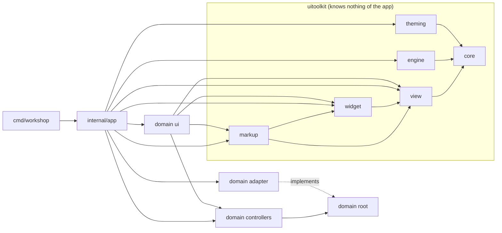
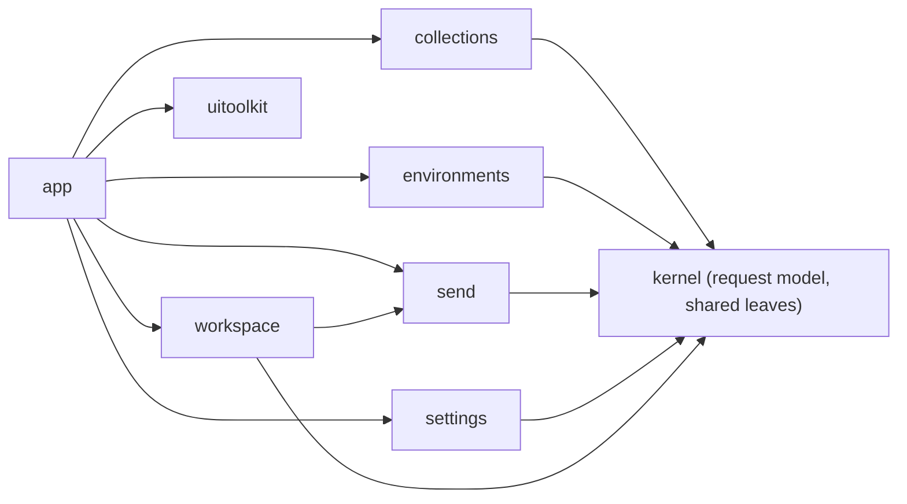

# Architecture

Start with `overview.md`; this file is the index of the detail. The layout follows the shared
`common/architecture-style.md`: each domain's root package (types and ports) is its core, `adapter` and `ui` its adapters,
the `App` its composition root. Known gaps are under Limits.

## Package layout

- Packages are `internal/<domain>/<package>`; only `ui/` and `adapter/` are zone directories. The import
  rules and their written exceptions are in `internal/CLAUDE.md`; no test checks them.
- `internal/app` is one package: Go cannot declare a method in another package, and everything
  that reads or writes the one `App` struct needs its methods. Adapters come in through `Options`.
- A feature that needs little of the `App` is its own `ui` package behind a `Host` interface the
  `App` implements, tested with a fake host: `calltrace` (`feature/send/ui/calltrace`), `mcpform` (`feature/send/ui/mcpform`), `sentlog` (`feature/history/ui/sentlog`), `settingsui`,
  `colorpage`, `shortcutpage`, `systempage`, `destpicker`. Adapters reach those views through the
  host (`Host.SentStore`, `Host.FontStore`).

## Modules

One functional module per file in `architecture/`; read only the one you touch. A module is a
domain directory under `internal/` (root, controllers, `ui/`, `adapter/`) or the toolkit.

| File | Module | Owns |
|---|---|---|
| `internal/feature/send/FEATURE.md` | `internal/feature/send`, `internal/kernel/request` | the request model and ports (kernel), protocols (rest, websocket, sse, mcp, grpc), assert, editor, mcpexplorer, response viewer and views, calltrace, mcpform, browser preview |
| `internal/feature/collections/FEATURE.md` | `internal/feature/collections` | open set, tree, importers, transfer, store, client config, sample and example server |
| `internal/feature/environments/FEATURE.md` | `internal/feature/environments` | environments, variables resolution, the chip's menu |
| `internal/feature/history/FEATURE.md` | `internal/feature/history` | responses kept per request, sent log |
| `internal/feature/settings/FEATURE.md` | `internal/feature/settings`, `internal/platform` | schema, prefs, theme, settings dialog and its pages; the OS adapters for display scale, fonts, key repeat and system info |
| `architecture/workspace.md` | `internal/workspace` | tabs, remembered state, bus, file browser, autosave, overlays, platform adapters |
| `internal/kernel` (see `internal/CLAUDE.md`) | `internal/kernel` | shared leaves: `severity`, `fileversion`, `userdir`, `textfmt`, `jsonview`, `openset`; documented in their package docs and in the module files that use them |
| `architecture/app.md` | `internal/app` | composition root: the `App`, its handlers and window |
| `architecture/toolkit.md` | `uitoolkit` | core, view, widgets, markup API and drawing |
| `architecture/persistence.md` | shared | formats and versions of every persisted file |
| `architecture/limits.md` | shared | limits, fuzzing, known gaps |

## Module dependencies

Every edge between features is a kernel package (the request model included); `go list` shows no
other one, except `workspace` importing `send` for MCP server info parsing and the `exampleserver` dev tool. Nothing checks it in `make check` yet.

## Known layer gaps

- A domain root imports a sub-package of its own domain: `workspace` imports `workspace/state`. 
- `internal/exampleserver` imports `feature/send/proto/ws`; the one written exception in `internal/CLAUDE.md`.
- No layer check runs in `make check`; `common/scripts/check-layers.sh` exists and is not wired
  (it needs a `.harness/layers.txt`).
