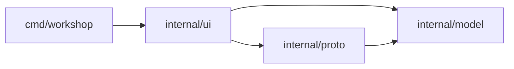

# Architecture

Status: window shell, `model`, `proto` and `jsonview` exist; `ui` is planned and described as they land.

| Package | Role |
|---|---|
| `cmd/workshop` | window setup and run loop |
| `internal/ui` | theme tokens, layout, widgets, screens |
| `internal/model` | collections, folders, requests, responses |
| `internal/proto` | `Protocol` interface and name registry; REST, WebSocket and MCP implementations |
| `internal/jsonview` | JSON pretty-print and token spans for the response pane |

## Model and protocols

`model.Request` is protocol-neutral: `Protocol` picks the implementation, `Method` only matters for REST. `{{name}}` in a URL is expanded from the collection vars (`model.Expand`) and the params table is folded into the URL with `model.WithParams`; `model.ParamsFromURL` goes the other way, so the URL bar and the Params table stay in sync. The caller does both before sending.

`proto.Registry` is a name-to-`Protocol` table (`rest`, `websocket`, `mcp`). `Send` returns an error only for misuse (unknown protocol, malformed method or URL). Transport failures arrive in `Response.Err` so the UI always has a value to render. `rest` uses `net/http`, keeps at most 32 MiB of body, and skips disabled header rows. `websocket` and `mcp` are stubs answering "not implemented yet".

## JSON view

`jsonview.Lines(body)` pretty-prints valid JSON with two-space indent and returns one `Line` per display row, each a list of `Span{Text, Kind}` (punctuation, key, string, number, literal, plain). Lines that open an object or array are `Foldable`, which the response pane uses for its fold arrows. Invalid JSON and other text come back as plain lines, so the pane renders any body.
