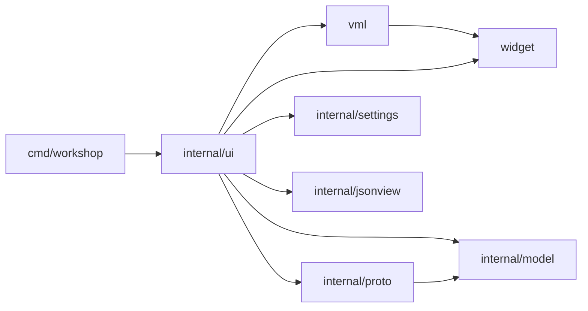

# Architecture

Status: window shell, all packages exist; the window is a first milestone (see Limits) and described as they land.



`widget` and `vml` are public packages: a reusable toolkit that knows nothing about the application (a test enforces it: `widget` imports nothing from this module, `vml` only `widget`). `internal/ui` is the application: state, handlers and the views written in VML.

| Package | Role |
|---|---|
| `cmd/workshop` | flags, window setup and run loop |
| `widget` | GPU toolkit on Ebitengine: theme tokens, drawing context, input, text field and code view state |
| `vml` | declarative view DSL: node tree, flex layout, event dispatch, `If`/`For`, ready-made Button, Tabs, Table |
| `internal/ui` | the app: state, handlers, the window as VML views, theme choices, sample data |
| `internal/model` | collections, folders, requests, responses |
| `internal/proto` | `Protocol` interface and name registry; REST, WebSocket and MCP implementations |
| `internal/settings` | user preferences (theme, text size) as JSON in the user config dir |
| `internal/jsonview` | JSON pretty-print and token spans for the response pane |

## Model and protocols

`model.Request` is protocol-neutral: `Protocol` picks the implementation, `Method` only matters for REST. `{{name}}` in a URL is expanded from the collection vars (`model.Expand`) and the params table is folded into the URL with `model.WithParams`; `model.ParamsFromURL` goes the other way (`model.MergeParams` rebuilds the table after a URL edit, keeping descriptions and disabled rows), so the URL bar and the Params table stay in sync. The caller does both before sending.

`proto.Registry` is a name-to-`Protocol` table (`rest`, `websocket`, `mcp`). `Send` returns an error only for misuse (unknown protocol, malformed method or URL). Transport failures arrive in `Response.Err` so the UI always has a value to render. `rest` uses `net/http`, keeps at most 32 MiB of body, and skips disabled header rows. `websocket` and `mcp` are stubs answering "not implemented yet".

## JSON view

`jsonview.Lines(body)` pretty-prints valid JSON with two-space indent and returns one `Line` per display row, each a list of `Span{Text, Kind}` (punctuation, key, string, number, literal, plain). Lines that open an object or array are `Foldable`, which the response pane uses for its fold arrows. Invalid JSON and other text come back as plain lines, so the pane renders any body.

## widget: the toolkit

Plain values; everything except the drawing calls is tested without a GPU.

- **Theme and tokens.** A `Theme` maps color `Token`s (`Bg`, `Frame`, `Sunken`, `Alt`, `Selected`, `Chip`, `Rule`, `Text`, `Muted`, `Accent`, ...) to colors; `widget.Dark()` and `widget.Light()` are flat gray palettes with a gold accent. Applications add tokens with `Theme.With` (the app adds `method.GET`, `json.key`, ...). Unknown tokens fall back to the text color. A test checks text/surface contrast for both themes.
- **`Ctx`** is what drawing and hit-testing use: theme, fonts, this frame's `Input`, tick and scale. Everything works in logical pixels; `Ctx` primitives (`Fill`, `Text`, `Clip`, `Line`, ...) multiply by `Scale` when drawing, text measures divide by it, and `Input.Scaled` converts the pointer back. `SetScale` and `SetTheme` rebuild the fonts. This is what makes the window sharp on HiDPI.
- **Input**: `ReadInput` samples mouse (including held, for drags), wheel, typed runes, edit keys with repeat, Enter, Escape, Shift/Ctrl and the Ctrl+A/C/X/V shortcuts.
- **`TextField`**: single-line text with a rune cursor and a selection (shift+arrows, drag, shift+click, select all). `Apply(typed, edits, extend)`, `Insert` (paste: line breaks become spaces, control characters are dropped), `DeleteSelection`, `SelectedText`.
- **Clipboard**: `widget.Clipboard` (read/write text). Ebitengine has no clipboard API, so `SystemClipboard()` runs the first complete pair of platform tools (`wl-paste`/`wl-copy`, `xclip`, `xsel`, `pbpaste`/`pbcopy`) with a 2 s timeout; with none installed every call fails with a hint to install wl-clipboard or xclip. No dependency is added.
- **`CodeView`**: lines of colored spans (`Span{Text, Style Token}`), a fold set, a pixel scroll and a whole-line selection (click or drag on the text; Ctrl+A selects all). Ctrl+C on the focused view copies the selected lines, or the whole body when nothing is selected. `Visible()` hides everything from a folded line through its closing line, found by indentation. `Update` handles wheel and fold clicks; `Draw` paints with line numbers and fold arrows.
- **`Rect`** and its split helpers.

## vml: the view DSL

A view is a Go function from state to a tree of nodes, rebuilt every frame, so the tree is always a pure function of the state: no diffing and no reactive system.

Every constructor takes **attributes first, children after**, so what an element is reads before what it contains. App view files dot-import `vml` (and alias `widget` as `w`) so views read like markup:

```go
Row(H(urlH), PadXY(w.Pad, 8), Gap(8), Bg(w.Bg),
	Row(Grow(1), Bg(w.Sunken), Border(w.Border),
		chip(protocolLabel, w.Muted, 64, cycleProtocol),
		VRuleInset(8),
		Field(&t.url, Grow(1), Placeholder("Enter URL"), OnEnter(send)),
	),
	PrimaryButton("Send", W(80), OnClick(send)),
)
```

- **Items**: a constructor's arguments are `Item`s: a child `Node`, or an `Option` that sets an attribute. A nil node (a false `If`) adds nothing; options given later override earlier ones, which is how components such as `Button` let callers override their defaults.
- **Elements** (`*El`, aliased `Node`): `Row`, `Col`, `Stack`, `Spacer`, `Text`, `Caption`, `Lines`, `Field`, `Code`, icons (`Checkbox`, `Cross`, `Triangle`, `Dots`) and the components `Button`, `PrimaryButton`, `Tabs`, `Table`, which are ordinary compositions of the primitives. Behaviors are values of one small interface (measure, layout, draw, update), not switch cases.
- **Options**: size (`W`, `H`, `Grow`, `Optional`), spacing (`Pad`, `PadXY`, `PadL`, `PadR`, `Gap`), look (`Bg`, `Border`, `BorderTop`, `BorderBottom`, `HoverBg`, `Lighten`, `Underline`, `Shadow`, `Clip`), text (`Color`, `Muted`, `Small`, `Mono`, `Ellipsis`, `Center`), events (`OnClick`, `OnChange`, `OnEnter`), overlays (`Float`, `Modal`).
- **Vue-like control flow**: `If`/`Either` (v-if), `For` (v-for), `Frag` (fragment). `Field(&textField)` edits state in place like v-model.
- **Layout** is a flexbox subset. Along its axis a child has a fixed size, a `Grow` share of the free space, or its content size; across it, it stretches unless it has a fixed size. `Optional` children are dropped when the row is too narrow. `Stack` layers children; a `Float(top, right)` child is pinned top-right and `Modal` makes it swallow clicks and report an outside click, which is how the settings menu works.
- **Frame cycle**: `vml.Layout`, then `vml.Update` (input goes to the top-most element first and runs handlers) or `vml.Draw`. `App.Update` and `App.Draw` each build the view, so what is drawn already reflects what the handlers just changed.

## internal/ui: the app

`ui.App` implements `ebiten.Game` and owns the state: open `reqTab`s (pointing at the collection's `model.Request`, plus URL `TextField`, active pane tabs, last `Response`, two `CodeView`s), the expanded tree folders, settings and the status line. `view.go` is the window as VML views (`sidebar`, `header`, `tabStrip`, `urlBar`, `pane`, `statusBar`); handlers are plain closures that change `App`.

- **Panes** are two tables, `requestPanes` and `responsePanes`: label, kind (table, code, note), row source, edit hook and an `empty` hook that supplies "Sending...", errors and "no response yet". A map from kind to builder turns a pane into nodes; adding a pane means adding a row.
- **URL bar**: protocol chip (REST / WS / MCP, click cycles), method chip (REST only), the URL field with `{{vars}}` colored, and Send. Editing the URL re-derives the Params table with `model.MergeParams`; toggling or deleting a param rewrites the URL with `model.WithParams`.
- **Clipboard status**: `ui` wraps the system clipboard so the status bar shows "Copied N characters" or why the clipboard failed.
- **Sending**: `App.send` expands `{{vars}}` from the collection and calls `proto.Registry.Send` in a goroutine with a 60 s timeout. The result returns over a channel and is applied in `Update`, so UI state is only touched from the game goroutine.
- **Settings menu**: the three-dot button toggles a modal VML overlay with Theme (Dark / Light) and Text size (Small / Medium / Large). Choices are tables (`themeChoices`, `textSizeChoices`), so a new theme is one row. A change calls `Ctx.SetTheme` and saves `internal/settings` to `<user config dir>/gascoigne-workshop/settings.json`; `-settings PATH` overrides the file and an empty path keeps settings in memory. Unknown ids in the file fall back to dark / medium. Escape or an outside click closes the menu.
- **Screenshot mode**: `workshop -screenshot out.png [-send] [-menu] [-settings FILE]` renders after a short settle, writes the PNG and exits (`make shot`). It is how UI changes are checked without a person at the window.

## Limits (milestone 1)

- Only the URL is editable; table cells, body and headers are display-only (checkbox and delete work). Copy and paste work in the URL field and the code views; no IME, no word-wise movement, no double-click word selection, and the code view selects whole lines only.
- No saving or loading of collections; the sample collection is built in (`ui.SampleCollection`).
- No text wrapping in the code view. Fractional scales round logical text metrics to whole pixels.
- VML is Go-native only; there is no template syntax or parser. One could be added later as a front end that emits the same nodes.
- WebSocket and MCP are registry stubs.
