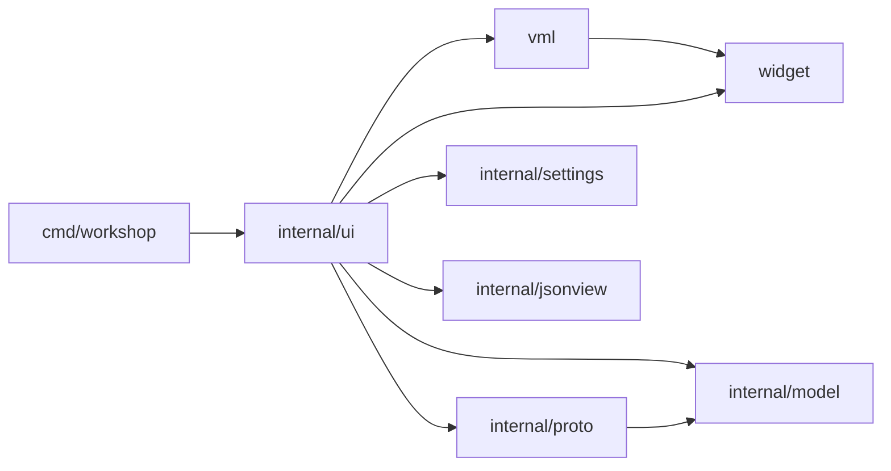

# Architecture

Status: window shell, all packages exist; the window is a first milestone (see Limits) and described as they land.



`widget` and `vml` are public packages: a reusable toolkit that knows nothing about the application (a test enforces it: `widget` imports nothing from this module, `vml` only `widget`). `internal/ui` is the application: state, handlers and the views written in VML.

| Package | Role |
|---|---|
| `cmd/workshop` | flags, window setup and run loop |
| `widget` | GPU toolkit on Ebitengine: theme tokens, drawing context, input, text field and code view state |
| `vml` | declarative view DSL: node tree, flex layout, event dispatch, `If`/`For`, ready-made Button, Tabs, Table |
| `internal/ui` | the app: state, handlers, the window as VML views, theme choices, sample data |
| `internal/model` | collections, folders, requests, responses |
| `internal/proto` | `Protocol` interface and name registry; REST, WebSocket and MCP implementations |
| `internal/settings` | user preferences (theme, text size) as JSON in the user config dir |
| `internal/jsonview` | JSON pretty-print and token spans for the response pane |

## Model and protocols

`model.Request` is protocol-neutral: `Protocol` picks the implementation, `Method` only matters for REST. `{{name}}` in a URL is expanded from the collection vars (`model.Expand`) and the params table is folded into the URL with `model.WithParams`; `model.ParamsFromURL` goes the other way (`model.MergeParams` rebuilds the table after a URL edit, keeping descriptions and disabled rows), so the URL bar and the Params table stay in sync. The caller does both before sending.

`proto.Registry` is a name-to-`Protocol` table (`rest`, `websocket`, `mcp`). `Send` returns an error only for misuse (unknown protocol, malformed method or URL). Transport failures arrive in `Response.Err` so the UI always has a value to render. `rest` uses `net/http`, keeps at most 32 MiB of body, and skips disabled header rows. The request body is encoded by a table keyed by `Request.BodyType` (`none`, `json`, `text`, `form`, `multipart`; "" sends `Body` as is with no Content-Type) which also gives the automatic Content-Type; an enabled `Content-Type` header of the user replaces it. Form and multipart bodies use the enabled, named rows of `Request.Form`. `websocket` and `mcp` are stubs answering "not implemented yet".

## Collection tree

`model.Folder` holds `[]*Folder` and `[]*Request`, so a request keeps its identity (open tabs point at it) however siblings change. `internal/model/tree.go` has the operations, all pure and tested: `UniqueName` ("x", "x 2", ... across folders and requests), `AddRequest` / `AddFolder`, `Parent`, `Contains`, `Rename` (trimmed, non-empty, unique among siblings), `Duplicate` (deep copy placed after the original as "<name> copy"), `Delete` and `Move` (into another folder, before a sibling or at the end; refused into itself or its subtree, onto a name clash, or for the root, and then nothing changes). The tree view's `treeRows` works on pointers and the expanded set is keyed by folder pointer, so renaming or moving a folder does not collapse it.

## JSON view

`jsonview.Lines(body)` pretty-prints valid JSON with two-space indent and returns one `Line` per display row, each a list of `Span{Text, Kind}` (punctuation, key, string, number, literal, plain). Lines that open an object or array are `Foldable`, which the response pane uses for its fold arrows. Invalid JSON and other text come back as plain lines, so the pane renders any body.

## widget: the toolkit

Plain values; everything except the drawing calls is tested without a GPU.

- **Palette source.** `theming.Dark()` and `theming.Light()` take their text, muted, accent (rose on dark, burgundy on light), OK, error and surface colors from the gascoigne CLI dashboard's tokens (`cmd/gascoigne/pages.css` in gascoigne-cli); a test pins them to those values. Borders, rules, chips, hover and selected rows keep the CLI's hues but are stronger than its soft web borders, because a native window's edges have to be visible (`TestNonTextElementsAreVisible`).
- **Theme and tokens.** A `Theme` maps color `Token`s (`Bg`, `Frame`, `Sunken`, `Alt`, `Selected`, `Chip`, `Rule`, `Text`, `Muted`, `Accent`, ...) to colors; `theming.Dark()` and `theming.Light()` are flat gray palettes with a gold accent. Applications add tokens with `Theme.With` (the app adds `method.GET`, `json.key`, ...). Unknown tokens fall back to the text color. A test checks text/surface contrast for both themes, and that non-text elements are visible: dividers (`Border`) at 2:1 on panes and lists, rules at 2.5:1, `AccentLine` (the accent used as an outline, underline or checkbox mark, a darker amber in the light theme where the gold fill would vanish) and icons at 3:1, selected and hovered rows distinct from the list.
- **`Ctx`** is what drawing and hit-testing use: theme, fonts, this frame's `Input`, tick and scale. Everything works in logical pixels; `Ctx` primitives (`Fill`, `Text`, `Clip`, `Line`, ...) multiply by `Scale` when drawing, text measures divide by it, and `Input.Scaled` converts the pointer back. `SetScale` and `SetTheme` rebuild the fonts. This is what makes the window sharp on HiDPI.
- **Input**: `ReadInput` samples mouse (including held, for drags), wheel, typed runes, edit keys with repeat (Ctrl turns them into word-wise edits), Enter, Escape, Tab, Shift/Ctrl and the Ctrl+A/C/X/V/Z/Y shortcuts. A `Sampler` adds the click count (double and triple clicks within 400 ms and 4 px).
- **`TextField`**: single-line text with a rune cursor, a selection (shift+arrows, drag, shift+click, double click selects a word, triple click everything, Ctrl+A), word movement and deletion (Ctrl+Left/Right/Backspace/Delete), horizontal scroll that keeps the cursor visible (`Reveal`, `ScrollX`) and undo/redo with coalescing (typing and single-character deletes merge into one step; paste, cut and word deletion are their own steps; 100 steps kept). `Apply(typed, edits, extend)`, `Insert` (paste: line breaks become spaces, control characters are dropped), `DeleteSelection`, `SelectedText`, `Undo`, `Redo`.
- **`TextArea`**: the multi-line editor, a `TextField` in multiline mode plus view state (`ScrollY`, optional `Styler` for syntax colors). It keeps line breaks (CRLF and CR become LF), moves by line with a remembered goal column (Up/Down/PageUp/PageDown; past the first or last line goes to the start or end), Home/End by line and Ctrl+Home/End by document, Enter inserts a line break plus the current indentation, Tab inserts spaces to the next stop (every selected line is indented when the selection spans lines), Shift+Tab dedents, triple click selects a line. Line numbers, scrollbars (the drag and page logic is shared with `CodeView` through `barDrag`), a current-line highlight and cursor-follows-scroll. Tab belongs to the editor, so Escape leaves it. A tab character in pasted text counts as one column.
- **Scrollbars**: `Thumb`, `PosFromOffset` and `ClampScroll` are the pure math (thumb length has a 24 px minimum); `Ctx.Scrollbar` draws a thumb for a vertical or horizontal track.
- **Clipboard**: `core.Clipboard` (read/write text). Ebitengine has no clipboard API, so `SystemClipboard()` runs the first complete pair of platform tools (`wl-paste`/`wl-copy`, `xclip`, `xsel`, `pbpaste`/`pbcopy`) with a 2 s timeout; with none installed every call fails with a hint to install wl-clipboard or xclip. No dependency is added.
- **`CodeView`**: lines of colored spans (`Span{Text, Style Token}`), a fold set, a pixel scroll and a character-level selection (drag, also across lines; double click a word, triple click a line; a click without dragging selects nothing; Ctrl+A selects all). `Find` / `SetMatches` / `RevealLine` give it search highlighting and scroll-to-line. Ctrl+C on the focused view copies the selected lines, or the whole body when nothing is selected. Long lines scroll sideways (Shift+wheel, a bottom scrollbar; the gutter stays put), a vertical scrollbar thumb can be dragged, and PageUp/PageDown/Home/End scroll while it has focus. `Visible()` hides everything from a folded line through its closing line, found by indentation. `Update` handles wheel and fold clicks; `Draw` paints with line numbers and fold arrows.
- **`Rect`** and its split helpers.

## vml: the view DSL

A view is a Go function from state to a tree of nodes, rebuilt every frame, so the tree is always a pure function of the state: no diffing and no reactive system.

Every constructor takes **attributes first, children after**, so what an element is reads before what it contains. App view files dot-import `vml` (and alias `widget` as `w`) so views read like markup:

```go
Row(H(urlH), PadX(w.Pad), PadY(8), Gap(8), Bg(w.Bg),
	Row(Grow(1), Bg(w.Sunken), Border(w.Border),
		chip(protocolLabel, w.Muted, 64, cycleProtocol),
		VRuleInset(8),
		Field(&t.url, Grow(1), Placeholder("Enter URL"), OnEnter(send)),
	),
	PrimaryButton("Send", W(80), OnClick(send)),
)
```

- **Items**: a constructor's arguments are `Item`s: a child `Node`, or an `Option` that sets an attribute. A nil node (a false `If`) adds nothing; options given later override earlier ones, which is how components such as `Button` let callers override their defaults.
- **Elements** (`*El`, aliased `Node`): `Row`, `Col`, `Stack`, `Spacer`, `Text`, `Caption`, `Lines`, `Field`, `TextArea`, `Code`, icons (`Checkbox`, `Cross`, `Triangle`, `Dots`) and the components `Button`, `PrimaryButton`, `Tabs`, `Table`, which are ordinary compositions of the primitives. Behaviors are values of one small interface (measure, layout, draw, update), not switch cases.
- **Options**: size (`W`, `H`, `Grow`, `Optional`), spacing (`Pad`, `PadX`, `PadY`, `PadL`, `PadT`, `PadR`, `PadB`, `Gap`; one rule for names: a side is a letter suffix, an axis is X or Y; templates spell the same options in kebab-case, `pad-x`), look (`Bg`, `Border`, `BorderT`, `BorderB`, `HoverBg`, `Lighten`, `Shadow`, `Clip`), text (`Color`, `Muted`, `Small`, `Mono`, `Ellipsis`, `Center`), events (`OnClick`, `OnChange`, `OnEnter`), overlays (`Float`, `Modal`).
- **Vue-like control flow**: `If` (v-if), `For` (v-for), `Frag` (fragment). `Field(&textField)` edits state in place like v-model.
- **`Scroll(&state, ...)`**: a column taller than its box, moved by the wheel and a draggable scrollbar thumb (a click in the track pages). The app owns the `ScrollState` so the position survives the per-frame rebuild. A clipping element (`Clip`, `Scroll`) masks the pointer position for its children while the pointer is outside it, so rows scrolled out of view cannot be hit; the click flag still passes so fields can blur. A scroller that uses the wheel zeroes it, so the innermost scroller wins. The tree and the table and note panes use it; the code view scrolls itself.
- **`Split(&state, default, first, second)`**: two children around a one-pixel divider that is dragged with the pointer (a few pixels either side grab it, and the drag keeps the offset where it was grabbed). The size is pixels, or a fraction of the container with `AsRatio`; `MinFirst` / `MinSecond` clamp it, the first child winning when the window is too small for both; double click resets to the default; `Vertical` stacks instead of side by side. While the pointer is over the divider or dragging it the element asks for the resize cursor (`Ctx.Cursor`, reset every frame and applied by the app). The app owns the `SplitState`, so it survives the per-frame rebuild and can be saved later.
- **Modal overlays own the pointer**: while any visible element is `Modal` (the settings menu, a context menu, a dialog), nothing under it gets clicks, wheel or hover, a click outside dismisses it, and hover feedback (`HoverBg`, `Lighten`, scrollbar and icon highlights) is off for everything drawn outside it (`Ctx.HoverOff`, read through `Ctx.Hovered`); the overlay's own items still light up. Toasts are not modal, so they block nothing.
- **Controls look**: a `Checkbox` is a 14 px square, an accent fill with a check mark when on and a plain outline (darker under the pointer) when off; the delete cross turns red under the pointer; table rows light up under the pointer; `LinkButton` is a quiet text button (accent text, no background) used for secondary actions such as Bulk edit, while `Button` / `PrimaryButton` are the filled chips.
- **Overlay primitives**: `FloatAt(x, y)` pins a Stack child's top-left at a point, shifted left when it would stick out on the right and opened above the point when it would stick out at the bottom; `FloatCenter()` centers it; `FocusScope()` makes Tab cycle only inside that element (the topmost scope wins); `OnRightClick(f)` gives the pointer position; a `Modal` element now swallows and dismisses on right click outside it as well.
- **Alignment, justification, bounds and margins** (`uitoolkit/vml/flex.go`): `AlignItems` on a Row or Col (and `AlignSelf` on a child) places children across the axis: `AlignStart`, `AlignCenter`, `AlignEnd`, `AlignStretch`, `AlignBaseline` (text baselines line up, the line is centered in the row), or the default (stretch; a fixed cross size is centered in a Row, left in a Col). `JustifyContent` (`JustifyStart/Center/End/Between/Around`) spreads free main-axis space and does nothing when a child grows. `MinW/MaxW/MinH/MaxH` bound any element's size, including a growing child's share. `Margin`/`MarginX`/`MarginY` add space around a child that counts in its parent's size. Text hugs its line height when not stretched, which is what makes `AlignStart/End` and baselines work. Tabs, tree rows and menu rows use baseline alignment so a small badge sits on the same baseline as the name.
- **Layout** is a flexbox subset. Along its axis a child has a fixed size, a `Grow` share of the free space, or its content size; across it, it stretches unless it has a fixed size. `Optional` children are dropped when the row is too narrow. `Stack` layers children; a `Float(top, right)` child is pinned top-right and `Modal` makes it swallow clicks and report an outside click, which is how the settings menu works.
- **Frame cycle**: `vml.Layout`, then `vml.Update` (input goes to the top-most element first and runs handlers) or `vml.Draw`. `App.Update` and `App.Draw` each build the view, so what is drawn already reflects what the handlers just changed.

## internal/ui: the app

`ui.App` implements `ebiten.Game` and owns the state: open `reqTab`s (pointing at the collection's `model.Request`, plus URL `TextField`, active pane tabs, last `Response`, two `CodeView`s), the expanded tree folders, settings and the status line. `view.go` is the window as VML views (`sidebar`, `header`, `tabStrip`, `urlBar`, `pane`, `statusBar`); handlers are plain closures that change `App`.

- **Panes** are two tables, `requestPanes` and `responsePanes`: label, kind (table, code, note), row source, edit hook and an `empty` hook that supplies "Sending...", errors and "no response yet". A map from kind to builder turns a pane into nodes; adding a pane means adding a row.
- **URL bar**: protocol chip (REST / WS / MCP, click cycles), method chip (REST only), the URL field with `{{vars}}` colored, and Send. Editing the URL re-derives the Params table with `model.MergeParams`; toggling or deleting a param rewrites the URL with `model.WithParams`.
- **Clipboard status**: `ui` wraps the system clipboard so the status bar shows "Copied N characters" or why the clipboard failed.
- **Response pane**: a toolbar (Pretty / Raw, Find, Copy, cURL) above the code view. Pretty is the colored, foldable JSON view; Raw shows the body exactly as received. Copy puts the received body on the clipboard; cURL puts `proto.Curl` of the request (variables expanded) there. A body that is not text (`looksBinary`: a NUL byte or invalid UTF-8 in the first 8 KiB) is replaced by a size note, while the Headers and Timeline panes still work. Ctrl+F (or the Find button) opens the find bar: typing searches case-insensitively, the code view highlights every hit and the active one and scrolls to it (opening a fold that hides it), Enter / Shift+Enter or the < > buttons step through the hits with wrap-around, and Escape closes the bar before it cancels anything else. A new response redoes an open search.
- **Auth pane**: `authTypes` is the table of authentication types (None, Bearer, Basic, API key) with their fields; the pane, the stored `model.Auth` values and the masking all follow it, and each type keeps its own values when you switch. Secret fields are masked (`TextField.Masked`: bullets on screen, and copy and cut are refused) until the Show secrets row is ticked. `proto.REST` applies credentials from a table keyed by type after the headers, so they win over an `Authorization` header typed by hand; an API key goes in a header or the query. Credentials never appear in the Headers table. At send time `Request.Expanded` replaces `{{vars}}` in the URL, headers, bodies, form fields and credentials, without changing the stored request.
- **Body pane**: a row of type chips (None, JSON, Text, Form, Multipart) above an editor that fits the type: a `TextArea` for JSON (colored line by line with `jsonview.Tokenize`) and Text, the editable fields table for Form and Multipart, a note for None. The text and the form rows are kept apart, so switching types loses nothing. JSON bodies show "Valid JSON" or the parse error and a Format button (`json.Indent`, applied as an undoable edit; invalid JSON is left alone and reported in the status bar). Requests from before body types get a type inferred when their tab opens.
- **Collection tree in the UI** (`internal/ui/treeops.go`): right-clicking a row opens its context menu: a request gets Rename, Duplicate, Copy URL and Delete; a folder New request, New folder, Rename, Duplicate and Delete; the collection root only the first three. Rename and Delete use the prompt and confirm dialogs (a refused name or move is an error toast, and nothing changes); deleting closes the tabs of everything removed. The "+" button and Ctrl+T add a request to the selected folder (`App.selected`, the node last clicked or moved to). Pressing a row starts a drag: dropping on a folder moves into it, on a request inserts before it, and the row under the pointer gets a gold outline; a request opens on press, while a folder toggles when the button is released on the same row so an open folder can still be dragged. The filter box in the sidebar header narrows the tree to requests whose name or URL contains the text and the folders that hold them. While the tree has the keyboard (after clicking a row, and no text widget focused) Up/Down move the selection, Enter opens or toggles, F2 renames and Delete deletes.
- **Right-click menus** (`internal/ui/ctxmenus.go`, the tree's is in `treeops.go`): a request tab (Close, Close others, Close tabs to the right, Duplicate, Copy URL), a table row (Insert row above / below, Duplicate, Move up / down, Enable all / Disable all, Delete, all through `applyRows` so they are undoable; the placeholder row has none), every text field and text area (Undo, Redo, Cut, Copy, Paste, Select all with shortcut text and enabled states; Cut and Copy are off for masked secrets, and the model follows via the widget's change callback) and the response (Copy the selection, Copy body, Copy as cURL, Select all, Find). A right click never clears a selection or moves focus. The innermost element with a right-click handler wins: a right click is consumed by the first handler that takes it, so the cell editor shows the text menu and not the row menu under it.
- **Request tabs**: each tab has a × (the label and the × are separate click targets, so closing never also selects), dragging with the left or the middle button reorders (a middle click no longer closes), Ctrl+W and the context menu close; closing the last tab leaves a blank request. A tab shows a dot when its request differs from the snapshot taken when it was opened (`reqTab.saved`, compared with `model.Request.Clone`, which turns empty slices into nil so deleting rows again is clean). Pressing a tab starts a drag (`App.dragTab`); `OnHeldOver` on the tab under the pointer moves the dragged tab there, and the active tab stays the same tab.
- **Table rows** (`internal/ui/tablerows.go`): every change of a table's rows goes through `App.applyRows(pane, tab, change)`: it runs the change on a copy, ignores it when nothing differs, records the old rows for undo (100 steps per table and tab, redo cleared), stores the new rows and runs the pane's `changed` hook (the URL rewrite for Params), then drops an edit or selection that points past the rows. Toggle, delete, cell commit, the header "enable all" checkbox, bulk edit and the keyboard operations all use it. The keyboard acts on the edited row, or on the selected row (the last one edited) while its table shows: Ctrl+Enter while editing inserts an empty row below and edits it (outside editing it still sends), Ctrl+D duplicates, Alt+Up / Alt+Down move it (an edit, even uncommitted, travels with it), Delete removes the selected row when nothing is typed. Ctrl+Z / Ctrl+Y undo and redo table changes when no text widget has the keyboard; inside a cell they belong to the text. The Bulk edit button shows a table as `name: value` lines (`# ` for disabled, one space after the first colon dropped, descriptions carried over by name) in a text area and applies it as a single undoable change when you switch back, change pane or tab. Duplicate enabled header names are drawn in the error color; rows with an empty name stay in the table but are never sent.
- **Resizable table columns**: a `TableSpec` with a `Widths *vml.ColumnWidths` (owned by the app, like a scroll or split state) gets draggable dividers over its header: dragging the boundary between two columns moves weight between those two only (`vml.ResizePair`, neither narrower than `MinColumnPx` = 56, the total unchanged, evenly split when the pair is too small for two minimums), double click on a divider clears the sizes back to the spec's defaults, and the resize cursor shows over a divider. Sizes are weights, so they keep their proportions when the window resizes. The app keeps one `ColumnWidths` per table (`widthsFor`: request tables by pane name, response tables prefixed), so Params, Headers, Vars, form fields and the response headers are independent. The weights are the state task 020 will save.
- **Cell editing**: clicking a cell of an editable table starts an edit (`App.beginEdit`): the table shows a `Field` in that cell with the old text selected. Enter or a click elsewhere commits (`commitEdit`), Escape cancels, Tab / Shift+Tab commit and move to the next / previous cell, wrapping across rows. Text typed into the placeholder row creates a row (enabled); an empty placeholder adds nothing. Params edits rewrite the URL through the pane's `changed` hook.
- **Layout**: the window is a `Split` of the sidebar and the main column (default 259 px, minimum 160, the main column keeps at least 420), and the request and response panes are a ratio `Split` (default one half, minimum 220 each). The settings menu has a Request / response choice, Side by side or Stacked, saved as `layout` in the settings file.
- **Drawing only when something changed** (`uitoolkit/engine/pacing.go`, wired in `internal/ui/redraw.go`): `main` turns off screen clearing (`SetScreenClearedEveryFrame(false)`), and `App.Draw` returns at once unless the `dirty` flag is set, so Ebitengine skips the frame's GPU work. A frame is dirty after any input that can change the screen (a moved pointer, a click or held or just-released button, the wheel, typed text or any key), when a response or an expired toast was applied, when a toast is shown, when the window size or scale changes, every 30 ticks while a text caret is on screen (the blink), on a 120-tick heartbeat in case the window system lost the picture, and always while a screenshot is taken. After 60 quiet ticks the update rate drops from 60 to 30 and returns on the next activity. `ebiten.ScheduleFrame`/`SetFPSMode` are deprecated, so this follows Ebitengine's `skipdraw` pattern.
- **Cancel and timeout**: while a request runs the Send button reads Cancel and Escape cancels it, in this order of priority: close the menu, cancel a cell edit, cancel the request (`cancelSend`). Each tab numbers its sends (`reqTab.seq`); a result whose number is no longer current (cancelled or replaced) is dropped. The timeout is the request's `TimeoutSec`, else `settings.TimeoutSec` (default 60), else a minute. `proto.REST` reports a stopped request as `Cancelled` or `Timed out`, and `Request.NoRedirects` stops it at the first redirect. Both options live in the request's Settings pane.
- **Sending**: `App.send` expands `{{vars}}` from the collection and calls `proto.Registry.Send` in a goroutine with a 60 s timeout. The result returns over a channel and is applied in `Update`, so UI state is only touched from the game goroutine.
- **Focus and shortcuts**: text fields and code views are the focusable elements. Tab / Shift+Tab (`vml.Update`) move focus through them in tree order, wrapping; a focused field that handles Tab itself (a cell editor) keeps it. The focused element draws a gold outline. Global key bindings are the `shortcuts` table in `internal/ui/shortcuts.go` (name, key, modifiers, action): Ctrl+Enter send, Ctrl+L focus URL, Ctrl+T new request, Ctrl+W close tab, Ctrl+Tab / Ctrl+Shift+Tab next / previous tab, Ctrl+, settings. A binding fires only when its modifiers match exactly, so plain keys never trigger anything; the settings menu lists the table.
- **Overlays**: the window's Stack ends with, from bottom to top, the settings menu, a context menu, a dialog (with a dimmed scrim) and the toasts. `App.openMenu(x, y, items)` shows a context menu (`menuItem`: label, shortcut text, disabled, separator, action) that closes on a pick, an outside click or Escape and is driven by Up / Down (skipping separators and disabled rows, wrapping) and Enter; the action runs after the menu closes so it can open another overlay. `App.confirm` and `App.prompt` open a modal dialog whose Enter runs the primary button, Escape or a click outside cancels, and whose text field (prompt) starts focused with its text selected; Tab stays inside it. While a menu or dialog is open the global shortcuts are off. `App.toast(text, isErr)` shows a message above the status bar: info toasts fade after 3 s (the clock is `App.now`, replaced in tests), errors stay until clicked, at most five are kept. Clipboard failures and settings save failures are error toasts; a successful copy is still a status line. Escape closes, in order: context menu, dialog, settings menu, cell edit, find bar, running request.
- **Configurable shortcuts** (`internal/ui/keybindings.go`): every entry of the `shortcuts` table has a stable `id`; its default is the table row, a user binding is `settings.Shortcuts[id]` as a key string (`Ctrl+Shift+Tab`: modifiers in any order when parsing, written Ctrl, Alt, Shift; `""` is unbound; unknown ids and unparsable values are ignored). `App.bindingOf` is the one place that resolves a binding, and `runShortcuts`, the settings list, the context menus' shortcut text (`shortcutHint`) and the key handling all read it. In the settings menu each action shows its key as a button: click it and the next combination is recorded (`recordKey`); modifier keys alone are waited out, Escape cancels, Backspace unbinds, and anything else goes through `checkBinding`, which refuses what the text widgets own (Ctrl+A/C/V/X/Z/Y, Ctrl+Shift+Z), plain Escape, plain keys other than F1-F12 and Delete (they would fire while typing) and a combination another action has (naming it). A refusal shows a note under the row and recording continues. A binding equal to the default is not stored, Reset removes an override, and while recording no shortcut or tree key fires. The settings menu is now a `Scroll` with `MaxHeight`, so it scrolls in a short window.
- **Colors and contrast** (`internal/appearance/colors.go`, `colorui.go`): `ThemeWith(settings)` builds the theme: the chosen theme and text size, then, when Contrast is High, the selection, find-match, active-match and accent colors moved (by `theming.EnsureContrast`, toward black or white) until their text reaches a 7:1 ratio, then the user's overrides for that theme. An override is ignored unless it parses as `#rrggbb`/`#rgb`, names one of the four customizable tokens (`customColors`: token, label, the text drawn on it) and reaches the required ratio (4.5:1, 7:1 in High); each theme keeps its own overrides in `settings.Colors[theme][token]`. The settings menu has the Contrast chooser and, per color, a swatch (it paints with the token, so it always shows the color in effect), a hex field and a Reset button, plus Reset colors; typing applies live and saves, a refused color shows why (`Contrast 2.1:1 is below 4.5:1` or `Use #rrggbb`) and changes nothing. Switching theme or contrast rebuilds the fields from the colors then in effect. `widget` has the helpers `ParseHex`, `FormatHex`, `ContrastRatio` and `EnsureContrast`.
- **Settings menu**: the three-dot button toggles a modal VML overlay with Theme (Dark / Light) and Text size (Small / Medium / Large). Choices are tables (`themeChoices`, `textSizeChoices`), so a new theme is one row. A change calls `Ctx.SetTheme` and saves `internal/settings` to `<user config dir>/gascoigne-workshop/settings.json`; `-settings PATH` overrides the file and an empty path keeps settings in memory. Unknown ids in the file fall back to dark / medium. Escape or an outside click closes the menu.
- **Screenshot mode**: `workshop -screenshot out.png [-send] [-menu] [-settings FILE]` renders after a short settle, writes the PNG and exits (`make shot`). It is how UI changes are checked without a person at the window.

## Limits (milestone 1)

- The URL, the Params, Headers, Vars and form-field cells, and the JSON and text body are editable. Multipart sends text fields only (no files). Copy and paste work in the URL field and the code views; no IME, no word-wise movement, no double-click word selection, and the code view selects whole lines only.
- No saving or loading of collections; the sample collection is built in (`ui.SampleCollection`).
- No text wrapping in the code view. Fractional scales round logical text metrics to whole pixels.
- VML is Go-native only; there is no template syntax or parser. One could be added later as a front end that emits the same nodes.
- WebSocket and MCP are registry stubs.

- **Spacing rhythm**: one `Pad` (12 px) is the inset between panes and content; bars (sidebar header, tabs, toolbars, status) are separated with one token, `Border` (never `Rule`, which is for outlines and table headers). The request and response panes both start their first row `Pad` below the pane tabs, so rows line up across the divider (`TestRequestAndResponsePanesShareTheirFirstRowBand`).

- **Click targets are outlined**: buttons (`Border`; primary buttons `AccentLine`), unfocused text fields and tables (all the same gentle `Border`) carry a 1 px outline drawn after the children so regions to click are visible at rest; a focused field swaps its outline to `AccentLine`.

- **Toolkit tree** (`ui/`): `uitoolkit/core` (theme, drawing, text widgets), `uitoolkit/vml` (layout DSL on widget) and `uitoolkit/engine` (app-independent frame loop: `Pacer`, `MustDraw`, `InputActive`, and the `Binding` key model with parse/format) form one layer that never imports `internal/`. `internal/ui` is the workshop's screens on top of them. `TestToolkitImportsStayInTheirLayer` guards the direction.

- **Remembered state** (`internal/state`, `internal/ui/statesync.go`): `state.json` next to the settings holds the window geometry, sidebar width, pane split, expanded folders (by path), open tabs (request path, selected request and response pane), the active tab and table column weights. It is separate from settings, written atomically, and a missing, broken or partly stale file only means a fresh start (missing requests are dropped, indexes clamped; a broken file shows a status note). `App.stateTick` snapshots each frame and writes after the state was unchanged for one second; `main` writes once more on exit and restores the window clamped to the monitor (`state.Window.Clamp`). `-state PATH` picks the file, empty keeps it in memory, and screenshot runs do not touch it unless `-state` is given.

- **Streaming and WebSocket** (`internal/proto/stream.go`, `websocket.go`, `ws/`): `Registry.Connect` opens a `Session` with a protocol that implements `Streamer`. `WebSocket.Send` is the one-shot form (connect, send the body, return the first reply as a `Response` with status 101). Headers, Auth pane credentials and a `Sec-WebSocket-Protocol` header (split into subprotocols) go into the handshake. The UI for live sessions is task 016's remaining part.
- **Sideways scrolling** (`vml.HScroll`, `vml.ScrollTabs`): a row at natural width inside a clipped box with arrow buttons at overflowing ends (they take the click before the tabs below them), wheel scrolling, and `Reveal()` to keep one child in view when it changes. The pane tab strips use it, so tabs past the pane width (Vars, Settings) stay reachable; their `ScrollState` lives in the request tab.
- **Spacing fixes**: table checkbox, delete and header cells center their icon; a caption row and its table are `Gap(6)` apart; the URL field has a `Pad-4` spacer after the method divider.

- **Copying from tables**: right-clicking a row of a read-only table (the response Headers) opens a menu with Copy value, Copy name, Copy as `Name: Value` and Copy all headers; the editable tables lead their row menu with the first three (`copyRowItems`).

- **Interface scale**: `settings.UIScalePct` (default 100, bounded 50..300) multiplies the display's scale factor. `frameSize` turns the window size into the logical size the UI lays out in (window / scale), the total scale and the screen size; the settings menu has a `vml.Slider` (50..200%, step 5, 100% at the middle of the track via `SliderMid`). The UI resizes live while the thumb moves (`onChange`), and the settings are saved on release (`OnSlideEnd`). A drag follows the pointer's movement in device pixels since the press, using `Ctx.PointerX/PointerY` (the pointer before any clipping container hides it), so the resizing track and the menu's clip never feed back into the value. Remembered window sizes are stored in window pixels (logical size times the interface scale) so they restore the same window.

- **Tooltips and icons**: `vml.Tooltip(text)` on any element; `vml.Draw` records the innermost hovered tip in `Ctx.TipText`, counts `TipDelayTicks` (30) of rest, then draws a small box near the pointer (flipped above or inward at the screen edge). A click or moving to another element restarts the wait, elements under a modal overlay have none, and while a tip waits the app keeps drawing (`Ctx.TipWaiting`). Line icons (`Trash`, `CopyIcon`, `SearchIcon`, `Plus`, `PromptIcon`, `ChevronUp/Down`, `Cross`) come from one `glyphs` table with a hover color table (`glyphHover`: the trash turns red); `IconButton(glyph, ...)` is an outlined chip around one. The response toolbar (find, copy, cURL), the find bar, the tab strip's new-tab button and the table delete cells use them; buttons and tabs show their shortcut in the tip (`App.hint`).

- **Theme files and control styles** (`uitoolkit/theming/themefile.go`, `uitoolkit/theming/themes/*.json`, `internal/appearance/themes/*.json`): themes are embedded JSON in the style of editor themes: `variables` (referenced as `$name`), a flat `colors` table (`#rrggbb` or `#rrggbbaa`) and a `controls` table of per-control styles: `radius` (px, a large value makes a pill), `gradient` (a strength 0..0.5 that shades the fill toward white above and black below, or `[top, bottom]` colors) and `border` (a color token). `theming.ParseTheme(data, base)` merges a file over a base theme and rejects unknown fields, variables, tokens and bad gradients. The toolkit's palettes and control styles are `uitoolkit/theming/themes/{dark,light}.json` (`theming.Dark()/Light()` load them); the app lays its own colors (HTTP methods, JSON syntax) over them from `internal/appearance/themes`. The look follows the CLI dashboard: 6 px buttons and fields, 8-10 px tables and menus, soft gradients, and a burgundy hero banner behind the window title.
- **Controls draw from their style**: `vml.Control(name)` makes an element take its fill (gradient, rounded), outline and shadow from `Theme.Style(name)`: `button`, `primary`, `icon-button`, `field`, `table`, `menu`, `tooltip`, `tabstrip`, `statusbar`, `hero`. `Ctx.FillStyled` fills a (rounded) path with per-vertex gradient colors and `Ctx.OutlineStyled` strokes it; outlines are drawn after an element's children, and a field's focus ring over its outline. Two settings act on every style: `corners` (square / soft / round scale the radii 0 / 1 / 1.7) and `flat` (every gradient becomes a flat fill), both in the settings menu. A control a theme does not list is plain, so a theme file can restyle or flatten any control without code.

- **Dashboard parity pass**: surfaces follow the CLI dashboard's roles: the page (`Frame`: #140f12 / #f6f3f4) with surface panes and lists on it (`Bg` = `Sunken`: #1c1519 / white) and `Alt` for the faint tint. Body text is 14 px (small 12, mono 13; large is 16), table headers are bold 12 px muted text (not uppercase) with a `BorderSoft` hairline under them and under every row but the last, instead of zebra stripes, and the window title is bold. Response status is a pill (`pill` control, radius 999) in the OK / warn / error color on its `*-soft` background, like the dashboard's badges. New tokens: `border-soft`, `ok-soft`, `warn-soft`, `error-soft`, `accent-soft`, `warn`, `track`, `faint`; `Fonts` gained `Bold` and `SmallBold` (Go Bold) behind `vml.Bold()`.

- **Second parity pass** (from a read-only comparison against the dashboard CSS): buttons and icon buttons are surface-filled with a `border-strong` outline (new token) and no gradient, as the dashboard's; fields, menus and tooltips use `border-strong`, tables `border-soft`; the tab strip and status bar are flat. Gradients stay a theme feature (only `hero` uses one by default, now dark at the top like the dashboard's night gradient). Dark `panel`/`alt` are the dashboard's surface-2, `hover` its accent-tinted mix, and `info`/`info-soft` back `method.PUT`. Not done, needing a renderer or layout change or approval: an outlined primary button and segmented pill groups, blurred shadows, 2 px focus rings, a medium font weight and letter-spacing, 36 px table rows, selected-row accent bar, floating cards; changing `border`, `selected` or the scrollbar thumb color would break `TestNonTextElementsAreVisible`.

- **Scrolling tab strips**: `HScroll` keeps an arrow's width of room at each end when its content overflows (so no tab is hidden under an arrow), draws both arrows whenever it overflows (dim at the end of the way, and a click on a dim arrow does not fall through to the tab under it), and scrolls with the wheel and a touchpad's two-finger sideways swipe (`Input.WheelX`). The request tab strip uses it too (`App.tabsScroll`), keeping the active tab in view. Light inputs are lighter than their pane: the light `bg` is #f9f6f7 and inputs sit on `sunken` (white).

- **Separators and padding**: `vml.Separator(show, inset)` draws a soft hairline (`BorderL`, `BorderInset`) on an element's left edge, used between tabs (request and pane strips) and between table columns (header and rows) so neighbours read as distinct. Holding an `HScroll` arrow scrolls once at the press, then repeats after 20 frames every 3 (a press on one arrow dragged onto the other does not). The table cell being edited is inset 3 px in its cell so its rounded outline and focus ring have room.

- **Panning a strip**: pressing on an overflowing `HScroll` and dragging more than 4 px pans it, following the pointer even outside the strip (`Ctx.PointerX`); the tab under the press is still selected. Because of that, a left drag no longer reorders tabs while the request strip overflows (`ScrollState.Overflowing`); the middle button always reorders, and with room to spare a left drag still does.

- **Tab and chrome refinements**: `HScroll` shows only the arrows that have somewhere to scroll to. The request tab row is 46 px, the pane tab row 44 px. The open request tab has the pane color, a 2 px accent a bold accent-colored name; the open pane tab is bold. Table headers sit on the `panel` tint with a `border` rule and uppercase bold muted labels. Corner radii are flatter (4 px buttons and fields, 6 px tables, 8 px menus; "round" is 1.5x). The URL bar draws a divider only between its chips, never after the last one. The response toolbar's chips and icon buttons are one height (`chipH`), centered.

- **Custom themes**: every `*.json` file in the themes folder (`-themes DIR`, default `<user config>/gascoigne-workshop/themes`) is a theme: the file name is its id, `name` its label, and `"extends": "dark"` (default) or `"light"` picks the built-in theme it is laid over (`theming.ThemeExtends`, `theming.ParseTheme`). It can set `variables`, `colors` (any token, including `method.*` and `json.*`) and `controls` (radius, gradient, border) and is listed in the Theme row of the settings next to the built-ins; the user's color overrides are kept per theme id. A file that does not parse, or extends an unknown theme, is skipped and reported in the status bar; a missing folder is fine. Example: `{"name": "Ocean", "extends": "light", "colors": {"accent": "#115577", "accent-line": "#115577"}, "controls": {"button": {"radius": 10}}}`.

- **Compact JSON view** (`internal/jsonview/compact.go`, `internal/respview/filter.go`): the response toolbar has Pretty, Raw and Compact. `jsonview.Compact(body, width)` parses with key order and number text kept, keeps every object or array whose one-line form fits (90 columns with indent and key) on one line and breaks only larger ones; block openers are foldable, carry their one-line preview (`{"id": 1, "name": "…", …}`) in `Line.Folded` (drawn by `CodeView` while folded) and every line has its `Depth`. Blocks from depth 2 start folded, so a long list shows one preview per item, like a browser's JSON viewer. While the find bar has text the compact view is filtered (`filterCompact`): matching lines, everything inside a matching block (its children) and the openers and closers of the blocks around them stay; clearing the text or closing the bar restores the full compact view with its folds. Line numbers in the filtered view count the shown lines.

- **Settings dialog** (`internal/ui/menu.go`): the settings are a 760x560 modal dialog (smaller windows keep a 40 px margin) centered over a dimmed window, with a title bar and close button, a list of pages on the left (`settingsCategories`: Appearance, Colors, Shortcuts; `App.settingsCat`) and the page's content scrolling on the right. Appearance holds theme, text size, interface scale, corners, gradients, request/response layout and contrast. Esc, the close button or a click outside close it. New pages are one entry in `settingsCategories`.

- **Round of refinements**: the open tab (request and pane strips) is marked only by the selected-row tint (`Selected`), the bar, bold name and underline are gone. A response opens **Compact** by default (`settings.ResponseView`: compact, pretty, raw; Appearance has a Response view row that applies to the open tabs too) and the toolbar lists Compact, Pretty, Raw in that order. The filtered find view keeps each line's real number (`Line.Num`, the gutter widens for it). A table cell being edited keeps its text where the shown cell had it (`FieldPad`: 3 px inset + 5 px field padding = 8). Find is tested in all three views.

- **Tab look** (supersedes the earlier tint/underline): the strip draws one continuous bottom line behind its tabs; inactive tabs are transparent so it shows under them, and the open tab has the pane color and an accent outline on its top, left and right (`vml.Edges`, 2 px) with the bottom open, so it runs into the pane below. Used by the request strip and the pane strips.

- **Size rules and rounding everywhere**: heights come in steps (`core.RowH` 28 for rows and standard controls, `CompactH` 24 for chips, icon buttons, inline fields and the slider, `LabelH` 22 and `NoteH` 18 for captions and notes) and icon buttons are `IconBtnW` 32 wide; new components use these instead of literals. Request tabs are 42 px and pane tabs 40 px. Every component takes its corners from the theme's control styles through `Ctx.Radius(name)` or `vml.Control`, so the Corners setting reaches them all: besides the buttons, fields, tables and menus, also `checkbox`, `slider`, `scrollbar`, `row` (tree rows and menu items), `swatch` and `match`. The open tab's accent outline (`Edges`) is still square.

- **Tab gap**: both tab strips keep `tabGap` (6 px) of empty space above their tabs, so the open tab's accent outline no longer touches the banner or the bar above it.

- **WebSocket tabs** (`internal/ui/wsui.go`): a tab whose protocol is `websocket` keeps a `proto.Session`. The URL bar button reads Connect / Disconnect (`toggleConnection`); dialing runs in a goroutine and its answer, every session `Event` and the end of the stream come back through `App.wsEvents` as `wsEvent`s (numbered by `reqTab.wsGen`, so an abandoned connect is ignored and its session closed), applied in `drain`. The response side is the single `Messages` pane (`responsePanesFor`): a `CodeView` log with `Follow` set (pinned to the end while new lines arrive, paused when the user scrolls up, resumed at the end), Ping / Clear buttons and a composer field. Changing the protocol disconnects.

- **WebSocket auto-reconnect**: the `Auto-reconnect` chip in the Messages toolbar sets `reqTab.reconnect` (per tab, not persisted). `wantOpen` records that the user wants the connection (set by `connect`, cleared by `disconnect`); when the session ends or a connect fails while both are set, `scheduleRetry` logs it and a timer sends a `retry` wsEvent after `retryDelay`. While retrying the button reads Disconnect, which stops it.

- **Workspace on disk** (`internal/store`, `internal/ui/workspace.go`): `store.Save/Load` write and read the collection tree (format in decisions 9; atomic writes, unchanged files are not rewritten). The app loads `-workspace DIR`, else the remembered `settings.workspace`, else keeps the built-in sample in memory; a folder that fails to load is reported and never overwritten. `Ctrl+S` (`save` shortcut) saves; the first save without a workspace goes to `settings.DefaultWorkspace()` and is remembered. Once a workspace is set, `workspaceTick` saves by itself after the collection stays unchanged for `saveDebounce` (1 s); saving also clears the tabs' dirty marks.

- **cURL import**: `proto.ParseCurl` (next to `proto.Curl`) splits the command like a POSIX shell (quotes, `$'..'`, line continuations) and maps the flags to a REST request: `-X -H -d/--data* -F -u --url -A -b -e -m -L -I`, bearer headers become Bearer auth, other flags are skipped. Redirects are followed only with `-L`, as in curl. The folder context menu entry `Import cURL from clipboard` adds the result named `METHOD /path`.

- **Environments** (`internal/ui/env.go`, `model.Environment`): `Collection.Envs` are named variable sets; `App.env` indexes the active one (-1 none, remembered by name in `settings.environment`). `App.vars()` is `model.MergeVars(collection vars, environment vars)`, so enabled environment variables win by name, and every send, cURL copy and WebSocket connect expands with it. The header chip opens the environment menu (switch, new, rename, delete). The Vars pane edits the active environment, else the collection variables. A variable marked secret (row menu) shows as bullets and its value is written to `.secrets.json`, not `environments/NN-name.env.json`. `App.varSegments` colors defined `{{names}}` green and unresolved ones red in the URL field.

- **MCP** (`internal/proto/mcp.go`): `proto.MCP` is a `Streamer` over two transports behind `mcpTransport`: streamable HTTP (POST per message, JSON or event-stream answers, `Mcp-Session-Id` and `MCP-Protocol-Version` headers, user headers and auth applied, DELETE on close) and stdio (`stdio:` + command line, newline-delimited JSON). `Connect` runs `initialize`, sends `notifications/initialized` and lists tools, resources and prompts the server announces; every message in both directions is an `Event` (kind request / response / error / notification), so the MCP tab reuses the WebSocket message-log pane (`isSocket`). The composer takes `call NAME {json}`, `read URI`, `prompt NAME {json}`, `method {json}` or a raw JSON-RPC object. The generated tool-call form is not built yet.

- **Pixel snapping**: `Ctx.Fill`, `Outline`, `HLine` and `VLine` convert logical edges to device pixels with `Ctx.snap` (rounded per edge, so neighbours share an edge with no gap) and draw lines `Ctx.LineWidth()` thick, the scale rounded to whole pixels and at least one, so borders stay sharp at fractional scales.

- **Toolkit location**: the UI toolkit lives under the root `uitoolkit/` directory (`widget`, `vml`, `engine`; `uitoolkit/doc.go` describes the layers). It never imports `internal/*` or `cmd/*`; `uitoolkit/core/layers_test.go` fails the build if it does and checks each toolkit package's imports against its layer. Earlier notes that say `ui/widget`, `ui/vml` or `ui/engine` mean the same packages under this name.

- **Feature packages** (task 018): code that does not need the `App` lives in a package of its own under `internal/`: `respview` (response body to colored lines: `CodeLines`, `CompactLines`, `RawLines`, `FoldDeep`, `LooksBinary`, `Filter` for the compact search, `Tokens` for the JSON colors), `textfmt` (`Duration`, `Size`). `appearance` (theme files, the user's theme folder, choices for theme / text size / corners / layout / contrast, `ThemeWith(settings)`, customizable colors and `MethodToken`; embedded `themes/*.json`). `collection` (the collection tree: `Rows`, `FilteredRows`, `Row`, and the built-in `Sample`). `internal/ui` keeps only what shares window state.

- **Templates** (`uitoolkit/component`, named after Vue's components): `component.View(src, scope)` builds an HTML-style template written inline in a Go method (parsed once per source string, panics on a mistake in the program); `component.Parse`/`Must` and `Template.Build`/`MustBuild` are the explicit forms (there is no file loader: one way to write a template). Rules of the format are in decisions 11 and the package doc. The status bar is the first view moved over (`App.statusBar`); `vml.Dump` prints a laid-out tree, and the test that it matches the Go view it replaced compares dumps, which is the pattern for moving more views.

- **Theming mechanics are toolkit code** (`uitoolkit/theming`): `Catalog` (the built-in choices, the user's theme folder via `LoadUser`/`SetUser`, `For`, `ThemeID`), `Prefs` (theme, text size, corners, contrast, flat, color overrides) and `Catalog.Theme(Prefs)`, plus the choice tables (`SizeChoices`, `CornerChoices`, `ContrastChoices`, `CustomColors`) and contrast rules. `internal/appearance` is now only the app's part: its embedded overlay themes (HTTP method and JSON colors), `MethodToken`, `LayoutChoices`, and thin wrappers that map `settings.Settings` to `theming.Prefs`.

- **Toolkit API conventions** (developer experience): one naming rule (a side is a letter suffix, an axis is X or Y, sizes are `W H MinW MaxW MinH MaxH`); options may stand anywhere among the children and a later option overrides an earlier one (components rely on it), with options-first as the style; every package has a package doc and tested `Example*` functions (`vml`, `component`, `theming`, `widget`), and the `vml` doc has a family index of the option names. Template errors name the file and line, suggest the nearest name and list the valid ones; `component.Reference()` prints the elements and attributes from the same tables the parser uses. `Ctx.PointerX/PointerY` are the pointer position that containers do not hide (drags); the slider measures drags in device pixels because its value can rescale the UI mid-drag.

- **core and vml** (toolkit layout): `uitoolkit/core` holds the fundamentals only: theme files and tokens, colors, the drawing context `Ctx`, pointer and keyboard `Input` (including the `Edit` vocabulary of text keys) and the clipboard. `uitoolkit/vml` holds everything that is a view or an input: the element tree and layout, and the input widgets `TextField`, `TextArea` and `CodeView` with their elements `Field`, `Area` and `Code` (a state type and its element share one stem), plus the scrollbar drawing they use. Views import `vml` (dot-imported) and reach `core` only for tokens, sizes and the context.

- **Every side the same way** (`vml`): padding, margin and border follow one rule. All sides: `Pad`, `Margin`, `Border` (an outline); an axis: `PadX`/`PadY`, `MarginX`/`MarginY`, `BorderX`/`BorderY`; one side: a letter suffix L, T, R or B (`PadL`, `MarginT`, `BorderR`). Border lines are one-pixel hairlines in a theme token, `BorderInset` keeps the left and right lines off the corners, and `Edges` is the separate two-pixel open-tab outline. Templates use the same names in kebab-case (`border-t`, `margin-x`, `pad-b`). The earlier `BorderTop`, `BorderBottom` and `BorderLeft` are now `BorderT`, `BorderB` and `BorderL`.

- **API consistency pass**: the rules for toolkit names are in `rules.md` ("Toolkit API rules"). Applied: icons end in `Icon`, `Ctx.Color` replaces `Ctx.Col`, `core.Gutter` replaces the `Pad` constant, `vml.Span` is the one colored-run type, callbacks are options (`Modal()` + `OnDismiss(f)`, `OnSlide(f)` on `Slider`, `OnSelect(f)` on `Tabs` and `ScrollTabs`). Remaining debt is `tasks/022-api-consistency.md`.

- **Theme pipeline lives in `theming`** (task 024, option A): `core` keeps the `Theme` and `Token` types, the token constants, `ControlStyle`, the gradient helpers `Shade` and `GradientEnds` and the drawing `Ctx`. `uitoolkit/theming` has the JSON theme parser (`ParseTheme`, `ThemeExtends`, `ParseColor`), the palettes and their files (`Dark`, `Light`, `themes/*.json`), the color math (`ParseHex`, `FormatHex`, `ContrastRatio`, `EnsureContrast`) and the preference mechanics (`Catalog`, `Prefs`). `theming` imports `core`, never the reverse, so `core`'s own tests build a tiny theme (`testTheme`) instead of calling `Dark()`.

- **API consistency, second pass**: `NewTextArea` returns a value; `Separator(inset)` and `When(cond, opt)`; `OnDragOver`, `TextCenter`, `KeepInView`, `FloatTopRight`, `CodeView.ScrollBy`. Open items are in `tasks/022-api-consistency.md`.

- **Icons are SVG files** (`uitoolkit/vml/icons/*.svg`, `svg.go`, `icon.go`, task 023): `vml.Icon(name, opts...)` draws a parsed icon (the subset is described in `svg.go`: path with all commands including arcs, line, polyline, polygon, rect, circle, ellipse, `fill` and `stroke` as `none`, `currentColor` or `token(name)`, stroke width, cap and join, `data-hover="token"` for the hover color, `none` for no change) as vector paths scaled to the device, in the element's `Color` (muted by default). Natural size is the viewBox; `W` and `H` scale it. `RegisterIcons(fs)` adds or replaces icons from a folder and reports broken files with file and line; `IconNames`, `HasIcon` list them. `CrossIcon`, `TrashIcon` and the other named functions are one-line wrappers, the checkbox keeps its own drawing, and templates have `<icon name="trash"/>`. An unknown name panics in Go and is a build error in a template, both listing the names.

- **Small follow-ups**: the window flushes pending collection edits on exit (`FlushWorkspace`); the URL field tooltip shows the resolved URL and undefined variables (`App.urlTip`); the WebSocket composer sends `hex: de ad be ef` as a binary message through `proto.BinarySender`, and subprotocols are offered by a `Sec-WebSocket-Protocol` header.

- **MCP pickers** (`internal/proto/mcpschema.go`, `internal/ui/wsui.go`): `proto.ParseTools`, `ParseResources` and `ParsePrompts` read the list answers from the event log; `proto.Skeleton(schema)` builds a JSON value that fits a tool's input schema. A tab keeps what the server announced (`reqTab.tools`, `resources`, `prompts`, cleared when the session ends) and the toolbar buttons open menus whose entries compose a `call`, `read` or `prompt` line in the composer.
