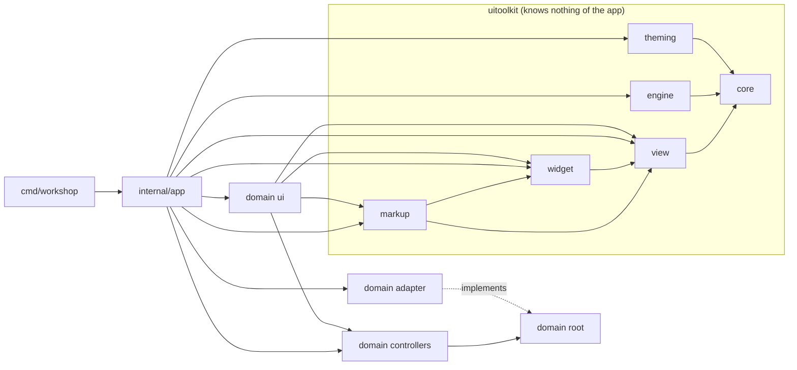
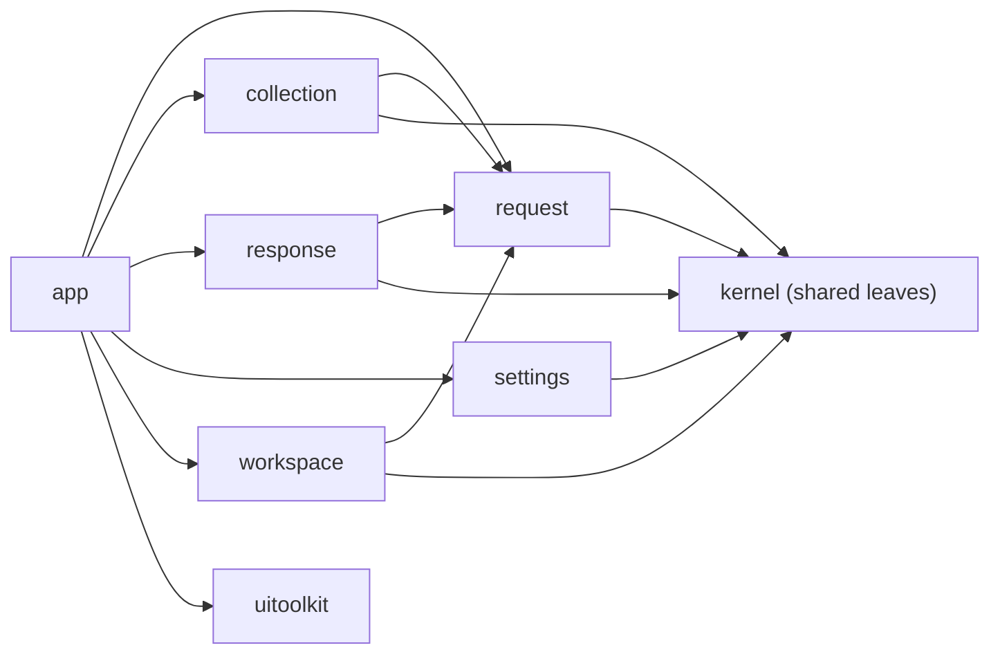

# Architecture

Start with `overview.md`; this file is the index of the detail. The layout follows the shared
`common/architecture-style.md`: each domain's root package (types and ports) is its core, `adapter` and `ui` its adapters,
the `App` its composition root. Known gaps are under Limits.

## Package layout

- Packages are `internal/<domain>/<package>`; only `ui/` and `adapter/` are zone directories. The import
  rules and their written exceptions are in `internal/CLAUDE.md`; no test checks them.
- `internal/app` is one package: Go cannot declare a method in another package, and everything
  that reads or writes the one `App` struct needs its methods. Adapters come in through `Options`.
- A feature that needs little of the `App` is its own `ui` package behind a `Host` interface the
  `App` implements, tested with a fake host: `calltrace`, `mcpform`, `sentlog`, `settingsui`,
  `colorpage`, `shortcutpage`, `systempage`, `destpicker`. Adapters reach those views through the
  host (`Host.SentStore`, `Host.FontStore`).

## Modules

One functional module per file in `architecture/`; read only the one you touch. A module is a
domain directory under `internal/` (root, controllers, `ui/`, `adapter/`) or the toolkit.

| File | Module | Owns |
|---|---|---|
| `architecture/request.md` | `internal/kernel/request`, `internal/request` | model, ports, protocols (rest, websocket, sse, mcp, grpc), assert, editor, calltrace, mcpform |
| `architecture/collection.md` | `internal/collection` | tree, environments, importers, transfer, store, client config, example server |
| `architecture/response.md` | `internal/response` | viewer, history, preview, sent log |
| `architecture/settings.md` | `internal/settings` | schema, prefs, theme, system adapters, settings dialog |
| `architecture/workspace.md` | `internal/workspace` | tabs, remembered state, bus, file browser, autosave, overlays, platform adapters |
| `internal/kernel` (see `internal/CLAUDE.md`) | `internal/kernel` | shared leaves: `severity`, `fileversion`, `userdir`, `textfmt`, `jsonview`, `openset`; documented in their package docs and in the module files that use them |
| `architecture/app.md` | `internal/app` | composition root: the `App`, its handlers and window |
| `architecture/toolkit.md` | `uitoolkit` | core, view, widgets, markup API and drawing |
| `architecture/persistence.md` | shared | formats and versions of every persisted file |
| `architecture/limits.md` | shared | limits, fuzzing, known gaps |

## Module dependencies

Every edge between the five domains is either the `request` model or a kernel leaf; `go list` shows no
other one. Nothing checks it in `make check` yet.

## Known layer gaps

- A domain root imports a sub-package of its own domain: `collection` imports `collection/clientconfig`,
  `workspace` imports `workspace/state`. 
- `internal/exampleserver` imports `request/adapter/proto/ws`; no rule covers it.
- No layer check runs in `make check`; `common/scripts/check-layers.sh` exists and is not wired
  (it needs a `.harness/layers.txt`).
