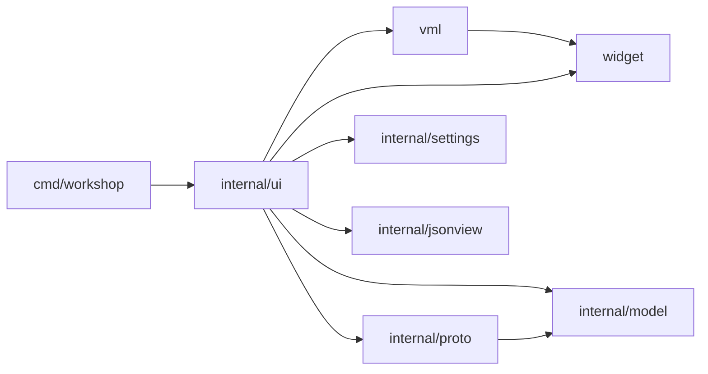

# Architecture

Status: window shell, all packages exist; the window is a first milestone (see Limits) and described as they land.



`widget` and `vml` are public packages: a reusable toolkit that knows nothing about the application (a test enforces it: `widget` imports nothing from this module, `vml` only `widget`). `internal/ui` is the application: state, handlers and the views written in VML.

| Package | Role |
|---|---|
| `cmd/workshop` | flags, window setup and run loop |
| `widget` | GPU toolkit on Ebitengine: theme tokens, drawing context, input, text field and code view state |
| `vml` | declarative view DSL: node tree, flex layout, event dispatch, `If`/`For`, ready-made Button, Tabs, Table |
| `internal/ui` | the app: state, handlers, the window as VML views, theme choices, sample data |
| `internal/model` | collections, folders, requests, responses |
| `internal/proto` | `Protocol` interface and name registry; REST, WebSocket and MCP implementations |
| `internal/settings` | user preferences (theme, text size) as JSON in the user config dir |
| `internal/jsonview` | JSON pretty-print and token spans for the response pane |

## Model and protocols

`model.Request` is protocol-neutral: `Protocol` picks the implementation, `Method` only matters for REST. `{{name}}` in a URL is expanded from the collection vars (`model.Expand`) and the params table is folded into the URL with `model.WithParams`; `model.ParamsFromURL` goes the other way (`model.MergeParams` rebuilds the table after a URL edit, keeping descriptions and disabled rows), so the URL bar and the Params table stay in sync. The caller does both before sending.

`proto.Registry` is a name-to-`Protocol` table (`rest`, `websocket`, `mcp`). `Send` returns an error only for misuse (unknown protocol, malformed method or URL). Transport failures arrive in `Response.Err` so the UI always has a value to render. `rest` uses `net/http`, keeps at most 32 MiB of body, and skips disabled header rows. The request body is encoded by a table keyed by `Request.BodyType` (`none`, `json`, `text`, `form`, `multipart`; "" sends `Body` as is with no Content-Type) which also gives the automatic Content-Type; an enabled `Content-Type` header of the user replaces it. Form and multipart bodies use the enabled, named rows of `Request.Form`. `websocket` and `mcp` are stubs answering "not implemented yet".

## Collection tree

`model.Folder` holds `[]*Folder` and `[]*Request`, so a request keeps its identity (open tabs point at it) however siblings change. `internal/model/tree.go` has the operations, all pure and tested: `UniqueName` ("x", "x 2", ... across folders and requests), `AddRequest` / `AddFolder`, `Parent`, `Contains`, `Rename` (trimmed, non-empty, unique among siblings), `Duplicate` (deep copy placed after the original as "<name> copy"), `Delete` and `Move` (into another folder, before a sibling or at the end; refused into itself or its subtree, onto a name clash, or for the root, and then nothing changes). The tree view's `treeRows` works on pointers and the expanded set is keyed by folder pointer, so renaming or moving a folder does not collapse it.

## JSON view

`jsonview.Lines(body)` pretty-prints valid JSON with two-space indent and returns one `Line` per display row, each a list of `Span{Text, Kind}` (punctuation, key, string, number, literal, plain). Lines that open an object or array are `Foldable`, which the response pane uses for its fold arrows. Invalid JSON and other text come back as plain lines, so the pane renders any body.

## widget: the toolkit

Plain values; everything except the drawing calls is tested without a GPU.

- **Theme and tokens.** A `Theme` maps color `Token`s (`Bg`, `Frame`, `Sunken`, `Alt`, `Selected`, `Chip`, `Rule`, `Text`, `Muted`, `Accent`, ...) to colors; `widget.Dark()` and `widget.Light()` are flat gray palettes with a gold accent. Applications add tokens with `Theme.With` (the app adds `method.GET`, `json.key`, ...). Unknown tokens fall back to the text color. A test checks text/surface contrast for both themes.
- **`Ctx`** is what drawing and hit-testing use: theme, fonts, this frame's `Input`, tick and scale. Everything works in logical pixels; `Ctx` primitives (`Fill`, `Text`, `Clip`, `Line`, ...) multiply by `Scale` when drawing, text measures divide by it, and `Input.Scaled` converts the pointer back. `SetScale` and `SetTheme` rebuild the fonts. This is what makes the window sharp on HiDPI.
- **Input**: `ReadInput` samples mouse (including held, for drags), wheel, typed runes, edit keys with repeat (Ctrl turns them into word-wise edits), Enter, Escape, Tab, Shift/Ctrl and the Ctrl+A/C/X/V/Z/Y shortcuts. A `Sampler` adds the click count (double and triple clicks within 400 ms and 4 px).
- **`TextField`**: single-line text with a rune cursor, a selection (shift+arrows, drag, shift+click, double click selects a word, triple click everything, Ctrl+A), word movement and deletion (Ctrl+Left/Right/Backspace/Delete), horizontal scroll that keeps the cursor visible (`Reveal`, `ScrollX`) and undo/redo with coalescing (typing and single-character deletes merge into one step; paste, cut and word deletion are their own steps; 100 steps kept). `Apply(typed, edits, extend)`, `Insert` (paste: line breaks become spaces, control characters are dropped), `DeleteSelection`, `SelectedText`, `Undo`, `Redo`.
- **`TextArea`**: the multi-line editor, a `TextField` in multiline mode plus view state (`ScrollY`, optional `Styler` for syntax colors). It keeps line breaks (CRLF and CR become LF), moves by line with a remembered goal column (Up/Down/PageUp/PageDown; past the first or last line goes to the start or end), Home/End by line and Ctrl+Home/End by document, Enter inserts a line break plus the current indentation, Tab inserts spaces to the next stop (every selected line is indented when the selection spans lines), Shift+Tab dedents, triple click selects a line. Line numbers, scrollbars (the drag and page logic is shared with `CodeView` through `barDrag`), a current-line highlight and cursor-follows-scroll. Tab belongs to the editor, so Escape leaves it. A tab character in pasted text counts as one column.
- **Scrollbars**: `Thumb`, `PosFromOffset` and `ClampScroll` are the pure math (thumb length has a 24 px minimum); `Ctx.Scrollbar` draws a thumb for a vertical or horizontal track.
- **Clipboard**: `widget.Clipboard` (read/write text). Ebitengine has no clipboard API, so `SystemClipboard()` runs the first complete pair of platform tools (`wl-paste`/`wl-copy`, `xclip`, `xsel`, `pbpaste`/`pbcopy`) with a 2 s timeout; with none installed every call fails with a hint to install wl-clipboard or xclip. No dependency is added.
- **`CodeView`**: lines of colored spans (`Span{Text, Style Token}`), a fold set, a pixel scroll and a character-level selection (drag, also across lines; double click a word, triple click a line; a click without dragging selects nothing; Ctrl+A selects all). `Find` / `SetMatches` / `RevealLine` give it search highlighting and scroll-to-line. Ctrl+C on the focused view copies the selected lines, or the whole body when nothing is selected. Long lines scroll sideways (Shift+wheel, a bottom scrollbar; the gutter stays put), a vertical scrollbar thumb can be dragged, and PageUp/PageDown/Home/End scroll while it has focus. `Visible()` hides everything from a folded line through its closing line, found by indentation. `Update` handles wheel and fold clicks; `Draw` paints with line numbers and fold arrows.
- **`Rect`** and its split helpers.

## vml: the view DSL

A view is a Go function from state to a tree of nodes, rebuilt every frame, so the tree is always a pure function of the state: no diffing and no reactive system.

Every constructor takes **attributes first, children after**, so what an element is reads before what it contains. App view files dot-import `vml` (and alias `widget` as `w`) so views read like markup:

```go
Row(H(urlH), PadXY(w.Pad, 8), Gap(8), Bg(w.Bg),
	Row(Grow(1), Bg(w.Sunken), Border(w.Border),
		chip(protocolLabel, w.Muted, 64, cycleProtocol),
		VRuleInset(8),
		Field(&t.url, Grow(1), Placeholder("Enter URL"), OnEnter(send)),
	),
	PrimaryButton("Send", W(80), OnClick(send)),
)
```

- **Items**: a constructor's arguments are `Item`s: a child `Node`, or an `Option` that sets an attribute. A nil node (a false `If`) adds nothing; options given later override earlier ones, which is how components such as `Button` let callers override their defaults.
- **Elements** (`*El`, aliased `Node`): `Row`, `Col`, `Stack`, `Spacer`, `Text`, `Caption`, `Lines`, `Field`, `TextArea`, `Code`, icons (`Checkbox`, `Cross`, `Triangle`, `Dots`) and the components `Button`, `PrimaryButton`, `Tabs`, `Table`, which are ordinary compositions of the primitives. Behaviors are values of one small interface (measure, layout, draw, update), not switch cases.
- **Options**: size (`W`, `H`, `Grow`, `Optional`), spacing (`Pad`, `PadXY`, `PadL`, `PadR`, `Gap`), look (`Bg`, `Border`, `BorderTop`, `BorderBottom`, `HoverBg`, `Lighten`, `Underline`, `Shadow`, `Clip`), text (`Color`, `Muted`, `Small`, `Mono`, `Ellipsis`, `Center`), events (`OnClick`, `OnChange`, `OnEnter`), overlays (`Float`, `Modal`).
- **Vue-like control flow**: `If`/`Either` (v-if), `For` (v-for), `Frag` (fragment). `Field(&textField)` edits state in place like v-model.
- **`Scroll(&state, ...)`**: a column taller than its box, moved by the wheel and a draggable scrollbar thumb (a click in the track pages). The app owns the `ScrollState` so the position survives the per-frame rebuild. A clipping element (`Clip`, `Scroll`) masks the pointer position for its children while the pointer is outside it, so rows scrolled out of view cannot be hit; the click flag still passes so fields can blur. A scroller that uses the wheel zeroes it, so the innermost scroller wins. The tree and the table and note panes use it; the code view scrolls itself.
- **`Split(&state, default, first, second)`**: two children around a one-pixel divider that is dragged with the pointer (a few pixels either side grab it, and the drag keeps the offset where it was grabbed). The size is pixels, or a fraction of the container with `AsRatio`; `MinFirst` / `MinSecond` clamp it, the first child winning when the window is too small for both; double click resets to the default; `Vertical` stacks instead of side by side. While the pointer is over the divider or dragging it the element asks for the resize cursor (`Ctx.Cursor`, reset every frame and applied by the app). The app owns the `SplitState`, so it survives the per-frame rebuild and can be saved later.
- **Modal overlays own the pointer**: while any visible element is `Modal` (the settings menu, a context menu, a dialog), nothing under it gets clicks, wheel or hover, a click outside dismisses it, and hover feedback (`HoverBg`, `Lighten`, scrollbar and icon highlights) is off for everything drawn outside it (`Ctx.HoverOff`, read through `Ctx.Hovered`); the overlay's own items still light up. Toasts are not modal, so they block nothing.
- **Overlay primitives**: `FloatAt(x, y)` pins a Stack child's top-left at a point, shifted left when it would stick out on the right and opened above the point when it would stick out at the bottom; `FloatCenter()` centers it; `FocusScope()` makes Tab cycle only inside that element (the topmost scope wins); `OnRightClick(f)` gives the pointer position; a `Modal` element now swallows and dismisses on right click outside it as well.
- **Layout** is a flexbox subset. Along its axis a child has a fixed size, a `Grow` share of the free space, or its content size; across it, it stretches unless it has a fixed size. `Optional` children are dropped when the row is too narrow. `Stack` layers children; a `Float(top, right)` child is pinned top-right and `Modal` makes it swallow clicks and report an outside click, which is how the settings menu works.
- **Frame cycle**: `vml.Layout`, then `vml.Update` (input goes to the top-most element first and runs handlers) or `vml.Draw`. `App.Update` and `App.Draw` each build the view, so what is drawn already reflects what the handlers just changed.

## internal/ui: the app

`ui.App` implements `ebiten.Game` and owns the state: open `reqTab`s (pointing at the collection's `model.Request`, plus URL `TextField`, active pane tabs, last `Response`, two `CodeView`s), the expanded tree folders, settings and the status line. `view.go` is the window as VML views (`sidebar`, `header`, `tabStrip`, `urlBar`, `pane`, `statusBar`); handlers are plain closures that change `App`.

- **Panes** are two tables, `requestPanes` and `responsePanes`: label, kind (table, code, note), row source, edit hook and an `empty` hook that supplies "Sending...", errors and "no response yet". A map from kind to builder turns a pane into nodes; adding a pane means adding a row.
- **URL bar**: protocol chip (REST / WS / MCP, click cycles), method chip (REST only), the URL field with `{{vars}}` colored, and Send. Editing the URL re-derives the Params table with `model.MergeParams`; toggling or deleting a param rewrites the URL with `model.WithParams`.
- **Clipboard status**: `ui` wraps the system clipboard so the status bar shows "Copied N characters" or why the clipboard failed.
- **Response pane**: a toolbar (Pretty / Raw, Find, Copy, cURL) above the code view. Pretty is the colored, foldable JSON view; Raw shows the body exactly as received. Copy puts the received body on the clipboard; cURL puts `proto.Curl` of the request (variables expanded) there. A body that is not text (`looksBinary`: a NUL byte or invalid UTF-8 in the first 8 KiB) is replaced by a size note, while the Headers and Timeline panes still work. Ctrl+F (or the Find button) opens the find bar: typing searches case-insensitively, the code view highlights every hit and the active one and scrolls to it (opening a fold that hides it), Enter / Shift+Enter or the < > buttons step through the hits with wrap-around, and Escape closes the bar before it cancels anything else. A new response redoes an open search.
- **Auth pane**: `authTypes` is the table of authentication types (None, Bearer, Basic, API key) with their fields; the pane, the stored `model.Auth` values and the masking all follow it, and each type keeps its own values when you switch. Secret fields are masked (`TextField.Masked`: bullets on screen, and copy and cut are refused) until the Show secrets row is ticked. `proto.REST` applies credentials from a table keyed by type after the headers, so they win over an `Authorization` header typed by hand; an API key goes in a header or the query. Credentials never appear in the Headers table. At send time `Request.Expanded` replaces `{{vars}}` in the URL, headers, bodies, form fields and credentials, without changing the stored request.
- **Body pane**: a row of type chips (None, JSON, Text, Form, Multipart) above an editor that fits the type: a `TextArea` for JSON (colored line by line with `jsonview.Tokenize`) and Text, the editable fields table for Form and Multipart, a note for None. The text and the form rows are kept apart, so switching types loses nothing. JSON bodies show "Valid JSON" or the parse error and a Format button (`json.Indent`, applied as an undoable edit; invalid JSON is left alone and reported in the status bar). Requests from before body types get a type inferred when their tab opens.
- **Collection tree in the UI** (`internal/ui/treeops.go`): right-clicking a row opens its context menu: a request gets Rename, Duplicate, Copy URL and Delete; a folder New request, New folder, Rename, Duplicate and Delete; the collection root only the first three. Rename and Delete use the prompt and confirm dialogs (a refused name or move is an error toast, and nothing changes); deleting closes the tabs of everything removed. The "+" button and Ctrl+T add a request to the selected folder (`App.selected`, the node last clicked or moved to). Pressing a row starts a drag: dropping on a folder moves into it, on a request inserts before it, and the row under the pointer gets a gold outline; a request opens on press, while a folder toggles when the button is released on the same row so an open folder can still be dragged. The filter box in the sidebar header narrows the tree to requests whose name or URL contains the text and the folders that hold them. While the tree has the keyboard (after clicking a row, and no text widget focused) Up/Down move the selection, Enter opens or toggles, F2 renames and Delete deletes.
- **Right-click menus** (`internal/ui/ctxmenus.go`, the tree's is in `treeops.go`): a request tab (Close, Close others, Close tabs to the right, Duplicate, Copy URL), a table row (Insert row above / below, Duplicate, Move up / down, Enable all / Disable all, Delete, all through `applyRows` so they are undoable; the placeholder row has none), every text field and text area (Undo, Redo, Cut, Copy, Paste, Select all with shortcut text and enabled states; Cut and Copy are off for masked secrets, and the model follows via the widget's change callback) and the response (Copy the selection, Copy body, Copy as cURL, Select all, Find). A right click never clears a selection or moves focus. The innermost element with a right-click handler wins: a right click is consumed by the first handler that takes it, so the cell editor shows the text menu and not the row menu under it.
- **Request tabs**: each tab has a × (the label and the × are separate click targets, so closing never also selects), middle-click closes, Ctrl+W closes; closing the last tab leaves a blank request. A tab shows a dot when its request differs from the snapshot taken when it was opened (`reqTab.saved`, compared with `model.Request.Clone`, which turns empty slices into nil so deleting rows again is clean). Pressing a tab starts a drag (`App.dragTab`); `OnHeldOver` on the tab under the pointer moves the dragged tab there, and the active tab stays the same tab.
- **Table rows** (`internal/ui/tablerows.go`): every change of a table's rows goes through `App.applyRows(pane, tab, change)`: it runs the change on a copy, ignores it when nothing differs, records the old rows for undo (100 steps per table and tab, redo cleared), stores the new rows and runs the pane's `changed` hook (the URL rewrite for Params), then drops an edit or selection that points past the rows. Toggle, delete, cell commit, the header "enable all" checkbox, bulk edit and the keyboard operations all use it. The keyboard acts on the edited row, or on the selected row (the last one edited) while its table shows: Ctrl+Enter while editing inserts an empty row below and edits it (outside editing it still sends), Ctrl+D duplicates, Alt+Up / Alt+Down move it (an edit, even uncommitted, travels with it), Delete removes the selected row when nothing is typed. Ctrl+Z / Ctrl+Y undo and redo table changes when no text widget has the keyboard; inside a cell they belong to the text. The Bulk edit button shows a table as `name: value` lines (`# ` for disabled, one space after the first colon dropped, descriptions carried over by name) in a text area and applies it as a single undoable change when you switch back, change pane or tab. Duplicate enabled header names are drawn in the error color; rows with an empty name stay in the table but are never sent.
- **Resizable table columns**: a `TableSpec` with a `Widths *vml.ColumnWidths` (owned by the app, like a scroll or split state) gets draggable dividers over its header: dragging the boundary between two columns moves weight between those two only (`vml.ResizePair`, neither narrower than `MinColumnPx` = 56, the total unchanged, evenly split when the pair is too small for two minimums), double click on a divider clears the sizes back to the spec's defaults, and the resize cursor shows over a divider. Sizes are weights, so they keep their proportions when the window resizes. The app keeps one `ColumnWidths` per table (`widthsFor`: request tables by pane name, response tables prefixed), so Params, Headers, Vars, form fields and the response headers are independent. The weights are the state task 020 will save.
- **Cell editing**: clicking a cell of an editable table starts an edit (`App.beginEdit`): the table shows a `Field` in that cell with the old text selected. Enter or a click elsewhere commits (`commitEdit`), Escape cancels, Tab / Shift+Tab commit and move to the next / previous cell, wrapping across rows. Text typed into the placeholder row creates a row (enabled); an empty placeholder adds nothing. Params edits rewrite the URL through the pane's `changed` hook.
- **Layout**: the window is a `Split` of the sidebar and the main column (default 259 px, minimum 160, the main column keeps at least 420), and the request and response panes are a ratio `Split` (default one half, minimum 220 each). The settings menu has a Request / response choice, Side by side or Stacked, saved as `layout` in the settings file.
- **Cancel and timeout**: while a request runs the Send button reads Cancel and Escape cancels it, in this order of priority: close the menu, cancel a cell edit, cancel the request (`cancelSend`). Each tab numbers its sends (`reqTab.seq`); a result whose number is no longer current (cancelled or replaced) is dropped. The timeout is the request's `TimeoutSec`, else `settings.TimeoutSec` (default 60), else a minute. `proto.REST` reports a stopped request as `Cancelled` or `Timed out`, and `Request.NoRedirects` stops it at the first redirect. Both options live in the request's Settings pane.
- **Sending**: `App.send` expands `{{vars}}` from the collection and calls `proto.Registry.Send` in a goroutine with a 60 s timeout. The result returns over a channel and is applied in `Update`, so UI state is only touched from the game goroutine.
- **Focus and shortcuts**: text fields and code views are the focusable elements. Tab / Shift+Tab (`vml.Update`) move focus through them in tree order, wrapping; a focused field that handles Tab itself (a cell editor) keeps it. The focused element draws a gold outline. Global key bindings are the `shortcuts` table in `internal/ui/shortcuts.go` (name, key, modifiers, action): Ctrl+Enter send, Ctrl+L focus URL, Ctrl+T new request, Ctrl+W close tab, Ctrl+Tab / Ctrl+Shift+Tab next / previous tab, Ctrl+, settings. A binding fires only when its modifiers match exactly, so plain keys never trigger anything; the settings menu lists the table.
- **Overlays**: the window's Stack ends with, from bottom to top, the settings menu, a context menu, a dialog (with a dimmed scrim) and the toasts. `App.openMenu(x, y, items)` shows a context menu (`menuItem`: label, shortcut text, disabled, separator, action) that closes on a pick, an outside click or Escape and is driven by Up / Down (skipping separators and disabled rows, wrapping) and Enter; the action runs after the menu closes so it can open another overlay. `App.confirm` and `App.prompt` open a modal dialog whose Enter runs the primary button, Escape or a click outside cancels, and whose text field (prompt) starts focused with its text selected; Tab stays inside it. While a menu or dialog is open the global shortcuts are off. `App.toast(text, isErr)` shows a message above the status bar: info toasts fade after 3 s (the clock is `App.now`, replaced in tests), errors stay until clicked, at most five are kept. Clipboard failures and settings save failures are error toasts; a successful copy is still a status line. Escape closes, in order: context menu, dialog, settings menu, cell edit, find bar, running request.
- **Configurable shortcuts** (`internal/ui/keybindings.go`): every entry of the `shortcuts` table has a stable `id`; its default is the table row, a user binding is `settings.Shortcuts[id]` as a key string (`Ctrl+Shift+Tab`: modifiers in any order when parsing, written Ctrl, Alt, Shift; `""` is unbound; unknown ids and unparsable values are ignored). `App.bindingOf` is the one place that resolves a binding, and `runShortcuts`, the settings list, the context menus' shortcut text (`shortcutHint`) and the key handling all read it. In the settings menu each action shows its key as a button: click it and the next combination is recorded (`recordKey`); modifier keys alone are waited out, Escape cancels, Backspace unbinds, and anything else goes through `checkBinding`, which refuses what the text widgets own (Ctrl+A/C/V/X/Z/Y, Ctrl+Shift+Z), plain Escape, plain keys other than F1-F12 and Delete (they would fire while typing) and a combination another action has (naming it). A refusal shows a note under the row and recording continues. A binding equal to the default is not stored, Reset removes an override, and while recording no shortcut or tree key fires. The settings menu is now a `Scroll` with `MaxHeight`, so it scrolls in a short window.
- **Colors and contrast** (`internal/ui/colors.go`, `colorui.go`): `ThemeWith(settings)` builds the theme: the chosen theme and text size, then, when Contrast is High, the selection, find-match, active-match and accent colors moved (by `widget.EnsureContrast`, toward black or white) until their text reaches a 7:1 ratio, then the user's overrides for that theme. An override is ignored unless it parses as `#rrggbb`/`#rgb`, names one of the four customizable tokens (`customColors`: token, label, the text drawn on it) and reaches the required ratio (4.5:1, 7:1 in High); each theme keeps its own overrides in `settings.Colors[theme][token]`. The settings menu has the Contrast chooser and, per color, a swatch (it paints with the token, so it always shows the color in effect), a hex field and a Reset button, plus Reset colors; typing applies live and saves, a refused color shows why (`Contrast 2.1:1 is below 4.5:1` or `Use #rrggbb`) and changes nothing. Switching theme or contrast rebuilds the fields from the colors then in effect. `widget` has the helpers `ParseHex`, `FormatHex`, `ContrastRatio` and `EnsureContrast`.
- **Settings menu**: the three-dot button toggles a modal VML overlay with Theme (Dark / Light) and Text size (Small / Medium / Large). Choices are tables (`themeChoices`, `textSizeChoices`), so a new theme is one row. A change calls `Ctx.SetTheme` and saves `internal/settings` to `<user config dir>/gascoigne-workshop/settings.json`; `-settings PATH` overrides the file and an empty path keeps settings in memory. Unknown ids in the file fall back to dark / medium. Escape or an outside click closes the menu.
- **Screenshot mode**: `workshop -screenshot out.png [-send] [-menu] [-settings FILE]` renders after a short settle, writes the PNG and exits (`make shot`). It is how UI changes are checked without a person at the window.

## Limits (milestone 1)

- The URL, the Params, Headers, Vars and form-field cells, and the JSON and text body are editable. Multipart sends text fields only (no files). Copy and paste work in the URL field and the code views; no IME, no word-wise movement, no double-click word selection, and the code view selects whole lines only.
- No saving or loading of collections; the sample collection is built in (`ui.SampleCollection`).
- No text wrapping in the code view. Fractional scales round logical text metrics to whole pixels.
- VML is Go-native only; there is no template syntax or parser. One could be added later as a front end that emits the same nodes.
- WebSocket and MCP are registry stubs.
