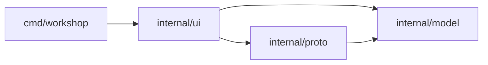

# Architecture

Status: scaffold only. Packages below are planned and described as they land.

| Package | Role |
|---|---|
| `cmd/workshop` | window setup and run loop |
| `internal/ui` | theme tokens, layout, widgets, screens |
| `internal/model` | collections, folders, requests, responses |
| `internal/proto` | `Protocol` interface and name registry; REST, WebSocket and MCP implementations |
| `internal/jsonview` | JSON pretty-print and token spans for the response pane |
