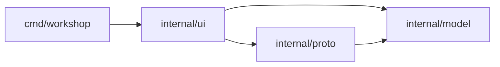

# Architecture

Status: window shell, all packages exist; the window is a first milestone (see Limits) and described as they land.

| Package | Role |
|---|---|
| `cmd/workshop` | window setup and run loop |
| `internal/ui` | theme tokens, layout, widgets, screens |
| `internal/model` | collections, folders, requests, responses |
| `internal/proto` | `Protocol` interface and name registry; REST, WebSocket and MCP implementations |
| `internal/jsonview` | JSON pretty-print and token spans for the response pane |

## Model and protocols

`model.Request` is protocol-neutral: `Protocol` picks the implementation, `Method` only matters for REST. `{{name}}` in a URL is expanded from the collection vars (`model.Expand`) and the params table is folded into the URL with `model.WithParams`; `model.ParamsFromURL` goes the other way (`model.MergeParams` rebuilds the table after a URL edit, keeping descriptions and disabled rows), so the URL bar and the Params table stay in sync. The caller does both before sending.

`proto.Registry` is a name-to-`Protocol` table (`rest`, `websocket`, `mcp`). `Send` returns an error only for misuse (unknown protocol, malformed method or URL). Transport failures arrive in `Response.Err` so the UI always has a value to render. `rest` uses `net/http`, keeps at most 32 MiB of body, and skips disabled header rows. `websocket` and `mcp` are stubs answering "not implemented yet".

## JSON view

`jsonview.Lines(body)` pretty-prints valid JSON with two-space indent and returns one `Line` per display row, each a list of `Span{Text, Kind}` (punctuation, key, string, number, literal, plain). Lines that open an object or array are `Foldable`, which the response pane uses for its fold arrows. Invalid JSON and other text come back as plain lines, so the pane renders any body.

## UI primitives

Everything here is a plain value, tested without a GPU.

- `Theme` (`DarkTheme()`): colors, method colors, JSON syntax colors, font sizes, row height. Widgets read tokens from it, never literals.
- `Rect` and `Compute(w, h) Layout`: pure rect arithmetic. The window is a sidebar, a header, a request-tab strip, a URL bar, a request pane and a response pane side by side, and a status bar. Regions tile the window exactly (tested).
- `TextField`: single-line text with a rune cursor. `Apply(typed, edits)` inserts runes, then runs backspace/delete/arrows/home/end.
- `treeRows`: flattens a `model.Folder` into the visible rows given the expanded folder paths. Request rows alias the tree's request, so an open tab edits the collection's own value.
- `CodeView`: lines from `jsonview`, a fold set and a pixel scroll offset. `Visible()` hides everything from a folded line through its closing line, found by indentation.
- `formatDuration`, `formatSize`: status strings such as `1.4s` and `156.67KB`.

## Window shell

`ui.App` implements `ebiten.Game`. `Layout` receives the window size in logical pixels and returns it times the monitor's `DeviceScaleFactor`, so the screen is sharp on HiDPI. All layout, hit-testing and widget code works in logical pixels; only `Ctx` drawing primitives (`fill`, `text`, `clip`, `line`, ...) multiply by `Ctx.Scale`, text measures divide by it, and `Input.scaled` converts the pointer back. `Ctx.SetScale` rebuilds the fonts when the scale changes, e.g. when the window moves to another monitor. `Update` reads one `Input` snapshot, applies finished sends, then lets each region handle clicks and keys; `Draw` paints the same `Compute` layout. Hit-testing and drawing share geometry helpers (`tabRects`, `tableCols`, `urlBar`) so they cannot drift apart.

- **Open requests** are `reqTab`s pointing at the tree's `model.Request`, plus per-tab UI state (URL `TextField`, active pane tabs, last `Response`, two `CodeView`s). `+` opens an unsaved blank request.
- **URL bar**: protocol chip (REST / WS / MCP, click cycles through the registry names), method chip (REST only, click cycles), the URL field and Send. `{{vars}}` are colored. Editing the URL re-derives the Params table with `MergeParams`; toggling or deleting a param rewrites the URL with `WithParams`.
- **Panes** are two tables, `requestPanes` and `responsePanes`: label, kind (table, code, note), row source, edit hook and an `empty` hook that supplies "Sending...", errors and "no response yet". Adding a pane means adding a row, not a switch case.
- **Sending**: `App.send` expands `{{vars}}` from the collection and calls `proto.Registry.Send` in a goroutine with a 60 s timeout. The result returns over a channel and is applied in `Update`, so UI state is only touched from the game goroutine.
- **Screenshot mode**: `workshop -screenshot out.png [-send]` renders after a short settle, writes the PNG and exits (`make shot`). It is how UI changes are checked without a person at the window.

## Limits (milestone 1)

- Only the URL is editable; table cells, body and headers are display-only (checkbox and delete work). No clipboard, selection or IME.
- No saving or loading of collections; the sample collection is built in (`ui.SampleCollection`).
- No text wrapping in the code view. Fractional scales round logical text metrics to whole pixels.
- WebSocket and MCP are registry stubs.
