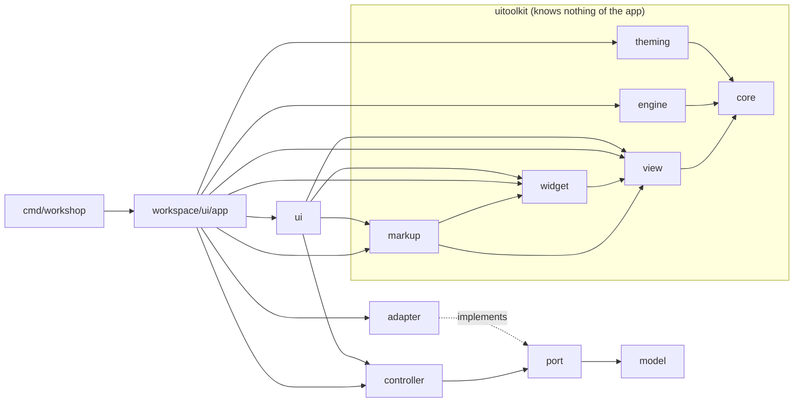

# Architecture

Start with `overview.md`; this file is the index of the detail. The layout follows the shared
`common/architecture-style.md`: `model` and `port` are its core, `adapter` and `ui` its adapters,
the `App` its composition root. Known gaps are under Limits.

## Package layout

- Packages are `internal/<domain>/<role>/<package>` (decision 11). The tree is `packagemap.md`;
  the import rules are in `rules.md` and enforced by `internal/layers_test.go` and
  `uitoolkit/core/layers_test.go`, with no exceptions.
- `workspace/ui/app` is one package: Go cannot declare a method in another package, and everything
  that reads or writes the one `App` struct needs its methods. Adapters come in through `Options`.
- A feature that needs little of the `App` is its own `ui` package behind a `Host` interface the
  `App` implements, tested with a fake host: `calltrace`, `mcpform`, `sentlog`, `settingsui`,
  `colorpage`, `shortcutpage`, `systempage`, `destpicker`. Adapters reach those views through the
  host (`Host.SentStore`, `Host.FontStore`).

## Index

One file per area in `architecture/`; read the one you touch.

| File | Area |
|---|---|
| `architecture/model-and-protocols.md` | Model and protocols |
| `architecture/example-server-and-client-config.md` | Example server and client config |
| `architecture/collection-tree.md` | Collection tree |
| `architecture/json-view.md` | JSON view |
| `architecture/core.md` | core: the toolkit |
| `architecture/view.md` | view: the view DSL |
| `architecture/app.md` | workspace/ui/app: the app |
| `architecture/toolkit-api.md` | Toolkit: API and templates |
| `architecture/toolkit-widgets.md` | Toolkit: widgets and drawing |
| `architecture/look.md` | Look |
| `architecture/requests.md` | Requests |
| `architecture/protocols.md` | Protocols |
| `architecture/responses.md` | Responses |
| `architecture/collections-and-environments.md` | Collections and environments |
| `architecture/settings.md` | Settings |
| `architecture/files-state-and-platforms.md` | Files, state and platforms |
| `architecture/persistence.md` | Persistence |
| `architecture/limits.md` | Limits |
