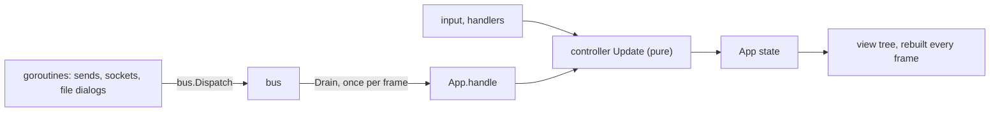

## internal/app: the app

`app.App` implements `ebiten.Game`, owns the window state and is the composition root's runtime
half: `cmd/workshop` builds the adapters, the `App` wires them to the controllers and views. Its
fields are grouped by concern in embedded structs (`appstate.go`); the per-tab widget state is a
`reqTab` beside each `tabs.Tab`.

### State changes

A domain with a controller changes its state through Model, Msg, Update and Cmd (the user's
choice); the `App` changes the rest directly in its handlers. `Update` is pure: no I/O, goroutine or
clock. A UI handler applies its message at once, because the next line needs the new state; the bus
carries only what goroutines report. `Update` may type-switch on its message, the one place where
"table over switch" yields. `prefs` messages may carry functions: the page decides what changes, the
App owns the settings. Accepted gaps: settings `Persist` and image decoding stay on the UI
goroutine. Rejected: signals, React-style diffing, more controllers behind closures.

- **Bus** (`feature/workspace/bus`): the only path from a goroutine to the UI. Goroutines read
  only fields that never change after `NewApp` (the bus, the ports). A one-shot send is a `Cmd` run
  by `Bus.Run` whose result (`sends.Result`) comes back as a message. A connection emits many events,
  so its goroutine dispatches `wsOpened`/`wsFailed` and each `wsReceived` itself and returns
  `wsClosed` as its `Cmd` result; a retry dispatches `wsRetry` from a timer. A dispatched `func()` runs on the UI goroutine (file dialog answers, the
  gRPC method menu, MCP sampling dialogs (`mcp.Component.Sample`), `prefs.Later`).
- **Request edits** (`feature/send/requestedit`): no code outside `requestedit` assigns to a field of a
  tab's request. `editRequest` writes the result into the collection's own request, so the
  sidebar, the autosave and the dirty dot see it at once. The gRPC stream flag is tab state, not
  part of the request: it is kept by `ui/editor/grpc`. Renames and moves are tree operations (`tree.Update`, `treeops.go`).
- **Tab list** (`feature/workspace/tabs`): is `App.tabs`, a `tabs.Set` (owner of the open tabs and the current one; `Current()` is nil only before
  the first `Open`, closing the last tab leaves a blank one). It changes only through `Set.Apply` (a
  wrapper of the pure `tabs.Update`), and `App.updateTabs` is its only mutating caller: after each
  change it creates the widget state of tabs that appeared, drops the state of tabs that went
  (ending an inline edit, cancelling the send, closing the socket) and reveals the request. That sync
  is not a Set callback because the App must see which tabs left. Any tab change selects its
  request in the tree and opens the folders above it (`App.revealRequest`).
- **Table rows**: every change goes through the `ui/editor/kvtable` component's `applyRows`, which keeps
  the undo history (`tabs.HistoryLimit` steps per table and tab, on `tabs.Tab`) and asks the App to run the
  pane's `changed` hook (Params rewrite the URL). Menus, keys, drag and bulk edit all use it.
- **Sending**: `App.dispatch` expands `{{vars}}` (`Request.Expanded`, the stored request stays as
  typed) and runs `protocol.Registry.Send` as a `Cmd` returning a `sends.Result`. The store
  `feature/send/sends` (`App.sends`) holds the sends in flight, keyed by the tab's request (a controller
  of feature send may not import `tabs`), with one counter for the whole store: a number is never reused,
  so a result whose send was cancelled, or whose tab closed, is dropped even when the same request opens
  again. `Begin`, `Accept`, `Cancel` and `Sending` are the only way to start, end or ask; `cancelSend`
  also shows the cancellation as the response. Timeout: the request's, else `settings.TimeoutSec`, else a minute.

### Window

The window is VML views (`window.go`, `tree_sidebar.go`);
the settings dialog is the component `ui/overlays/settingsdialog` (`App.prefs`, built in `NewApp`): it owns whether the dialog is open, whether settings were changed but not written (auto-save off), the file question it asked, the shell and the Form, Colors and Shortcuts pages. It asks `settingsHost` (`window_hosts.go`) for the settings in effect and their effects (`Edit` and `Apply` rebuild the theme, the response mode of the open tabs and the protocols; `SetScale`), the window (size, pointer, toasts, status, menus, redraw), the file chooser, the one dialog, the bus, the looks and the keymap; the file, its store and whether it may be written (`settings.ReadOnly` after a newer build wrote it) are values it is built with. `App.changeSettings` and `App.saveSettings` forward to it. `prefs.Poll` is called every `PollTicks` frames from `endFrame`;
the bar above the request pane is the component `ui/editor/urlbar` (`App.urlbar`, built in `NewApp`): it owns the URL field of every open tab (a map pruned in `Tick`), the protocol, method and Stream chips and the Send, Connect and Cancel button, and asks `urlbarHost` (`window_hosts.go`) for the current tab, the sends, the connection, the gRPC method and stream, the protocols the chip offers, the variable colors and tooltip, and the hints. The Params table rewrites the URL through `urlbar.Reload` (the pane's `changed` hook takes the `App`); `Field` serves the variable completion and `Type` the driver;
the Body and Schema panes are the component `ui/editor/body` (`App.body`, built in `NewApp`): it owns, per open tab, the JSON/Text area (also the GraphQL query editor, which `ui/editor/graphql` reaches with `body.Area`), the file path field, the type chips' scroll, what the disk said about the path and the gRPC message schema, in a map of pointers made from the request's `Body` on first use and pruned in `Tick`. It asks `bodyHost` (`window_hosts.go`) for the current tab, the form table, the GraphQL editor (answered with `graphql.View`) and a status line (its `Slots`, since siblings never import each other), the variables, the disk check and file chooser, the message schema of a gRPC method (the host expands the variables and applies the timeout) and window actions (commit a cell edit, show the Body pane, set the status). `body.Keys` claims keys like `urlbar.Keys`; the pane table (which tab has which pane) stays in the App, which calls `body.View` and `body.SchemaView`; `Fill body` writes into the area and shows the Body pane. The variable colors of the area, the URL and the table cells are one helper, `theme.VarSpans`;
the Auth pane is the component `ui/editor/auth` (`App.auth`, built in `NewApp`): it owns, per open tab, the text field of each auth field and whether secrets are shown (a map of pointers made from the request's `Auth` on first use and pruned in `Tick`), and the two prompts that go with sending: `Allowed`, the trust prompt (asks once per command and per file outside the collection, and remembers the answer), and `ShowCookies`, the cookie dialog opened from the tab menu. The jar, the protocol registry (`newRegistry`, `options.go`) and the trusted set stay in the App and reach the component through `authHost` (`window_hosts.go`): `Clear` swaps the jar and rebuilds the registry. `auth.Typing()` feeds `textFocused`; there is no `auth.Keys`. The App calls `auth.View` for the pane and `auth.Allowed` before a send or a connect.

The request's Tests and Settings panes and the response's Tests pane are the component `ui/editor/assertions` (`App.assertions`, built in `NewApp`): it owns, per open tab, the tests area, the timeout field and the results of the last check (a map of pointers made from the request on first use and pruned in `Tick`; the request stays the stored source of truth, every edit writes back through `requestedit`). It asks the App through `assertionsHost` (`window_hosts.go`): the current tab, where a captured value is kept (the active environment, else the collection's variables), the status line and the default timeout. It draws the request's Tests and Settings panes (`View`, `SettingsView`) and the response's Tests pane (`ResultsView`, which the App hands the tab's response scroll), and `Run` checks a response after a send: results kept, captures stored, summary added to the status line of a response that did not fail. `assertions.Typing()` feeds `textFocused`; there is no `assertions.Keys`.

the Messages pane (the log of a socket's traffic, its toolbar and the composer) is the component `ui/editor/ws` (`App.ws`, built in `NewApp`): it owns, per open tab, the log (a code view that follows its end) and the composer field, in a map of pointers made on first use and pruned in `Tick`. The connection itself stays in `workspace/tabs` (`tabs.Connection`: state, session, the tools, resources and prompts an MCP server announced, the auto-reconnect policy); the pane reads it from the tab and writes only the policy. The lifecycle stays in the App (`request_send.go`: connect, disconnect, retry, the goroutines and the `ws*` messages), because it serves gRPC streams and MCP too and needs the auth gate, the call log and the status line; it reaches the log through `ws.Log` and `ws.Note`. `wsHost` (`window_hosts.go`) answers the current tab, the ordered send queue (`sendInOrder`), the tool form (`mcp.OpenToolForm`, which fills the composer through `ws.ComposeCall` or `ws.SetComposer` by way of `mcpHost`), menus and toasts, and how a protocol composes (`protocolView.composer`, a `ws.Composer`: whether there is a field, whether it offers `{ }`, its hint). `ws.Typing()` feeds `textFocused`; there is no `ws.Keys`. `ws.StateText` is the connection bar's wording, which the MCP explorer header reuses through `mcpHost.Looks`. The message log has no bound yet.
the GraphQL editor of a GraphQL body is the component `ui/editor/graphql` (`App.graphql`, built in `NewApp`): it owns, per open tab, the variables area (made from the request's `GraphQLVars` on first use) and the schema the last introspection answered (not saved), in a map of pointers pruned in `Tick`; the query is the body's text area, reached through `Deps.Query` (`*body.Component`), so its text and undo history carry across a change of body type. Edits write back through `requestedit` (`BodyTyped`, `VarsTyped`, `OperationChosen`). `Load schema` builds the introspection request in the component and `graphqlHost.Dispatch` (`window_hosts.go`) sends it through `App.dispatch`, so it uses the tab's URL, headers and credentials; `apply` (`request_send.go`) hands every answer to `graphql.Remember`, which keeps a schema only for a GraphQL body and an answer that parses. `graphqlHost` also answers the current tab, which tabs are open and menus. `graphql.Typing()` feeds `textFocused` (the query area is `body.Typing()`'s); there is no `graphql.Keys`.
the gRPC method picker, the Stream switch and the Proto pane are the component `ui/editor/grpc` (`App.grpc`, built in `NewApp`): it owns, per open tab, whether the tab streams (not saved), whether the Proto pane's file lists show, the text fields of the path rows and what reading the proto files found, in a map of pointers made by the pane or by a click and pruned in `Tick`. The request stays the source of truth for the paths (`requestedit.ProtoPath*`, `MethodChosen`); a row's field is made again when its text no longer stands for the request's path. Drawing the Proto pane while files show starts a background read of them (`Methods.List`), and an answer for an older source is not shown. `grpcHost` (`window_hosts.go`) answers the gRPC client (`listGRPCMethods`, off the UI goroutine with the request's timeout), the variables and the collection folder, the file chooser, `disconnect`, menus, toasts and the status line. `App.isSocket` and `App.responsePanesFor` ask `grpc.Streaming`, so a stream turned on shows the Messages pane and a Connect button; `App.protoReading` (the driver waits for the Proto pane) asks `grpc.ProtoPending`. The path fields are not part of `textFocused`, as before; there is no `grpc.Keys`.
the MCP explorer, the tool call form and the sampling dialog are the component `ui/editor/mcp` (`App.mcp`, built in `NewApp`; the argument form is its child `mcp/mcpform`): it owns, per open tab, the list shown, the open entry, the form of its arguments, its answer and the scrolls, in a map of pointers made by the pane or by a click and pruned in `Tick`; an answer writes into the state the call was made from, so a tab closed meanwhile gets no new state. What the server announced, its description and the session stay in `tabs.Connection` and are only read. The call runs through `Deps.Bus.Run` (`mcpHost.Run` wraps `bus.Run`), so the answer is applied on the UI goroutine. The tool call dialog opened from the composer keeps its form in the closures of the dialog: `mcpHost.Open` sets `App.dialog` from a `widget.DialogState` and a content func and returns a closer that clears only that dialog, and `mcpHost.Busy` tells the sampling request to wait while one is open; `dialog` no longer carries a form. `Component.Sample` is the `request.Sampler` handed to the protocol registry (`newRegistry`); it runs on the session goroutine and touches only `Deps.Bus.Dispatch` and its own channels. `mcpHost.Looks` answers `ws.StateText`, `respview.CodeLines` and `respview.RawLines`, siblings the package may not import; the host answers with exactly the functions the pane used before it moved. Enter in a field of the explorer's form calls the open entry and in the dialog's form fills the composer: each form has its own `mcpform.Host`, so the App is no longer the host of a form. The explorer's fields are not part of `textFocused`, as before; there is no `mcp.Typing` or `mcp.Keys`.
the response panes are the component `ui/response` (`App.resp`, built in `NewApp`): it owns, per open tab, the code view of the body with its wrap flag, the picture of an image body, the view mode and find bar (`viewer.Model`), the unfiltered compact lines and the find field (a map of pointers made on first use with the mode `settings.ResponseView` names, and pruned in `Tick`). It draws the contents of the four response panes (`View` for `Body`, `Headers`, `Timeline` and `Tests`, the last through its `Slots`, which `responseHost` answers with `assertions.ResultsView`) and the status pill (`StatusView`, the strip's extra); the App keeps the strip, the badges, the "Sending..." or error message that replaces a pane and `respTab`, `respScroll` and `respTabsX` on the tab, which the stream panes of a socket tab share. `responseHost` (`window_hosts.go`) answers the current tab, the Tests pane, the column widths of the Headers table (the record `kvlogic.ResponseHeaders` of `kv`, persisted with the others) and its cell colors, the file chooser and the write of a saved body, the cURL command and the browser preview, window actions (commit a cell edit, show the Response pane, open a menu, toast), the hints and the settings (`ResponseView`, the clock). `Refresh` rebuilds the lines after a response, `SetMode` changes the mode (the setting applies to every open tab), `OpenFind`, `CloseFind` and `Find` drive the find bar (the `find` shortcut row, Escape and the driver), `ClearView` empties the lines when a send is cancelled. `resp.Typing()` feeds `textFocused` and `resp.Keys` claims keys like `urlbar.Keys`, while the find field has the keyboard;
the request tab strip is the component `ui/tabstrip` (`App.strip`, built in `NewApp`): it owns its scroll, ends a tab drag on release in `BeginFrame` (called in `beginFrame` before `kv.BeginFrame`), and asks `tabstripHost` (`window_hosts.go`) for the tabs (`Update` is `updateTabs`), the dirty and stripe marks, the tab menu (still built by the App), a new request and the hints; the drag index stays in `tabs.Set`;
the status bar is the component `ui/statusbar` (`App.bar`, built in `NewApp`; it reads the status line and opens the log and the welcome dialog through its `Deps`), the fixed widths and `StatusH` are `ui/sizes`, and the status line is `workspace/notice` (`App.notices`); the toasts are the component `ui/overlays/toasts` (`App.toasts`, answered by `toastsHost` in `window_hosts.go`); handlers are closures that change the `App`. Panes are tables, not switches:

- `requestPanes`, `connectionRequestPanes`, `grpcRequestPanes` and `responsePanes` list the tabs;
  `paneBuilders` maps a pane kind to its view. A new pane is a row.
  The table stays in `internal/app` for now. Moving it to `ui/editor` (with a dump test of the
  composite) is deferred until the tasks that follow the MCP pane (042 to 045) are done: its
  response-side rows would need a sibling import of `ui/response`, and every row is an `App` method
  over `reqTab` fields that those tasks remove.
- `protocolViews` has one row per row of `request.Protocols`, in the same order (a test checks it):
  the UI half of a protocol (its panes, its composer, whether settings offer it). The protocol chip
  cycles the offered rows; SSE and gRPC are offered once their `experimental` setting is on.
- Auth: `authTypes` (in `ui/editor/auth`) drives the pane, the stored `request.Auth` and masking. `protocol.REST` applies
  credentials after the headers, so they win over a typed `Authorization` header; they never show
  in the Headers table. Secret fields refuse copy and cut.
- Body: the text and the form rows are kept apart, so switching body type loses nothing.
- Each open collection has a color (`theme.CollectionToken`, tokens `collection.0`-`.5`,
  repeating): a stripe on its tabs and its root row.

### Key-value tables in the UI

The Params, Headers, Vars and form-field tables are the component
`ui/editor/kvtable` (`App.kv`, built in `NewApp`) with its decisions in `kvtable/logic` (`Kind`, `Table`, `Cell`,
`NextCell`, `SetCell`, `Settle`, `Target`). It owns the cell edit, the bulk edit, the selected and the dragged
row and the column widths; each of the first four is one slot that remembers its table and so its tab (not a map
per tab: that would allow an edit open in two tabs), the widths are one record per `Kind`, shared by every tab
(persisted under `Kind.Key()`; the response Headers table, drawn by `ui/response`, keeps its widths in the `ResponseHeaders` record). `kvtable.Deps` (`Tables`, `Tabs`, `Menus`, `Secrets`, `Styles`) is answered by
`kvtableHost` in `window_hosts.go`, which finds the rows through `tablePanes`, runs the pane's `changed` hook
and says which table `Visible` is. Per frame: `BeginFrame` ends a row drag on release; `Tick` (after the view
is built) drops a closed tab's edit, commits an edit whose field lost focus, applies the bulk text of a table
that is no longer showing, and returns whether it changed the view (the App then marks the tree stale).
`commitEdit` in the App is a thin wrapper of `kv.Commit` that ~15 callers use before they change the tab or rows.

### Collection tree in the UI

The sidebar is the component `ui/sidebar` (`App.side`, built in `NewApp`). It owns the filter, the sent log, the
scroll and the tree state `ui/sidebar/logic.Tree`: the selected node, the open folders (a map keyed by folder
pointer, read once per row per frame), who has the keyboard and the drag. `Drag.Phase` (idle, pressed, dragging)
is computed from its fields, so no flag can disagree with them. Its menus and keys ask the App through the
narrow interfaces of `sidebar.Deps`, which `sidebarHost` and `collectionHost` (`window_hosts.go`) answer;
node work (`applyTree`, rename, delete, duplicate, `transferNode`, the destination picker) stays in `treeops.go`.
The open set and the operations on whole collections are `collections.Library` (`App.cols`): it owns the `Set`,
runs open, restore, create, rename, delete, locate, close and move through the `Store` port and writes the
remembered list; it raises no prompt or toast, so the prompts and confirmations (`window_hosts.go`), the toasts
(`App.toastError` shows a Library error with its first letter upper-cased) and tab teardown (`workspace.go`) stay
in the App. The clipboard imports are `sidebarHost.Import`: `ui/sidebar/logic.Importers` (a table by kind)
parses and `Imported.Attach` puts the result into the tree; export (`exportPostman`) is in `treeops.go` and asks through `pickFile`. A drag is resolved in
`beginFrame` (`side.BeginFrame`): a release over another row builds `transfer.Drop` and `App.transferNode`
applies it, in one collection or across two; Alt
copies (the user's choices and what was rejected: the `transfer` package doc). Across collections:

- the target is written before the source (`flushMoved`); a failed target write leaves the source
  on disk and shows an error toast;
- variables are never rewritten; a toast names those the node uses that the target does not define
  (`transfer.MissingText`);
- a moved request keeps its tab (same pointer); a copy is a new request without a tab.

The drop outline is the row's `DropBorder` token, empty when not the target.

### Keyboard, focus and overlays

- **Focus**: `core.Ctx.FocusOwner` is the one owner of the keyboard. The app asks for focus by
  setting a state's `Focused`; `view.Update` makes the last asker the owner and blurs the rest, so
  no code clears the old owner by hand.
- **Keys**: `routeKeys` (`game.go`) reads whether a shortcut was being recorded (`prefs.Recording`) before the overlay takes the frame's keys, then gives them to the overlay, the sidebar (`sidebar.Keys`:
  Up, Down, Enter, F2 and Delete while the tree has the keyboard; its result is not read yet, the shortcuts
  still run in that frame), the URL field and the body (`urlbar.Keys`, `body.Keys`, `resp.Keys`, each of which claims only while the current tab's field or area has the
  keyboard: Undo and Redo, which keep the table's undo from running while a user binding on them still fires, and a
  frame of typing keys, `engine.Binding.TypesText`, which skips the shortcuts; Escape, Ctrl+Enter, Ctrl+L and
  Ctrl+Space are never claimed), the settings dialog (`prefs.Keys`: the recorded key while a shortcut is recorded, the arrow keys and Enter of the Shortcuts page while it is shown; it swallows the frame's keys when it answers), else the keymap (`runKeymap`, skipped while an overlay is open or the frame's keys were typing; an Undo or Redo claim does not skip it, so a user binding on them still fires) and, after the keymap and only when no text field claimed, the table undo (`kvtable.Keys`, offered last, claims Ctrl+Z and
Ctrl+Y for the showing table unless text has the keyboard: `textFocused` asks `urlbar.Typing()`, `resp.Typing()`, `body.Typing()`, `graphql.Typing()`, `auth.Typing()`, `assertions.Typing()`, `ws.Typing()` and `kv.Typing()`), in that order. The `send` and `focus-url` rows (`App.commands`, `app.go`) call `urlbar.Send` and `urlbar.FocusURL`; their ids and defaults are declared there. The claims are not exclusive and the table undo is not moved before the keymap: a user who binds Ctrl+Z or Ctrl+Y would otherwise lose the binding. Escape is skipped for a frame that began recording and closes one layer per press, the topmost in
  `feature/workspace/overlay`'s order, ending with cancelling a running request.
- **Shortcuts**: every component declares the actions it offers in its `commands.go`
  (`Commands() []keymap.Command`: a stable id, a name, a default chord, what to do): `tabstrip`, `kvtable`,
  `sidebar` and `response`; the `App` offers the rows that reach across components (`send`, `focus-url`,
  `delete-row`, `complete-variable`, `save`) in `App.commands` (`app.go`), which also fixes the
  display order; the settings dialog offers `settings` (`settingsdialog.Component.Commands`), last. A user binding is `settings.Shortcuts[id]`, stored only when it differs from the default.
  `keymap.Resolve` (`feature/settings/keymap`) is the one place a binding is resolved: `App.keymap()` derives it
  from the settings and the commands where it is read (once per frame with keys, once per hint or page draw), and
  the key runner (`runKeymap`), the tooltips' shortcut text and the Shortcuts page read that one answer. A binding fires only when its modifiers match exactly. A
  plain-key binding is allowed but held back while a text field has focus. The editor is
  `ui/overlays/settingsdialog/shortcutpage` (Settings).
- **Overlays**, bottom to top: settings dialog, in-app file browser, context menu, dialog (with a
  scrim; its optional content, such as an MCP tool's form, is handed in by the component that owns it), toasts. While one has the keyboard the global shortcuts are off. The dialog is still state of the `App` (`App.dialog`); the others are packages under `ui/overlays`. The context menu is `ui/overlays/menus`: functions over the
  toolkit's popup menu, its state in `core.Ctx.Menu` (typed `any`, see its doc), with no component of its own; it fills a missing
  icon from the label. The in-app file browser is the component `ui/overlays/filebrowser` (`App.browser`, built in `NewApp`; `browserHost` answers the desktop dialog, the folders, the bus, the window and the dialogs, reading `App.files` and `App.folders` on every call): `Pick` asks the desktop dialog when it has a program, else opens the browser in the home folder; `Keys` takes its keys (only while no dialog is open over it, and `View` gives the path field the keyboard under the same condition). `App.pickFile` forwards to it, `overlayKeys`, `openLayers` and `escape` read `Shown` and `Close`. The toasts are the component `ui/overlays/toasts`: `Show` marks the tree stale and asks a redraw only when the stack changed, `Prune` runs in `beginFrame` because its result decides whether the frame moved. Every dialog has its own title bar and moves by it
  (`widget.Dialog` says why). The right-click handler of the innermost element wins, so a cell editor shows the
  text menu, not the row menu.
- **Toasts** carry a `severity.Level` (`internal/feature/request/severity`), mapped once to the toolkit's
  kind; the settings, the sent log and the call trace use the same type. Info fades, errors stay.
- The settings dialog's System page (`ui/overlays/settingsdialog/systempage`) reports
  the app's `SystemInfo` port.

### Drawing only when something changed

`main` turns off screen clearing and `App.Draw` returns at once unless the frame is dirty, so
Ebitengine skips the GPU work. Dirty: input activity (`engine.InputActive`), a drained message, a
toast, a size change, a screenshot, or the floor of `engine.MinFPS` frames a second (caret blink, a
lost picture comes back). Idle updates slow down (`engine.Pacer`). This follows Ebitengine's
skip-draw pattern, since `ScheduleFrame` and `SetFPSMode` are deprecated.

### Welcome dialog

`ui/overlays/welcome` holds the release notes as a table and opens them as the window's dialog through `Dialogs`; `App.OpenWelcome` records the version as welcomed and calls it. It opens once per version (`state.State.Welcomed`), or
at every start in the dev build. The notes are kept in step with `CHANGELOG.md` by hand.

### The apptest seam

`internal/app/apptest` starts a whole `App` from outside package `app`, so whole-app tests can move
to `e2e/`. `Start(t, ...Option)` sandboxes `HOME` and `XDG_*` (so it cannot run under
`t.Parallel`), builds the App with the real adapters, runs one frame in a 1280x800 window and
returns it; `Click`, `Type`, `Until`, `Dump` and the queries drive and read it. It reaches the App
only through four exported methods: `Step` (one frame), `SetSize` (window size without the scale
change of `Layout`), `WaitWrites` (background saves) and `Tree` (the laid-out view tree the next
`Draw` paints). `Tree` exists because the dump and widget queries need the tree and production code
must not get dump formatting; the dump format is the toolkit's `view.Dump`, unchanged. `app` never
imports `apptest`. Helpers that need private state stay in `package app` tests.

### Screenshots and golden scenes

- The shipped `workshop` has no screenshot code. `e2e/cmd/shot -screenshot out.png` renders,
  writes the PNG and exits (`make shot`). It wires the app like `cmd/workshop`, wraps it in a
  `capture` (`ebiten.Game`: frame count, settle wait, `ReadPixels`, PNG write) and sets
  `Options.DrawEveryFrame`. Scene flags become a list of steps, run in the order of
  `sceneFlagTable` (`e2e/cmd/shot/scene.go`) whatever the command line order; `deferred` steps
  wait for the sends to be answered. Every step calls `app.Driver` (`driver.go`), the one place
  where the app exposes what a scene needs, each action the same path as the user action it is
  named after; the driver lives in the app because the views own the state it reaches.
- A screenshot run keeps settings and state in memory unless `-settings` or `-state` is given, so
  `-set` and `-record` never write the user's files. `-set key=value` changes a setting live,
  through the same path the settings dialog uses.
- `TestGoldenScenes` (`e2e/golden_scenes_test.go`, runner in `softshot_test.go`) draws
  each scene under Xvfb with Mesa's software rasterizer (why: `renderShot`), with `HOME` and `XDG_*`
  sandboxed. Two runs there give byte-identical PNGs, which is what makes goldens comparable; the
  small slack (`shotTolerance`, `maxDifferingPixels`) absorbs driver noise. A stub answers the sample request on `127.0.0.1:8081`; MCP and gRPC scenes use the
  example server's ports (`exampleserver.Config`). Testdata folders are copied to temp dirs first, so
  nothing the program writes lands in `testdata`. `go test ./e2e -update` rewrites the
  goldens; look at the PNG before committing.

`TestAppPackageDoesNotGrow` (`e2e/appsize_test.go`) caps the number of non-test `.go` files directly in
`internal/app` (`maxAppFiles`) while the package is dissolved (`.harness/reorg.md`). Each extraction task
lowers the cap to the new count; it never goes up.
