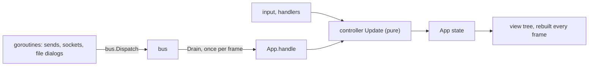

## internal/app: the app

`app.App` implements `ebiten.Game`, owns the window state and is the composition root's runtime
half: `cmd/workshop` builds the adapters, the `App` wires them to the controllers and views. Its
fields are grouped by concern in embedded structs (`appstate.go`); the per-tab widget state is a
`reqTab` beside each `tabs.Tab`.

### State changes

A domain with a controller changes its state through Model, Msg, Update and Cmd (the user's
choice); the `App` changes the rest directly in its handlers. `Update` is pure: no I/O, goroutine or
clock. A UI handler applies its message at once, because the next line needs the new state; the bus
carries only what goroutines report. `Update` may type-switch on its message, the one place where
"table over switch" yields. `prefs` messages may carry functions: the page decides what changes, the
App owns the settings. Accepted gaps: settings `Persist` and image decoding stay on the UI
goroutine. Rejected: signals, React-style diffing, more controllers behind closures.

- **Bus** (`feature/workspace/bus`): the only path from a goroutine to the UI. Goroutines read
  only fields that never change after `NewApp` (the bus, the ports). A one-shot send is a `Cmd` run
  by `Bus.Run` whose result (`sendResult`) comes back as a message. A connection emits many events,
  so its goroutine dispatches `wsOpened`/`wsFailed` and each `wsReceived` itself and returns
  `wsClosed` as its `Cmd` result; a retry dispatches `wsRetry` from a timer. A dispatched `func()` runs on the UI goroutine (file dialog answers, the
  gRPC method menu, MCP sampling dialogs, `prefs.Later`).
- **Request edits** (`feature/send/editor`): no code outside `editor` assigns to a field of a
  tab's request. `editRequest` writes the result into the collection's own request, so the
  sidebar, the autosave and the dirty dot see it at once. The gRPC stream flag is tab state, not
  part of the request. Renames and moves are tree operations (`tree.Update`, `treeops.go`).
- **Tab list** (`feature/workspace/tabs`): changes only through `tabs.Update`; `App.updateTabs`
  then creates or drops the widget state of tabs that appeared or went. Any tab change selects its
  request in the tree and opens the folders above it (`App.revealRequest`).
- **Table rows**: every change goes through `App.applyRows`, which keeps the undo history
  (`tabs.HistoryLimit` steps per table and tab) and runs the pane's `changed` hook (Params rewrite
  the URL). Menus, keys, drag and bulk edit all use it.
- **Sending**: `App.dispatch` expands `{{vars}}` (`Request.Expanded`, the stored request stays as
  typed) and runs `proto.Registry.Send` as a `Cmd`. Each tab numbers its sends; a result whose
  number is no longer current (cancelled or replaced) is dropped. Timeout: the request's, else
  `settings.TimeoutSec`, else a minute.

### Window

The window is VML views (`window.go`, `tree_sidebar.go`, `requesttabs.go`, `request_urlbar.go`,
`window_statusbar.go`); handlers are closures that change the `App`. Panes are tables, not switches:

- `requestPanes`, `connectionRequestPanes`, `grpcRequestPanes` and `responsePanes` list the tabs;
  `paneBuilders` maps a pane kind to its view. A new pane is a row.
- `protocolViews` has one row per row of `request.Protocols`, in the same order (a test checks it):
  the UI half of a protocol (its panes, its composer, whether settings offer it). The protocol chip
  cycles the offered rows; SSE and gRPC are offered once their `experimental` setting is on.
- Auth: `authTypes` drives the pane, the stored `request.Auth` and masking. `proto.REST` applies
  credentials after the headers, so they win over a typed `Authorization` header; they never show
  in the Headers table. Secret fields refuse copy and cut.
- Body: the text and the form rows are kept apart, so switching body type loses nothing.
- Each open collection has a color (`theme.CollectionToken`, tokens `collection.0`-`.5`,
  repeating): a stripe on its tabs and its root row.

### Collection tree in the UI

`treeops.go`, `treemenu.go`, `treedrag.go`. Context menus and drag act on `App.selected`. A drop
builds a `transfer.Drop` and `App.transferNode` applies it, in one collection or across two; Alt
copies (the user's choices and what was rejected: the `transfer` package doc). Across collections:

- the target is written before the source (`flushMoved`); a failed target write leaves the source
  on disk and shows an error toast;
- variables are never rewritten; a toast names those the node uses that the target does not define
  (`transfer.MissingText`);
- a moved request keeps its tab (same pointer); a copy is a new request without a tab.

The drop outline is the row's `DropBorder` token, empty when not the target.

### Keyboard, focus and overlays

- **Focus**: `core.Ctx.FocusOwner` is the one owner of the keyboard. The app asks for focus by
  setting a state's `Focused`; `view.Update` makes the last asker the owner and blurs the rest, so
  no code clears the old owner by hand.
- **Keys**: `routeKeys` (`game.go`) gives the frame's keys to the overlay, the tree, the shortcuts
  or the table undo, in that order of claim. Escape closes one layer per press, the topmost in
  `feature/workspace/overlay`'s order, ending with cancelling a running request.
- **Shortcuts**: the `shortcuts` table (`settings_shortcuts.go`) holds each action with a stable `id` and its
  default. A user binding is `settings.Shortcuts[id]`, stored only when it differs from the default.
  `App.bindingOf` is the one place a binding is resolved; the shortcut runner, menus' shortcut
  text and the Shortcuts page read it. A binding fires only when its modifiers match exactly. A
  plain-key binding is allowed but held back while a text field has focus. The editor is
  `feature/settings/ui/shortcutpage` (Settings).
- **Overlays**, bottom to top: settings dialog, in-app file browser, context menu, dialog (with a
  scrim), toasts. While one has the keyboard the global shortcuts are off. The context menu is the
  toolkit's popup menu, its state in `core.Ctx.Menu` (typed `any`, see its doc); the app only fills a missing
  icon from the label (`menuIcons`). Every dialog has its own title bar and moves by it
  (`widget.Dialog` says why). The right-click handler of the innermost element wins, so a cell editor shows the
  text menu, not the row menu.
- **Toasts** carry a `severity.Level` (`internal/kernel/severity`), mapped once to the toolkit's
  kind; the settings, the sent log and the call trace use the same type. Info fades, errors stay.
- The settings dialog's System page (`feature/settings/ui/systempage`) reports
  the app's `SystemInfo` port.

### Drawing only when something changed

`main` turns off screen clearing and `App.Draw` returns at once unless the frame is dirty, so
Ebitengine skips the GPU work. Dirty: input activity (`engine.InputActive`), a drained message, a
toast, a size change, a screenshot, or the floor of `engine.MinFPS` frames a second (caret blink, a
lost picture comes back). Idle updates slow down (`engine.Pacer`). This follows Ebitengine's
skip-draw pattern, since `ScheduleFrame` and `SetFPSMode` are deprecated.

### Welcome dialog

`window_welcome.go` holds the release notes as a table; it opens once per version (`state.State.Welcomed`), or
at every start in the dev build. The notes are kept in step with `CHANGELOG.md` by hand.

### Screenshots and golden scenes

- The shipped `workshop` has no screenshot code. `e2e/cmd/shot -screenshot out.png` renders,
  writes the PNG and exits (`make shot`). It wires the app like `cmd/workshop`, wraps it in a
  `capture` (`ebiten.Game`: frame count, settle wait, `ReadPixels`, PNG write) and sets
  `Options.DrawEveryFrame`. Scene flags become a list of steps, run in the order of
  `sceneFlagTable` (`e2e/cmd/shot/scene.go`) whatever the command line order; `deferred` steps
  wait for the sends to be answered. Every step calls `app.Driver` (`driver.go`), the one place
  where the app exposes what a scene needs, each action the same path as the user action it is
  named after; the driver lives in the app because the views own the state it reaches.
- A screenshot run keeps settings and state in memory unless `-settings` or `-state` is given, so
  `-set` and `-record` never write the user's files. `-set key=value` changes a setting live,
  through the same path the settings dialog uses.
- `TestGoldenScenes` (`e2e/golden_scenes_test.go`, runner in `softshot_test.go`) draws
  each scene under Xvfb with Mesa's software rasterizer (why: `renderShot`), with `HOME` and `XDG_*`
  sandboxed. Two runs there give byte-identical PNGs, which is what makes goldens comparable; the
  small slack (`shotTolerance`, `maxDifferingPixels`) absorbs driver noise. A stub answers the sample request on `127.0.0.1:8081`; MCP and gRPC scenes use the
  example server's ports (`exampleserver.Config`). Testdata folders are copied to temp dirs first, so
  nothing the program writes lands in `testdata`. `go test ./e2e -update` rewrites the
  goldens; look at the PNG before committing.

`TestAppPackageDoesNotGrow` (`e2e/appsize_test.go`) caps the number of non-test `.go` files directly in
`internal/app` (`maxAppFiles`) while the package is dissolved (`.harness/reorg.md`). Each extraction task
lowers the cap to the new count; it never goes up.
