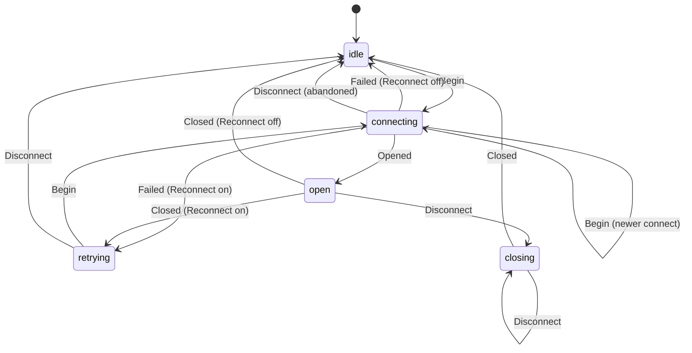

## Protocols

Each protocol is a client of its own in `request/adapter/proto` (decision 2). A protocol that keeps a
connection implements `port.Streamer`; `Registry.Connect` opens a `port.Session`, and its one-shot
`Send` connects, sends and returns the first reply.

### Sessions and socket tabs

- Every `Session` write takes the context of that write; the context ends the write, never the
  session. Closes after a timed-out connect use `context.WithoutCancel`, so the goodbye still goes
  out.
- A tab keeps a session when its protocol's `Connection` is `Always`, or `OnStream` while gRPC
  streams (`isSocket`). Dialing runs off the UI goroutine; every answer, event and end comes back as
  a `ws*` message carrying the tab and its connection generation, and a stale generation is dropped
  (its session closed). Changing the protocol disconnects.
- Every log line is a `port.Event`; code compares its `Kind`, never the peer's `Name` (see the
  `port.Event` doc).
- The connection is the machine `tabs.ConnState`; its table and the reason for it are in
  `controller/tabs/connstate.go`. `Auto-reconnect` (per tab, not saved) turns a move into retrying
  into a move to idle when off. While retrying, a timer sends `wsRetry` after `retryDelay`; the timer
  is not an event of the machine. Whether a request is in flight is a second machine, `SendState`
  (`sendstate.go` says why it is separate).

### Per protocol

- **REST** (`proto.REST`): the cookie jar lives as long as the app; changing the proxy or a
  certificate in the settings rebuilds the registry. A body over `MaxBody` is cut and flagged
  `Response.Truncated`. Every send is traced (`net/http/httptrace`) into `Response.Timing`.
- **WebSocket**: headers, Auth credentials and a `Sec-WebSocket-Protocol` header (split into
  subprotocols) go into the handshake. The one-shot reply has status 101. The composer sends
  `hex: de ad be ef` as a binary message (`port.BinarySender`), and `{ }` compacts JSON keeping key
  order and number text.
- **SSE**: a long GET read by `readEventStream` (`eventstream.go`), shared with the MCP HTTP
  transport. Events are `KindMessage` with the server's name in `Event.Name`; the session refuses
  `Send` and `Ping`.
- **GraphQL** is a body type, not a protocol: it encodes `{"query", "variables"}` and makes a GET
  POST. `App.dispatch` is the one place a tab sends, so a schema load reuses the tab's URL, headers
  and credentials. An introspection answer gives the `Schema (n)` menu of starters; the schema is
  not saved.
- **gRPC** (decision 2, decision 19): `Send` makes one unary call and refuses streaming methods. Methods
  come from a table of sources keyed by `model.SourceKind` (`grpcsource.go`):
  - reflection asks v1, then v1alpha on `Unimplemented`;
  - proto files are compiled with protocompile and list only the services those files declare. A
    missing or broken file is the send's error with its path and line; it never falls back to
    reflection. Only reflection dials to list methods.
  - The JSON body becomes a `dynamicpb` message; headers and the Authorization go out as lowercase
    metadata. The answer is indented by `encoding/json`, because `protojson` randomizes its
    spacing. Header and trailer metadata are the response headers.
  - Requests hold absolute proto paths; the collection stores them relative to its folder when
    inside (`model.StoredPath`, `LoadedPath`). The source is derived from the request, so choosing
    Proto files with no file yet changes only the tab.
  - The Schema pane drops an answer for an older URL, method or source.
  - Streaming: the `Stream` chip (not saved) makes the tab a socket tab. The Body is the first
    message (blank: `{}` for a server stream, nothing otherwise); the composer sends a JSON message,
    or `end` to close this side. The stream's end is a close event with the gRPC code.

### MCP

- Two transports behind `mcpTransport`: streamable HTTP (a POST per message, JSON or event-stream
  answers, `Mcp-Session-Id` and `MCP-Protocol-Version` headers, DELETE on close) and `stdio:` + command line (newline-delimited JSON).
- The stdio process runs under a context the session owns, not Connect's. Closing ends its input and
  kills it a second later if it is still running. Its stderr tail (Limits) shows only when it exits.
- `Connect` runs `initialize`, sends `notifications/initialized` and lists the tools, resources and
  prompts the server announces. The initialize result becomes `Connection.Server`; a result that is
  not an object is noted and the session goes on.
- The keys of the messages the client writes are in alphabetical order; a test pins the bytes.
- List answers are decoded once, in the session, and sent as `Event.Payload`. Only a response to a
  list request the session sent carries one, so a WebSocket frame or a notification never fills
  `Tools`. One bad entry is skipped; a tool with a non-object schema gets an empty form.
- `list_changed` notifications refresh that list, one refresh per list at a time.
- On HTTP, the optional GET event stream carries notifications. A broken POST answer stream ends the
  session (the call cannot complete); a broken GET stream is a note and the session goes on. An event
  over the size limit ends either.
- Sampling: with `MCP.Sampler` nil it is neither offered nor answered. The app shows one prompt at a
  time; a second gets the user-rejected error (-1) at once.
- The explorer calls through `port.Requester` on the bus, so the answer matches its request; its
  UI-free state is `request/controller/mcpexplorer`. A tool result with `isError` shows as an error.
- `model.JSONSchema` is decoded once, at the MCP answer and at the OpenAPI import, and read typed
  afterwards. Only the keywords it has fields for are read. Real captures of the example server are
  under `internal/request/model/testdata/mcp`.
