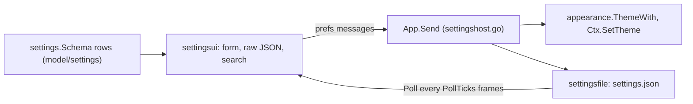

## Settings

- **One row per setting.** `settings.Schema` (`model/settings/schema.go`) is the form, the raw
  view's validation and completion, the search, reset and the order of keys in the file. A row is
  built from the accessor of its `Settings` field, so its kind and its value type cannot disagree.
  A new setting is one row, plus an entry of `settingControls` when the plain control does not fit.
- **Dialog and host** (`settings/ui/settingsui`): `settingsui.SettingsDialog` is `App.prefs` and
  the `App` is its `Host`. Host methods only read; everything a page asks for is a
  `settings/controller/prefs` message applied by `App.Send`. `SetFonts` stays a method because its
  error is the answer. The Colors, Shortcuts and System pages are separate `ui` packages that the
  App draws through `Host.ExtraPage`.
- **Closing forgets.** Closing the dialog drops page, search, raw view and typed text
  (`SettingsDialog.Fresh`); only its size (resized by any edge, `widget.Resizable`) stays, in
  `state.json`. A file chooser it opened is
  taken back when it closes (`App.pickFile` returns the cancel).
- **settings.json** holds only what differs from the defaults (`settings.Minimal`), grouped in
  sections (`sections.go`) after its `version`; the Go struct stays flat. The older flat form is
  read too and regrouped on the next write. The written bytes are pinned by
  `testdata/encode-*.golden`.
- **Raw view**: text with problems (`settings.Validate`) changes nothing and lists them; text
  without is applied and written as typed. `settings.Complete` offers keys and values at the caret.
- **Reload**: the dialog polls the file's time and size and applies an outside change; a file with
  problems is reported and ignored. The program's own writes are stamped and not reloaded, and
  nothing is reloaded while changes are unsaved.
- **Auto-save** (`autoSave`, on by default): a change applies at once either way; with auto-save off
  it is only marked unsaved until Save. Turning it off writes that choice once; turning it on
  writes what was pending. Closing with unsaved changes asks Cancel, Discard or Save.
- **Theme**: how settings become a theme (`appearance.ThemeWith`) is in `style.md`, Theming pipeline.
- **Fonts** (`settings/adapter/fonts`): the scan runs in a goroutine at start and its result is
  applied on the UI goroutine. A saved family that is not installed stays saved, shows as
  `(not installed)` and draws in the built-in Go font. The font list builds only the rows in view,
  so only their files are read.
- **Shortcut editor** (`settings/ui/shortcutpage`): records the next combination for an action. What
  it refuses (`Refuse`) derives from the text widgets' own keys (`textKeys`) and Escape. A
  combination another action has is not saved until the user picks Replace. Only overrides are
  stored. The binding model itself is in Keyboard, focus and overlays (app.md).
