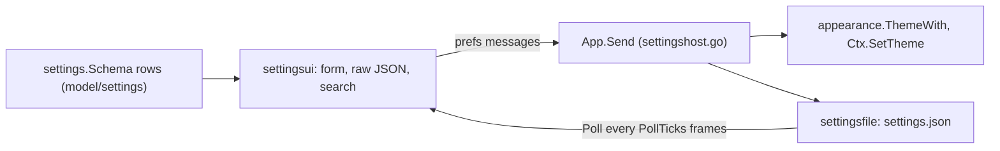

## Settings

- **One row per setting.** `settings.Schema` (`model/settings/schema.go`) is the form, the raw
  view's validation and completion, the search, reset and the order of keys in the file. A row is
  built from the accessor of its `Settings` field, so its kind and its value type cannot disagree.
  A new setting is one row, plus an entry of `settingControls` when the plain control does not fit.
- **Rows and controls.** A row is the title block (title, reset icon while changed, description) and
  one control. `placementOf` puts the control beside the block or under it from the setting's
  `Kind` (a bool, a stepped number and an enum of at most three values go right) with a table
  (`customPlacement`) for the custom controls; a bool is a `widget.Switch`. A font and its size are one row (`fontFaces`, `face.go`): the title block is the font's (its description ends with the size's range, read from the size row), the control line holds the font drop-down and the stepper with its own Reset; `FormPage` skips the size row, and a search lists the line once whichever of the two settings it names. The reset icon, the
  category heading (search results only), the page title row and the search field in the page list
  follow `style.md` (Settings row). The Colors, Shortcuts and System pages stay tables and get only the
  title row.
- **Dialog and host** (`settings/ui/settingsui`): `settingsui.SettingsDialog` is `App.prefs` and
  the `App` is its `Host`. Host methods only read; everything a page asks for is a
  `settings/controller/prefs` message applied by `App.Send`. `SetFonts` stays a method because its
  error is the answer. The Colors, Shortcuts and System pages are separate `ui` packages that the
  App draws through `Host.ExtraPage`.
- **Closing forgets.** Closing the dialog drops page, search, raw view and typed text
  (`SettingsDialog.Fresh`); only its size (resized by any edge, `widget.Resizable`) stays, in
  `state.json`. A file chooser it opened is
  taken back when it closes (`App.pickFile` returns the cancel).
- **settings.json** holds only what differs from the defaults (`settings.Minimal`), grouped in
  sections (`sections.go`) after its `version`; the Go struct stays flat. The older flat form is
  read too and regrouped on the next write. The written bytes are pinned by
  `testdata/encode-*.golden`.
- **Font sizes** are three number settings; the interface and code sizes sit on the line of their font, Small text size is a row of its own: `fontSize` (interface,
  10 to 24 px, default 14), `smallFontSize` (captions, hints, table headers; 8 to 24, default 12)
  and `codeFontSize` (bodies and code views; 8 to 32, default 13). Each is an `Int` field shown in
  the form as a minus button, a field and a plus button (`SettingsDialog.stepControl`): a step
  starts from the setting, does nothing at an end of the range and refreshes the field; a typed
  number outside the range shows a note and keeps the last good value. `Clamp` brings a loaded
  value into the range its schema row states (0 is the face's default). The sizes are independent
  (`theming.FontSizes.Resolved` builds the theme's three sizes); control heights follow the
  interface size through `Ctx.Sizes`.
  The file versions 0 and 1 wrote the size as `textSize`: small, medium or large; their reader
  (`upgradeTextSize`) maps those to 13, 14 and 16 (anything else to 14, `fontSize` wins when both
  are present), and `Validate` accepts the old key only below version 2 (at 2: "replaced by
  fontSize"). Versions 0 to 2 had one size for the three faces: `deriveFaceSizes` sets whichever
  of `smallFontSize` and `codeFontSize` the file does not state from its `fontSize` (small =
  size - 2, never under 9; code = size - 1; `fontSize` clamped to 10 to 24 first), so an upgrade
  changes nothing on screen. A version 3 file is read as it is: missing keys are the defaults.
- **Raw view**: text with problems (`settings.Validate`) changes nothing and lists them; text
  without is applied and written as typed. `settings.Complete` offers keys and values at the caret.
- **Reload**: the dialog polls the file's time and size and applies an outside change; a file with
  problems is reported and ignored. The program's own writes are stamped and not reloaded, and
  nothing is reloaded while changes are unsaved.
- **Auto-save** (`autoSave`, on by default): a change applies at once either way; with auto-save off
  it is only marked unsaved until Save. Turning it off writes that choice once; turning it on
  writes what was pending. Closing with unsaved changes asks Cancel, Discard or Save.
- **Theme**: how settings become a theme (`appearance.ThemeWith`) is in `style.md`, Theming pipeline.
- **Fonts** (`settings/adapter/fonts`): the scan runs in a goroutine at start and its result is
  applied on the UI goroutine. A saved family that is not installed stays saved, shows as
  `(not installed)` and draws in the built-in Go font. The font list builds only the rows in view,
  so only their files are read.
- **Shortcut editor** (`settings/ui/shortcutpage`): records the next combination for an action. What
  it refuses (`Refuse`) derives from the text widgets' own keys (`textKeys`) and Escape. A
  combination another action has is not saved until the user picks Replace. Only overrides are
  stored. The binding model itself is in Keyboard, focus and overlays (app.md).
