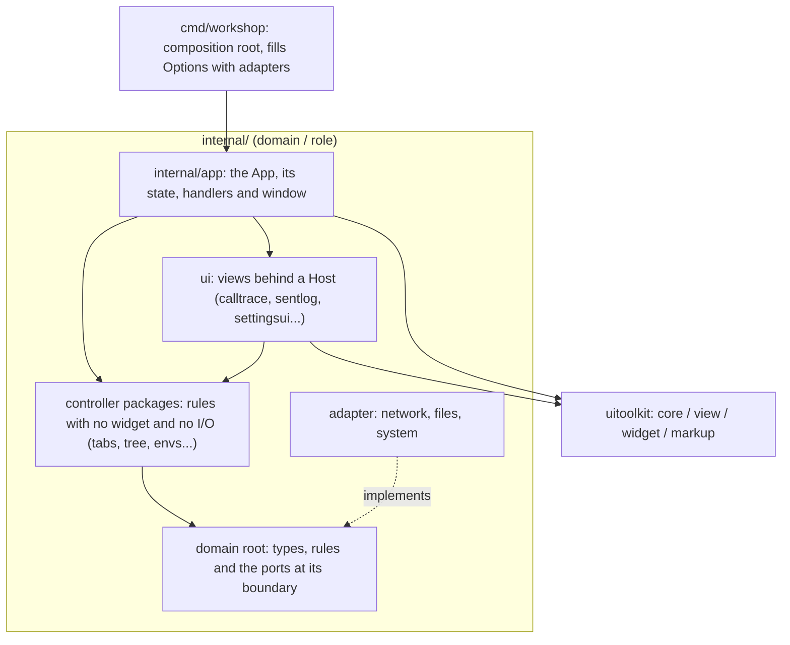

# Overview

The 3000 ft view. Details are in `architecture.md`, the reasons for a choice in the doc comment of the code it shapes (else in the matching `architecture/*.md`), the rules in `rules.md`, the look in `style.md`.

## What it is

A desktop client in Go for REST, WebSocket, SSE, MCP and gRPC calls. One window, three panes: the collection tree (left), the request editor (top right), the response viewer (bottom right). It is drawn with Ebitengine (GPU 2D) and its own widget toolkit, so every widget, text input and scroll area is ours. Ebitengine was the user's choice: pure-Go GPU 2D drawing on Wayland and X11, one nearly static binary, at the cost of writing every widget. A collection is a folder of JSON files (the `collection/adapter/store` package doc); several can be open, each a root of the tree known by its folder, with its own variables and environment, and the set is reopened at the next start (`architecture/collections-and-environments.md`).

## Where things are

```
cmd/workshop         the program: flags, window, wiring of adapters into the App
cmd/example-server   one local server per protocol, for the example requests
uitoolkit/           the GPU toolkit; knows nothing of requests (`uitoolkit/doc.go`)
  core               primitives: tokens, colors, geometry, input, fonts, drawing
  view               the framework: element tree, layout, runtime, extension point
  widget             every component: buttons, menus, dialogs, tabs, fields, tables
  markup             templates (HTML-like) that build the same trees
  theming, engine    palettes and theme files; key bindings and frame pacing
internal/<domain>/<role>/<package>
                     the application
packaging/           desktop entry, macOS bundle
.harness/            rules, architecture, style, tasks
```

## The layers



Dependencies point inward: what each role may import is written once, in `rules.md` (Layout of `internal/`). The adapters never reach the App directly: `cmd/workshop` builds them and hands them in through `Options`, and a nil port falls back to a null one, so tests and screenshots need no desktop.

## One request, end to end

1. The user types a URL in the URL bar (`urlbar` template in `internal/app/request_urlbar.go`) and presses Send or Ctrl+Enter.
2. `App.send` calls `dispatch`: `tabs.Tab.BeginSend` numbers the send, `request.Request.Expanded` fills `{{variables}}` from the collection and the active environment, the call log records it.
3. A command runs off the UI goroutine: `reg.Send(ctx, req)` on the protocol registry, a name-to-`Protocol` table built in `request/adapter/proto` (`rest`, `websocket`, `sse`, `mcp`, `grpc`; its package doc says which are hand-written and why). Streaming protocols return a `Session` from `Connect` and report through the same bus.
4. The result comes back as a message on the bus (`workspace/bus`), drained once per frame on the UI goroutine; a late result of a cancelled send is dropped by its number.
5. The tab keeps the response; the response pane (`response/ui/respview`, and `response/viewer` for its mode and find state) draws it. The sent request and response are written to the history by an adapter behind a port, the collection by `collection/adapter/store`.

Every frame the whole window tree is rebuilt from the App state (why: the `markup` package doc): no diffing, no reactive graph. Widgets that need identity across frames (a text field, a code view) take a pointer to state the App owns.

## Where to add things

| To add | Do |
|---|---|
| a protocol | implement `request.Sender` (and `Streamer` if it stays connected) in `request/adapter/proto`, add a row to `NewRegistry`; add its panes to the tables in `internal/app/window_panes.go` |
| a widget | `uitoolkit/widget`: a composition of `view` elements, or a `view.Custom` behavior when it needs its own layout, input or drawing; options, tests, the package doc index and the markup tables (`rules.md`, toolkit API rules) |
| a view | a template string (a `const` at the end of the Go file) and a `Scope` in the file of the view; pinned with a `view.Dump` test; a state of the `App` that has no widget in it goes to a controller package first |
| a setting | one row in `settings.Schema` (`settings/schema.go`); the form, raw view, validation and reset read it |
| a rule or state with no widget | a controller package directly under its domain: a `Model`, typed messages, a pure `Update` (`architecture/app.md`, State changes) |
| an outside dependency (files, network, system) | a `port` interface in the domain, an `adapter` implementing it, wired in `cmd/workshop` |

## How the project is run

- `make check` is the gate (flags and release-tag scope are commented in the Makefile). `make fuzz` runs the fuzz targets (`architecture/limits.md`), `make shot OUT=x.png` renders the window once; golden scenes are compared under software GL (why: `e2e/softshot_test.go`).
- Work is tasks (`.harness/tasks/NNN-title.md`, run by `/task-loop`); shared rules are in the submodule `.harness/common`.
