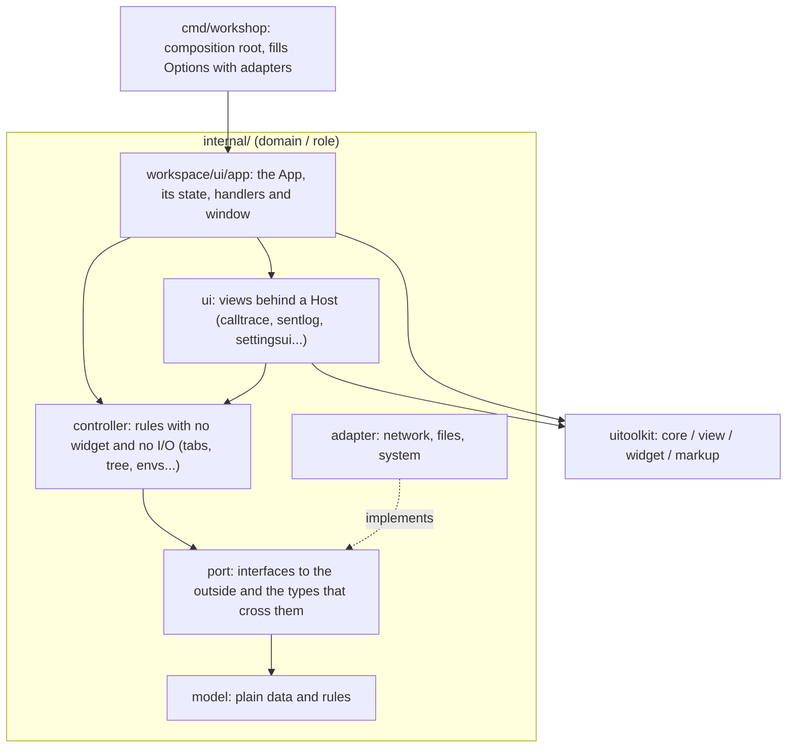

# Overview

The 3000 ft view. Details are in `architecture.md`, the reasons in `decisions.md`, the rules in `rules.md`, the look in `style.md`, the tree of packages in `packagemap.md`.

## What it is

A desktop client in Go for REST, WebSocket, SSE, MCP and gRPC calls. One window, three panes: the collection tree (left), the request editor (top right), the response viewer (bottom right). It is drawn with Ebitengine (GPU 2D) and its own widget toolkit, so every widget, text input and scroll area is ours (decision 1). A collection is a folder of JSON files (decision 7); several can be open, each a root of the tree known by its folder, with its own variables and environment, and the set is reopened at the next start (decision 17).

## Where things are

```
cmd/workshop         the program: flags, window, wiring of adapters into the App
cmd/example-server   one local server per protocol, for the example requests
uitoolkit/           the GPU toolkit; knows nothing of requests (decision 3)
  core               primitives: tokens, colors, geometry, input, fonts, drawing
  view               the framework: element tree, layout, runtime, extension point
  widget             every component: buttons, menus, dialogs, tabs, fields, tables
  markup             templates (HTML-like) that build the same trees
  theming, engine    palettes and theme files; key bindings and frame pacing
internal/<domain>/<role>/<package>
                     the application, see packagemap.md
packaging/           desktop entry, macOS bundle
.harness/            rules, architecture, decisions, style, tasks
```

## The layers



Dependencies point inward: what each role may import is written once, in `rules.md` (Layout of `internal/`) and in the generated `packagemap.md`, and `internal/layers_test.go` enforces it. The adapters never reach the App directly: `cmd/workshop` builds them and hands them in through `Options`, and a nil port falls back to a null one, so tests and screenshots need no desktop.

## One request, end to end

1. The user types a URL in the URL bar (`urlbar` template in `workspace/ui/app/urlbar.go`) and presses Send or Ctrl+Enter.
2. `App.send` calls `dispatch`: `tabs.Tab.BeginSend` numbers the send, `model.Request.Expanded` fills `{{variables}}` from the collection and the active environment, the call log records it.
3. A command runs off the UI goroutine: `reg.Send(ctx, req)` on the protocol registry, a name-to-`Protocol` table built in `request/adapter/proto` (`rest`, `websocket`, `sse`, `mcp`, `grpc`; decision 2). Streaming protocols return a `Session` from `Connect` and report through the same bus.
4. The result comes back as a message on the bus (`workspace/controller/bus`), drained once per frame on the UI goroutine; a late result of a cancelled send is dropped by its number.
5. The tab keeps the response; the response pane (`response/ui/respview`, and `response/controller/viewer` for its mode and find state) draws it. The sent request and response are written to the history by an adapter behind a port, the collection by `collection/adapter/store`.

Every frame the whole window tree is rebuilt from the App state (decision 4): no diffing, no reactive graph. Widgets that need identity across frames (a text field, a code view) take a pointer to state the App owns.

## Where to add things

| To add | Do |
|---|---|
| a protocol | implement `request/port.Protocol` (and `Streamer` if it stays connected) in `request/adapter/proto`, add a row to `NewRegistry`; add its panes to the tables in `workspace/ui/app/panes.go` |
| a widget | `uitoolkit/widget`: a composition of `view` elements, or a `view.Custom` behavior when it needs its own layout, input or drawing; options, tests, the package doc index and the markup tables (`rules.md`, toolkit API rules) |
| a view | a template string (a `const` at the end of the Go file) and a `Scope` in the file of the view; pinned with a `view.Dump` test; a state of the `App` that has no widget in it goes to a `controller` first |
| a setting | one row in `settings.Schema` (`settings/model/settings/schema.go`); the form, raw view, validation and reset read it (decision 9) |
| a rule or state with no widget | a `controller` package of its domain: a `Model`, typed messages, a pure `Update` (decision 13) |
| an outside dependency (files, network, system) | a `port` interface in the domain, an `adapter` implementing it, wired in `cmd/workshop` |

## How the project is run

- `make check` is the gate: gofmt, `go vet`, `go test -race`, `go vet -tags release` on everything, and `go test -race -tags release` only on the packages that link a file behind the `release` tag (`make release-packages` computes them from the import graph; `make check-release-scope` fails when a release-tagged file sits outside that set, then add its directory to `RELEASE_BASE` in the Makefile). `make fuzz` runs the native fuzz targets for 30 s each (not part of the gate; `architecture.md` Limits lists them and the input limits). `make packagemap` rewrites `packagemap.md`. `make shot OUT=x.png` renders the window once; golden scenes (`cmd/workshop/testdata/golden`) are compared under software GL with `xvfb-run` on Linux (decision 5).
- Work is tasks: a file `.harness/tasks/NNN-title.md` with a goal, a scope in order (one commit per item) and an acceptance; the file is deleted in the commit that finishes it. One task is finished before the next starts.
- A change to behavior updates `architecture.md` in the same commit; a design choice is a numbered entry in `decisions.md` with its date and why; a change to the look updates `style.md`.
- Shared rules (commit style, code style) are in the submodule `.harness/common`.
