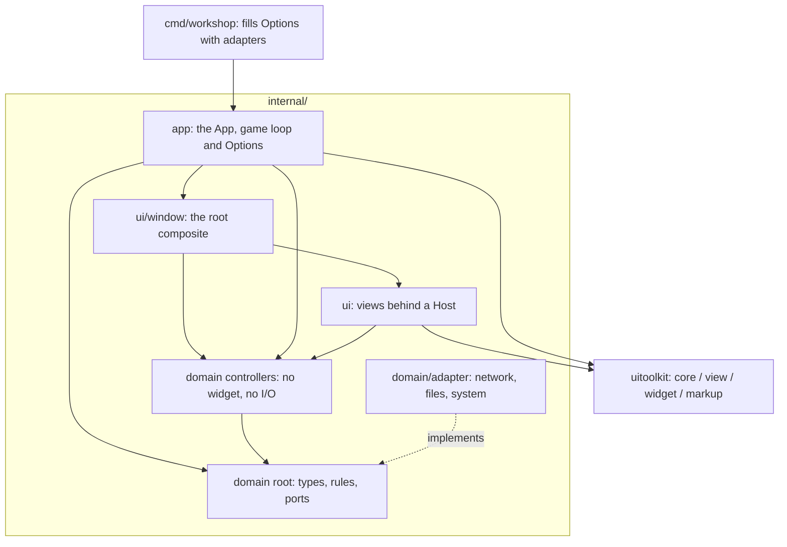

# Overview

The 3000 ft view. Details are in `architecture.md`, the reasons for a choice in the doc comment of the code it shapes (else in the matching `architecture/*.md`), the rules in `rules.md`, the look in `style.md`.

## What it is

A desktop client in Go for REST, WebSocket, SSE, MCP and gRPC calls. One window, three panes: the collection tree (left), the request editor (top right), the response viewer (bottom right). It is drawn with Ebitengine (GPU 2D) and its own widget toolkit, so every widget, text input and scroll area is ours. Ebitengine was the user's choice: pure-Go GPU 2D drawing on Wayland and X11, one nearly static binary, at the cost of writing every widget. A collection is a folder of JSON files (the `feature/collections/adapter/collectionstore` package doc); several can be open, each a root of the tree known by its folder, with its own variables and environment, and the set is reopened at the next start (`feature/collections/FEATURE.md`).

## Where things are

```
cmd/workshop         the program: flags, window, wiring of adapters into `Options`
cmd/example-server   one local server per protocol, for the example requests
uitoolkit/           the GPU toolkit; knows nothing of requests (`uitoolkit/doc.go`)
  core               primitives: tokens, colors, geometry, input, fonts, drawing
  view               the framework: element tree, layout, runtime, extension point
  widget             every component: buttons, menus, dialogs, tabs, fields, tables
  markup             templates (HTML-like) that build the same trees
  theming, engine    palettes and theme files; key bindings and frame pacing
internal/feature/    feature slices: collections, environments, history, send, settings, workspace (model, controllers, adapter/, FEATURE.md; no ui)
internal/ui/         the screen, one directory per component (overlays/, response/ with respview/ and calltrace/, sidebar/, tabstrip/, editor/kvtable/, editor/urlbar/, editor/body/, editor/auth/, editor/assertions/, editor/ws/, editor/graphql/, editor/grpc/, editor/mcp/ with mcpform/, appicon, theme)
internal/ui/format/  display formatting, no toolkit: durations, sizes, JSON text helpers, body to display lines
internal/storage/    user-file location and versioning (zone base): where the program's files live, the "version" key readers
internal/feature/request/  the request model and ports and OpenCollection, the base feature every other may import
  (root package)     types, rules and ports of the domain
  <controller>/      state and decisions, no widget, no I/O (tabs, tree, envs...)
  adapter/<package>  files, network, system: implement the ports
internal/app         composition root: the App (game loop, Options to window Stores); five files, no handler
internal/ui/window  the root composite of the screen: its handlers, keys and frame
internal/exampleserver  the local test server
packaging/           desktop entry, macOS bundle
.harness/            rules, architecture, style, tasks
```

## The layers



Dependencies point inward: what each package may import is written once, in `internal/CLAUDE.md`; `e2e/layers_test.go` checks it in `make check`. The adapters never reach the window directly: `cmd/workshop` builds them and hands them in through `Options`, and a nil port falls back to a null one, so tests and screenshots need no desktop.

## One request, end to end

1. The user types a URL in the URL bar (`ui/editor/urlbar`) and presses Send or Ctrl+Enter.
2. `Component.send` (in `ui/window`) calls `dispatch`: `sends.Begin` (`feature/send/sends`) numbers the send, `request.Request.Expanded` fills `{{variables}}` from the collection and the active environment, the call log records it.
3. A command runs off the UI goroutine: `reg.Send(ctx, req)` on the protocol registry, a name-to-`Protocol` table built in `feature/send/adapter/protocol` (`rest`, `websocket`, `sse`, `mcp`, `grpc`; its package doc says which are hand-written and why). Streaming protocols return a `Session` from `Connect` and report through the same bus.
4. The result comes back as a message on the bus (`feature/workspace/bus`), drained once per frame on the UI goroutine; a late result of a cancelled send is dropped by its number (`sends.Accept`).
5. The tab keeps the response; the response panes (`ui/response`, with `ui/response/respview` for the lines, and `feature/send/viewer` for its mode and find state) draw it. The sent request and response are written to the history (`feature/history`) by an adapter behind a port, the collection by `feature/collections/adapter/collectionstore`.

Every frame the whole window tree is rebuilt from the window's state and the components' own (why: the `markup` package doc): no diffing, no reactive graph. Widgets that need identity across frames (a text field, a code view) take a pointer to state the owning component keeps.

## Where to add things

| To add | Do |
|---|---|
| a protocol | implement `request.Sender` (and `Streamer` if it stays connected) in `feature/send/adapter/protocol`, add a row to `NewRegistry`; add its panes to the tables in `internal/ui/editor/panes.go` (the request side and the stream panes) and `internal/ui/window/panes.go` (the response side) |
| a widget | `uitoolkit/widget`: a composition of `view` elements, or a `view.Custom` behavior when it needs its own layout, input or drawing; options, tests, the package doc index and the markup tables (`rules.md`, toolkit API rules) |
| a view | a package under `internal/ui/<area>/` (anatomy in `internal/CLAUDE.md`): a template string (a `const` at the end of the Go file) and a `Scope` in the file of the view; pinned with a `view.Dump` test; a state of the window that has no widget in it goes to a controller package first |
| a setting | one row in `settings.Schema` (`feature/settings/schema.go`); the form, raw view, validation and reset read it |
| a rule or state with no widget | a controller package directly under its domain: a `Model`, typed messages, a pure `Update` (`architecture/app.md`, State changes) |
| an outside dependency (files, network, system) | a port interface in the domain root, an implementation in the domain's `adapter/`, wired in `cmd/workshop` |

## How the project is run

- `make check` is the gate (flags and release-tag scope are commented in the Makefile). `make fuzz` runs the fuzz targets (`architecture/limits.md`), `make shot OUT=x.png` renders the window once; golden scenes are compared under software GL (why: `e2e/softshot_test.go`).
- Work is tasks (`.harness/tasks/NNN-title.md`, run by `/task-loop`); shared rules are in the submodule `.harness/common`.
