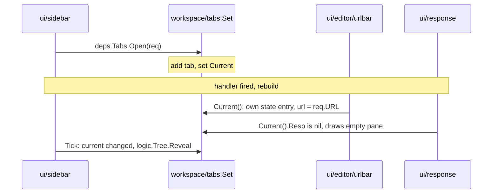

# Reorganization of the app code (tasks 015-048)

Working note for the queued tasks `015`-`048`. Every task reads it. Task 046 folds what stays true into
`architecture.md`, `architecture/app.md` and `internal/CLAUDE.md`, and then deletes this file.

## Why

`internal/app` is one package: 63 non-test files (about 9.5k lines), an `App` with about 100 fields and a
`reqTab` with 23 fields per tab. The handlers, callbacks and layout of one screen component are spread over
`request_*`, `tree_*` and `window_*`, and all of them change `App` directly. About 90% of its tests start the
whole `App`. Feature slices each carry a `ui/`, so one screen area spans several slices, and `kernel` holds six
tiny packages next to the one real one (`request`).

Goal: reading one directory explains one component (state, callbacks, keys, layout); the `ui/` tree mirrors the
screen; the domain is grouped by feature; no object runs all actions; the outside world is reached through ports
and adapters. `uitoolkit/` is not touched (the one task that may touch it, 048, asks first).

## Target tree

```text
internal/
  feature/   domain by capability: model, stores, ports, adapters. No ui, no toolkit.
    request/      request model and ports (was kernel/request) and OpenCollection (was kernel/openset); the one base feature every other may import
    collections/  root (pkg collection), collections, tree, transfer, clientconfig, importers/{postman,openapi,miniyaml}, adapter/{collectionstore,clientfile}
    send/         root, curlparse, mcpserver, graphqlschema, binarymessage, assert, requestedit, mcpexplorer, viewer, outbox, sends (new store), adapter/{protocol,protocol/ws,preview}
    environments/ (pkg envs)
    history/      root, adapter/historyfile
    settings/     root, prefs, form, keymap (new), adapter/settingsfile
    workspace/    root, tabs, state, filebrowser, autosave, bus, overlay, serial, notice (new), adapter/{folders,statefile}
  storage/   user-file location and versioning (was kernel/userdir and kernel/fileversion)
  ui/        the screen, one directory per component
    theme  sizes  appicon  format (was kernel/textfmt and kernel/jsonview)
    window                       root composite
    sidebar (+logic)  sidebar/sentlog
    header  header/envchip
    tabstrip
    editor                       composite
      urlbar  kvtable(+logic)  body  auth  assertions  ws  grpc  graphql  mcp  mcp/mcpform
    response                     composite
      respview  calltrace
    statusbar
    overlays                     composite
      settingsdialog  settingsdialog/{formpage,colorpage,shortcutpage,systempage}
      filebrowser  destpicker  welcome  toasts  menus
  app/  app/apptest  app/drive   (at most 6 files: options, ports, app, game, frame)
  exampleserver/
```

## Component anatomy

`ui/<area>/<name>` is the view package:

- `<name>.go`: the Component, `New(Deps)`, widget state.
- `deps.go`: narrow interfaces the component declares itself (1-4 methods each); a feature store satisfies them.
- `view.go`: the VML template and every on-click closure.
- `keys.go`: `Keys(in) bool`, the keys the component claims.
- `commands.go`: `Commands()`, the shortcut actions it offers.
- `tick.go`: `Tick(ctx) bool`, per-frame work; it returns whether something changed.
- optional nested `logic/` (package `logic`): toolkit-free state and decisions, unit-tested without a GPU.

The shape is structural: no base package. Per-tab widget state lives in the component, in a
`map[*tabs.Tab]*state` pruned in `Tick`; it leaves `reqTab`. Why `logic/` is a package and not a file split:
the layer test only sees packages. Why not `<name>/view`: parents would import several packages called `view`,
which clash with the dot-imported toolkit `view`.

## Composition

Parents import and wire children; siblings never import each other; a child never imports its parent. `app` builds
the stores from `Options`, calls `window.New(Stores{...})`, runs the frame loop and holds no handler. Each
composite offers a key to its children in its own order and the first claim wins (overlays, sidebar, editor,
response, then `keymap.Run`); there is no `routeKeys` switch and no `textFocused`. `Tick` returns `changed` and
parents OR it upward. A change that reaches another component goes through a shared feature store and is read
on the next rebuild (the whole tree is rebuilt every frame); there is no event bus between components. `bus`
stays the way from a goroutine to the UI goroutine.



## Layer table

Zones: `base` (`feature/request`, `storage`), feature root, controller, `adapter` (`feature/*/adapter/**`),
`uilogic` (`ui/**/logic`, matched before `ui`), `ui`, `app`, `exampleserver`, `toolkit`. Rows:

- feature root, controller and adapter: base and their own feature (as today).
- `uilogic`: base, feature root, controller.
- `ui`: base, feature root, controller, toolkit, `ui/format`, `ui/theme`, `ui/sizes`, and its own sub-tree
  (flag `Below`: the target path has the importer path as prefix).
- `app`: base, feature root, controller, ui, toolkit.
- `exampleserver`: base, and the written exception `send/adapter/protocol/ws`.

Absent by design: feature to feature, ui to adapter, logic to toolkit, sibling ui, child to parent, adapter to
ui, app to adapter (`cmd` wires them), feature to ui or toolkit.

## Common acceptance (every task)

- Behavior does not change. Tests only move or get access-only rewrites: same inputs and assertions; a read of a
  private field becomes an `apptest` query or a layout dump. Goldens (`e2e/testdata`, `*.dump`) stay; never run
  with `-update`.
- New seams and types are test first: the test fails for the expected reason before the code.
- The layer table matches the tree after the task; docs that describe moved things change in the same commit.
- The cap in `e2e/appsize_test.go` is lowered where files left `internal/app`.
- `make check` passes.

## Move recipe

`git mv` (testdata and fuzz corpora follow), rewrite import paths with `sed` longest path first, `gofmt -w`, then
update `FUZZ_TARGETS`, `RELEASE_BASE`, the rule table and the docs in the same commit.

## Questions

A task that meets an ambiguity ends `RESULT: blocked <question>`. The orchestrator asks the user (recommendation
first), writes the answer under `## Decision` in the task file, commits it and runs the task again. Open
questions known now: 021 (where `severity` lives), 042 (where action ids are owned), 045 (deleting
`harness_test.go` and `appstate.go`), 048 (child component or toolkit widget), and any component whose fields
are shared by two panes.
