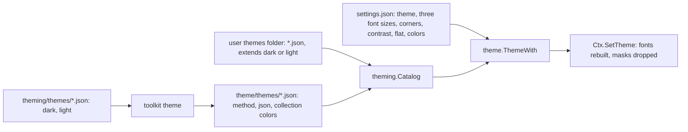

# Visual style

The one document for how the UI looks: the rules a view follows, the visual language, the theme pipeline, the reasons behind the look and how a UI change is checked. Every number here is a token or constant in code (`uitoolkit/core/theme.go` unless named otherwise); code doc comments hold the mechanics.

## 1. Rules

These are hard rules (`rules.md` makes them part of the repo's rules).

- **Tokens, never literals.** Colors, spacing, sizes and font sizes in a view or widget come from the color tokens and size constants of `uitoolkit/core/theme.go`; the app adds its own tokens (`method.*`, `json.*`, `collection.*`) in `internal/settings/theme/themes/*.json`. Markup has no constants, so a template reads them from its scope (`{{rowH}}`, `{{gutter}}`).
- **Corners through the theme.** A component takes its radius from `view.Control(name)` or `Ctx.Radius(name)`, so the Corners setting reaches it. A square fill in a rounded panel is a bug. Tabs are square by choice (section 4); toasts do not follow this yet (Not done).
- **Icon-only controls have a tooltip**, and buttons and tabs name their shortcut in it (`App.hint`; `focusorder_test.go` holds it).
- **Contrast is tested.** The palettes hold their ratios in `theming/palette_test.go`; `TestNonTextElementsAreVisible` holds the floors for borders, rules, icons and row states. A color change that breaks them is a change of these rules, not of a test.
- **The look changes here first.** A change to the look updates this file in the same commit.
- **Verify by looking.** A UI change is checked with `make shot` and the PNG looked at (section 5); layout and widget logic still get unit tests. Golden files change only where the task changes the look.

### Sizes

Logical pixels; the interface scale multiplies them at draw time. Every size is a rule over three bases, never a free number:

| Base | Value | What it is |
|---|---|---|
| `BaseLine` | 16 | line height of the default UI face (`TestBaseLineIsTheDefaultFaceLineHeight`) |
| `BaseSmallLine` | 14 | line height of the default small face |
| `Unit` | 2 | the grid every padding and gap sits on |

**Height classes** are a line plus padding on both sides, so text centers on whole pixels:

| Class | Rule | Value | Use |
|---|---|---|---|
| `RowH` | `BaseLine` + 6U | 28 | list and table rows, standard controls, dialog buttons |
| `CompactH` | `BaseLine` + 4U | 24 | chips, icon buttons, inline fields in a row, menu rows (`MenuRowH`) |
| `LabelH` | `BaseLine` + 3U | 22 | section captions |
| `SlimH` | `BaseLine` + 2U | 20 | pills, and buttons in the status bar |
| `NoteH` | `BaseSmallLine` + 2U | 18 | one-line notes |

**Sizes follow the faces.** `Ctx.Sizes` (`SizesFor(line, small)`) applies these rules to the line heights of the faces the context really draws with, so a larger text size never clips a row. It is recomputed in `NewCtx`, `SetTheme` and `SetFonts`, never in `SetScale` (the scale multiplies at draw time). The UI line is clamped to 13..28 (a 24 px font has a line near 27, so the largest Text size is not cut short) and the small line to 1..line; spacings never move. Toolkit widgets read them: Go views write `HOf(core.RowOf)`, `WOf(core.IconBtnOf)` or `SeparatorOf(f)`, which `Layout` resolves from `ctx.Sizes` on every pass (a later `H` or `W` replaces the role), and widgets with a `*Ctx` read `ctx.Sizes` directly (`MenuRowHeight(ctx)`). The constants in the tables are the same rules for the default faces (`DefaultSizes()` equals them) and stay only for code outside the toolkit that still uses them (`MenuRowH`, ...). `Sizes.Scope()` names them for templates (`rowH`, `compactH`, `gutter`, ...). The app's views follow the same rule: a template gets `App.scope(...)`, which merges `ctx.Sizes.Scope()`, the app's fixed control widths (`internal/app/sizes.go`, one named constant per role, e.g. `wrapChipW`) and the view's own entries, so a template holds no raw size attribute and Go code writes `a.ctx.Sizes.Row` or `HOf(core.CompactOf)`. Text size therefore moves the app's rows, bars and chips too. The feature views (`internal/{collection,request,response,settings}/ui`) follow the same rule: each build function takes the `*Ctx` (`page.View(ctx, host)`), a package-local `scope(ctx.Sizes, own)` merges `Sizes.Scope()` with the view's own entries and one named constant per fixed width (`labelColW`). Dialog widths follow the units too: `DialogW` 380 (a message dialog) and `DialogButtonMinW` 80 (5 dialog steps).

**Spacing steps** are named multiples of `Unit`; each role constant is one step:

| Step | Units | Value | Roles |
|---|---|---|---|
| `StepHair` | 1 | 2 | `TabLead` (room before the first tab), `EdgeW` (open tab outline) |
| `StepNear` | 2 | 4 | `NearGap` (items that read as one), `ShadowOffset` |
| `StepTight` | 3 | 6 | `TightGap` (controls side by side), `TabGap` (above tabs), `RuleInset` (menu separator), `EdgeGrab` (resize grab inside a border) |
| `StepLoose` | 4 | 8 | `LooseGap` (blocks of a pane in a column, rows that need air), `CellPad` (table and header cells) |
| `StepLabel` | 5 | 10 | `LabelPad` (side inset of a pill, tab or button label), `TabSepInset` (line between tabs, off top and bottom) |
| `StepGutter` | 6 | 12 | `Gutter` (inset between a container and its content; gap between its sections) |
| `StepDialog` | 8 | 16 | `DialogPad` (inset of a dialog's title bar, toolbar, footer and body) |

**Bars and fixed shapes** are a class plus a step:

| Constant | Rule | Value |
|---|---|---|
| `ToolbarH` | `RowH` + 2 `NearGap` | 36 |
| `DialogToolbarH`, `TabBarH` | `RowH` + 2 `TightGap` | 40 |
| `DialogTitleH` | `RowH` + 2 `LooseGap` | 44 |
| `IconBtnW` | `CompactH` + 2 `NearGap` | 32 |
| `WordBtnW` | `IconBtnW` + `StepGutter` | 44 (one short word: Log, Raw, Reset) |
| `CheckboxSize` | `BaseSmallLine` | 14 |

**Fixed geometry**, not content, so it follows no line or step: `DialogMargin` 40 (room kept around a dialog), `DialogMaxH` 560 (tallest default dialog height).

**Adding a component**: pick a height class and a spacing step, never a number. A size no class or step fits is a new rule in `theme.go` and a row here, or a fixed number listed in this paragraph with the reason.

Window chrome (`internal/app/window.go`, fixed numbers with a role each): header `headerH` 44, request tab row `tabsH` 42, URL bar `urlH` 56, status bar `statusH` 28, sidebar `sidebarW` 260 by default.

### Scale

- Widgets, layout and hit tests work in logical pixels; `Ctx` multiplies by `Scale` when it draws, so HiDPI stays sharp (`architecture/core.md`).
- **Interface scale** (`settings.UIScalePct`, slider 50 to 200 % in steps of 5, `settings.ScaleSliderMin/Max/Step`) multiplies the display factor and the platform base (`settings.BaseScale`: 1.1 on Linux, 1 elsewhere), so 100 % is the platform's normal size. Screenshots skip it. The slider resizes live, saves on release and follows the pointer in device pixels from the press, so the resizing UI never feeds back into the value. Remembered window sizes are in window pixels.
- **Display scale on Linux.** Ebitengine reports 1 for an Xwayland window on a scaled monitor, so the App asks the `settings/port.DisplayScale` port (adapter `settings/adapter/displayscale`); `frameSize` then lays the UI out in window pixels over the real scale, with no supersampling. `Factor` returns a cached value and refreshes it in the background, so a hung compositor command never stalls a frame. Windows and macOS use Ebitengine's factor.
- Fractional scales round text metrics to whole pixels (`architecture/limits.md`).

### States

| State | Look |
|---|---|
| Rest | Click targets are outlined, drawn after the children: buttons, icon buttons, fields and menus in `BorderStrong`, tables in `BorderSoft`, primary buttons in `AccentLine` (the control's `border` in the theme file). |
| Hover | Buttons brighten their fill (`Lighten`); rows and menu items fill with `Hover` (`HoverBg`); the dialog close button darkens with `Shadow`; an unchecked checkbox outline goes from `Rule` to `Muted`; a scrollbar thumb goes from `Muted` to `Text`. |
| Selected | `Selected` fill (list, tree and menu rows); the open tab as in Tabs below; a segment chip as a primary button. |
| Focus | A focused field draws its outline again in `AccentLine` over the resting one (`fieldB.DrawOver`), at line width. |
| Disabled | Text in `Muted` and no hover: menu items (`MenuItem.Disabled`), muted table rows (the editable table's placeholder row), rows a picker refuses. A disabled button is built by the view as an unlit, muted button that does nothing (the destination picker); the toolkit has no disabled option. |
| Drag | `CursorMove` only from press to release (`App.showGrab`); a drop target row is outlined in `AccentLine`, in `OK` while Alt makes the drop a copy. |

High contrast changes colors, not states: see the pipeline (section 3).

## 2. Visual language

The look follows the gascoigne CLI dashboard (`theming.Dark`/`Light` doc, `TestPalettesFollowTheCLIDashboard`): burgundy accent, warm near-black or cream surfaces, outlined controls, flat fills, one gradient.

### Palette roles

| Role | Tokens |
|---|---|
| Surfaces, back to front | `Frame` (window chrome, status bar), `Bg` (raised panes, dialogs, menus, the open tab), `Panel` (table headers, toasts), `Sunken` (lists, code, fields, buttons' fill) |
| Row states | `Hover`, `Selected`; `Alt` fills every second row of a table that opts into zebra stripes |
| Lines | `Border` (bars, dividers, `HRule`/`VRule`), `BorderStrong` (control outlines), `BorderSoft` (hairlines between table rows, `Separator` lines, dialog toolbar and footer lines), `Rule` (an idle checkbox's outline, the slider's middle tick) |
| Text | `Text`, `Muted`, `Faint` (the quietest), `ChipText` (on a button) |
| Accent | `Accent` (primary fill, checkbox, slider), `AccentLine` (focus, open tab, links, outlines), `AccentText` (on the accent), `AccentSoft` |
| Status | `OK`, `Warn`, `Error`, `Info`, each with a pale `*Soft` background for pills |
| Header | `Hero` (flat fallback of the `hero` gradient), `HeroText`, `HeroMuted` |
| Find and selection | `Selection`, `FindMatch`, `FindActive` |
| Other | `Shadow` (scrim and drop shadows, with alpha), `Chip`, `Track` (empty part of a bar) |
| App | `method.GET`... (HTTP method), `json.*` (JSON view), `collection.0`-`.5` (collection stripes, reused in turn) |

An unknown token draws in `Text`, so a typo stays visible.

### Type

- The interface font is the embedded Go font, code the Go Mono font; the user may pick installed families (Settings, `settings/adapter/fonts`). A saved family that is not installed draws in the Go font.
- Three faces, each with its own size setting, whole numbers of pixels: interface `settings.FontSize` (10..24, default 14), small `settings.SmallFontSize` (8..24, default 12) and code `settings.CodeFontSize` (8..32, default 13). `theming.FontSizes{UI, Small, Code}.Resolved` brings each into its range (0 is the default). The sizes are independent: small may exceed interface (`core.SizesFor` keeps the small line inside the line height), and control heights follow the interface size through `Ctx.Sizes`. A file written before version 3 had one size; its reader derives small (size - 2, never under 9) and code (size - 1) from it, so nothing changes on screen. Theme files do not state sizes; one that still carries `fontSize`, `smallSize` or `monoSize` loads and the keys are ignored (logged at debug).
- Tabs are display only: the text keeps the real `\t`. In code (`CodeView`, `TextArea`) a tab advances to the next stop of `core.TabStop` (4) columns, counted along the whole line, and the caret, selection, hit-testing, wrap and horizontal extent count it the same way (`core.ColumnAfter`, `Column`, `IndexAt`); in proportional text (labels, fields) it is a gap of `TabStop` spaces of the face (`Ctx.Width`, `Ctx.Text`). The fonts have no tab glyph, so a tab is never handed to the font as is.
- Bold marks names that structure the window: dialog titles, a collection's root row, table headers. Folder, request and tab names stay regular.
- Table headers are small, bold, muted and upper case. Secondary text (badges, shortcuts, hints, subtitles) is small and muted.
- Text is rendered the macOS way: unhinted glyph outlines at fractional x positions (text/v2 keeps up to 8 subpixel variants per glyph; the baseline snaps to a whole device pixel), with a light stem boost. `Ctx.Text` draws the glyphs a second time at alpha `core.StemBoost` (0.5), so a partly covered edge pixel at coverage a ends at a + 0.5·a·(1−a): a half covered pixel at 0.625, empty and full pixels unchanged. Plain linear coverage made the Go fonts thin and grey, most of all light text on a dark panel; the boost stands in for CoreText's stem darkening. It touches no outline or advance, so `Width`, `Advance` and `LineH` measure exactly what is drawn and `BaseLine`/`BaseSmallLine` hold.

### Shapes and lines

| Control | Radius (soft) | Outline |
|---|---|---|
| `button`, `icon-button`, `field` | 4 | `border-strong` |
| `primary` | 4 | `accent-line` |
| `tooltip` | 4 | `border-strong` |
| `row`, `slider` | 4 | none |
| `table` | 6 | `border-soft` |
| `menu` (dialogs, menus, file and picker panels) | 8 | `border-strong` |
| `scrollbar` | 5 | none |
| `checkbox`, `swatch` | 3 | none, `border-strong` |
| `match` | 2 | none |
| `pill` | 999 | none |
| `hero` | 0 | none; gradient `hero-top` to `hero-bottom` |
| `tabstrip`, `statusbar` | 0 | none |

- The Corners setting scales every radius: square 0, soft 1 (the theme's own), round 1.5. Flat turns the one gradient into its flat `Hero` fill.
- Tabs and toasts have no control, so they stay square under every Corners setting.
- Borders are one-pixel hairlines in a token; edges snap to device pixels so neighbours share an edge (`architecture/toolkit-widgets.md`). The open tab's outline is the separate 2 px `Edge` family.
- Bars are separated by `Border`, never `Rule`.
- Something that fills a corner of a rounded panel rounds that corner to the panel's radius with `RoundT`, `RoundB` or `RoundBL` (`round-t`... in templates, argument `menu`), anti-aliased with alpha.
- Floating panels (dialogs, menus, toasts) cast a `Shadow` shifted `ShadowOffset`, not blurred.

### Icons

- Icons are SVG files (`widget/icons/*.svg`), drawn as vector paths in the element's `Color`. Glyphs inside widgets are icons too: the checkbox check, fold arrows, a `Span.Icon` in a code view.
- They are the toolkit's own; an icon from an open set (Lucide is ISC, Tabler MIT) goes in with its license file.
- A theme's `iconStroke` scales every stroke (0.8 thin, 1.3 bold), so icon weight is a theme choice.
- Muted by default where they decorate (folder icons, the dialog close cross on `HeroMuted`); a menu reserves a 14 px icon column when any item has an icon, so labels line up.

### Components

**Window.** The header (44) is the app's identity: `Hero` with the `hero` gradient, the title bold in `HeroText`, icons in `HeroMuted` lit to `HeroText` on hover, the environment as a `HeroText` pill. Every pane starts its first row one `Gutter` below its tabs, so rows line up across the divider (`TestRequestAndResponsePanesShareTheirFirstRowBand`). The status bar (28) is `Frame` with a `Border` line on top, small muted text; the response status is a small bold pill, `OK`/`Warn`/`Error` on its `*Soft` color, then the timing.

**Tabs.** The request tab row is `tabsH` (42), a pane tab row `TabBarH` (40), each with `TabGap` above. The strip draws one bottom `Border` line under transparent inactive tabs (label `Muted`); the open tab has the pane color `Bg`, its label in `Text` and a square 2 px `AccentLine` outline on top, left and right, open at the bottom so it runs into the pane. No tab name is bold. A strip that does not fit scrolls sideways with an arrow only at an end that can still scroll.

**Buttons.** `Button`: `Sunken` fill, `ChipText` label, outlined, brightens on hover, label padded 10, ellipsized only when the row has no room. `PrimaryButton`: `Accent` fill, `AccentText` label, `AccentLine` outline. `SegmentChip`: a primary button when chosen, a button otherwise. `LinkButton`: `AccentLine` text on no fill, `Hover` under the pointer. Dialog buttons are `RowH` high and at least 80 wide.

**Fields.** `Sunken`, `RowH` high (`CompactH` inline), `BorderStrong` outline, `AccentLine` when focused; variables in a field are green when resolved and red when not (`architecture/requests.md`).

**Menus.** `Bg` panel, `menu` control, shadow, inset `MenuPad` (4), 120 to 420 wide; rows `MenuRowH` (24) padded 10, the hot row `Selected`, others `Hover` on hover; shortcut and hint lines small and muted; separators 9 high.

**Tables.** Rows on `Sunken`, a `BorderSoft` hairline between rows, the row under the pointer lit, no zebra stripes unless the table opts in (`TableSpec.Zebra`: every second row in `Alt`; the Shortcuts page does); the header is `RowH` on `Panel` with a `Border` line under it; cells padded `CellPad`; columns at least `MinColumnPx` (56). A table may also opt into a fixed lead column (`RowLead`, `tableActionW` wide, a header spacer over it) that shows the pencil icon on the selected row, a row click (`OnRowClick`, editable or not), a node in place of a cell's text (`CellNode`) and a detail node under a row (`RowDetail`); all are off when unset. The Shortcuts page is such a table (Action, Keystrokes, Source): the selected row is `Selected` with the pencil, and its Unbind and Reset buttons and its conflict, refusal or plain-key note sit in the detail under it.

**Key chip.** `widget.KeyChips` shows key text as one small chip per key (`Chip` fill, the `button` control's corners, `ChipText`, padded `NearGap`, `CompactH` high), split on `+`; a key being recorded is one `Accent` chip, "Press keys...", and an action without a key says "Unbound" in muted small text.

**Scrollbars.** An 8 px track with no fill; the thumb `Muted`, `Text` while hovered or dragged, at least 24 long, rounded by `scrollbar`; drawn only when the content overflows.

**Tooltips.** After the pointer rests half a second (30 ticks), a `Frame` box with a `BorderStrong` outline and small `Text`, 16 below and right of the pointer, kept inside the window.

**Toasts.** Bottom right, above the status bar, 320 x 36, 6 apart, at most 5, oldest on top: `Panel` with a shadow, `Border` and `Text` for info (fades after 3 s), `Error` border and text for errors (stay until clicked).

**Checkbox and slider.** A 14 px checkbox: an outline in `Rule` when off, an `Accent` square with the check in `AccentText` when on. A slider thumb in `Chip`, outlined in `Border`, with a `Rule` tick at the middle.

**Switch.** A toggle for a true-or-false value (`widget.Switch`): a pill `IconBtnW` wide and `Checkbox + 2 * StepHair` high with a `Checkbox`-sized round knob, both from `ctx.Sizes`. On: `Accent` track, `AccentText` knob at the right. Off: `Track` fill, `BorderStrong` outline (`Muted` under the pointer), `Muted` knob at the left. `DisabledSwitch` draws the off colors whatever the value and ignores a click. A click flips the value the caller owns, as for a checkbox; it takes no keyboard focus, like the checkbox.

**Settings row.** A row of the settings form has pad-y `LooseGap` and a `BorderSoft` line under it. Left, the title block grows: the title (bold) with a `Reset` icon button (`undo` icon, tooltip says the setting is changed and what Reset does) beside it only while the value differs from the default, and the description under it in small muted text that wraps at the width the control leaves (`widget.Paragraph`). The control sits right of the block, centered on it, when it is short: a switch, a stepper, an enum of at most three values. A wide control (text or file field, slider, theme chips, a longer enum) goes under the block at the full width. A setting may share its line with the setting it belongs to: a font and its size are one row, the font dropdown growing (it elides its name and keeps `fontMinW`, 120) and the stepper at the right with its own `Reset` icon, whose slot stays reserved while the size is unchanged so the steppers line up. A refusal note goes under the whole row. **Category heading:** a small muted caption in capitals over a `BorderSoft` line, shown only in search results, to separate the categories; a single page does not repeat the name its title row already has. **Page title row:** over every page and the raw view, a pill (`AccentSoft`, bold `AccentLine` label) with the page, the base name of the settings file in muted text (the full path is its tooltip), free room, and the button "Edit in settings.json" (in the raw view "Back to the form"). Search is the top of the page list, not the toolbar.

**Splits.** Dividers are `Border` lines, dragged with a resize cursor.

**Resizing.** A resizable dialog is grabbed within `EdgeGrab` (6) inside or 4 outside its border (`edgeSlop`, `edgeOut`), grows about its center and stays inside the window (`ScreenMargin` = `DialogMargin` in the settings dialog). Size and position outlive the dialog's rebuild; the settings dialog keeps its size in `state.json`.

### Dialogs

Every dialog is a modal floating panel over a dimmed scrim (`widget.Dialog`, `ResizableDialog`, `MessageDialog`), centered until the user drags it, built from the top: the **title bar** (`DialogTitle`), optionally the **toolbar** (`DialogToolbar`), then the **body**.

**Title bar.**
- Height `DialogTitleH` (44), side padding `DialogPad` (16), gap `LooseGap` (8), items centered vertically, flush with the panel's edges (the panel has no padding).
- Drawn like the window's header: `Hero` with the `hero` gradient (`Control("hero")`), so it differs from the body in every theme, its top corners rounded to the panel's radius (`RoundT("menu")`), a `Border` line under it. Text on it is `HeroText`, icons and the subtitle `HeroMuted`; never `Text`/`Muted`, which are for the body.
- From the left: the **title** (bold; a short noun: "Settings", "Log", "Rename"), an optional **subtitle** (`DialogSubtitle`: small, ellipsized, gives way first; the page shown, a count, the file; never a sentence or an action), free room, then the **close button** (`IconBtnW` x `CompactH`, no chip, `CrossIcon` in `HeroMuted`, darkened under the pointer with `Shadow` in the `row` control's corners, tooltip "Close (Esc)").
- No controls in the bar besides close; they go in the toolbar.
- The close button, Escape and a click outside all run `OnDismiss`, so they cancel alike. A dialog that ignores an outside click still has the button.
- The bar is the drag handle (`DragHandle`): a press on its free part drags the dialog, a double click centers it. The grab cursor shows only from press to release, so an idle bar reads as a title, not a control. The dialog stays inside the window (`Moved`, `MoveState`).

**Toolbar.** Height `DialogToolbarH` (40), side padding 16, gap 8, `BorderSoft` line under it; controls `CompactH` (fields `RowH`), a field that takes the room has `Grow(1)`. It holds what acts on the whole dialog: Settings has Save only, and no toolbar while changes are written at once; Log has filter, Clear. A dialog with no such control has no toolbar.

**Message dialogs.** Title bar (title only), then a body padded 16 with gap 12: a muted `Lines` text, any form, the input line, then the buttons on the right (gap 8, the primary one lit). Width `MessageDialogW` (380).
- The welcome dialog is a message dialog 560 wide: the lead text, then the release notes scrolling in a column (a bold heading and bulleted muted points per section, 12 between sections, 4 inside, points wrapped by hand at 64 characters), and one primary button, Get started.

**File browser** (the in-app chooser, used when the desktop has no dialog program). Width 640, height 520 at most (40 from the window's edges). Title bar: the caller's title, the count of items as subtitle. Toolbar: the parent-folder icon button (`chevron-up`), the path field (`RowH`, `Sunken`, grows), the Hidden files check row. The list fills the rest on `Sunken`: `ListRow`s `RowH` high, padded 12, gap 8, a muted folder icon before a folder's name and the same room empty before a file's, the selected row `Selected`. Footer: `RowH` buttons with 12 above and below, padded 16, a `BorderSoft` line over it; the problem in small `Error` text on the left (with no problem, a small muted hint naming the program that gives native dialogs: "For native dialogs install zenity"), then Cancel and the primary Open or Save.

**Destination picker** (Move to... and Copy to..., `collection/ui/destpicker`). Width 440, height 480 at most, a message-dialog footer. Title bar: "Move to" or "Copy to", the node's name as subtitle. The list on `Sunken`: `ListRow`s `RowH` high, padded `Gutter` times one plus the depth on the left and `Gutter` on the right, gap `TightGap`; a collection's root row is bold with its `collection.N` stripe (3 x 14) as in the tree. A row that cannot be chosen is `Muted` with a small muted reason at its end ("itself", "inside itself", "current folder"). Footer: a small muted hint "Variables are not changed" on the left, then Cancel and the primary "Move here" or "Copy here", unlit, muted and inert until a row is picked. Up and Down skip refused rows, Enter and a double click pick, Escape or a click outside closes; movable by its bar.

### Panes

**Proto (gRPC).** Padded `Gutter`, gap 8, like Auth: a `RowH` row of two choice chips, *Reflection* and *Proto files*. Reflection shows one muted line, "Methods come from the server's reflection". Proto files shows two lists, each a caption (FILES, IMPORT PATHS), its rows (a `Sunken` path field `RowH` high that grows, then a Remove icon button `IconBtnW` x `CompactH` with the trash icon, gap `TightGap`) and its add button (*Add file...*, *Add path*). Problems found in the files follow, one small `Error` line each, `file:line:col: message`.

**Sidebar.**
- With no collection open, the tree's place holds, on `Sunken` padded `Gutter` with gap 8: a muted note "No collection is open", then *Open collection folder...* and *New collection...*, `RowH` high and as wide as the sidebar. Nothing is made on disk until one is pressed.
- A collection's root row looks like a folder row (same height, indent, disclosure triangle, no icon of its own) except that its name is bold, also in the pieces the filter splits it into, so where one collection ends and the next begins reads at a glance. Folder and request names stay regular.
- Dragging a node onto a row outlines the row in `AccentLine`; while Alt is held the outline is `OK`, the cue that releasing copies.

## 3. Theming pipeline

- **Theme files** (format in `theming/themefile.go`): `name`, `extends`, `variables`, a flat `colors` table, `iconStroke` and per-control styles (`radius`, `gradient`, `border`). `ParseTheme` merges a file over a base and rejects unknown fields, variables and tokens. The toolkit's palettes are `theming/themes`; the app lays its HTTP-method, JSON and collection colors over them from `internal/settings/theme/themes`.
- **Controls draw from their style.** `view.Control(name)` takes fill gradient, radius and outline from `Theme.Style(name)`; a control a theme does not list is plain, so a theme restyles any control without code.
- **Custom themes.** Every `*.json` in the themes folder (`-themes DIR`, default `settingsfile.ThemesDir()`) is a theme: the file name is its id, `name` its label, `extends` `dark` (default) or `light`. It may set any token, `method.*` and `json.*` included, and controls. It is listed beside the built-ins; color overrides are kept per theme id. A file that does not parse or extends an unknown theme is skipped and reported in the status bar; no folder is fine.
- **From settings** (`theme.ThemeWith`, `theming.Catalog.Theme`), in order: the chosen theme (unknown ids fall back to the first) and the three font sizes (`FontSizes.Resolved`: each out of range is clamped into its range, 0 is its default); the Corners factor and Flat; with High contrast, the customizable colors moved to 7:1 against their text and the `highBars` table (text, muted, error, ok, accent line, borders, rules, row states, chips) moved in their own hue until each reaches its ratio on every surface it is drawn on, surfaces unchanged; then the user's color overrides for that theme (Selection, Find match, Active match, Accent), each ignored when it does not parse or misses `theming.RequiredRatio` (4.5, or 7 with high contrast).
- Packages: `core` owns `Theme`, `Token`, `ControlStyle`, color math and `Ctx`; `theming` the parser, palettes and preferences and imports `core`, never the reverse; `internal/settings/theme` is only the app's part (its overlay themes, `MethodToken`, `CollectionToken`, the mapping from settings to `theming.Prefs`).

## 4. Decisions

Still-true choices of the look. Where a reason is code-specific, the doc comment named holds it in full. An empty cell is one no source records.

| Choice | Why | Rejected | Revisit when |
|---|---|---|---|
| Dialogs are panels inside the window, each with its own title bar (`widget.Dialog`) | Ebitengine has one OS window per process | | Ebitengine offers more than one window |
| The dialog title bar looks like the window header | it differs from the body in every theme | | |
| The grab cursor shows only while a bar is pressed | an idle bar should read as a title, not a control | a move cursor on hover | |
| Follow the CLI dashboard: palette, surfaces, type, outlines, radii (`theming.Dark` doc) | | | the dashboard changes its look |
| Borders stronger than the dashboard's web borders | a native window's edges must show (`TestNonTextElementsAreVisible`) | the web values as they are | |
| Themes are data per control, in our own small JSON (`theming` package doc) | it carries radii and gradients, and its parser stays in the standard library | | |
| High contrast ratios sit above WCAG's (`highBars`) | both palettes already meet WCAG, so the switch would change nothing visible | WCAG ratios | |
| Linux gets a base scale of 1.1 (`settings.BaseScale`) | Linux desktops draw text and controls small | | |
| Xwayland scale from the compositor, no supersampling (`displayscale` package doc) | Ebitengine reports 1 there | | Ebitengine reports the Xwayland scale |
| Icons are our own SVGs; an open-set icon only with its license file | the license travels with the file | | |
| Text drawn unhinted, fractionally placed, with a second pass at `StemBoost` (`Ctx.Text` doc) | macOS-like weight with no new dependency and no new font; coverage only, so measurement stays exact | changing the typeface; a new rasterizer dependency (hinting or gamma-aware); a coverage shader or a wider outline (more code, or advances drift) | the boost looks too heavy or too light on a hi-dpi screen (scale 2), where stems cover whole pixels and the boost shows least |
| Goldens are drawn by Mesa's llvmpipe under Xvfb (`renderShot` doc) | byte-identical PNGs run to run, which makes goldens comparable | a Go rasterizer, Xwayland | |
| Flat fills and one gradient, `hero`, behind the window title | follows the dashboard | | |
| Square tab outline, open at the bottom | the open tab runs into its pane | | |

**Not done.** A sticky table header that stays while the rows scroll (the keymap table scrolls with the page). From the dashboard, these need a renderer or layout change, or an approval: the outlined primary button and segmented pill groups, blurred shadows, 2 px focus rings, a medium font weight and letter-spacing, 36 px table rows, a selected-row accent bar and floating cards. Changing `border`, `selected` or the scrollbar thumb color would break `TestNonTextElementsAreVisible`. Toasts take no control, so they ignore the Corners setting. An icon before a dialog title needs a place for it in `DialogTitle` first, since the bar lays out title, items, room, close.

## 5. Verifying a UI change

1. `make shot OUT=x.png` renders the window once (`e2e/cmd/shot`); scene flags pick what is shown (`e2e/cmd/shot/scene.go`, `-set key=value`, menus, dialogs). Look at the PNG: tokens in both themes, alignment of rows across panes, corners of rounded panels, text cut by an ellipsis, contrast in the light theme.
2. Golden scenes (`TestGoldenScenes`, `e2e/testdata/golden/*.png`: default, light theme, flat high contrast, large text, narrow, side by side, dialogs, settings pages, tree, toasts and the request and response panes) run in `make check` when Xvfb is there; without it they are skipped, except in CI where that fails. They are regenerated with `go test ./e2e -update` on Linux in a container like CI, never on the desktop (`release.md`). Look at every changed PNG; only the scenes the task changes may change.
3. A failing scene writes `<name>.got.png` and `<name>.diff.png` beside the golden to look at (ignored by git).

The mechanics (scene steps, sandboxing, tolerance) are in `architecture/app.md`, Screenshots and golden scenes.
