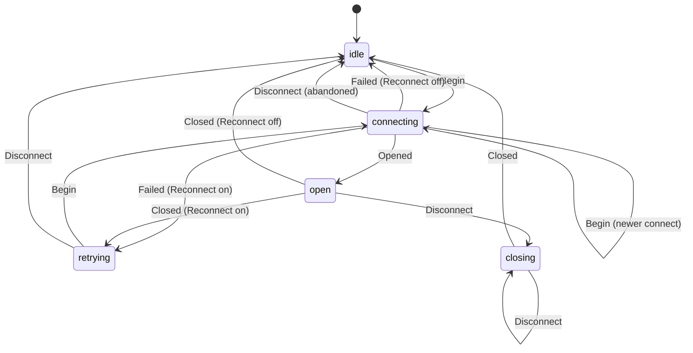

# Feature: send

Sending a request and reading the answer: the protocol clients, the request editor, assertions, the MCP explorer, the response viewer and its views, the call trace and the browser preview. The request model and its ports (`Request`, `Protocols`, `Sender`, `Streamer`, `Session`) are in `internal/feature/request`, because collections, environments, history and the workspace use them too.

## Layout
- `internal/feature/send`: package `send`: `ParseCurl` and `ShellSplit` (`curlparse.go`), `ParseServerInfo` (`mcpserver.go`), `ParseSchema` (`graphqlschema.go`), `BinaryMessage` (`binarymessage.go`, the composer's `hex:` syntax), `ImportedName` and the `BodyPreview` port (`model.go`).
- `proto`: one client per protocol, keyed by name in `proto.Registry` (REST, WebSocket, SSE, MCP, gRPC, GraphQL as a body type); `proto/ws` is the WebSocket framing. `proto/testdata` holds the proto files and captures its tests read.
- `assert`: the assertion language of `Request.Tests`. `editor`: the request edits of a tab. `mcpexplorer`: the UI-free state of the MCP explorer. `viewer`: the response viewer's model (mode, find state). `outbox`: the order of a connection's sends and pings, one in flight at a time.
- `adapter/preview`: serves a body on a loopback address for "Open in browser".
- `ui/respview` (response views), `ui/calltrace` (the call trace), `ui/mcpform` (the form for an MCP tool's arguments); each behind a `Host` interface the `App` implements.
- Imports: the kernel and the base feature (`feature/request`; kernel: `kernel/jsonview`, `kernel/severity`, `kernel/textfmt`) plus the toolkit for the views. `go list` (tests included) shows no other feature. `internal/exampleserver` imports `proto/ws`: the one written exception (`internal/CLAUDE.md`); `workspace/tabs` imports this package's root for `MCPServer` parsing.

## Model and protocols

- `request.Request` is protocol-neutral. What differs per protocol is a row of `request.Protocols`;
  A protocol name literal or a comparison with a `request.Protocol*` constant outside the rows and the
  registry is a review failure.
- Protocol, body type, auth type and API key location are parsed once, at the edge. An unknown one
  fails the collection file (named), names the server or request of a client config, and skips a
  sent-log line.
- The URL bar and the Params table stay in sync through `request.WithParams`, `ParamsFromURL` and
  `MergeParams`; the caller expands `{{variables}}` and folds the params in before sending.
- `proto.Registry` maps each row of `request.Protocols` to a `request.Sender` (why the table is split: the `request.Protocols` doc); a test
  checks both directions and that a connected row is a `Streamer`. `Send` errors only on misuse;
  transport failures arrive in `Response.Err`, so the UI always has a value to render.
- `rest`, `sse`, the HTTP transport of `mcp` and the `websocket` handshake share one request
  builder and client factory (`proto/httpclient.go`). The Auth pane is applied last, so it wins over
  a header typed by hand; a user `Content-Type` replaces the automatic one.
- `Configured` gives the cookie jar, proxy, CA file and client certificate to `rest`, `sse` and
  `mcp`, and only the TLS settings to `websocket` (Limits).
- A multipart value `@path` sends a file; one rule, `request.FormFile`, serves the encoder, the access
  check (`App.allowed`) and the Postman export.

## Requests

- **Variables**: `{{name}}` is colored green when the request resolves it and red when not, the same
  in the URL field, the body editor and every table (`App.withVariables`, `App.cellStyler`).
  Completion is a key (`Ctrl+Space`, `complete-variable`), not a popup while typing, so the field
  keeps the keyboard; the pure part is `request.VarCompletion`.
- **Path parameters**: a `:name` path segment has a `:name` row in Params, kept in step by
  `MergeParams`; `Request.Expanded` fills it (`ApplyPathParams`) and it never reaches the query.
- **Assertions** (`send/assert`): `Request.Tests` holds one assertion per line, run after
  each response. A line that does not parse is a failure with the reason, so a typo never passes.
- **Chaining**: a `set name = json PATH | header Name | status` line stores the value into the
  active environment, else the collection variables. The value is `Literal` (saved as `literal`):
  `{{...}}` inside it is never expanded, so a server reply cannot pull another variable, such as a
  secret, into the next request.
- **cURL import** (`send.ParseCurl`, the reverse of `proto.Curl`): POSIX-shell splitting, the
  common flags mapped to a REST request, others skipped. Redirects are followed only with `-L`, as
  in curl.
- **Trust**: before a send or connect, `App.allowed` lists what the request does on
  this machine (`request.Request.Accesses`: an MCP `stdio:` command, a file read outside the
  collection folder). Anything not yet trusted opens a confirm dialog; Allow adds it to a
  `request.AccessSet`, saved as `trusted` in `state.json`, and retries.
- **Exit**: the window flushes pending collection edits on exit (`FlushWorkspace`).

## Protocols

Each protocol is a client of its own in `send/proto` (its package doc says which are hand-written and why). A protocol that keeps a
connection implements `request.Streamer`; `Registry.Connect` opens a `request.Session`, and its one-shot
`Send` connects, sends and returns the first reply.

### Sessions and socket tabs

- Every `Session` write takes the context of that write; the context ends the write, never the
  session. Closes after a timed-out connect use `context.WithoutCancel`, so the goodbye still goes
  out.
- A tab keeps a session when its protocol's `Connection` is `Always`, or `OnStream` while gRPC
  streams (`isSocket`). Dialing runs off the UI goroutine; every answer, event and end comes back as
  a `ws*` message carrying the tab and its connection generation, and a stale generation is dropped
  (its session closed). Changing the protocol disconnects.
- Every log line is a `request.Event`; code compares its `Kind`, never the peer's `Name` (see the
  `request.Event` doc).
- The connection is the machine `tabs.ConnState`; its table and the reason for it are in
  `workspace/tabs/connstate.go`. `Auto-reconnect` (per tab, not saved) turns a move into retrying
  into a move to idle when off. While retrying, a timer sends `wsRetry` after `retryDelay`; the timer
  is not an event of the machine. Whether a request is in flight is a second machine, `SendState`
  (`sendstate.go` says why it is separate).

### Per protocol

- **REST** (`proto.REST`): the cookie jar lives as long as the app; changing the proxy or a
  certificate in the settings rebuilds the registry. A body over `MaxBody` is cut and flagged
  `Response.Truncated`. Every send is traced (`net/http/httptrace`) into `Response.Timing`.
- **WebSocket**: headers, Auth credentials and a `Sec-WebSocket-Protocol` header (split into
  subprotocols) go into the handshake. The one-shot reply has status 101. The composer sends
  `hex: de ad be ef` as a binary message (`request.BinarySender`), and `{ }` compacts JSON keeping key
  order and number text.
- **SSE**: a long GET read by `readEventStream` (`eventstream.go`), shared with the MCP HTTP
  transport. Events are `KindMessage` with the server's name in `Event.Name`; the session refuses
  `Send` and `Ping`.
- **GraphQL** is a body type, not a protocol: it encodes `{"query", "variables"}` and makes a GET
  POST. `App.dispatch` is the one place a tab sends, so a schema load reuses the tab's URL, headers
  and credentials. An introspection answer gives the `Schema (n)` menu of starters; the schema is
  not saved.
- **gRPC**: `Send` makes one unary call and refuses streaming methods. Methods
  come from a table of sources keyed by `request.SourceKind` (`grpcsource.go`):
  - reflection asks v1, then v1alpha on `Unimplemented`;
  - proto files are compiled with protocompile and list only the services those files declare. A
    missing or broken file is the send's error with its path and line; it never falls back to
    reflection. Only reflection dials to list methods.
  - The JSON body becomes a `dynamicpb` message; headers and the Authorization go out as lowercase
    metadata. The answer is indented by `encoding/json`, because `protojson` randomizes its
    spacing. Header and trailer metadata are the response headers.
  - Requests hold absolute proto paths; the collection stores them relative to its folder when
    inside (`request.StoredPath`, `LoadedPath`). The source is derived from the request, so choosing
    Proto files with no file yet changes only the tab.
  - The Schema pane drops an answer for an older URL, method or source.
  - Streaming: the `Stream` chip (not saved) makes the tab a socket tab. The Body is the first
    message (blank: `{}` for a server stream, nothing otherwise); the composer sends a JSON message,
    or `end` to close this side. The stream's end is a close event with the gRPC code.

### MCP

- Two transports behind `mcpTransport`: streamable HTTP (a POST per message, JSON or event-stream
  answers, `Mcp-Session-Id` and `MCP-Protocol-Version` headers, DELETE on close) and `stdio:` + command line (newline-delimited JSON).
- The stdio process runs under a context the session owns, not Connect's. Closing ends its input and
  kills it a second later if it is still running. Its stderr tail (Limits) shows only when it exits.
- `Connect` runs `initialize`, sends `notifications/initialized` and lists the tools, resources and
  prompts the server announces. The initialize result becomes `Connection.Server`; a result that is
  not an object is noted and the session goes on.
- The keys of the messages the client writes are in alphabetical order; a test pins the bytes.
- List answers are decoded once, in the session, and sent as `Event.Payload`. Only a response to a
  list request the session sent carries one, so a WebSocket frame or a notification never fills
  `Tools`. One bad entry is skipped; a tool with a non-object schema gets an empty form.
- `list_changed` notifications refresh that list, one refresh per list at a time.
- On HTTP, the optional GET event stream carries notifications. A broken POST answer stream ends the
  session (the call cannot complete); a broken GET stream is a note and the session goes on. An event
  over the size limit ends either.
- Sampling: with `MCP.Sampler` nil it is neither offered nor answered. The app shows one prompt at a
  time; a second gets the user-rejected error (-1) at once.
- The explorer calls through `request.Requester` on the bus, so the answer matches its request; its
  UI-free state is `send/mcpexplorer`. A tool result with `isError` shows as an error.
- `request.JSONSchema` is decoded once, at the MCP answer and at the OpenAPI import, and read typed
  afterwards. Only the keywords it has fields for are read. Real captures of the example server are
  under `internal/feature/request/testdata/mcp`.

## Responses

- **Views**: Compact (the default, `settings.ResponseView`), Pretty and Raw. Compact keeps a block on
  one line when it fits `respview.CompactWidth` columns and folds blocks from depth 2, so a long list
  shows one preview per item. While the find bar has text, Compact shows the matching lines, the
  inside of matching blocks and the openers and closers around them; clearing it restores the folds.
- **Wrap**: a per-tab choice for the response and the body editor, off by default and not saved.
  Rows come from the pure `layoutWrap` (`uitoolkit/widget/wraplayout.go`). Selection, search and
  copy still work by original line and column, so a copy has no line breaks the text did not have.
  A wrapped view never scrolls sideways.
- **Images**: PNG, JPEG and GIF are sniffed from the body whatever the Content-Type says and shown
  scaled down, never up.
- **History** and the **sent log**: `internal/feature/history/FEATURE.md`.
- **Call trace** (`send/ui/calltrace`): the last 500 sends, results and connection changes, in
  memory only, shown by the status bar's `Log` button. Socket messages are not traced; the Messages
  pane has them.
- **Open in browser** (`send/adapter/preview`): the app draws no HTML, so it serves the body on
  `127.0.0.1:0` at a random 128-bit path for 5 minutes, with the response's Content-Type. It
  refuses another Host header (DNS rebinding) and sends a sandboxed `Content-Security-Policy` with
  no scripts (`pageCSP`) and `nosniff`, because the body comes from a server the user does not control
  and is shown on a local origin.

## JSON view

`kernel/jsonview` turns a body into colored, foldable display lines (`Lines`, `Compact`).
Invalid JSON and other text come back as plain lines, so the response pane renders any body.

## Known gaps
- `proto` is one package for every protocol and the registry; only `proto/ws` is split out, so the protocols share the request builder, the event stream and the session helpers.
- `ui/*` import the toolkit (`uitoolkit/...`), as every `ui` does.
