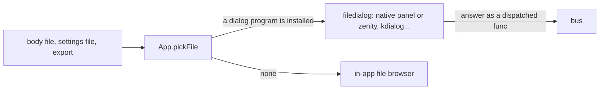

# Feature: workspace

Tabs, remembered state, the bus, the file browser, autosave, overlays, and the files, state and platform behavior around them.

## Layout
- `internal/feature/workspace`: the model (root package `workspace`) with the ports `Clock`, `Folders` and `StateStore`.
- Controllers as sub-packages: `tabs` (tab list, send and connection state), `state` (the remembered-state record), `filebrowser`, `autosave`, `bus`, `overlay`, `serial`.
- `adapter/statefile`: the `state.json` store. `ui/appicon`: the application icon.
- The OS adapters sit in `internal/platform`: `folders`, `systemclock`. `folders` imports `feature/workspace` for the port types it implements, a written exception for platform (as `internal/CLAUDE.md` says for `feature/settings`).
- Imports: the kernel only (`kernel/request` for the MCP server info a connection keeps) plus the toolkit for the icon. The root imports its own `state` sub-package.

## Files, state and platforms

### Remembered state

`state.json` (model `workspace/state`, adapter `workspace/adapter/statefile` (both under `internal/feature/`), sync in
`internal/app/statesync.go`) sits next to the settings and is separate from them: settings are
what users edit, state is bookkeeping (window geometry, splits, expanded folders, open tabs, table
column weights, the settings dialog's size).

- A missing, broken or partly stale file only means a fresh start; it never stops the program.
- Tabs and expanded folders are found again by collection folder and path, so several open
  collections restore into the right one.
- `App.stateTick` writes, off the UI goroutine, once the state stayed unchanged for a second;
  `main` writes once more on exit. `-state PATH` picks the file, `-state ""` keeps it in memory.

### Choosing a file

- `App.pickFile` takes the first usable row of `fileChoosers`: the desktop's dialog, else the in-app
  file browser (why not a D-Bus portal: the `filedialog` package doc). It returns a cancel function, which the settings dialog uses to take
  its question back when it closes.
- `uitoolkit/desktop/filedialog` (the app's `FileDialog` port) picks the program order per desktop from a table (`detect.go`);
  that choice is pure and tested per desktop without a display. Both choosers start in the user's
  home folder every time (user's decision 2026-11-15).
- The in-app browser (rules in `workspace/filebrowser`, listing through `workspace.Folders`)
  is a fallback: its footer names the program to install for native dialogs
  (`FileDialog.Suggested`).
- A `File` body sends a file as it is; whether the path exists is asked in the background and an
  answer for an older path is dropped. A multipart value `@path` sends a file part.

### Platforms

- Linux is the tested target. CI compiles and vets for Windows and macOS; nothing has been run on
  them yet.
- `core.Input.Ctrl` is the platform's primary modifier (Command too on macOS). Settings and key
  strings keep the name `Ctrl`; only displayed key text goes through `core.PlatformKeyText`. The OS
  comes from `Ctx.HostOS` (`app.Options.HostOS`), not a package variable, so tests pin it per
  context and run in parallel.
- **IME and dead keys**: text widgets take the composed text Ebitengine reports, so accents, CJK
  and emoji arrive whole. Ebitengine does not report the composition in progress, so no preedit is
  drawn and the candidate window may sit away from the caret. This is a toolkit limit.
- **Accessibility**: contrast and tooltip rules are in `style.md`, Rules; Tab cycles through the
  text widgets and code views (`window_focusorder_test.go`). Buttons are reached by pointer or shortcut, not Tab. No screen reader:
  Ebitengine has no accessibility tree to publish.

### Icon and packaging

- `workspace/ui/appicon` (under `internal/feature/`) rasterizes `appicon.svg` in software, so the icon exists before any window.
  `main` sets it as the window icon, `desktop.SetDockIcon` (toolkit) as the macOS Dock icon, and
  `-icon-png FILE` writes it for packaging.
- `make install` installs the binary and, on Linux, `packaging/gascoigne-workshop.desktop` and the
  icon. `check.yml` runs `make check` under xvfb.
- A `v*` tag runs `release.yml`: Linux, macOS (`packaging/macos/make-app.sh` builds the `.app`) and
  Windows builds, all with `-tags release`, published as one GitHub release. The Windows `.exe`
  gets its icon from `go-winres` (approved build tool, `rules.md`). `packaging_test.go` checks the
  macOS property list; the jobs themselves run only in CI.
